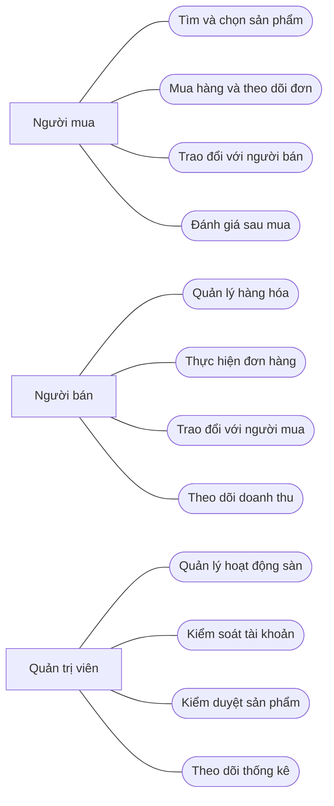
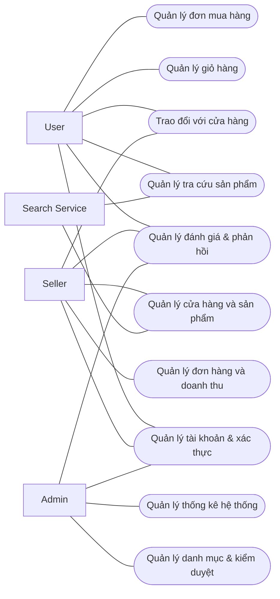
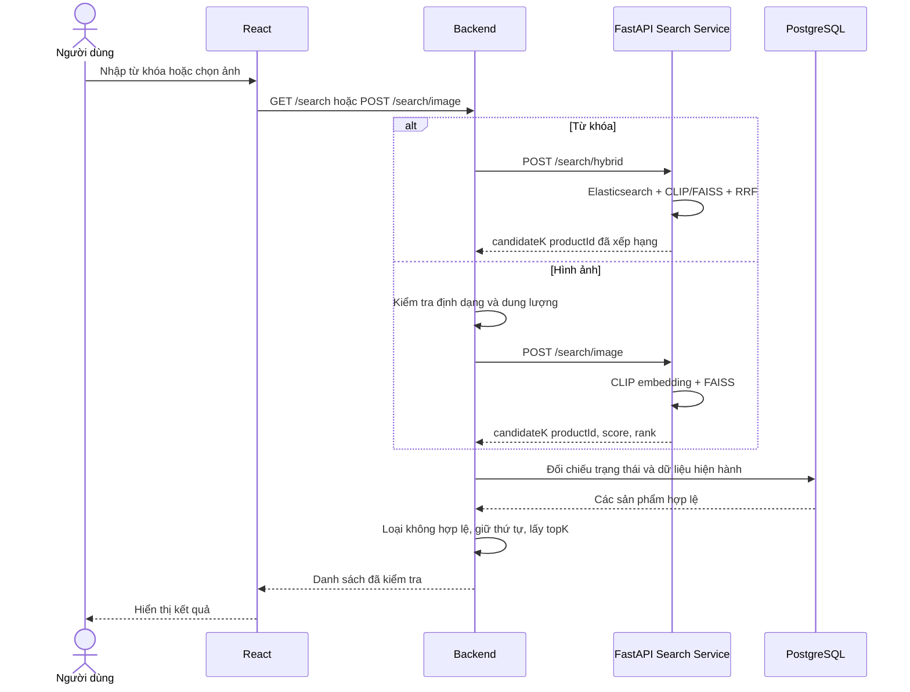
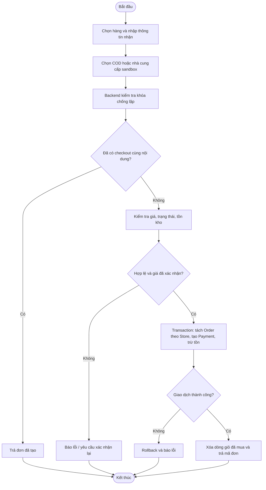
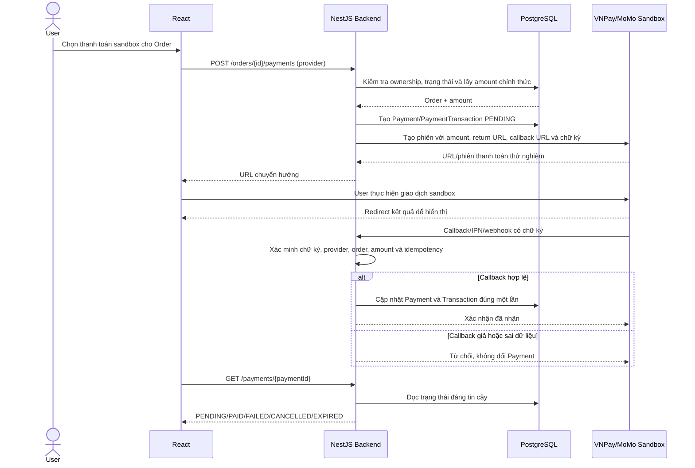
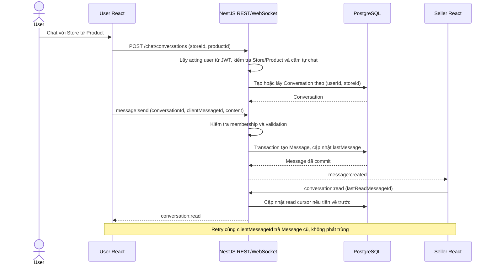

# TÀI LIỆU PHÂN TÍCH HỆ THỐNG — BẢN 0.5

**Đề tài:** Hệ thống quản lý sàn thương mại điện tử có tích hợp tìm kiếm sản phẩm bằng hình ảnh
**Mã đề tài:** CNTT-KLCN201
**Người phụ trách phần phân tích:** Nguyễn Quốc Hiền
**Ngày cập nhật:** 19/09/2026

**Cập nhật review PR #5:** Đã đồng bộ workflow đầy đủ từ PR #16. Search là **IN_PROGRESS/TARGET**; PR #8 sở hữu contract Backend–Search Service (mốc Hoàng xác nhận `8f2b058`). PR #5 không thay đổi file contract; các minh họa Search trong SRS là thiết kế mục tiêu, không dùng làm contract triển khai thay PR #8.
**Trạng thái (19/09/2026):** Đã đồng bộ `develop` sau PR #10, #12 và #15. Product schema, Store lifecycle và Category/Brand API đã merge; ERD bên dưới phân biệt schema hiện có với phần mở rộng mục tiêu. P0/P1 là phạm vi cam kết cho bản bảo vệ, không mặc nhiên là chức năng đã triển khai. Chỉ chức năng có code, dữ liệu demo, luồng end-to-end và bằng chứng kiểm thử mới được ghi là đã triển khai.

**Căn cứ:** `SRS_DeTai18_v2.docx` là chuẩn đề cương; `docs/project/work-assignment.md`, `docs/project/implementation-scope.md`, `docs/architecture/product-domain-design.md`, `docs/architecture/product-implementation-plan.md`, `docs/architecture/chat-domain-design.md` và hợp đồng Search Service là các quyết định chi tiết mới hơn. `productId` là số nguyên do PostgreSQL sinh; `externalId` là chuỗi nullable dạng `<source>:<source-id>` cho dữ liệu import; corpus hiện dùng 1.200 sản phẩm điện tử ABO. Những chi tiết chưa được nhóm duyệt được đánh dấu **[Đề xuất]** hoặc đưa vào phần cần chốt.

## 1. Mục đích và phạm vi SRS

Hệ thống là ứng dụng web thương mại điện tử cho User, Seller và Admin, tích hợp tìm kiếm truyền thống với tìm kiếm đa phương thức. User tìm sản phẩm bằng từ khóa hoặc ảnh, xem chi tiết, mua hàng và theo dõi đơn. Seller quản lý cửa hàng, sản phẩm, giao dịch và doanh thu. Admin quản lý tài khoản, cây danh mục, kiểm duyệt, thống kê và tình trạng các dịch vụ tìm kiếm.

Chuỗi nghiệp vụ cần hoạt động xuyên suốt:

Seller tạo sản phẩm → Backend lưu PostgreSQL và phát outbox tới FastAPI Search Service → Search Service cập nhật Elasticsearch và FAISS → User tìm kiếm bằng từ khóa/ảnh → Search Service hợp nhất bằng RRF → Backend đối chiếu PostgreSQL → User xem sản phẩm, chat với Store, thêm giỏ và đặt hàng → thanh toán COD hoặc sandbox → Seller xử lý đơn → Admin giám sát và quản lý.

### 1.1 Trong phạm vi

- Đăng ký, đăng nhập bằng JWT và phân quyền User/Seller/Admin.
- TARGET/P0: hồ sơ/địa chỉ, xác minh và khôi phục tài khoản, một tài khoản mua rồi mở Store sau duyệt; thông báo trong ứng dụng. Đây là yêu cầu cần triển khai tiếp, không phải trạng thái hiện tại.
- Quản lý Store; cây Category; thuộc tính mô tả theo Category; nhóm lựa chọn theo Product; ProductVariant với giá, tồn kho và SKU riêng; nhiều ảnh và thông tin kiện hàng.
- Tìm kiếm từ khóa bằng Elasticsearch, tìm kiếm ngữ nghĩa văn bản/ảnh bằng CLIP + FAISS; lọc danh mục, giá, thương hiệu, đánh giá; hợp nhất kết quả từ khóa bằng RRF.
- Giỏ hàng, đặt hàng, COD, lịch sử trạng thái và đánh giá sản phẩm.
- Chat văn bản User–Seller theo cặp User–Store, có lịch sử PostgreSQL, realtime, unread/read state và kiểm tra quyền.
- VNPay và MoMo trong môi trường sandbox là P1 cam kết, triển khai sau khi Order, COD và Payment model hoạt động ổn định.
- TARGET/P1: hậu mãi cơ bản theo OrderItem đã giao, hoàn tiền mô phỏng và hoàn kho có điều kiện, doanh thu thuần trừ điều chỉnh đúng một lần.
- Dashboard Seller; thống kê doanh thu theo ngày/tháng/quý.
- Admin quản lý tài khoản, danh mục, kiểm duyệt/ẩn sản phẩm, thống kê và trạng thái dịch vụ.
- Ghi nhận tìm kiếm và lượt nhấp; chuẩn hóa bộ ABO 1.200 sản phẩm điện tử; xây query/ground truth và đo Precision@K, Recall@K, thời gian phản hồi cho Elasticsearch, CLIP và RRF.
- Triển khai hệ thống bằng Docker Compose và dữ liệu mẫu.

### 1.2 Phân loại phạm vi

- **P0 bắt buộc:** Auth/RBAC; Store/Category/Product/Variant/Image; Search Service; Cart/Order/COD; Chat văn bản; Review; Admin/Dashboard; Docker, migration, seed, API documentation và kiểm thử.
- **P1 cam kết:** VNPay/MoMo sandbox sau khi Order, COD và Payment model ổn định; hậu mãi cơ bản/hoàn tiền mô phỏng theo OrderItem, vận chuyển mô phỏng và các mở rộng hồ sơ/thông báo theo `implementation-scope.md`.
- **P2 dự phòng:** thanh toán production, refund online, ví Seller, đối soát/rút tiền thật; gợi ý cá nhân hóa, hoàn tiền một phần trong OrderItem, tranh chấp nhiều cấp, voucher/flash sale, nhiều kho, Chat media và tích hợp vận chuyển thật.

Thanh toán sandbox và hậu mãi P1 chỉ mô phỏng, không chuyển tiền thật. **CURRENT:** schema/Auth hiện có một role; USER mua hàng, SELLER quản lý một Store. **TARGET/P0:** một tài khoản được mua và sau onboarding/duyệt Store có thêm quyền Seller; cần migration, Auth/JWT/API/UI và test tương thích riêng. Không trình bày TARGET như đã triển khai. Quy mô chỉ phục vụ thử nghiệm khóa luận.

### 1.3 Kiến trúc và ràng buộc công nghệ

- Frontend: React + TypeScript cho User, Seller và Admin.
- Backend: Node.js/NestJS và PostgreSQL; điều phối nghiệp vụ, phân quyền, phát outbox đồng bộ và kiểm tra dữ liệu hiện hành trước khi trả React.
- Search Service: Python/FastAPI; quản lý Elasticsearch, CLIP/FAISS, thực hiện RRF và trả `productId`, điểm, thứ hạng cho Backend.
- Elasticsearch: do Search Service quản lý, tìm kiếm từ khóa/thuộc tính và là một nhánh đầu vào của RRF.
- Docker đóng gói các service; Google Colab dùng để trích/cập nhật embedding.
- `productId` là số nguyên nội bộ xuyên suốt PostgreSQL, Backend, Elasticsearch và FAISS. `externalId` là chuỗi nullable, duy nhất khi có, dạng `<source>:<source-id>` như `abo:B07ABC123`; sản phẩm Seller tạo để null.

### 1.4 Thuật ngữ

| Thuật ngữ | Ý nghĩa |
|---|---|
| SRS | Tài liệu yêu cầu phần mềm |
| ERD | Sơ đồ thực thể và quan hệ dữ liệu |
| Embedding | Vector biểu diễn nội dung ảnh hoặc văn bản |
| FAISS | Thành phần tra cứu các vector tương tự |
| Elasticsearch | Thành phần lập chỉ mục và tìm kiếm văn bản |
| RRF | Cách kết hợp các danh sách kết quả theo thứ hạng |
| Ground truth | Tập sản phẩm được gán nhãn liên quan cho từng truy vấn |
| COD | Thanh toán khi nhận hàng |
| Payment sandbox | Phiên thanh toán thử nghiệm VNPay/MoMo, không chuyển tiền production |
| Product option | Nhóm lựa chọn và giá trị do Seller cấu hình trong phạm vi một Product để tạo Variant |

## 2. Tác nhân và quyền hạn

**[Đề xuất]** Khách chưa đăng nhập được duyệt và tìm kiếm; cần đăng nhập để dùng giỏ hàng, đặt hàng và đánh giá. API phải tự kiểm tra quyền, không chỉ ẩn nút trên giao diện.

| Tác nhân | Quyền chính | Giới hạn |
|---|---|---|
| Khách | Đăng ký, đăng nhập, xem sản phẩm, tìm kiếm | Không đặt hàng |
| User | Quyền của khách; giỏ hàng, checkout, COD/sandbox, đơn cá nhân, đánh giá và Chat với Store | Không xem hoặc sửa đơn/Conversation người khác |
| Seller | Quản lý một Store, sản phẩm, đơn, doanh thu và inbox thuộc Store mình | CURRENT: role SELLER chưa dùng luồng mua. TARGET/P0: cùng tài khoản giữ quyền mua sau onboarding/duyệt Store; quyền bán vẫn giới hạn Store của mình |
| Admin | Quản lý tài khoản, danh mục, kiểm duyệt, thống kê toàn sàn, xem sức khỏe dịch vụ | Không được xem mật khẩu; thao tác quản trị cần được ghi nhận |
| Search Service | FastAPI quản lý Elasticsearch, CLIP/FAISS, RRF và trả kết quả đã xếp hạng cho Backend | API tìm kiếm/lập chỉ mục chỉ dành cho Backend |

**CURRENT/TARGET:** Hiện mỗi tài khoản có một role trong schema; bản bảo vệ phải hỗ trợ cùng tài khoản mua và bán sau khi Store được duyệt. Mỗi Seller sở hữu tối đa một Store. Admin được tạo bằng seed/quy trình quản trị, không đăng ký công khai. MVP chưa có `StoreMember`; không tự nâng quyền theo email hoặc seed.

## 3. Yêu cầu chức năng

Mã yêu cầu được giữ đúng theo `SRS_DeTai18_v2`. P0 là luồng bắt buộc; P1 hoàn thiện phạm vi và số liệu báo cáo.

### 3.0 Chức năng nền tảng

| Mã | Yêu cầu | Ưu tiên | Tiêu chí nghiệm thu |
|---|---|---|---|
| FR-00 | Đăng ký/đăng nhập/đăng xuất | P0 | Đăng ký công khai USER hoặc SELLER; chặn ADMIN; access token, refresh cookie, refresh/logout và `isActive` khớp Auth đã merge |
| FR-01 | Đổi mật khẩu, quản lý tài khoản | P0 | Người dùng cập nhật hồ sơ/đổi mật khẩu; Seller cập nhật thông tin cửa hàng của mình |
| FR-02 | Xác minh và khôi phục tài khoản | P0 TARGET | Email verify/reset, Google login và phone OTP sandbox theo phạm vi đã chốt; chưa có code/test tích hợp thì không ghi đã triển khai |
| FR-03 | Hồ sơ, địa chỉ và thông báo | P0/P1 TARGET | User/Store quản lý địa chỉ theo quyền; thông báo sau commit sự kiện, lỗi gửi không rollback Order/Product |

### 3.1 Module Người dùng (User)

| Mã | Yêu cầu | Ưu tiên | Tiêu chí nghiệm thu |
|---|---|---|---|
| FR-U01 | Tìm kiếm sản phẩm truyền thống | P0 | Elasticsearch và CLIP xử lý từ khóa; RRF trả một danh sách; lọc cây danh mục, giá, thương hiệu, rating có hiệu lực |
| FR-U02 | Tìm kiếm sản phẩm bằng hình ảnh | P0 | Ảnh hợp lệ trả danh sách tương tự có thứ hạng; ảnh lỗi hoặc không kết quả được thông báo |
| FR-U03 | Xem chi tiết sản phẩm | P0 | Hiển thị ảnh, mô tả, thuộc tính, các variant/SKU cùng giá, tồn kho và đánh giá; chỉ trả sản phẩm công khai |
| FR-U04 | Giỏ hàng | P0 | Thêm/xóa/cập nhật số lượng và tính lại tổng từ dữ liệu hiện hành |
| FR-U05 | Đặt hàng và thanh toán | P0/P1 | P0 tạo Order/COD nhất quán và lưu snapshot; P1 tạo phiên VNPay/MoMo sandbox, xác minh callback/IPN và cập nhật Payment độc lập OrderStatus |
| FR-U06 | Quản lý đơn hàng cá nhân | P0 | User xem đơn/lịch sử của mình, theo dõi trạng thái và hủy khi hợp lệ |
| FR-U07 | Đánh giá sản phẩm | P0 | Chỉ người mua có Order `COMPLETED` đánh giá một lần cho mỗi OrderItem, điểm 1–5 |
| FR-U08 | Chat với Store | P0 | User mở một Conversation cho mỗi cặp User–Store, gửi/nhận TEXT hoặc PRODUCT_CONTEXT, xem lịch sử và cập nhật trạng thái đọc |
| FR-U09 | Yêu cầu hậu mãi | P1 TARGET | User của OrderItem đã giao yêu cầu hoàn toàn dòng hàng; Backend lấy số tiền từ snapshot, không tin amount client; trạng thái ReturnRequest độc lập OrderStatus |

### 3.2 Module Người bán (Seller)

| Mã | Yêu cầu | Ưu tiên | Tiêu chí nghiệm thu |
|---|---|---|---|
| FR-S01 | Đăng ký gian hàng/Seller profile | P0 | Store mới `PENDING`; Seller chỉ sửa Store của mình, được sửa `REJECTED` và nộp lại trên cùng Store; `SUSPENDED` không tự mở lại; TARGET cho User sau onboarding có thêm quyền Seller |
| FR-S02 | Quản lý sản phẩm, thuộc tính và biến thể | P0 | Seller nhập thuộc tính mô tả theo cấu hình Category, tự tạo ProductOptionGroup/ProductOptionValue trong Product và quản lý ProductVariant; DRAFT được thiếu dữ liệu, chỉ submit/public khi đủ ảnh chính, variant hợp lệ và khối lượng kiện hàng |
| FR-S03 | Quản lý đơn hàng, giao dịch | P0 | Seller chỉ xem và chuyển trạng thái đơn của cửa hàng mình theo quy tắc |
| FR-S04 | Đối soát doanh thu cửa hàng | P1 | Doanh thu gốc chỉ ghi khi Order `COMPLETED`; hậu mãi P1 ghi adjustment âm đúng một lần để tính doanh thu thuần |
| FR-S05 | Thống kê tìm kiếm cửa hàng | P1 | Thống kê sản phẩm được tìm/nhấp nhiều từ search log và click log |
| FR-S06 | Quản lý inbox | P0 | Seller xem và trả lời Conversation thuộc Store mình sở hữu; không truy cập inbox Store khác |
| FR-S07 | Phản hồi đánh giá | P0 | Seller phản hồi Review thuộc Product của Store mình; mỗi Review có tối đa một phản hồi trong MVP |
| FR-S08 | Phản hồi hậu mãi | P1 TARGET | Seller chỉ phản hồi ReturnRequest của Store mình; quyết định hoàn tiền/hoàn kho lưu history, chống ghi trùng |

### 3.3 Module Quản trị (Admin)

| Mã | Yêu cầu | Ưu tiên | Tiêu chí nghiệm thu |
|---|---|---|---|
| FR-A01 | Quản lý User/Seller | P0 | Admin xem, khóa/mở tài khoản; trạng thái khóa có hiệu lực với API xác thực |
| FR-A02 | Quản lý Category/Brand và thuộc tính | P0 | Admin CRUD Category/Brand; không tắt Category khi còn con hoạt động hoặc Product tham chiếu; public chỉ thấy Category cùng toàn bộ tổ tiên hoạt động; thuộc tính Category phục vụ mô tả/filter, không tạo Variant |
| FR-A03 | Kiểm duyệt sản phẩm | P0 | Admin duyệt/từ chối/ẩn kèm lý do; sản phẩm không đạt bị loại khỏi tìm kiếm công khai |
| FR-A04 | Giám sát hệ thống | P1 | Admin xem log lỗi và trạng thái Backend, Search Service, Elasticsearch, FAISS có thời điểm kiểm tra |
| FR-A05 | Thống kê, báo cáo toàn sàn | P1 | Doanh thu/đơn theo kỳ và chỉ số tìm kiếm được tổng hợp, đối chiếu được |
| FR-A06 | Kiểm duyệt đánh giá | P0 | Admin ẩn/hiện Review vi phạm kèm lý do và lưu audit; không xóa mất lịch sử |
| FR-A07 | Quyết định hậu mãi bất đồng | P1 TARGET | Admin xử lý bất đồng cơ bản; refund adjustment âm đúng một lần, hoàn kho chỉ khi nhận hàng đủ điều kiện |

### 3.4 Module Tìm kiếm và gợi ý đa phương thức

Module kỹ thuật này hỗ trợ cả ba module nghiệp vụ và là trọng tâm thuật toán của đề tài.

| Mã | Yêu cầu | Ưu tiên | Tiêu chí nghiệm thu |
|---|---|---|---|
| FR-AI01 | Tiền xử lý và gán nhãn dataset | P0 | Chuẩn hóa bộ prototype ABO 1.200 sản phẩm; đóng phiên bản riêng cho query/ground truth được Đạt và Hiền gán nhãn bằng pooling |
| FR-AI02 | Trích embedding văn bản và ảnh | P0 | CLIP đa ngôn ngữ sinh vector cùng không gian cho mô tả và ảnh |
| FR-AI03 | Kết hợp văn bản–hình ảnh | P1 | Có thử nghiệm early/late fusion và lưu cấu hình kết quả |
| FR-AI04 | Lập chỉ mục vector | P0 | Bản đầu lưu một vector cho mỗi sản phẩm từ ảnh chính, gắn trực tiếp `productId` số nguyên trong FAISS; có quy trình cập nhật |
| FR-AI05 | Truy vấn tương đồng | P0 | Ảnh hoặc văn bản trả `candidateK` ứng viên theo cosine/KNN, mỗi `productId` xuất hiện tối đa một lần |
| FR-AI06 | Elasticsearch | P0 | FastAPI Search Service quản lý index tên, mô tả, danh mục, thương hiệu và chạy nhánh tìm kiếm từ khóa |
| FR-AI07 | Hợp nhất bằng RRF | P0 | Search Service hợp nhất Elasticsearch với CLIP/FAISS thành một danh sách không phân tầng trước khi trả Backend |
| FR-AI08 | API tìm kiếm và lập chỉ mục | P0 | FastAPI cung cấp health, `/search/hybrid`, search ảnh/semantic và index; JSON dùng `productId` số nguyên, score và rank; không expose vector thô |
| FR-AI09 | Đánh giá định lượng | P1 | Xuất Precision@K, Recall@K tại K=5,10,20 và thời gian cho Elasticsearch, CLIP, RRF; báo riêng truy vấn tiếng Việt và tiếng Anh |

## 4. Yêu cầu phi chức năng

Mã và nhóm chất lượng theo SRS v2; cột kiểm tra bổ sung tiêu chí nghiệm thu. Các ngưỡng hiệu năng chưa được coi là kết quả đạt cho đến khi có biên bản đo.

| Mã | Loại và yêu cầu | Cách kiểm tra |
|---|---|---|
| NFR-01 | Hiệu năng: timeout Backend→Search Service là 2 giây; toàn bộ tìm kiếm từ khóa/RRF hoặc ảnh mục tiêu dưới 3 giây ở 1.200 sản phẩm ABO | Chạy ≥100 truy vấn mỗi loại sau warm-up; ghi p50/p95, máy thử, timeout và tỷ lệ lỗi |
| NFR-02 | Khả năng mở rộng: Backend và FastAPI Search Service tách service; Elasticsearch/FAISS nằm sau Search Service; các thành phần đóng gói Docker | Khởi động bằng Docker Compose; Backend chỉ phụ thuộc contract Search Service, không gọi trực tiếp index |
| NFR-03 | Bảo mật: băm mật khẩu, JWT, role/ownership, không lộ dữ liệu giao dịch; xác minh chữ ký callback thanh toán; secret chỉ nằm trong `.env`; ảnh JPEG/PNG tối đa 5 MB | Kiểm tra token sai/hết hạn/sai quyền, callback giả/sai chữ ký/sai số tiền và tệp giả đuôi/hỏng/quá lớn |
| NFR-04 | Bảo trì: module React, Node.js, Python tách rõ và cấu hình môi trường có tài liệu | Chạy trên môi trường sạch bằng migration, seed và cấu hình mẫu không chứa bí mật |
| NFR-05 | Tính chính xác: Precision@K/Recall@K có thể tái lập cho Elasticsearch, CLIP và RRF; đơn/tồn kho nhất quán | Chạy lại cùng dataset/query/seed; thử lỗi giữa giao dịch và hai yêu cầu tranh chấp tồn kho |
| NFR-06 | Khả năng sử dụng: giao diện tìm kiếm không phân tầng nguồn kết quả và dùng được từ 360 px đến 1366 px | Kiểm tra các màn hình User/Seller/Admin ở hai kích thước, trạng thái tải/rỗng/lỗi |
| NFR-07 | Khả năng cập nhật: PostgreSQL là nguồn chuẩn; Backend dùng outbox/job idempotent và `version` tới target `SEARCH_SERVICE`; Search Service cập nhật Elasticsearch/FAISS | Làm lỗi lần lượt từng index, kiểm tra trạng thái thành phần, retry cùng version, bỏ qua version cũ và khôi phục nhất quán |
| NFR-08 | Khả năng phục hồi Chat: Message được commit trước khi phát sự kiện; retry cùng `clientMessageId` không tạo trùng; read cursor chỉ tiến | Ngắt/kết nối lại WebSocket, tải lại lịch sử, gửi lặp và thử đọc chéo giữa hai User/Store |
| NFR-09 | Tính toàn vẹn thanh toán: số tiền lấy từ Order trong PostgreSQL; callback/IPN được xác minh và idempotent; redirect trình duyệt không tự làm Payment thành `PAID` | Test thành công, thất bại, hủy, hết hạn, callback lặp, sai chữ ký, sai số tiền và callback giả |

## 5. Use Case tổng quát

Các hình dưới dùng cú pháp Mermaid để dễ chỉnh sửa. Đây là sơ đồ quan hệ tác nhân–chức năng, chưa phải bản ký pháp UML Use Case để nộp chính thức; Hiền có thể dựng lại bằng công cụ UML sau khi nhóm chốt phạm vi.

### 5.1 Nghiệp vụ



### 5.2 Hệ thống



Use Case hệ thống được nhóm thành 10 chức năng cấp cao sau khi Chat trở thành P0. Các thao tác chi tiết như khóa tài khoản, quản lý cây danh mục, duyệt sản phẩm, thêm sản phẩm, thanh toán và cập nhật trạng thái đơn được mô tả bên trong Use Case tương ứng thay vì tách thành các hình elip độc lập.

| Mã | Use Case hệ thống | Tác nhân | Yêu cầu liên quan |
|---|---|---|---|
| UC-HT01 | Quản lý tài khoản & xác thực | User, Seller, Admin | FR-00, FR-01, FR-S01 |
| UC-HT02 | Quản lý tra cứu sản phẩm | User, Search Service | FR-U01–FR-U03, FR-AI02–FR-AI08 |
| UC-HT03 | Quản lý giỏ hàng | User | FR-U04 |
| UC-HT04 | Quản lý đơn mua hàng | User | FR-U05, FR-U06 |
| UC-HT05 | Quản lý đánh giá & phản hồi | User, Seller, Admin | FR-U07, FR-S07, FR-A06 |
| UC-HT06 | Quản lý cửa hàng và sản phẩm | Seller, Search Service | FR-S01, FR-S02, FR-AI04, FR-AI06, FR-AI08 |
| UC-HT07 | Quản lý đơn hàng và doanh thu | Seller | FR-S03–FR-S05 |
| UC-HT08 | Quản lý thống kê hệ thống | Admin | FR-A04, FR-A05, FR-AI09 |
| UC-HT09 | Quản lý danh mục & kiểm duyệt | Admin | FR-A01–FR-A03 |
| UC-HT10 | Trao đổi với cửa hàng | User, Seller | FR-U08, FR-S06 |

## 6. Đặc tả Use Case quan trọng

### UC-HT01 — Quản lý tài khoản & xác thực

- **Tác nhân:** User, Seller, Admin.
- **Mục tiêu CURRENT:** Đăng ký USER/SELLER và duy trì phiên theo role hiện có. **TARGET/P0:** cùng tài khoản mua và được cấp quyền bán sau onboarding/duyệt Store; không tự nâng quyền theo email/seed, phải bảo toàn lịch sử mua.
- **Tiền điều kiện:** Có tài khoản; dịch vụ xác thực hoạt động.
- **Kích hoạt:** Người dùng gửi email và mật khẩu.
- **Luồng CURRENT:** (1) Đăng ký `accountType` USER/SELLER; chặn ADMIN, kiểm tra email duy nhất. (2) Đăng nhập và kiểm tra `isActive`. (3) Cấp access token, refresh cookie HttpOnly; refresh/logout xoay hoặc thu hồi phiên. (4) `/auth/me` trả hồ sơ an toàn.
- **Luồng TARGET/P0:** Người mua nộp hồ sơ Store, Admin duyệt trước khi cấp quyền Seller. Auth/JWT/capability giữ quyền mua trên cùng tài khoản, quyền bán kiểm tra Store/ownership. Hồ sơ/đổi mật khẩu và luồng onboarding cần API/UI/test riêng; chưa coi là đã triển khai từ Auth hiện tại.
- **Ngoại lệ:** Yêu cầu đăng ký ADMIN → từ chối. Thiếu trường hoặc `accountType` sai → lỗi đầu vào. Sai thông tin → thông báo chung. `isActive=false` → từ chối. Refresh token hết hạn/đã thu hồi → không cấp phiên mới.
- **Hậu điều kiện thành công:** Người dùng có phiên xác thực; các API tiếp theo vẫn kiểm tra quyền.
- **Hậu điều kiện thất bại:** Không cấp token hợp lệ; dữ liệu tài khoản không thay đổi.
- **Yêu cầu liên quan:** FR-00, FR-01, FR-S01, NFR-03.

**Khoảng cách CURRENT → TARGET:** API đăng ký hiện cho chọn USER/SELLER và schema một role. Bản bảo vệ yêu cầu User giữ quyền mua khi được duyệt bán; Hoàng cần chốt migration/capability và kiểm thử tài khoản cũ. Không coi việc tạo role SELLER hiện tại là hoàn tất onboarding.

### UC-HT06 — Quản lý cửa hàng và sản phẩm

- **Tác nhân:** Seller; Backend gọi FastAPI Search Service.
- **Mục tiêu:** Seller quản lý thông tin cửa hàng và vòng đời sản phẩm; Search Service cập nhật Elasticsearch và FAISS qua một contract thống nhất.
- **Tiền điều kiện:** Seller đăng nhập và tài khoản hoạt động.
- **Luồng Store (đã có API PR #15):** (1) Seller tạo đúng một Store, mặc định `PENDING`. (2) Admin duyệt `PENDING → ACTIVE` hoặc từ chối `PENDING → REJECTED` kèm lý do. (3) Với `REJECTED`, Seller sửa hồ sơ rồi nộp lại `REJECTED → PENDING` trên chính Store đó. (4) Admin có thể `ACTIVE → SUSPENDED` và chỉ Admin khôi phục `SUSPENDED → ACTIVE`. Mỗi quyết định ghi actor, thời gian, from/to và reason vào `StoreStatusHistory`; cập nhật trạng thái có kiểm tra cạnh tranh để không ghi history sai. Store `SUSPENDED/CLOSED` không cho Seller sửa hoặc tự mở lại.
- **Luồng tạo:** (1) Seller tạo Product DRAFT với tên, mô tả, Category lá và Brand. (2) Backend trả `CategoryAttributeDefinition`/`CategoryAttributeOption`; Seller nhập `ProductAttributeValue` phục vụ mô tả và filter. (3) Seller tự tạo `ProductOptionGroup`/`ProductOptionValue` trong phạm vi Product để làm trục phân loại. (4) Backend sinh hoặc nhận các tổ hợp ProductVariant; mỗi variant có `skuCode` nội bộ, `sellerSku` tùy chọn, `optionSignature`, giá và tồn kho riêng. (5) Seller tải ảnh chung hoặc gắn ảnh với một ProductOptionValue, chọn tối đa một ảnh chính và nhập ProductShippingProfile. (6) Khi submit, Backend kiểm tra ảnh chính, khối lượng kiện hàng, thuộc tính bắt buộc và ít nhất một variant hợp lệ; chuyển moderation sang `PENDING`. (7) Admin duyệt; Product chỉ công khai khi `sellerStatus=ACTIVE` và `moderationStatus=APPROVED`. (8) Backend tăng `version`, ghi Product và outbox target `SEARCH_SERVICE` trong cùng transaction. (9) Search Service cập nhật Elasticsearch/FAISS và trả trạng thái từng index; Backend retry cùng payload/version khi chưa hoàn tất.
- **Luồng cập nhật:** Tải sản phẩm thuộc cửa hàng; kiểm tra dữ liệu mới; lưu; đồng bộ lại khi cần. **[Đề xuất]** Sửa tên/mô tả/ảnh/danh mục đưa sản phẩm về chờ duyệt; sửa giá/tồn kho của variant không cần duyệt lại.
- **Luồng ẩn:** Seller ẩn sản phẩm; Backend loại ngay khỏi kết quả công khai và yêu cầu xóa khỏi chỉ mục. Chi tiết đơn cũ vẫn được giữ.
- **Ngoại lệ:** Seller truy cập Store khác, nộp lại Store không `REJECTED`, sửa Store `SUSPENDED/CLOSED` hoặc chuyển trạng thái cạnh tranh → từ chối, không sinh history sai. `skuCode`/`sellerSku`/tổ hợp option trùng, một variant chọn hai value cùng group, option không thuộc Product, giá không dương khi bán, tồn kho âm, thiếu ảnh chính/khối lượng hoặc ảnh lỗi → từ chối submit. Dữ liệu import thiếu trường được giữ DRAFT để bổ sung, không suy đoán từ dataset. Search Service hoặc một index lỗi → giữ PostgreSQL, đánh dấu job chờ/lỗi và thử lại.
- **Hậu điều kiện:** Dữ liệu PostgreSQL là nguồn chính; trạng thái hiển thị và trạng thái đồng bộ phân biệt rõ.
- **Yêu cầu liên quan:** FR-S01, FR-S02, FR-AI04, FR-AI06, FR-AI08, FR-A03.

### UC-HT02 — Quản lý tra cứu sản phẩm

- **Tác nhân:** Khách/User; FastAPI Search Service.
- **Tiền điều kiện:** Có sản phẩm công khai được lập chỉ mục.
- **Luồng chính:** (1) User nhập từ khóa hoặc tải ảnh cùng bộ lọc. (2) Với từ khóa, Backend gọi `POST /search/hybrid` của FastAPI Search Service. (3) Search Service chạy Elasticsearch và semantic text CLIP/FAISS, sau đó hợp nhất hai thứ hạng bằng RRF. (4) Với ảnh, Backend gọi `POST /search/image`; Search Service tạo embedding và truy vấn FAISS. (5) Search Service trả tối đa `candidateK` `productId` đã xếp hạng, không trùng. (6) Backend lấy dữ liệu hiện hành từ PostgreSQL, loại sản phẩm ẩn/chưa duyệt/không hợp lệ, áp dụng giá/rating/tồn kho và giữ nguyên thứ tự, sau đó lấy `topK`. (7) User xem danh sách/chi tiết; hệ thống ghi search log và click log.
- **Ngoại lệ:** Ảnh hỏng/quá lớn → báo lỗi cụ thể. Không có kết quả → danh sách rỗng và thông báo. Search Service timeout → báo dịch vụ tạm không sẵn sàng. `productId` không còn tồn tại → bỏ kết quả đó, không làm lỗi cả truy vấn.
- **Hậu điều kiện:** Không thay đổi sản phẩm hay tồn kho. **[Đề xuất]** Không lưu ảnh truy vấn mặc định.
- **Quy ước over-fetch:** `topK` mặc định 10, nhận 1–50. Backend gửi `candidateK = min(max(topK × 3, 30), 150)` cho Search Service; sau khi đối chiếu PostgreSQL có thể trả ít hơn `topK` nếu không đủ sản phẩm hợp lệ. Elasticsearch trong Search Service xử lý text/category/brand; price/rating/trạng thái hiện hành do Backend kiểm tra và không đưa vào FAISS.
- **Yêu cầu liên quan:** FR-U01–FR-U03, FR-AI02, FR-AI04–FR-AI08, NFR-01, NFR-03, NFR-06.

### UC-HT03 — Quản lý giỏ hàng

- **Tác nhân:** User.
- **Tiền điều kiện:** Đã đăng nhập; sản phẩm tồn tại và được phép bán.
- **Luồng chính:** (1) Chọn ProductVariant/SKU và số lượng. (2) Backend xác nhận số lượng dương, variant hoạt động và sản phẩm công khai. (3) Thêm hoặc cộng số lượng cho cùng `variantId`. (4) Khi mở giỏ, đọc lại giá/tồn kho của variant. (5) Cho phép đổi số lượng hoặc xóa dòng. (6) Trả tên sản phẩm, snapshot lựa chọn hiển thị và tổng tiền dự kiến.
- **Ngoại lệ:** Vượt tồn kho → thông báo số lượng có thể mua. Sản phẩm bị ẩn/hết hàng sau khi thêm → đánh dấu không thể mua. Giỏ rỗng → không cho chuyển sang đặt hàng.
- **Hậu điều kiện:** Giỏ được lưu theo tài khoản; **[Đề xuất]** thêm giỏ không giữ tồn kho, giá cuối cùng được xác nhận lúc đặt.
- **Yêu cầu liên quan:** FR-U04, FR-U05, NFR-05.

### UC-HT04 — Quản lý đơn mua hàng

- **Tác nhân:** User.
- **Tiền điều kiện:** Đăng nhập, tài khoản hoạt động; có sản phẩm được chọn và địa chỉ/số điện thoại nhận hàng hợp lệ.
- **Luồng chính:** (1) Xem lại variant/SKU và tiền phải trả. (2) Gửi checkout cùng `Idempotency-Key` và chọn COD hoặc nhà cung cấp sandbox được hỗ trợ. (3) Backend đọc lại giá, trạng thái và tồn kho từng variant; số tiền chính thức luôn lấy từ PostgreSQL. (4) Nếu giá thay đổi, yêu cầu User xác nhận lại. (5) Trong một transaction, tách một Order cho mỗi Store, lưu snapshot tên sản phẩm/SKU/thuộc tính/giá/địa chỉ, tạo Payment và trừ tồn variant. (6) Với COD, Payment ở `UNPAID`; với VNPay/MoMo sandbox, Backend tạo phiên thanh toán sau khi Order tồn tại. (7) Chỉ xóa dòng giỏ đã mua sau khi checkout thành công. (8) User xem lịch sử, chi tiết, trạng thái thanh toán/đơn và hủy khi đủ điều kiện.
- **[Đề xuất nhiều Seller]:** Một lần checkout tạo một nhóm đặt hàng và một đơn riêng cho mỗi cửa hàng; toàn bộ lần checkout thành công hoặc rollback cùng nhau.
- **Ngoại lệ:** Hết hàng hoặc bị ẩn → không tạo đơn, yêu cầu sửa giỏ. Lỗi cơ sở dữ liệu → rollback toàn bộ. Gửi lặp cùng khóa và nội dung → trả lại đơn cũ; cùng khóa khác nội dung → báo xung đột. Phản hồi bị mất → tra lại bằng khóa, không tạo đơn mới.
- **Hậu điều kiện:** Order `PENDING_CONFIRMATION`; COD `UNPAID`, thanh toán online có thể `PENDING`; tồn kho không âm và đơn có thể tra cứu ngay.
- **Yêu cầu liên quan:** FR-U05, FR-U06, NFR-03, NFR-05, NFR-09.

**Quy tắc trạng thái cần thiết cho luồng đặt hàng:**

| Từ | Sang | Tác nhân | Điều kiện chính |
|---|---|---|---|
| Chưa có đơn | PENDING_CONFIRMATION | User | Checkout tạo Order và trừ tồn trong cùng transaction |
| PENDING_CONFIRMATION | CONFIRMED | Seller | Đơn thuộc Store và chưa bị hủy |
| PENDING_CONFIRMATION | CANCELLED | User/Seller | Ghi lý do, hoàn tồn đúng một lần |
| CONFIRMED | PACKING | Seller | Bắt đầu chuẩn bị hàng |
| CONFIRMED | CANCELLED | Seller | Chưa đóng gói; ghi lý do và hoàn tồn |
| PACKING | READY_TO_SHIP | Seller | Kiện hàng đã sẵn sàng |
| READY_TO_SHIP | SHIPPING | Seller | Đã bàn giao vận chuyển mô phỏng |
| SHIPPING | DELIVERED | Seller | Giao thành công; COD chuyển `PAID` |
| DELIVERED | COMPLETED | Backend/Seller | Hoàn tất nghiệp vụ; Dashboard ghi nhận doanh thu |
| SHIPPING | DELIVERY_FAILED | Seller | Ghi lý do; chưa ghi nhận doanh thu |
| DELIVERY_FAILED | SHIPPING | Seller | Giao lại theo quy trình mô phỏng |
| DELIVERY_FAILED | CANCELLED | Seller | Hàng đã trả về; hoàn tồn đúng một lần |

Các chuyển đổi ngoài bảng bị từ chối. Backend phải kiểm tra trạng thái hiện tại, quyền sở hữu và ghi lịch sử cho mỗi lần chuyển.

**Quy tắc Payment:** `PaymentStatus` độc lập `OrderStatus`. COD bắt đầu `UNPAID` và chuyển `PAID` khi Order đạt `DELIVERED`. Thanh toán VNPay/MoMo sandbox đi qua `PENDING` rồi nhận một trong `PAID`, `FAILED`, `CANCELLED` hoặc `EXPIRED`. Backend lấy amount từ Order, xác minh chữ ký và nội dung callback/IPN; redirect trên trình duyệt không đủ để ghi `PAID`. Callback lặp phải trả kết quả idempotent và không tạo hai giao dịch.

### UC-HT07 — Quản lý đơn hàng và doanh thu

- **Tác nhân:** Seller.
- **Tiền điều kiện:** Đăng nhập; đơn thuộc cửa hàng của Seller.
- **Luồng chính:** (1) Xem đơn mới. (2) Xác nhận, chuẩn bị và đánh dấu sẵn sàng giao. (3) Chuyển sang `SHIPPING` khi bàn giao vận chuyển mô phỏng. (4) Ghi `DELIVERED` khi giao thành công; COD chuyển `PAID`. (5) Chuyển `COMPLETED` khi hoàn tất nghiệp vụ; chỉ lúc này Dashboard ghi nhận doanh thu. (6) Mỗi lần chuyển, Backend kiểm tra trạng thái hiện tại, quyền và ghi lịch sử. (7) Seller xem doanh thu từ các đơn `COMPLETED` theo khoảng thời gian.
- **Ngoại lệ:** Chuyển sai thứ tự hoặc yêu cầu cạnh tranh → báo xung đột và tải lại đơn. Đơn bị hủy → không xử lý tiếp. Giao thất bại → áp dụng nhánh trong bảng trạng thái.
- **Hậu điều kiện:** Trạng thái đơn, thanh toán, tồn kho và lịch sử nhất quán.
- **Yêu cầu liên quan:** FR-S03, FR-S04, FR-S05.

**Hậu mãi TARGET/P1 sau giao hàng:** User của OrderItem đã giao tạo `ReturnRequest`; Seller phản hồi, Admin quyết định bất đồng cơ bản. Backend tính hoàn **toàn bộ OrderItem** theo `lineTotal` snapshot, không nhận amount từ client. `REFUND_ONLY` không nhập kho; `RETURN_AND_REFUND` chỉ nhập kho khi đã `ITEM_RECEIVED` và xác nhận `RESTOCKABLE`. Ghi refund record và revenue adjustment âm đúng một lần; Dashboard tính doanh thu thuần từ doanh thu Order `COMPLETED` trừ adjustment, không đảo ngược `OrderStatus`. Refund, hoàn kho và adjustment có khóa idempotency/history riêng. Hoàn một phần trong cùng OrderItem và chuyển tiền hoàn production thuộc P2. Luồng này chưa có migration/API triển khai tại PR #12.

**Ràng buộc hậu mãi TARGET/P1 bắt buộc:**

- Backend khóa/kiểm tra `OrderItem` trong transaction trên tất cả `ReturnRequest`. Request `PENDING`/`APPROVED` giữ quyền xử lý; `REJECTED`/`CANCELLED` không giữ hạn mức. Nếu có request giữ quyền hoặc tổng refund thành công đã bằng `OrderItem.lineTotal`, từ chối request mới với `ORDER_ITEM_ALREADY_FULLY_REFUNDED`. P1 hoàn toàn dòng; tổng refund không vượt `lineTotal` bất kể request ID/idempotency key khác nhau.
- Hai request cạnh tranh chỉ một request được refund, revenue adjustment và stock movement; retry cùng thao tác trả kết quả cũ. `REFUND_ONLY` không tăng kho; `RETURN_AND_REFUND` chỉ tăng kho sau `ITEM_RECEIVED` và `RESTOCKABLE`.
- Refund sau `DELIVERED` nhưng trước `COMPLETED` vẫn tạo refund/adjustment đúng một lần; projection Dashboard chưa áp adjustment thành doanh thu âm. Order tiếp tục được chuyển `COMPLETED`; lúc đó ghi gross revenue và áp adjustment đã có đúng một lần trong cùng kỳ. Dòng hoàn đủ có doanh thu thuần bằng 0. Refund sau `COMPLETED` có hiệu lực ngay. Retry/cạnh tranh giữa hoàn tất và refund không cộng/trừ hai lần.

### UC-HT05 — Quản lý đánh giá & phản hồi

- **Tác nhân:** User, Seller, Admin.
- **Tiền điều kiện:** User đăng nhập và đã mua sản phẩm trong Order `COMPLETED`.
- **Luồng chính:** (1) User mở Product trong lịch sử mua. (2) Chọn điểm 1–5 và nhập nhận xét. (3) Backend kiểm tra Order `COMPLETED`, ownership và tính duy nhất theo OrderItem. (4) Lưu Review và cập nhật điểm tổng hợp. (5) Seller có thể tạo/cập nhật một phản hồi cho Review thuộc Store mình. (6) Admin có thể ẩn/hiện nội dung vi phạm kèm lý do và audit.
- **Ngoại lệ:** Chưa mua hoặc đơn chưa hoàn tất → từ chối. Đã có đánh giá cho dòng hàng → chuyển sang cập nhật. Nội dung vi phạm hoặc dữ liệu không hợp lệ → báo lỗi.
- **Hậu điều kiện:** Đánh giá hợp lệ gắn với User, sản phẩm và dòng hàng; không làm thay đổi đơn.
- **Yêu cầu liên quan:** FR-U07, FR-S07, FR-A06, NFR-03.

### UC-HT08 — Quản lý thống kê hệ thống

- **Tác nhân:** Admin.
- **Tiền điều kiện:** Admin đăng nhập và có quyền thống kê.
- **Luồng chính:** (1) Chọn khoảng thời gian. (2) Hệ thống tổng hợp tài khoản, sản phẩm, đơn hàng, doanh thu và dữ liệu tìm kiếm. (3) Hiển thị chỉ số toàn sàn cùng trạng thái Backend, Search Service, Elasticsearch và FAISS. (4) Admin lọc và xem chi tiết chỉ số cần theo dõi.
- **Ngoại lệ:** Dữ liệu một dịch vụ không sẵn sàng → hiển thị trạng thái lỗi và thời điểm cập nhật gần nhất, không trả số liệu thành công giả.
- **Hậu điều kiện:** Không thay đổi dữ liệu nghiệp vụ; thao tác quản trị được ghi log khi cần.
- **Yêu cầu liên quan:** FR-A04, FR-A05, FR-AI09, NFR-01, NFR-05, NFR-07.

### UC-HT09 — Quản lý danh mục & kiểm duyệt

- **Tác nhân:** Admin.
- **Tiền điều kiện:** Admin đăng nhập và có quyền quản trị nội dung.
- **Luồng chính:** (1) Admin tạo, xem, sửa/tắt Category và Brand; public chỉ thấy Category hoạt động khi mọi tổ tiên đều hoạt động. (2) Quản lý CategoryAttributeDefinition: tên chuẩn hóa, kiểu dữ liệu, bắt buộc/tùy chọn, có dùng làm filter và có cho nhập tự do hay không. (3) Quản lý CategoryAttributeOption chuẩn; các option này chỉ phục vụ thuộc tính mô tả, không phải trục tạo Variant. (4) Xem hàng chờ kiểm duyệt, kiểm tra nội dung, ảnh, thuộc tính mô tả, option/variant và kiện hàng. (5) Phê duyệt, từ chối hoặc đóng băng sản phẩm kèm lý do. (6) Backend cập nhật trạng thái công khai và đồng bộ Search Service.
- **Ngoại lệ:** Category có con hoạt động hoặc bất kỳ Product tham chiếu thì không được tắt; Category/Brand còn được tham chiếu không được xóa. Tên/slug trùng, tạo chu trình hoặc parent không hợp lệ → từ chối. Cấu hình trục variant không hợp lệ hoặc sản phẩm ACTIVE không có variant bán được → từ chối. Search Service lỗi → giữ quyết định trong PostgreSQL và đánh dấu đồng bộ lỗi để thử lại.
- **Hậu điều kiện:** Chỉ sản phẩm đủ điều kiện mới công khai; quyết định kiểm duyệt có dấu vết.
- **Yêu cầu liên quan:** FR-A01, FR-A02, FR-A03, FR-S02, NFR-03, NFR-07.

### UC-HT10 — Trao đổi với cửa hàng

- **Tác nhân:** User, Seller.
- **Mục tiêu:** User trao đổi với Store về Product; Seller trả lời từ inbox của Store với lịch sử bền vững và cập nhật gần thời gian thực.
- **Tiền điều kiện:** Tài khoản đã đăng nhập và hoạt động; User không phải chủ Store đích; Seller chỉ thao tác trên Store mình sở hữu.
- **Luồng chính:** (1) User mở Chat từ Product và gửi `storeId`, `productId` làm đối tượng đích. (2) Backend lấy acting user từ JWT, kiểm tra Product thuộc Store và tạo hoặc mở Conversation duy nhất theo `(userId, storeId)`. (3) User/Seller gửi `TEXT` hoặc `PRODUCT_CONTEXT` với `clientMessageId`. (4) Backend kiểm tra membership, lưu Message và cập nhật tin cuối trong transaction. (5) Sau commit, Gateway phát `message:created` vào room Conversation. (6) Client tải lịch sử theo cursor `(createdAt,id)` và gửi `lastReadMessageId` của tin cuối thực sự hiển thị. (7) Backend chỉ cho read cursor tiến và cập nhật unread count.
- **Ngoại lệ:** Người ngoài hoặc Seller của Store khác join/read/send → từ chối. Product không thuộc Store, tin rỗng/quá 2.000 ký tự hoặc type sai → lỗi validation. Gửi lại cùng `(conversationId,senderId,clientMessageId)` → trả Message cũ và không phát sự kiện trùng. Mất WebSocket → client tải bù lịch sử hoặc dùng REST dự phòng.
- **Hậu điều kiện:** Message tồn tại trong PostgreSQL; lịch sử không mất khi tải lại; không đưa nội dung Chat vào Elasticsearch, FAISS hoặc dataset thực nghiệm.
- **Yêu cầu liên quan:** FR-U08, FR-S06, NFR-03, NFR-08.

## 7. ERD phiên bản đầu

Sơ đồ logic dưới đây gồm bảng đã có trong Product/Store migration và bảng nghiệp vụ TARGET chưa triển khai. Từ điển bên dưới ghi rõ từng nhóm; không xem toàn bộ ERD là migration hiện hữu.

```mermaid
erDiagram
    USERS ||--o| STORES : owns
    STORES ||--o{ STORE_STATUS_HISTORY : records
    USERS ||--o{ STORE_STATUS_HISTORY : acts
    USERS ||--o| CARTS : has
    CARTS ||--o{ CART_ITEMS : contains
    PRODUCT_VARIANTS ||--o{ CART_ITEMS : referenced_by
    STORES ||--o{ PRODUCTS : sells
    CATEGORIES o|--o{ CATEGORIES : parent_of
    CATEGORIES ||--o{ PRODUCTS : classifies
    CATEGORIES ||--o{ CATEGORY_ATTRIBUTE_DEFINITIONS : defines
    CATEGORY_ATTRIBUTE_DEFINITIONS ||--o{ CATEGORY_ATTRIBUTE_OPTIONS : offers
    BRANDS o|--o{ PRODUCTS : labels
    PRODUCTS ||--o{ PRODUCT_IMAGES : has
    PRODUCTS ||--o| PRODUCT_SHIPPING_PROFILES : ships_as
    PRODUCTS ||--o{ PRODUCT_ATTRIBUTE_VALUES : describes
    CATEGORY_ATTRIBUTE_DEFINITIONS ||--o{ PRODUCT_ATTRIBUTE_VALUES : types
    PRODUCTS ||--o{ PRODUCT_OPTION_GROUPS : configures
    PRODUCT_OPTION_GROUPS ||--o{ PRODUCT_OPTION_VALUES : contains
    PRODUCTS ||--o{ PRODUCT_VARIANTS : has
    PRODUCT_VARIANTS ||--o{ PRODUCT_VARIANT_OPTION_VALUES : selects
    PRODUCT_OPTION_VALUES ||--o{ PRODUCT_VARIANT_OPTION_VALUES : used_by
    PRODUCT_OPTION_VALUES o|--o{ PRODUCT_IMAGES : represents
    USERS ||--o{ CHECKOUTS : places
    CHECKOUTS ||--|{ ORDERS : groups
    STORES ||--o{ ORDERS : receives
    ORDERS ||--|{ ORDER_ITEMS : contains
    PRODUCT_VARIANTS ||--o{ ORDER_ITEMS : referenced_by
    ORDERS ||--|{ ORDER_STATUS_HISTORY : records
    ORDERS ||--o{ PAYMENTS : paid_by
    PAYMENTS ||--o{ PAYMENT_TRANSACTIONS : records
    ORDER_ITEMS ||--o| REVIEWS : receives
    USERS ||--o{ REVIEWS : writes
    REVIEWS ||--o| REVIEW_REPLIES : receives
    USERS ||--o{ REVIEW_REPLIES : writes
    USERS o|--o{ SEARCH_LOGS : performs
    SEARCH_LOGS ||--o{ CLICK_LOGS : produces
    PRODUCTS ||--o{ CLICK_LOGS : clicked
    PRODUCTS ||--o{ SEARCH_OUTBOX : synchronizes
    ORDER_ITEMS ||--o{ RETURN_REQUESTS : requests
    RETURN_REQUESTS ||--o{ RETURN_HISTORY : records
    RETURN_REQUESTS ||--o{ REFUND_RECORDS : settles
    RETURN_REQUESTS ||--o{ STOCK_MOVEMENTS : restocks
    REFUND_RECORDS ||--|| REVENUE_ADJUSTMENTS : adjusts
    ORDER_ITEMS ||--o{ REFUND_RECORDS : caps_total_refund
    USERS ||--o{ ADMIN_AUDIT_LOGS : performs
    USERS ||--o{ CONVERSATIONS : starts
    STORES ||--o{ CONVERSATIONS : receives
    CONVERSATIONS ||--o{ MESSAGES : contains
    USERS ||--o{ MESSAGES : sends
    CONVERSATIONS ||--o{ CONVERSATION_READ_STATES : tracks
    USERS ||--o{ CONVERSATION_READ_STATES : reads
```



### 7.1 Từ điển dữ liệu cốt lõi

| Bảng | Trường chính đề xuất | Ràng buộc quan trọng |
|---|---|---|
| users | id, email, password_hash, full_name, role, is_active, created_at | email duy nhất; đăng ký công khai USER/SELLER, chặn ADMIN; không trả password_hash |
| refresh_tokens | id, token_hash, user_id, expires_at, revoked_at, created_at | token_hash duy nhất; cookie HttpOnly; thu hồi khi logout; FK users |
| stores | id, seller_id, name, description, status, created_at, updated_at | **CURRENT PR #15:** seller_id duy nhất, FK users; status mặc định PENDING; chỉ Admin duyệt/khôi phục; Seller nộp lại REJECTED trên Store cũ |
| store_status_history | id, store_id, from_status, to_status, actor_id, reason, created_at | **CURRENT PR #15:** ghi quyết định thành công cùng actor/thời gian/lý do; không ghi khi update cạnh tranh thất bại |
| categories | id, parent_id, name, slug, is_active | parent_id nullable; không tự tham chiếu hoặc tạo chu trình; slug duy nhất |
| brands | id, name, slug, is_active, created_at, updated_at | **CURRENT PR #10/#15:** slug duy nhất; Brand có thể null ở Product khi chưa đủ bằng chứng |
| products | id, external_id, store_id, category_id, brand_id, name, description, seller_status, moderation_status, rejection_reason, submitted_at, reviewed_at, reviewed_by, version | `external_id` nullable dạng namespace, unique khi có; không có color/price/stock cố định; chỉ công khai khi trạng thái Seller và kiểm duyệt hợp lệ |
| product_images | id, product_id, product_option_value_id, url, sort_order, is_primary | `product_option_value_id` nullable cho ảnh đại diện một lựa chọn; tối đa một ảnh chính mỗi Product |
| product_shipping_profiles | product_id, package_weight_grams, package_length_cm, package_width_cm, package_height_cm | product_id duy nhất; DRAFT được thiếu, trước submit khối lượng phải >0 |
| category_attribute_definitions | id, category_id, name, slug, data_type, is_required, is_filterable, allows_custom, sort_order, is_active | **CURRENT PR #10:** Admin quản lý thuộc tính mô tả/filter; unique theo category/slug; không dùng làm trục Variant |
| category_attribute_options | id, attribute_definition_id, value, slug, sort_order, is_active | **CURRENT PR #10:** option mô tả chuẩn; unique theo definition/slug |
| product_attribute_values | id, product_id, attribute_definition_id, option_id, text_value, number_value, boolean_value | **CURRENT PR #10:** giá trị theo data_type; option phải thuộc đúng definition |
| product_option_groups | id, product_id, name, position | **CURRENT PR #10:** Seller cấu hình nhóm trong Product |
| product_option_values | id, group_id, product_id, value, position | **CURRENT PR #10:** giá trị phân loại thuộc group/Product; unique theo group/value |
| product_variants | id, product_id, store_id, sku_code, seller_sku, option_signature, price, stock, is_active | `sku_code` duy nhất toàn hệ thống; `seller_sku` nullable và unique trong Store; price >0 khi bán, stock ≥0; UNIQUE(product_id, option_signature) |
| product_variant_option_values | variant_id, product_id, option_group_id, option_value_id | **CURRENT PR #10:** một value tối đa cho mỗi group trên Variant; option phải thuộc đúng Product; Backend ghi cùng Variant trong transaction |
| carts | id, user_id | user_id duy nhất |
| cart_items | id, cart_id, variant_id, quantity | UNIQUE(cart_id, variant_id); quantity nguyên >0; giá/tồn kiểm tra theo variant |
| checkouts | id, user_id, idempotency_key, request_hash, created_at | UNIQUE(user_id, idempotency_key); nhóm các đơn của một lần đặt |
| orders | id, checkout_id, store_id, status, recipient_name, phone, address_snapshot, subtotal, shipping_fee, total, completed_at, stock_restored_at | Một Store mỗi Order; trạng thái độc lập Payment; tiền ≥0; stock_restored_at chống hoàn tồn lặp |
| order_items | id, order_id, product_id, variant_id, product_name_snapshot, sku_snapshot, attributes_snapshot, unit_price, quantity, line_total | TARGET: snapshot và line_total bất biến; quantity >0; khóa dòng khi giữ quyền hậu mãi/refund; tổng refund thành công ≤ line_total |
| order_status_history | id, order_id, from_status, to_status, actor_id, reason, created_at | Ghi cả trạng thái khởi tạo; không sửa lịch sử qua API thông thường |
| payments | id, order_id, provider, amount, currency, status, created_at, paid_at, failed_at | provider COD/VNPAY/MOMO; amount lấy từ Order; PaymentStatus độc lập OrderStatus |
| payment_transactions | id, payment_id, provider_transaction_id, request_id, idempotency_key, status, amount, signature_verified, failure_code, failure_message, created_at | Callback/IPN idempotent; unique theo provider/request hoặc provider transaction; không lưu secret |
| reviews | id, order_item_id, user_id, rating, content, is_hidden, moderation_reason, created_at | order_item_id duy nhất; rating 1–5; người viết là người mua của Order COMPLETED; Admin ẩn nhưng không xóa lịch sử |
| review_replies | id, review_id, seller_id, content, created_at, updated_at | review_id duy nhất; Seller phải sở hữu Store của Product được đánh giá |
| search_logs | id, user_id, query_type, query_text, strategy, result_count, response_time_ms, created_at | strategy ELASTICSEARCH/CLIP/RRF; user_id/query_text nullable; không lưu ảnh thô mặc định |
| click_logs | id, search_log_id, product_id, rank, created_at | Liên kết lượt nhấp với tìm kiếm |
| search_outbox | id, product_id, version, target, operation, payload, status, attempt_count, next_attempt_at, processed_at, last_error, created_at, updated_at | **CURRENT PR #10 schema:** UNIQUE(target, product_id, version); worker/Search Service integration và phản hồi từng index vẫn cần kiểm thử tích hợp |
| return_requests, return_history | order_item_id, request_status, resolution, actor_id, reason, created_at | **TARGET/P1:** PENDING/APPROVED giữ quyền theo OrderItem, REJECTED/CANCELLED giải phóng; transaction khóa OrderItem bảo đảm tối đa một request giữ quyền; history độc lập OrderStatus |
| refund_records | id, return_request_id, order_item_id, amount, status, idempotency_key, created_at | **TARGET/P1:** amount từ line_total; khóa OrderItem và kiểm tra tổng refund xuyên request/key; tối đa một lần hoàn đủ dòng; uniqueness theo thao tác không thay khóa/kiểm tra hạn mức |
| revenue_adjustments | id, refund_record_id, order_item_id, amount, applied_at, created_at | **TARGET/P1:** refund_record_id unique; adjustment âm tạo cùng refund; chỉ projection khi Order COMPLETED, dấu vết áp dụng chống lặp; gross và adjustment áp cùng kỳ |
| stock_movements | id, return_request_id, order_item_id, quantity, idempotency_key, created_at | **TARGET/P1:** chỉ RETURN_AND_REFUND + ITEM_RECEIVED + RESTOCKABLE; khóa/check OrderItem xuyên request để không nhập kho hai lần; REFUND_ONLY không tạo movement |
| admin_audit_logs | id, actor_id, action, entity_type, entity_id, reason, created_at | Ghi khóa/mở tài khoản, duyệt/ẩn sản phẩm và sửa danh mục |
| conversations | id, user_id, store_id, context_product_id, last_message_id, last_message_at, created_at, updated_at | id Int tự tăng; UNIQUE(user_id, store_id); Product context nullable |
| messages | id, conversation_id, sender_id, client_message_id, type, content, context_product_id, created_at | UNIQUE(conversation_id, sender_id, client_message_id); TEXT hoặc PRODUCT_CONTEXT; không xóa cứng MVP |
| conversation_read_states | conversation_id, user_id, last_read_message_id, last_read_at | UNIQUE(conversation_id, user_id); con trỏ chỉ tiến và Message phải thuộc Conversation |

DB dùng unique/index cho các ràng buộc biểu diễn trực tiếp được. Backend chuẩn hóa và sắp xếp ProductOptionValue để tạo `optionSignature`, kiểm tra mỗi Variant chỉ chọn tối đa một value trong từng ProductOptionGroup, mọi option thuộc cùng Product và ghi Variant/bảng nối trong một transaction. Các quy tắc liên bảng như role Seller, điều kiện submit/public, quyền đánh giá, chuyển trạng thái Order, Chat membership và callback Payment cũng được Backend kiểm tra trong transaction hoặc cơ chế idempotent tương ứng.

### 7.2 Sequence — tìm kiếm đa phương thức



### 7.3 Activity — đặt hàng



### 7.4 Sequence — thanh toán VNPay/MoMo sandbox



### 7.5 Sequence — Chat User–Seller



## 8. Danh sách API dự kiến

Toàn bộ đường dẫn web dưới đây là **[Đề xuất]**, chưa phải API đã tồn tại. Tiền tố `/api/v1`. A=Admin, S=Seller, U=User, Public=không cần đăng nhập. API S vẫn phải kiểm tra quyền sở hữu; API U phải giới hạn theo tài khoản gọi.

| Method | Đường dẫn | Quyền | Đầu vào chính → kết quả |
|---|---|---|---|
| POST | /auth/register | Public | email, password, fullName, accountType USER/SELLER → accessToken, user; chặn ADMIN |
| POST | /auth/login | Public | email, password → accessToken, user; refresh token đặt trong cookie HttpOnly |
| POST | /auth/refresh | Public + refresh cookie | refresh token hợp lệ → accessToken mới và xoay refresh token |
| POST | /auth/logout | Public + refresh cookie | thu hồi refresh token và xóa cookie |
| GET | /auth/me | U/S/A | JWT → thông tin tài khoản hiện tại |
| GET | /categories | Public | → cây Category hoạt động, loại nhánh có tổ tiên không hoạt động; **CURRENT PR #15** |
| GET | /brands | Public | → Brand hoạt động; **CURRENT PR #15** |
| GET | /categories/{id}/attributes | Public/S | → CategoryAttributeDefinition/Option phục vụ mô tả và filter; không phải trục Variant |
| GET | /products | Public | page, pageSize, categoryId, brandId, minPrice, maxPrice → danh sách |
| GET | /products/{id} | Public | → chi tiết sản phẩm, thuộc tính và các variant/SKU công khai |
| POST | /seller/store | S | name, description → tạo Store `PENDING` nếu chưa có; **CURRENT PR #15** |
| GET | /seller/store | S | → cửa hàng của mình; **CURRENT PR #15** |
| PATCH | /seller/store | S | name, description → cập nhật Store được phép sửa; **CURRENT PR #15** |
| POST | /seller/store/resubmit | S | Store `REJECTED` của mình → `PENDING` trên cùng ID; **CURRENT PR #15** |
| GET | /seller/products | S | page, status → sản phẩm của cửa hàng |
| POST | /seller/products | S | name, categoryId, brandId, description → Product DRAFT |
| PATCH | /seller/products/{id} | S | nội dung và ProductAttributeValue → sản phẩm cập nhật/version mới |
| POST | /seller/products/{id}/option-groups | S | name, values[] → ProductOptionGroup/Value của Product |
| PATCH | /seller/products/{id}/option-groups/{groupId} | S | name, values, sortOrder → nhóm lựa chọn cập nhật |
| POST | /seller/products/{id}/variants | S | sellerSku?, optionValueIds, price, stock → variant với skuCode nội bộ |
| PATCH | /seller/products/{id}/variants/{variantId} | S | sellerSku?, optionValueIds, price, stock, isActive → variant cập nhật |
| POST | /seller/products/{id}/images | S | multipart, productOptionValueId?, sortOrder, isPrimary → ProductImage |
| PUT | /seller/products/{id}/shipping-profile | S | packageWeightGrams, kích thước → thông tin kiện hàng |
| POST | /seller/products/{id}/submit | S | → kiểm tra điều kiện và chuyển `PENDING` |
| PATCH | /seller/products/{id}/visibility | S | ACTIVE/HIDDEN → trạng thái Seller |
| GET | /search | Public | q, mode=hybrid, bộ lọc, topK → Backend gọi Search Service `/search/hybrid`, đối chiếu PostgreSQL và giữ thứ tự |
| POST | /search/image | Public | multipart image, topK, bộ lọc → Backend gọi Search Service `/search/image`, đối chiếu dữ liệu hiện hành rồi lấy topK |
| POST | /search/clicks | Public | searchId, productId, rank → ghi lượt nhấp |
| GET | /cart | U | → giỏ và tổng tiền dự kiến |
| POST | /cart/items | U | variantId, quantity → giỏ cập nhật; giá/tồn đọc từ variant |
| PATCH | /cart/items/{id} | U | quantity → giỏ cập nhật |
| DELETE | /cart/items/{id} | U | → xóa dòng |
| POST | /checkouts | U | cartItemIds, recipient, expectedTotal; header Idempotency-Key → checkout và các đơn |
| POST | /orders/{id}/payments | U | provider VNPAY/MOMO → Payment PENDING và URL/phiên sandbox; amount lấy từ Order |
| GET | /payments/{id} | U | → trạng thái Payment thuộc Order của mình |
| GET | /payments/vnpay/return | Public | tham số redirect đã ký → hiển thị kết quả tham khảo, không tự ghi `PAID` |
| GET/POST | /payments/vnpay/ipn | Provider | callback/IPN có chữ ký → cập nhật idempotent |
| GET | /payments/momo/return | Public | tham số redirect → hiển thị kết quả tham khảo |
| POST | /payments/momo/webhook | Provider | webhook có chữ ký → cập nhật idempotent |
| GET | /checkouts/{id} | U | → nhóm đơn của mình |
| GET | /orders | U | page, status → đơn của mình |
| GET | /orders/{id} | U | → chi tiết và lịch sử đơn của mình |
| POST | /orders/{id}/cancel | U | reason → đơn đã hủy |
| GET | /seller/orders | S | page, status → đơn của cửa hàng |
| GET | /seller/orders/{id} | S | → chi tiết đơn của cửa hàng |
| PATCH | /seller/orders/{id}/status | S | status, expectedStatus, reason → trạng thái mới |
| GET | /seller/dashboard | S | from, to, groupBy → thống kê cửa hàng |
| POST | /reviews | U | orderItemId, rating, content → đánh giá |
| GET | /products/{id}/reviews | Public | page → danh sách đánh giá |
| PUT | /seller/reviews/{id}/reply | S | content → tạo/cập nhật phản hồi cho Review thuộc Store mình |
| POST | /chat/conversations | U | storeId, productId? → tạo hoặc lấy Conversation theo User–Store |
| GET | /chat/conversations | U/S | cursor, limit → inbox/hội thoại được phép xem |
| GET | /chat/conversations/{id} | U/S | → chi tiết Conversation nếu có membership |
| GET | /chat/conversations/{id}/messages | U/S | cursor, limit → lịch sử ổn định theo createdAt/id |
| POST | /chat/conversations/{id}/messages | U/S | clientMessageId, type, content/contextProductId → Message idempotent |
| POST | /chat/conversations/{id}/read | U/S | lastReadMessageId → cập nhật con trỏ chỉ tiến |
| GET | /admin/users | A | role, isActive, q, page → tài khoản |
| PATCH | /admin/users/{id}/status | A | isActive, reason → trạng thái tài khoản |
| GET | /admin/stores | A | status, page → danh sách Store và lịch sử duyệt; **CURRENT PR #15** |
| PATCH | /admin/stores/{storeId}/status | A | trạng thái hợp lệ, reason → quyết định có history; **CURRENT PR #15** |
| GET | /admin/categories | A | → cây Category cho quản trị; **CURRENT PR #15** |
| POST | /admin/categories | A | name, parentId → danh mục |
| PATCH | /admin/categories/{id} | A | name, parentId, isActive → từ chối tắt nếu có con hoạt động hoặc Product tham chiếu |
| DELETE | /admin/categories/{id} | A | → tắt (soft delete) nếu không có con hoạt động hoặc Product tham chiếu; **CURRENT PR #15** |
| GET | /admin/brands | A | → danh sách Brand; **CURRENT PR #15** |
| POST | /admin/brands | A | name, slug → Brand; **CURRENT PR #15** |
| PATCH | /admin/brands/{id} | A | name, slug, isActive → Brand cập nhật; **CURRENT PR #15** |
| DELETE | /admin/brands/{id} | A | → tắt (soft delete); Product đã tham chiếu vẫn giữ lịch sử; **CURRENT PR #15** |
| POST | /admin/categories/{id}/attributes | A | name, dataType, isRequired, isFilterable, allowCustomValue → định nghĩa mô tả chuẩn hóa |
| PATCH | /admin/attributes/{id} | A | tên/cấu hình thay đổi → định nghĩa cập nhật nếu không phá dữ liệu đang dùng |
| DELETE | /admin/attributes/{id} | A | → xóa nếu chưa được ProductAttributeValue sử dụng |
| POST | /admin/attributes/{id}/options | A | value, sortOrder → option đã chuẩn hóa |
| PATCH | /admin/attribute-options/{id} | A | value, sortOrder → option cập nhật |
| DELETE | /admin/attribute-options/{id} | A | → xóa nếu chưa được ProductAttributeValue sử dụng |
| GET | /admin/products | A | moderationStatus, page → sản phẩm cần quản lý |
| PATCH | /admin/products/{id}/moderation | A | APPROVED/REJECTED/FROZEN, reason → kết quả duyệt |
| PATCH | /admin/reviews/{id}/visibility | A | isHidden, reason → ẩn/hiện nội dung vi phạm và ghi audit |
| GET | /admin/dashboard | A | from, to → số liệu toàn sàn |
| GET | /admin/services/health | A | → trạng thái từng dịch vụ và checkedAt |

**API TARGET chưa có trong PR #10/#12/#15:** User→Seller onboarding/capability, hồ sơ/địa chỉ, xác minh/khôi phục tài khoản, thông báo và hậu mãi P1 cần Hoàng chốt payload/schema trước khi đánh đường dẫn chính thức. Dự kiến `POST /returns`, `GET /returns/{id}`, `PATCH /seller/returns/{id}/response`, `PATCH /admin/returns/{id}/resolution`; số tiền hoàn do Backend tính từ `OrderItem` snapshot. Không xem bốn đường dẫn này là API hiện hữu.

**API hậu mãi TARGET/P1:** `POST /returns` nhận `orderItemId`, lý do, khóa chống lặp; Backend xác minh người mua/thời hạn/trạng thái đã giao rồi khóa OrderItem. Request mới khi đã có PENDING/APPROVED giữ quyền hoặc đã hoàn đủ trả **409 `ORDER_ITEM_ALREADY_FULLY_REFUNDED`**, kể cả khác request/key; retry cùng thao tác trả kết quả cũ. Client không quyết định amount. Command Seller/Admin kiểm tra cùng OrderItem trước refund/restock; hàng chưa nhận hoặc không RESTOCKABLE không tăng kho. Refund trước COMPLETED chưa trừ Dashboard; command hoàn tất ghi gross và áp adjustment đã có idempotent trong cùng kỳ. Đây là contract mục tiêu cần Hoàng review, chưa có controller/migration.

### 8.1 Quy ước chung đề xuất

- Danh sách: `items`, `page`, `pageSize`, `total`; mặc định page=1, pageSize=20, tối đa 100. Search dùng hợp đồng riêng theo topK và khả năng phân trang của Đạt.
- Lỗi: `{ "error": { "code": "OUT_OF_STOCK", "message": "Sản phẩm không đủ tồn kho", "requestId": "..." } }`.
- HTTP: 400 dữ liệu sai; 401 chưa xác thực/token không hợp lệ; 403 thiếu quyền/tài khoản khóa; 404 không tìm thấy; 409 xung đột trạng thái, giá hoặc tồn kho; 413 tệp quá lớn; 415 định dạng không hỗ trợ; 503 dịch vụ tìm kiếm không sẵn sàng.
- Timestamp dùng ISO 8601 và lưu UTC; hiển thị/thống kê theo múi giờ đã thống nhất.
- Backend tự tính tiền và suy ra chủ sở hữu từ phiên đăng nhập. Không cho client tự đặt userId, storeId hoặc role để vượt quyền.
- WebSocket Chat dự kiến dùng các sự kiện client `conversation:join`, `conversation:leave`, `message:send`, `conversation:read`; server phát `message:created`, `conversation:updated`, `conversation:read`, `chat:error`. Mỗi join/send/read đều xác thực socket và kiểm tra membership.
- API thanh toán chỉ là contract dự kiến; đường dẫn, HTTP method và tên trường cụ thể phải được Hoàng đối chiếu tài liệu chính thức hiện hành của từng sandbox trước khi code.

### 8.2 API Search Service theo bảng phân công

FastAPI Search Service quản lý Elasticsearch, CLIP/FAISS và thực hiện RRF. NestJS Backend dùng `POST /search/hybrid` cho tìm kiếm văn bản production, dùng `POST /search/image` cho tìm kiếm ảnh, sau đó đối chiếu PostgreSQL, loại dữ liệu không hợp lệ và giữ thứ tự. `POST /search/text` chỉ phục vụ semantic branch/thực nghiệm. Contract cốt lõi: `GET /health`, `POST /search/hybrid`, `POST /search/image`, `POST /search/text`, `POST /index/product`, `POST /index/products`, `DELETE /index/product/{productId}`. `/embed` không phải API nghiệp vụ công khai.

Kết quả tìm kiếm đã được nêu trong nguồn:

```json
{
  "query": { "type": "hybrid", "text": "tai nghe chống ồn", "topK": 10, "candidateK": 30 },
  "items": [{ "productId": 101, "rank": 1, "score": 0.0328 }],
  "responseTimeMs": 132
}
```

Dữ liệu sản phẩm Backend gửi Search Service theo nguồn:

```json
{
  "productId": 101,
  "externalId": "abo:B07ABC123",
  "name": "Tai nghe Bluetooth",
  "description": "Tai nghe không dây chống ồn",
  "category": "Electronics",
  "brand": "ABO Sample",
  "imageUrls": ["..."],
  "version": 3
}
```

**Quy ước đã chốt theo review Search/AI:** PostgreSQL/Backend là nguồn chuẩn. Backend không gọi Elasticsearch hoặc tính RRF; FastAPI Search Service quản lý Elasticsearch, CLIP/FAISS và RRF. Backend dùng outbox/job idempotent tới target `SEARCH_SERVICE`, kèm `productId`, name/description, imageUrls, `version` và metadata category/brand. Search Service báo trạng thái từng index; Backend retry cùng payload/version khi đồng bộ chưa đủ. Price, rating, tồn kho và trạng thái công khai được Backend kiểm tra lại từ PostgreSQL. Timeout Backend→Search Service là 2 giây; `topK` mặc định 10, phạm vi 1–50.

**Nhiều ảnh:** bản đầu chỉ lập chỉ mục ảnh chính, tương ứng một vector và một `productId`. Nếu mở rộng một vector/ảnh, phải bổ sung `vectorId`, mapping `vectorId → productId`, gom bằng max score theo `productId` trước khi trả; không ghi nhiều vector cùng ID FAISS.

**Bộ đánh giá:** bộ ABO 1.200 sản phẩm là corpus prototype, không đồng nhất với bộ query/ground truth. Ground truth được đóng phiên bản riêng; mỗi query có tập `productId` liên quan do Đạt và Hiền gán nhãn từ pool kết quả Elasticsearch/CLIP. Recall@K chỉ được báo khi pool đã được rà đủ; kết quả tiếng Việt và tiếng Anh được báo riêng tại K=5,10,20.

## 9. Phụ lục kiểm tra khởi đầu

Đây là thiết kế kiểm thử; **chưa chạy, chưa có kết quả Pass/Fail**.

| Mã | Tình huống / thao tác | Kết quả mong đợi | Liên kết |
|---|---|---|---|
| TC-01 | Đăng nhập tài khoản hoạt động bằng mật khẩu đúng | Có token, thông tin an toàn và đúng vai trò | FR-00 |
| TC-02 | Đăng nhập sai mật khẩu | Không có token; thông báo chung | FR-00 |
| TC-03 | Khóa tài khoản (`isActive=false`) rồi gọi API bằng JWT cũ | API từ chối | FR-00, FR-A01 |
| TC-04 | Seller A sửa sản phẩm Seller B | Bị từ chối; sản phẩm không đổi | FR-S02 |
| TC-05 | Tạo variant có SKU/tổ hợp trùng, giá âm hoặc tồn kho âm | Bị từ chối; không có dữ liệu variant lỗi | FR-S02 |
| TC-06 | Tạo sản phẩm khi Search Service đang tắt | Sản phẩm lưu được; đồng bộ báo lỗi/chờ; phục hồi và thử lại được | FR-S02, FR-AI08 |
| TC-07 | Gửi ảnh hỏng, giả đuôi ảnh hoặc >5 MB | Lỗi đầu vào; không chạy suy luận | FR-U02, NFR-03 |
| TC-08 | Tìm ảnh hợp lệ có sản phẩm liên quan | Kết quả có productId số nguyên, thứ hạng, không trùng | FR-U02, FR-AI05 |
| TC-09 | Admin ẩn sản phẩm còn trong FAISS | Backend không trả sản phẩm trong danh sách công khai | FR-A03 |
| TC-10 | Hai User đồng thời đặt cùng variant còn tồn=1 | Chỉ một đơn thành công; tồn variant=0 | FR-U05, NFR-05 |
| TC-11 | Gửi hai lần checkout cùng Idempotency-Key | Một nhóm đơn duy nhất; trừ tồn một lần | FR-U05 |
| TC-12 | Giá variant thay đổi sau khi thêm vào giỏ | Yêu cầu xác nhận giá mới; không âm thầm đặt theo giá cũ | FR-U04, FR-U05 |
| TC-13 | Checkout hai Seller nhưng một mặt hàng hết tồn | Không tạo đơn hoặc trừ tồn dở dang | FR-U05, NFR-05 |
| TC-14 | User hủy đơn chờ xác nhận rồi gửi lại | Đơn vẫn hủy; tồn variant chỉ hoàn một lần | UC-HT04 |
| TC-15 | Chuyển `PENDING_CONFIRMATION` thẳng sang `COMPLETED` | Bị từ chối; lịch sử không có chuyển sai | FR-S03 |
| TC-16 | `DELIVERY_FAILED` rồi xác nhận hàng đã trả về và hủy | Chỉ hoàn tồn variant đúng một lần khi chuyển `CANCELLED` | UC-HT04 |
| TC-17 | User xem đơn của User khác | Không lộ dữ liệu đơn | FR-U06, NFR-03 |
| TC-18 | Tạo quan hệ danh mục làm thành chu trình | Bị từ chối | FR-A02 |
| TC-19 | Đối chiếu doanh thu với đơn hoàn tất và đơn hủy | Chỉ cộng đơn hoàn tất đúng kỳ | FR-S04, FR-A05 |
| TC-20 | Chạy lại toàn bộ luồng Seller → hybrid search → COD → hoàn tất → Admin | Dữ liệu, trạng thái và thống kê nhất quán | FR-U01–FR-A05, FR-S02–FR-S04, FR-A01–FR-A05 |
| TC-21 | Import sản phẩm thiếu thuộc tính hoặc variant bắt buộc | Lưu DRAFT để bổ sung; không suy đoán giá trị từ dataset và không công khai | FR-S02 |
| TC-22 | Chuyển sản phẩm DRAFT chưa có variant hợp lệ sang ACTIVE | Bị từ chối; DRAFT vẫn được lưu để bổ sung | FR-S02, FR-A03 |
| TC-23 | Một Variant chọn hai ProductOptionValue của cùng ProductOptionGroup | Backend từ chối trong transaction; không lưu dở dang | FR-S02 |
| TC-24 | Tạo variant thứ hai có cùng tổ hợp option nhưng thứ tự gửi khác | Backend tạo cùng optionSignature; UNIQUE(product_id, option_signature) từ chối | FR-S02 |
| TC-25 | Seller tạo ProductOptionGroup trong Product khác hoặc Admin tạo CategoryAttributeDefinition trùng tên chuẩn hóa | Bị từ chối; không tạo liên kết sai Product và không sinh thuộc tính mô tả trùng | FR-A02, FR-S02 |
| TC-26 | Tìm từ khóa qua `/search/hybrid`, trong danh sách xếp hạng có sản phẩm vừa bị ẩn | Search Service thực hiện Elasticsearch + CLIP/FAISS + RRF; Backend loại sản phẩm ẩn từ PostgreSQL và giữ thứ tự các mục còn lại | FR-U01, FR-AI06–FR-AI08 |
| TC-27 | Search Service cập nhật Elasticsearch thành công nhưng FAISS lỗi | Phản hồi nêu trạng thái từng index; Backend giữ outbox chưa hoàn tất và retry cùng productId/version; version cũ không ghi đè | FR-AI04, FR-AI06, FR-AI08, NFR-07 |
| TC-28 | User/Seller đọc, join hoặc gửi vào Conversation không thuộc mình | Bị từ chối; không lộ lịch sử hoặc unread | FR-U08, FR-S06, NFR-03 |
| TC-29 | Gửi lại cùng `clientMessageId`, reconnect rồi cập nhật read cursor cũ | Chỉ có một Message; tải lại đủ lịch sử; con trỏ đọc không lùi | FR-U08, FR-S06, NFR-08 |
| TC-30 | Thanh toán VNPay/MoMo sandbox thành công với callback hợp lệ | Amount khớp Order; Payment chuyển `PAID` đúng một lần; lưu PaymentTransaction | FR-U05, NFR-09 |
| TC-31 | Callback lặp, giả, sai chữ ký hoặc sai số tiền | Callback lặp không ghi hai lần; callback không hợp lệ không đổi Payment và được ghi lỗi an toàn | FR-U05, NFR-03, NFR-09 |
| TC-32 | User hủy, giao dịch thất bại hoặc phiên sandbox hết hạn | Payment chuyển đúng `CANCELLED`, `FAILED` hoặc `EXPIRED`; Order/Payment không bị đồng nhất sai | FR-U05, NFR-09 |
| TC-33 | Payment đã `PAID` nhưng Order chưa `COMPLETED` | Dashboard chưa ghi doanh thu; chỉ ghi nhận khi Order đạt `COMPLETED` | FR-S04, FR-A05, FR-U05 |
| TC-34 | Seller tạo Store rồi Admin từ chối có lý do, Seller sửa/nộp lại | Cùng `storeId`; `PENDING → REJECTED → PENDING`; history đủ actor, thời gian, lý do | FR-S01, UC-HT06 |
| TC-35 | Seller thử sửa Store `SUSPENDED` hoặc tự chuyển `SUSPENDED → ACTIVE`; hai Admin duyệt cạnh tranh | Bị từ chối; chỉ một update hợp lệ và một history tương ứng | FR-S01, FR-A01 |
| TC-36 | Admin tắt Category có con hoạt động hoặc Product tham chiếu; khách truy vấn con có tổ tiên tắt | Không tắt Category đang bị ràng buộc; public không thấy nhánh không đủ điều kiện | FR-A02, UC-HT09 |
| TC-37 | Admin tạo/sửa/xóa Brand, Category dưới role Seller hoặc dùng slug trùng | 403 với Seller, 409/validation với slug trùng; không phá tham chiếu Product | FR-A02 |
| TC-38 | User đã mua đăng ký Store rồi được duyệt bán trên cùng tài khoản | **TARGET/P0:** vẫn mua được và có quyền Seller sau duyệt; chưa PASS khi migration/Auth chưa có | FR-00, FR-S01 |
| TC-39 | Hậu mãi `REFUND_ONLY` cho OrderItem đã giao, gửi request lặp | **TARGET/P1:** hoàn toàn dòng theo snapshot, không tăng kho, một refund và một adjustment âm; OrderStatus không đổi | FR-S04, UC-HT07 |
| TC-40 | `RETURN_AND_REFUND` trước/sau `ITEM_RECEIVED`, hàng không/có `RESTOCKABLE` | **TARGET/P1:** chỉ nhập kho khi đủ cả hai điều kiện; retry không nhập lần hai; doanh thu thuần trừ adjustment một lần | FR-S04, UC-HT07 |
| TC-41 | Hai ReturnRequest khác ID/key cạnh tranh cho cùng OrderItem | TARGET/P1: một request giữ quyền; request còn lại 409 ORDER_ITEM_ALREADY_FULLY_REFUNDED; tổng refund ≤ lineTotal; tối đa một refund/adjustment/restock hợp lệ | FR-U09, FR-S08, UC-HT07 |
| TC-42 | Tạo request mới khi request cũ PENDING/APPROVED, REJECTED/CANCELLED hoặc đã hoàn đủ | TARGET/P1: chặn khi giữ quyền/đã hoàn đủ; trạng thái từ chối/hủy giải phóng khi chưa refund; retry cùng thao tác không ghi trùng | FR-U09, UC-HT07 |
| TC-43 | Refund toàn dòng sau DELIVERED, trước COMPLETED, rồi hoàn tất đơn và retry | TARGET/P1: chưa có doanh thu âm; lúc COMPLETED ghi gross và áp adjustment cùng kỳ đúng một lần; net dòng hoàn đủ bằng 0 | FR-S04, UC-HT07 |
| TC-44 | Refund sau COMPLETED hoặc refund cạnh tranh với hoàn tất đơn | TARGET/P1: adjustment có hiệu lực đúng lúc gross tồn tại, không mất/nhân đôi; request lặp không cộng/trừ hoặc hoàn kho hai lần | FR-S04, UC-HT07 |

Các TC-38–TC-44 là đặc tả mục tiêu, chưa chạy/PASS khi module tương ứng chưa triển khai.

### 9.1 Ma trận đối chiếu đề cương và bằng chứng

| Tiêu chí trong SRS Đề tài 18 v2 | Chức năng đáp ứng | Ưu tiên | Người phụ trách chính | Bằng chứng nghiệm thu cần có |
|---|---|---|---|---|
| Quản lý sản phẩm và danh mục cha–con | Store, Category, Product, CategoryAttribute, ProductOption, ProductVariant, ProductImage, kiểm duyệt | P0 | Hoàng; Hiền review nghiệp vụ/ERD/test | UI, Swagger/API, migration, seed và test ownership/validation/moderation |
| Giỏ hàng, đặt hàng và thanh toán cơ bản | Cart theo Variant, checkout tách Order theo Store, COD và PaymentStatus độc lập | P0 | Hoàng; Hiền kiểm thử | Luồng User–Seller, transaction tồn kho, lịch sử trạng thái và E2E/idempotency |
| Thanh toán mở rộng | VNPay/MoMo trong môi trường sandbox | P1 cam kết | Hoàng; Hiền cập nhật tài liệu/test | Tạo phiên, callback/IPN/webhook, xác minh chữ ký, trạng thái và test lỗi/lặp |
| Quản lý đơn hàng và giao dịch | Seller xử lý trạng thái; Payment/PaymentTransaction; Dashboard chỉ ghi nhận Order COMPLETED | P0 | Hoàng; Hiền review/test | API/UI Seller, lịch sử trạng thái, đối chiếu Payment và doanh thu |
| Tìm kiếm truyền thống | Elasticsearch trong FastAPI Search Service và bộ lọc | P0 | Đạt + Hoàng | API `/search/hybrid`, index, log, integration test và kết quả thực nghiệm |
| Tìm kiếm bằng hình ảnh và hợp nhất | CLIP/FAISS, semantic text và RRF | P0 | Đạt; Hoàng tích hợp; Hiền làm ground truth/test | API, mapping productId, Precision@K/Recall@K, p50/p95 và báo cáo Việt/Anh |
| Thống kê và báo cáo | Seller/Admin Dashboard, search log và click log | P0/P1 | Hoàng + Hiền | UI, truy vấn tổng hợp, dữ liệu đối chiếu và test không cộng đơn chưa COMPLETED |
| Chat User–Seller | Conversation, Message, ConversationReadState, REST/WebSocket | P0 theo decision record | Hoàng; Hiền review nghiệp vụ/test | UI User/Seller, lịch sử, realtime, unread, reconnect, idempotency và test phân quyền |
| Seller onboarding và hậu mãi cơ bản | Cùng tài khoản mua/bán sau duyệt Store; hoàn toàn OrderItem mô phỏng, điều chỉnh doanh thu và hoàn kho có điều kiện | P0/P1 TARGET | Hoàng triển khai; Hiền SRS/ERD/test | Migration/API/UI/test phân quyền, trạng thái, idempotency và báo cáo doanh thu thuần |
| Chức năng mở rộng | Gợi ý cá nhân hóa, hoàn một phần, tranh chấp nhiều cấp, voucher, nhiều kho, Chat media, vận chuyển thật | P2 | Chỉ phân công qua issue | Chỉ ghi đã làm khi có acceptance criteria, code, demo và bằng chứng kiểm thử |

## 10. Những điểm cần nhóm chốt

| Mã | Câu hỏi | Đề xuất hiện tại | Người review |
|---|---|---|---|
| Q-01 | Có thuộc tính/biến thể và ai quản lý? | **Đã chốt theo PR #6:** Admin quản lý CategoryAttributeDefinition/Option cho mô tả/filter; Seller tạo ProductOptionGroup/Value trong Product và quản lý ProductVariant; DRAFT được thiếu variant, submit/public phải đủ điều kiện | Hoàng |
| Q-02 | Checkout nhiều Seller xử lý thế nào? | **Đã chốt:** một checkout tách một Order độc lập cho mỗi Store; tạo trong cùng transaction | Hoàng |
| Q-03 | Khi nào trừ/hoàn tồn, ai hủy đơn? | **Đã chốt:** trừ khi checkout; User hủy ở PENDING_CONFIRMATION, Seller hủy ở PENDING_CONFIRMATION/CONFIRMED; hoàn tồn idempotent đúng một lần | Hoàng |
| Q-04 | Ai được sửa cây danh mục? | Admin sửa, Seller chỉ chọn | Hoàng |
| Q-05 | Có bắt buộc duyệt trước khi công khai? | Có; sửa nội dung chính cần duyệt lại | Hoàng |
| Q-06 | Cách ánh xạ ID dữ liệu import? | **Đã chốt:** `productId` integer nội bộ; `externalId` String nullable dạng `<source>:<source-id>`, unique khi có; ABO dùng prefix `abo:` | Hoàng, Đạt |
| Q-07 | Ai đồng bộ Elasticsearch/FAISS và xử lý retry? | **Đã chốt:** Backend/PostgreSQL là nguồn chuẩn và phát outbox tới `SEARCH_SERVICE`; FastAPI cập nhật hai index, báo trạng thái thành phần và bỏ qua version cũ; Backend retry job chưa hoàn tất | Hoàng, Đạt |
| Q-08 | Lọc và RRF ở đâu? | **Đã chốt:** FastAPI Search Service quản lý Elasticsearch + CLIP/FAISS và thực hiện RRF; Backend đối chiếu PostgreSQL, loại dữ liệu không hợp lệ và giữ nguyên thứ tự | Hoàng, Đạt |
| Q-09 | Cấp vai trò Seller bằng cách nào? | **CURRENT:** Auth đăng ký USER/SELLER, chặn ADMIN. **TARGET/P0 PR #12:** cùng User mua và bán sau onboarding/duyệt; Hoàng cần migration/capability, không tự nâng role theo email | Hoàng |
| Q-10 | Đơn đang mở của Seller bị khóa xử lý sao? | Cần thống nhất cơ chế xử lý và ghi audit trước khi code; không xóa lịch sử Order/Chat | Hoàng |
| Q-11 | Phí ship, giao thất bại, đổi trả có trong phạm vi? | Vận chuyển mô phỏng; DELIVERY_FAILED có thể giao lại/hủy khi hàng về. **TARGET/P1 PR #12:** hậu mãi cơ bản, refund toàn OrderItem và adjustment/hoàn kho idempotent; hoàn một phần và logistics thật là P2 | Cả nhóm |
| Q-12 | Mục tiêu hiệu năng có phù hợp máy thực nghiệm? | Đo prototype rồi điều chỉnh NFR-06 với bằng chứng | Đạt, Hoàng |
| Q-13 | Phạm vi thanh toán trực tuyến? | **Đã chốt ngày 11/09:** VNPay/MoMo sandbox là P1 cam kết sau COD; production, refund online, ví và đối soát thật là P2 | Hoàng |

## 11. Tình trạng bàn giao ngày 19/09

| Nhóm | Trạng thái tài liệu | Việc triển khai/kiểm chứng còn lại |
|---|---|---|
| Product/Store/Category/Brand | SRS, Use Case, ERD và API đã đối chiếu PR #10/#15 | Product Draft API và E2E nhập dữ liệu; quyền Store/Category có test trên nhánh đã merge |
| Vai trò mua và bán trên một tài khoản | Ghi rõ TARGET/P0 theo PR #12 | Hoàng chốt migration/Auth/JWT/UI và test tương thích tài khoản cũ |
| Hậu mãi, hoàn tiền và doanh thu thuần | Ghi rõ TARGET/P1 theo PR #12, tách khỏi OrderStatus | Hoàng chốt ReturnRequest/refund/stock movement/adjustment schema, API và test idempotency |
| Search/AI | IN_PROGRESS/TARGET; contract do PR #8 quản lý, PR #5 không thay đổi file contract | Hoàng đã gửi mapping 86 DRAFT trên PR #8; cần xác minh database tích hợp, fixture công khai và test; chưa có Precision/Recall đủ nhãn |

Hiền tiếp tục dataset/query/ground truth và test case giai đoạn 2 theo bảng phân công; không đánh dấu test PASS hoặc công bố chỉ số tổng quát khi chưa chạy và lưu bằng chứng.

## 12. Điều kiện chốt bản 0.5 thành bản bàn giao

- Các quyết định phạm vi quan trọng có người review và ngày chốt; điểm chưa chốt vẫn phải hiện rõ.
- Hoàng xác nhận ERD, quyền hạn, quy tắc đơn và danh sách API phù hợp phần web.
- Đạt xác nhận productId, đầu vào/đầu ra tìm kiếm, bộ lọc và trách nhiệm đồng bộ.
- Sửa sơ đồ và đặc tả đồng thời khi thay đổi nghiệp vụ; dùng cùng tên trạng thái trong tài liệu và mã nguồn.
- Không ghi nhận kiểm thử thành công hoặc số liệu thực nghiệm khi chưa chạy và lưu bằng chứng.

## 13. Truy vết nguồn và phạm vi Hiền phụ trách

| Nhóm đầu ra | Căn cứ SRS v2 | Phần Hiền thực hiện trong tài liệu |
|---|---|---|
| Phạm vi và actor | Mục 1.2–1.3 | Phạm vi SRS, quyền User/Seller/Admin/Search Service |
| Yêu cầu chức năng | Mục 3.0–3.4 | Chuẩn hóa toàn bộ mã FR và tiêu chí nghiệm thu |
| Yêu cầu phi chức năng | Mục 4 | Chuẩn hóa 7 nhóm NFR và cách kiểm tra |
| Use Case | Kế hoạch tuần 2 | 12 UC nghiệp vụ, 10 UC hệ thống và 10 đặc tả cấp cao |
| Thiết kế dữ liệu | Kế hoạch tuần 3–4 | ERD logic, cây danh mục và từ điển dữ liệu để review cùng Hoàng |
| Luồng trọng tâm | Mục 2.1 và FR-U05 | Sequence hybrid search và Activity đặt hàng; điều kiện trạng thái nằm trong UC-HT04 |
| API dự kiến | Mục 5.2 và FR-AI08 | API User/Seller/Admin, AI/Search và hợp đồng `productId` |
| Dữ liệu, kiểm thử | FR-AI01, FR-AI09 | Corpus ABO 1.200 sản phẩm; query/ground truth version riêng bằng pooling; báo Việt/Anh tại K=5,10,20 |

### 13.1 Các khác biệt đã chuẩn hóa so với SRS v2

- SRS v2 minh họa dataset thời trang; repository đã chốt ABO 1.200 sản phẩm điện tử nên tài liệu dùng ABO.
- SRS v2 chưa khóa kiểu ID; repository đã chốt `productId` số nguyên và `externalId` nullable dạng namespace, chỉ dùng khi import và duy nhất khi có.
- SRS v2 cho phép VNPay/MoMo sandbox hoặc COD; quyết định ngày 11/09 giữ COD ở P0 và cam kết VNPay/MoMo sandbox ở P1 sau khi Order/COD ổn định.
- SRS v2 là chuẩn phạm vi 12 tuần từ 17/08 đến 08/11/2026; lịch tác nghiệp của Hiền trong repository bắt đầu từ 04/09 và nằm trong kế hoạch chung này.

### 13.2 Rủi ro cần theo dõi

| Rủi ro | Ảnh hưởng | Cách giảm thiểu |
|---|---|---|
| Dữ liệu ABO/ground truth chưa đủ sạch | Precision@K/Recall@K thiếu ý nghĩa | Chốt quy tắc chuẩn hóa, seed và tập query sớm; lưu phiên bản dữ liệu |
| Elasticsearch, FAISS và RRF không cùng ID/thứ hạng | Kết quả sai hoặc mất sản phẩm | Dùng `productId` integer xuyên suốt; contract test và log nguồn/rank |
| CLIP tiếng Việt chưa tốt | Giảm chất lượng tìm kiếm văn bản | Thử query Việt/Anh, chuẩn hóa mô tả và báo cáo riêng từng nhánh |
| Phạm vi Admin/thống kê lớn | Chậm chức năng cốt lõi | Giữ đúng chỉ số trong FR-A04/A05 và phân công; không mở rộng ngoài SRS |
| API giữa Backend và Search Service lệch hợp đồng | Chậm tích hợp | Chốt schema, timeout, lỗi, version và trách nhiệm index/RRF trước khi nối service |
| Thanh toán sandbox tốn thời gian | Ảnh hưởng luồng đặt hàng | Hoàn thiện Payment model và COD trước; tích hợp VNPay rồi MoMo sandbox; giới hạn đúng callback/idempotency/bảo mật, không mở rộng refund production |
