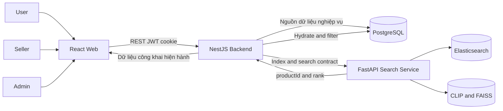
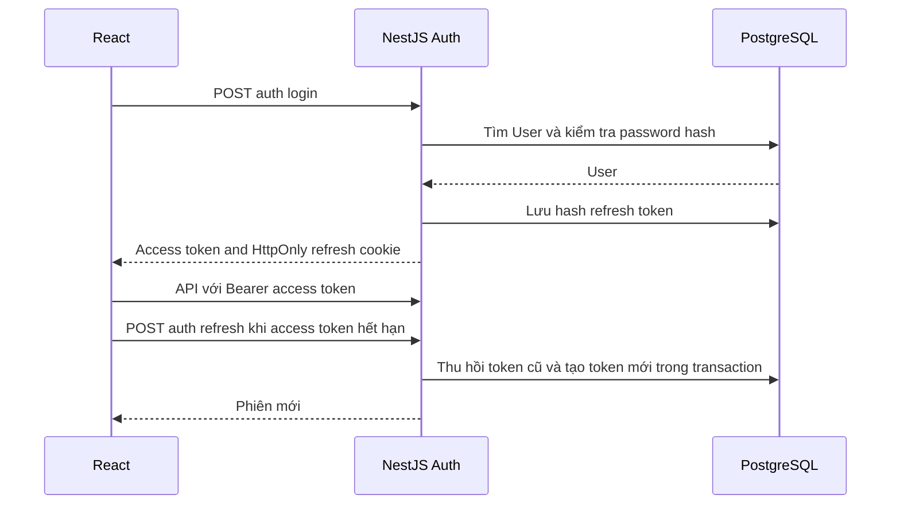
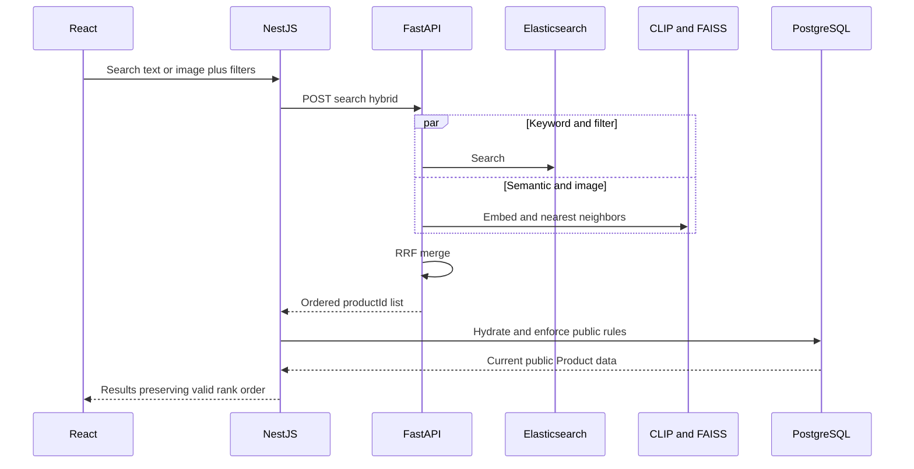

# Tổng quan kiến trúc và trạng thái hệ thống

**Đồng bộ #47 sau merge #46 ngày 15/10/2026:** nền develop `11a0da7` đã có #42/#43/#44/#46. C4.2 xác nhận hàng quay về vẫn IN_PROGRESS trên nhánh #47; giữ đầy đủ list/detail/Seller/cancel/delivery/returned và parser tương ứng. Các số kiểm thử cũ bên dưới là bằng chứng lịch sử, không thay kết quả head tích hợp. Web/G-FULFILMENT chưa nghiệm thu.

**Đợt kiểm thử PR #47 ngày 14/10/2026:** giữ baseline head ac7d003 trên nền f267399 để bổ sung test C4.2. Develop đã có #43 tại 515f68a nhưng chưa sync vào nhánh này; không lấy kết quả nhánh riêng thay nghiệm thu bản kết hợp. Không sửa service/schema/contract nghiệp vụ; C4.2/Web/G-FULFILMENT vẫn IN_PROGRESS. Các snapshot trước đây giữ ngày/baseline riêng.
**Lịch sử kiểm thử #46 trước merge:** develop đã merge #44 tại `2ed3ee5`, có API đọc đơn #42, Seller chuẩn bị #43 và hủy COD/hoàn kho #44. Nhánh #46 ghép thêm giao mô phỏng, chưa merge. Kiểm mới trên nhánh kết hợp: 535 unit, 511 Backend E2E, 122 FE PASS; 2 ca mới đi từ Checkout COD thật qua Seller tới delivery/replay và kiểm hủy muộn. [Báo cáo sau #44](../testing/pr46-post-pr44-integration-2026-10-15.md). Không ghép #47/#48/#54/#55 chưa merge; G-FULFILMENT/Web vẫn chưa nghiệm thu.

**Bằng chứng lịch sử PR #44 ngày 14/10/2026 (đã merge ngày 15/10 tại 2ed3ee5):** nền kiểm thử khi đó `develop 515f68a` sau merge Seller preparation #43; giữ API detail #42 và C3 hủy COD/hoàn kho trên nhánh #44.
OrderModule giữ list/detail/confirm/packing/ready/cancel, SearchModule và guard; parser GET → Seller command → cancellation → Checkout/default. #42/#43 CURRENT ở Backend, C3 vẫn IN_PROGRESS/chưa merge. Giữ nền #45/#49/#50/#52/#53; không ghép delivery/complete chưa merge. [Bằng chứng 13/10](../testing/pr44-post-pr42-integration-2026-10-13.md) là lịch sử, không thay test cạnh tranh HTTP head mới; toàn luồng Web chưa nghiệm thu.
Những mục ảnh chụp 10–13/10 phía dưới là lịch sử, không thay trạng thái mới này; G-FULFILMENT vẫn chưa DONE. [Bằng chứng tích hợp #43/#44 ngày 14/10](../testing/pr44-post-pr43-race-verification-2026-10-14.md): 458 unit, 487 Backend E2E và 122 FE PASS, gồm 5 ca cạnh tranh HTTP mới.

Tài liệu này là điểm bắt đầu để thành viên và AI hiểu hệ thống trước khi đọc code hoặc sửa một chức năng. Nội dung trả lời bốn câu hỏi: hệ thống đang giải quyết bài toán gì, các thành phần phối hợp như thế nào, phần nào đã chạy thật, và cần đọc đâu để tiếp tục công việc mà không suy đoán.

**Đồng bộ PR #46 ngày 15/10/2026:** nền `develop 2ed3ee5` sau merge #44, giữ detail #42, Seller preparation #43, cancellation #44 và bốn Admin delivery commands trên cùng ứng dụng. Parser GET → Seller command → cancellation → delivery → Checkout/default; OrderModule giữ SearchModule và đủ controller/service/guard. #42/#43/#44 CURRENT ở Backend, C4.1 vẫn IN_PROGRESS trên #46; chưa ghép #47/#48/Web hoặc nghiệm thu G-FULFILMENT. Các mốc và số liệu cũ phía dưới là bằng chứng lịch sử, không thay kết quả test tích hợp mới.

**Sau merge #38:** giữ CheckoutModule/OrderModule, guard body Order GET trước parser JSON, cookie/CORS Retry-After và writer audit BUYER. Mục 7.5.4–7.5.5 là bằng chứng lịch sử; mục 7.5.6–7.5.8 mô tả nền đã merge. Detail #42/Seller #43/C3 #44 hiện đã merge; các đoạn có baseline/ngày cũ giữ bằng chứng tại thời điểm đó. Khi tích hợp phải giữ cả controller/parser và chạy lại test, không dùng kết quả riêng hai nhánh làm bằng chứng head kết hợp.

## 1. Cách đọc và nguồn chuẩn

Khi tài liệu mâu thuẫn, dùng thứ tự ưu tiên sau:

1. `AGENTS.md` và quy tắc an toàn repository.
2. `docs/project/implementation-scope.md` cho phạm vi P0, P1, P2 và Definition of Done.
3. Tài liệu thiết kế miền tương ứng trong `docs/architecture/`.
4. Contract API đã được các bên sở hữu cùng review.
5. Migration, code và test đã merge trên `develop` để xác định trạng thái triển khai thật.
6. Pull request mở để hiểu phần đang phát triển, chưa được xem là chức năng đã hoàn thành.

Các nhãn trạng thái trong tài liệu:

| Nhãn | Ý nghĩa | Có được báo cáo là đã hoàn thành không |
|---|---|---|
| `CURRENT` | Đã merge vào `develop`; có code hoặc tài liệu làm bằng chứng | Chỉ khi luồng tích hợp và điều kiện Definition of Done đã đạt |
| `IN_PROGRESS` | Đang ở branch, PR, prototype hoặc thiếu một lớp trong luồng | Không |
| `TARGET` | Đã chốt yêu cầu/thiết kế nhưng chưa có đủ code | Không |
| `P2` | Hướng mở rộng sau phạm vi khóa luận hiện tại | Không |

Một schema, endpoint Swagger, màn hình Figma hoặc test đơn lẻ không đủ để biến một release gate thành `DONE`.

## 2. Mục tiêu và ranh giới hệ thống

Hệ thống là sàn thương mại điện tử nhiều người bán và đa ngành hàng. Người dùng có thể mua hàng; sau quy trình mở Store và được duyệt, cùng tài khoản đó phải có khả năng bán hàng trong kiến trúc đích. Seller quản lý Store, sản phẩm, biến thể, ảnh, giá và tồn kho. Admin quản lý danh mục, duyệt Store và sản phẩm. User tìm sản phẩm bằng từ khóa, văn bản ngữ nghĩa hoặc hình ảnh, sau đó mua hàng, theo dõi đơn, chat và sử dụng các nghiệp vụ hậu mãi trong phạm vi khóa luận.

Dataset ABO Electronics chỉ là dữ liệu seed và corpus thực nghiệm. Nó không giới hạn hệ thống ở ngành điện tử và không quyết định schema nghiệp vụ.



## 3. Kiến trúc chạy và trách nhiệm thành phần

### 3.1 Frontend React

Thư mục `FE/` chứa ứng dụng React, TypeScript và Vite. React Router điều hướng các trang public, account, Seller và Admin. `AuthProvider` giữ phiên đăng nhập trong bộ nhớ, gọi refresh session khi tải lại trang và dùng `apiClient` làm điểm gọi Backend thống nhất.

Frontend không được tự quyết định quyền, giá, tồn kho, trạng thái duyệt hay trạng thái đơn. Nó hiển thị dữ liệu và gửi command; Backend xác thực lại mọi quy tắc nghiệp vụ.

**CURRENT — bảo vệ phiên Frontend, #52 đã merge tại `fc52c8c` ngày 10/10/2026:** bản sửa trên
`codex/frontend-session-isolation` từ `develop f267399`; độc lập
với UI Address/Cart của Hiền. `apiClient` ghi nhớ chủ tài khoản và
`authSessionVersion` (số thế hệ phiên, tăng khi đăng nhập/đăng xuất, không tăng
khi xoay token cùng phiên). Mỗi request chụp số này lúc gửi. Phản hồi 401 cũ
không được refresh/retry sau khi đổi phiên; refresh trả về tài khoản khác cũng
không được dùng để gửi lại dữ liệu. Refresh cũ bị hủy và kiểm tra thế hệ trước
cập nhật token; lỗi cũ không xóa phiên mới. `AuthProvider` kiểm tra lại thế hệ
trước cập nhật User hoặc hoàn tất logout. Cùng phiên vẫn chia sẻ một refresh
và retry tối đa một lần. Đây là kiểm tra phía client, không thay JWT/ownership
Backend, không hoàn tác request đã được server chấp nhận, không tự đồng bộ
giao diện giữa các tab. Xem [test và giới hạn](../testing/frontend-session-isolation-verification.md).

**Cập nhật Address/Cart ngày 11/10/2026:** #49 Address đã merge tại `dc52d92`:
route `/account/addresses`, link từ Account, CRUD/default qua API Backend, guard
USER active và bỏ dữ liệu/response cũ khi đổi Buyer. #50 Cart vẫn đang ở PR riêng;
nhánh được đồng bộ với nền Address và Auth đã merge. Conflict `AppRouter.tsx`
được giải quyết bằng giữ cả hai import/route và guard USER, không bỏ Address
để thêm Cart. Cart gọi GET/PUT/DELETE, không giữ kho hoặc tạo đơn; link
`/checkout?variantId=...` chỉ là điểm bàn giao cho Checkout của Hoàng. Test
điều hướng chung dùng mock service, không thay bằng chứng browser/PostgreSQL
hoặc nghiệm thu G-CHECKOUT. Xem [bằng chứng Cart](../testing/buyer-cart-ui-verification.md).

### 3.2 Backend NestJS

**CURRENT — PR #24 đã merge:** bộ lọc listing `categoryId`/`brandId`/`inStock` được xử lý ở PostgreSQL và policy public trước khi đủ số kết quả một trang. `categoryId` có nghĩa là category đã chọn cùng toàn bộ nhánh con hoạt động, thống nhất với hybrid search khi người dùng nhập từ khóa. `inStock` chỉ tính variant bán hợp lệ; frontend dùng `nextCursor` để tải tiếp, kể cả sau trang rỗng. Xem [contract public listing](../api/product-moderation-public-api.md). Không đổi schema hoặc contract Search Service.

Form Product tại `FE/src/pages/SellerDashboardPage.tsx` dùng state cho tên/mô tả/category/brand: chọn Product nào nạp đúng dữ liệu Product đó, lỗi lưu giữ nguyên form, lưu thành công mới reset. Khóa thao tác trong khi request đang chạy ngăn gửi trùng. Nếu đã lưu nhưng reload danh sách lỗi, UI báo rõ đã lưu để tránh hiểu nhầm cần tạo lại. Listing/detail bỏ qua response cũ khi đổi truy vấn/Product. Các thay đổi này chưa đồng nghĩa hoàn thành toàn bộ UI Seller hoặc gate G-LISTING.

Thư mục `BE/` là modular monolith NestJS. Mỗi miền có controller, service, DTO, guard và test riêng nhưng chạy trong cùng một ứng dụng:

```text
HTTP request
→ Controller nhận DTO
→ ValidationPipe loại hoặc từ chối trường không hợp lệ
→ JWT and role guard xác thực actor
→ Service kiểm tra ownership và trạng thái
→ Prisma transaction đọc hoặc ghi PostgreSQL
→ Response DTO hoặc lỗi HTTP có cấu trúc
```

NestJS là lớp điều phối nghiệp vụ. Client không gọi trực tiếp PostgreSQL, Elasticsearch hoặc FAISS.

### 3.3 PostgreSQL và Prisma

PostgreSQL là nguồn dữ liệu chuẩn cho tài khoản, Store, catalog, sản phẩm, giá, tồn kho và các miền giao dịch sẽ được bổ sung. Prisma cung cấp schema, migration và client truy cập dữ liệu.

Mọi thay đổi database phải tạo migration mới. Không sửa migration đã merge. Những quy tắc có thể biểu diễn bằng foreign key, unique key và check constraint nên được bảo vệ ở database; ownership, state transition và quy tắc liên bảng phức tạp được kiểm tra trong service/transaction và phải có test.

### 3.4 FastAPI Search Service

Thư mục `AI_CLIP/` là ranh giới của Search Service. Kiến trúc đích giao cho FastAPI quản lý:

- Elasticsearch cho keyword search và filter.
- CLIP cho embedding ảnh và văn bản ngữ nghĩa.
- FAISS cho nearest-neighbor vector search.
- Reciprocal Rank Fusion để hợp nhất danh sách xếp hạng.

FastAPI chỉ trả `productId`, điểm và thứ hạng. NestJS phải đọc lại PostgreSQL, loại Product không còn công khai và hydrate dữ liệu hiển thị. Vì vậy index chậm không được làm sản phẩm đã ẩn xuất hiện công khai.

### 3.5 Docker và CI

Docker Compose trên `develop` hiện khởi động PostgreSQL. Frontend, Backend và Search Service chưa được đóng gói đầy đủ trong Compose chung.

Workflow `repository-checks` hiện kiểm tra fresh install bằng pnpm, whitespace, Docker Compose config, Prisma schema/migration/seed, lint, unit test và build của các workspace Node/Frontend/Backend, cùng Backend E2E trên PostgreSQL. Cùng workflow CI có job `ai-python-checks` (hiển thị `AI Service - Ruff and Pytest`), dùng Python 3.12 và chạy Ruff/Pytest cho `AI_CLIP/`; job này đã merge qua PR #8. Hai job xanh chứng minh các bộ kiểm tra tương ứng đã đạt, nhưng chưa thay thế CI xuyên dịch vụ thật hoặc kiểm thử luồng người dùng trên Web.

**CURRENT — PR #39 đã merge tại f0c7896 ngày 09/10/2026:**
CI thêm bước `pnpm --dir BE typecheck` để kiểm tra kiểu TypeScript cho cả source,
test và cấu hình Prisma. Build Nest chỉ biên dịch `src`, còn Vitest chạy test
không thay thế kiểm tra kiểu toàn bộ; trước đây 13 lỗi kiểu ở test/config có
thể tồn tại dù build/test xanh. Bản sửa bỏ cấu hình Prisma đã hết hiệu lực, dùng
kiểu HTTP server suy ra từ API công khai của Supertest, khai báo kiểu chính xác
cho seed JavaScript và thay assertion (điều kiện kiểm chứng) `locked` lỗi thời
bằng kiểm tra thống kê, Product nháp không đổi và không phát sự kiện outbox.
Không thay schema, API, mức cô lập giao dịch hoặc contract FastAPI.
Đây là củng cố chất lượng, không phải chức
năng nghiệp vụ mới; phải chạy lại typecheck trên nhánh kết hợp trước kết luận không có diagnostic mới.

## 4. Bản đồ repository

| Vị trí | Trách nhiệm | Đọc khi nào |
|---|---|---|
| `FE/src/` | React UI, route, auth context và API client | Khi sửa màn hình hoặc luồng trình duyệt |
| `BE/src/` | NestJS controller, service, DTO, guard | Khi sửa API hoặc nghiệp vụ |
| `BE/prisma/` | Prisma schema, migration và seed | Khi thay đổi dữ liệu hoặc ràng buộc |
| `BE/test/` | E2E cho Auth, schema Product, Store/Catalog và seed | Khi xác minh hành vi tích hợp |
| `AI_CLIP/` | FastAPI, CLIP, FAISS, Elasticsearch và RRF | Khi sửa Search Service hoặc thực nghiệm |
| `docs/api/` | Contract giữa các dịch vụ | Trước khi đổi request/response |
| `docs/architecture/` | Quyết định kiến trúc theo miền | Trước khi sửa schema hoặc luồng chính |
| `docs/project/` | Phạm vi, phân công và release gate | Trước khi nhận task |
| `docs/analysis/` | Cơ sở nghiệp vụ và nguồn tham khảo | Khi viết SRS, ERD, Use Case hoặc báo cáo |
| `docs/testing/` | Ground truth, query và test artifact | Khi đánh giá Search hoặc nghiệm thu |
| `docs/data-quality/` | Quyết định làm sạch dataset | Khi import hoặc thay đổi metadata |

## 5. Quy tắc dữ liệu xuyên suốt

### 5.1 ID sản phẩm

- `productId` là số nguyên do PostgreSQL sinh và là ID dùng trong Backend, Elasticsearch và FAISS.
- `externalId` là mã truy vết tùy chọn của dữ liệu import, có dạng `<source>:<source-id>` như `abo:B07ABC123`.
- Prefix phụ thuộc nguồn. `abo:` không gắn vào sản phẩm từ nguồn khác; sản phẩm Seller tạo trực tiếp có `externalId = null`.
- Mapping gửi pipeline AI có dạng `{"externalId":"abo:B07ABC123","productId":125}`.

### 5.2 Product và Variant

`Product` giữ thông tin chung như tên, mô tả, Store, Category, Brand và trạng thái. `ProductVariant` giữ SKU, giá, tồn kho và trạng thái bán. Sản phẩm không có phân loại vẫn cần một variant mặc định để Cart và Order chỉ xử lý một mô hình.

Không thêm các cột cố định như `color`, `size`, `ram` vào Product. Thuộc tính mô tả theo Category và option tạo Variant là hai khái niệm khác nhau.

### 5.3 Nguồn chuẩn và index phụ trợ

```text
PostgreSQL commit thành công
→ tạo SearchOutbox cùng transaction
→ worker gửi productId and version tới FastAPI
→ FastAPI cập nhật Elasticsearch and FAISS
→ tìm kiếm trả productId
→ NestJS hydrate and filter bằng PostgreSQL
```

Elasticsearch và FAISS có thể xây lại. Không dùng chúng làm nguồn chuẩn cho giá, tồn kho, quyền sở hữu hoặc trạng thái công khai.

## 6. Trạng thái triển khai tại ngày 10/10/2026

| Miền | Trạng thái | Bằng chứng chính trên `develop` hoặc PR đang mở | Khoảng trống tiếp theo |
|---|---|---|---|
| Nền móng workspace và PostgreSQL | `CURRENT` | PR #3; pnpm workspace, NestJS, React, migration, Docker PostgreSQL | Compose toàn hệ thống và hướng dẫn demo hoàn chỉnh |
| Auth email and password | `CURRENT` | PR #4; register, login, refresh rotation, logout, `/auth/me`, JWT/RBAC test | Profile/address, verify/reset, OAuth, OTP và multi-role mục tiêu |
| Frontend shell | `CURRENT` | PR #13; router, layout, auth context, route guard, trang khung | Màn hình nghiệp vụ thật cho Store, Product, Cart, Order, Search |
| Product database schema | `CURRENT` | PR #10, #18 và #22; Store, catalog, Product/Variant, thuộc tính, ảnh, shipping, importer và lịch sử quyết định | Media private/signed URL và UI Seller/Admin đầy đủ vẫn thiếu |
| Store and Catalog API | `CURRENT` | PR #15; Seller Store lifecycle, Admin review, Category/Brand API, ownership và E2E | Store address/profile đầy đủ và UI Seller/Admin |
| CI quality gates | `CURRENT` | PR #16, #17, #19 và #8; CI kiểm tra pnpm/FE/BE, Backend E2E và job Python Ruff/Pytest cho Search Service | Tiếp tục theo dõi độ ổn định và bổ sung kiểm thử trình duyệt khi UI nghiệp vụ hoàn thiện |
| Product draft API and importer | `CURRENT` | PR #18 đã merge (`cbc3e40`): draft, option/attribute/variant, image lifecycle, shipping, submit và importer idempotent kiểm tra ảnh hỏng; có Backend E2E. Smoke đã tạo mapping 86 Product DRAFT | 86 Product chưa phải Public Product; private media/signed URL và UI vẫn thiếu |
| FastAPI Search Service và Backend Search sync | `CURRENT` | PR #8 và #23 đã merge: Elasticsearch, CLIP/FAISS, RRF, dual-index, version/idempotency, transactional outbox, worker, durable reconciliation và PostgreSQL hydrate/filter; integration local đã đạt | Hoàn thiện Web Search và đánh giá chất lượng bằng ground truth độc lập ở PR #25 |
| SRS, Use Case and ERD | `CURRENT` (tài liệu) | PR #5 đã merge; SRS v3.1 ở `docs/analysis/hien/srs-v3.md`; 13 Use Case, 60 test case thiết kế. PR #21 bổ sung consensus pilot Search | Test case thiết kế không đồng nghĩa PASS; duy trì truy vết yêu cầu–API–test khi từng PR được nghiệm thu |
| Public Product and moderation | `CURRENT` | PR #22 và #23: Admin approve/reject/freeze, Seller hide/show, public list/detail, predicate chung, ProductStatusHistory, SearchOutbox/reconciliation và E2E | Media privacy và Admin/Seller/Public UI đầy đủ vẫn thiếu |
| Cart–Order–Inventory foundation | `CURRENT` (schema/migration) | PR #26 tại 08f165e và contract #27 tại c0a7d48 đã merge | Checkout Backend đã có qua #36; state machine, FE và nghiệm thu E2E luồng mua hàng còn thiếu |
| Buyer Cart API | `CURRENT` (Backend) | #31 đã merge tại 6663fab, GET/PUT/DELETE/DTO/privacy/rate limit, unit và E2E Address/Cart cùng hai app instance | Buyer Cart UI và Checkout/COD chưa nghiệm thu; chưa đạt G-CHECKOUT |
| Buyer/Seller Order list | `CURRENT` (Backend) | PR #37 đã merge tại bed88a0; hai GET list summary, cursor/status/ownership/READ ONLY; mục 7.5.7 | Detail #42 đã merge; command/hoàn kho đang ở PR riêng; UI chưa nghiệm thu |
| OrderCommand/audit foundation | `CURRENT` (database/helpers) | PR #38 merge tại 27e083b; unique/receipt/audit/typed BUYER writer; mục 7.5.8 | Không phải command API runtime |
| Buyer/Seller Order detail | `CURRENT` (Backend) | #42 đã merge tại ad1771b; snapshot/privacy/readonly, mục 7.5.11 | UI và toàn luồng fulfillment chưa nghiệm thu |
| C3 hủy COD/hoàn kho | `CURRENT` (Backend) | #44 merge tại 2ed3ee5, mục 7.5.9 | UI và Search xuyên dịch vụ trên head mới chưa nghiệm thu |
| Seller chuẩn bị đơn C2 | `CURRENT` (Backend) | #43 merge tại 515f68a; confirm/start-packing/ready-to-ship, mục 7.5.12 | Delivery/complete/UI chưa nghiệm thu |
| Admin delivery simulation C4.1 | `CURRENT` (Backend) | #46 merge tại 11a0da7; mục 7.5.13 | Chưa nghiệm thu Web/toàn luồng |
| Checkout v1 + preview/lookup + create COD | `CURRENT` (Backend) | PR #36 đã merge tại a2561c1, nền hash/receipt, hai API đọc và POST /checkouts với Order/stock/Cart/Payment/ledger/outbox cùng transaction, mục 7.5.4–7.5.6 | Buyer UI/Order lifecycle và nghiệm thu toàn luồng vẫn thiếu; G-CHECKOUT chưa DONE |
| Chat User and Seller | `TARGET` | `chat-domain-design.md` | Schema, REST/WebSocket, UI và E2E quyền/reconnect |
| Buyer Address API | `CURRENT` (Backend) | #30 đã merge tại efd86a3: CRUD/default/DTO/ownership, migration district nullable, unit/HTTP E2E; mục 7.5.1 | Buyer UI thật và bằng chứng tích hợp; chưa đạt gate G-ACCOUNT/G-CHECKOUT toàn luồng |
| Review, Admin dashboard and notification | `TARGET` | Phạm vi P0 | Schema/API/UI/test |
| Verify/reset, OAuth, OTP, payment sandbox and returns | `TARGET P1` | `implementation-scope.md` | Chỉ triển khai sau dependency P0 tương ứng ổn định |

Trạng thái này không tự cập nhật. Khi một PR được merge, người phụ trách phải sửa dòng liên quan, cập nhật ngày ảnh chụp và dẫn chứng test. Không xóa khoảng trống còn tồn tại chỉ vì một lớp riêng lẻ đã có code.

## 7. Các luồng cần hiểu

### 7.1 Auth hiện tại



Trạng thái hiện tại vẫn dùng một `Role` cho mỗi User. Yêu cầu cùng tài khoản vừa mua vừa bán là `TARGET` và cần migration/Auth/UI/test riêng; không được mô tả là đã hoạt động.

### Bổ sung C4.2 — hàng giao thất bại quay về (IN_PROGRESS)

Đồng bộ 15/10 trên `develop 11a0da7` sau #46. Luồng mới được kiểm qua HTTP:
Cart → Checkout COD → Seller confirm/packing/ready → Admin ship/delivery-failed
→ Seller confirm-returned → Buyer/Seller GET detail. Chỉ bước nhận hàng quay về
mới hoàn kho; replay cùng key không hoàn hai lần. Catalog/ảnh/địa chỉ vẫn là
fixture có nhãn, không phải nghiệm thu Web, ảnh được phục vụ hay ES/FAISS.
Kết quả head tích hợp xem [báo cáo sau #46](../testing/pr47-post-pr46-integration-2026-10-15.md).

[Kiểm thử bổ sung 14/10](../testing/pr47-returned-regression-2026-10-14.md) kiểm Product APPROVED có hai Variant hết kho → hoàn 2/3 đúng từng dòng nhưng một version/UPSERT; exact DELETE khi Store/Category invalid, restore cũ/version overflow rollback và account/role bị thu hồi sau receipt thật. Production service không đổi. 20 return E2E và 372 full E2E PASS trên database QA riêng; không chứng minh API #46, serving ảnh hoặc ES/FAISS/Web đã chạy.

Nhánh `codex/order-returned-confirmation` bổ sung hai command Seller/Admin `confirm-returned` theo [contract](../api/order-returned-command-contract.md). Không cộng kho ngay khi DELIVERY_FAILED. Khi xác nhận hàng đã quay về và bán lại được, giao dịch ghi ledger hoàn kho, Variant.stock, Product.version/SearchOutbox, Order/Payment CANCELLED, history và receipt bền vững cùng nhau. Hàng hỏng/mất không tăng kho; LOST chỉ Admin. Replay dùng receipt gốc, không hoàn hai lần. Chưa có UI/toàn luồng và không thay thế ReturnRequest/refund P1.

### 7.2 Store hiện tại

Seller tạo một Store ở `PENDING`. Admin có thể chuyển `PENDING` sang `ACTIVE` hoặc `REJECTED`; Store bị từ chối được Seller sửa và nộp lại trên cùng bản ghi. Admin có thể chuyển `ACTIVE` sang `SUSPENDED` và khôi phục lại. Mỗi thay đổi ghi `StoreStatusHistory`; service dùng cập nhật có điều kiện để chống hai request ghi đè trạng thái của nhau.

### 7.3 Product và import dataset

```text
products.jsonl plus image folder
→ dry-run validate schema, externalId, category and safe relative paths
→ upsert by externalId without overwriting unrelated business edits
→ PostgreSQL assigns productId
→ ingest valid image into managed storage
→ keep incomplete Product as DRAFT
→ export externalId to productId mapping
→ rebuild FAISS and Elasticsearch with official productId
```

Code importer đã merge qua PR #18. Lượt smoke đã import 86 Product DRAFT, kiểm tra PostgreSQL và xuất mapping 86 cặp cho Đạt rebuild FAISS. Mapping xác nhận ID kỹ thuật; việc công khai từng Product vẫn phải qua hoàn thiện dữ liệu, submit và Admin duyệt.

### 7.3.1 Phần mới: quyết định duyệt và đọc Product công khai

**CURRENT — PR #22 đã merge.** Contract cụ thể ở [Product moderation/public API](../api/product-moderation-public-api.md).

```text
Seller submit (PR #18) → ACTIVE/PENDING, version N
→ Admin đọc chi tiết và gửi approve/reject kèm version N
→ Serializable transaction kiểm tra version/trạng thái/điều kiện bán
→ Product đổi trạng thái + tăng version + ghi ProductStatusHistory
→ commit → public list/detail kiểm tra lại PostgreSQL → response chỉ có dữ liệu hiển thị
```

`ProductLifecycleService` xử lý quyết định và hide/show. `product-public-policy.ts` là nơi đọc quy tắc công khai: Store/account, category và tổ tiên, ảnh, required attributes, kiện hàng và variant hợp lệ. Public list và detail gọi cùng quy tắc để không có chuyện bị ẩn ở danh sách nhưng còn mở được qua URL chi tiết. Giá/tồn kho vẫn thuộc Variant; hàng hết kho được hiển thị với `inStock:false`.

Ví dụ: Admin đang xem version 7, Seller hoặc request khác đã làm Product thành version 8 thì quyết định cho version 7 nhận 409. Admin phải tải lại nội dung. Product và history cùng transaction nên không có tình trạng đổi kết quả duyệt nhưng mất lịch sử. Hai service instance vẫn được bảo vệ bằng version và Serializable; khóa process chỉ bổ trợ việc publish ảnh.

Seller hide chuyển ACTIVE/APPROVED thành HIDDEN/APPROVED. Show chỉ được phép khi APPROVED và đủ điều kiện. Admin freeze chặn Seller tự mở lại. Sửa nội dung APPROVED theo PR #18 đưa về DRAFT/NOT_SUBMITTED, vì thế public ngừng trả ngay dù Search index chưa đồng bộ.

File cần đọc theo thứ tự:

1. `BE/src/product/admin-product.controller.ts`, `public-product.controller.ts` và route visibility ở `seller-product.controller.ts`.
2. `BE/src/product/product-lifecycle.service.ts`: transaction, phiên bản, lịch sử và phân trang.
3. `BE/src/product/product-public-policy.ts`: điều kiện hiển thị và dữ liệu được phép trả.
4. `BE/prisma/schema.prisma` → `ProductStatusHistory`; migration `20260925120000_product_status_history` chỉ thêm bảng, không sửa Product cũ.
5. `BE/test/product-lifecycle.e2e-spec.ts`: ca thành công, từ chối, race, rollback và public filtering.

**Chưa làm trong đợt này:** thông báo, media private/signed URL, gỡ FROZEN và UI đầy đủ. Bảng history mới ghi quyết định Admin/hide/show, chưa phải audit toàn bộ nội dung. Public endpoint bảo vệ JSON; bảo vệ file ảnh draft là đầu việc storage riêng. SearchOutbox, worker và durable reconciliation đã merge qua PR #23.

### 7.4 Tìm kiếm đích



Hoàng và Đạt đã thống nhất version, UPSERT/DELETE, filter, image URL theo môi trường, lỗi và retry trong `docs/api/ai-service-contract.md`. PR #8 và #23 đã merge: Search Service, SearchOutbox/worker, reconciliation và PostgreSQL hydrate/filter đều đã có code và kiểm thử. Phần chưa đạt là trải nghiệm Web Search hoàn chỉnh và đánh giá chất lượng bằng bộ ground truth độc lập.

### 7.5 Checkout đích

**Contract đã review/merge; Checkout Backend CURRENT, Order lifecycle TARGET:** #27 đã merge tại c0a7d48; #36 Checkout Backend đã merge tại a2561c1 ngày 09/10. Xem [Cart–Order–Inventory API contract](../api/cart-order-inventory-api-contract.md). Checkout chỉ lấy dòng trong giỏ Buyer với quantity khớp. Order command đích dùng key/hash và receipt PostgreSQL để replay không hoàn kho hai lần; audit hủy dùng cột/history riêng; Buyer hoặc job D07 hoàn tất theo SRS v3.1, vận chuyển mô phỏng Admin/adapter. Các command này chưa triển khai trên branch list, không đổi actor theo tài liệu v0.5.

Cart tham chiếu variantId. Checkout đọc lại canonical Product/Variant, giá/kho, tạo Order snapshot một Store mỗi Order và cập nhật kho/history/outbox cùng transaction. Schema #26, Address #30, Cart #31, Checkout.hashVersion/receipt #36, OrderCommand/audit #38 và DeliveryAttempt #45 đã merge. C4.1 API giao mô phỏng ở nhánh riêng; state machine/Frontend toàn luồng chưa nghiệm thu, không sửa migration cũ.

Contract đã chốt province/ward bắt buộc, district nullable; delivered/failed phải khớp attempt hiện hành, tối đa 3 retry (4 attempt tổng). Các quyết định này đã review, không nhận API/test runtime là hoàn thành.

**Điều phối/readiness:** Hoàng giữ Backend Address/Cart → Checkout/COD/Order và Buyer UI Checkout/Order. Hoàng giao Hiền CODE hai màn Buyer Address/Cart ngày 04/10; Hiền đã [xác nhận nhận task trên PR #29](https://github.com/grumhu124/BCKL_ThuongMaiDienTu/pull/29#issuecomment-5978048696) (**CONFIRMED_BY_HIEN**), không chỉ review. Hiền tách hai PR UI ngoài Admin #28, nối API thật sau Backend tương ứng merge vào develop. Chưa có cam kết lịch cụ thể hoặc bằng chứng UI hoàn thành. Xem [phân công tăng tốc](../project/address-cart-delivery-assignment-2026-10-03.md), [checklist Address/Cart](address-cart-backend-readiness.md) và [checklist Checkout/COD](checkout-cod-backend-readiness.md). #29 đã được re-review và merge như mục 7.5.3; approval thiết kế không chứng minh UI đã làm.

### 7.5.1 Address API — CURRENT ở lớp Backend, PR #30 đã merge

Contract Address đã duyệt trong #27. PR #30 merge tại `efd86a3` thêm `AddressModule` và năm route tại `/me/addresses`: GET/POST, PATCH/DELETE `/:addressId`, PUT `/:addressId/default`. CURRENT chỉ ở lớp Backend; chưa có UI thật thì chưa nhận luồng người dùng DONE. Cart Backend cũng đã merge qua #31 tại `6663fab`; Cart UI/Checkout chưa triển khai.

Luồng: JWT đọc User active → guard USER → DTO trim/validate và từ chối trường thừa → service lọc ownership → transaction PostgreSQL → response chỉ có địa chỉ của actor. Error filter chỉ áp dụng route Address, không đổi lỗi API cũ. GET không cache dữ liệu cá nhân.

Mọi write khóa hàng `users` của actor bằng `SELECT ... FOR UPDATE` trước đọc/count địa chỉ, kể cả User chưa có địa chỉ. READ COMMITTED đọc dữ liệu mới sau khi chờ khóa; vì tất cả write Address tuân thủ cùng khóa, hai service instance không tạo hai default hoặc vượt giới hạn 20. Partial unique index vẫn bảo vệ tối đa một default tại DB. Đổi default bỏ cờ cũ và đặt cờ mới cùng transaction; lỗi rollback cả hai. Xóa default chọn địa chỉ cũ nhất `(createdAt,id)`; xóa cuối cho phép không có default. Đây không phải khóa trong memory; những writer mới vào bảng Address phải dùng cùng giao thức. Retry chỉ serialization/deadlock, tối đa 5 lần có backoff; không retry mọi lỗi DB.

Migration mới `20261003140000_nullable_address_district` chỉ bỏ NOT NULL ở `user_addresses.district` và `orders.districtSnapshot`; không sửa migration #26 hoặc dữ liệu/snapshot cũ. Province/ward bắt buộc, district nullable. `ADDRESS_MAX_PER_USER` mặc định 20. PATCH bỏ field giữ nguyên, null chỉ xóa optional; default không unset bằng PATCH. Address không sửa Product/version/outbox, giá/kho hoặc snapshot Order.

Đọc code theo thứ tự: `BE/src/address/address.controller.ts` → `address.dto.ts`/`address-http.ts` → `address.service.ts` → migration mới → `BE/test/address.e2e-spec.ts`. Xem [hướng dẫn kiểm thử và bàn giao Address](../testing/address-api-verification.md) để biết bằng chứng và giới hạn.

### 7.5.2 Buyer Cart API — CURRENT ở Backend, PR #31 đã merge

PR #31 đã được người dùng merge ngày 05/10 tại `6663fab`, sau review Hiền đúng head `979ef58` và CI xanh. Bản tích hợp giữ cả AddressModule/CartModule, cấu hình Address + Cart và migration district nullable đã merge; không tạo migration mới, không sửa migration cũ, Auth hay FastAPI. `GET /cart`, `PUT /cart/items/:variantId` và `DELETE /cart/items/:variantId` phục vụ USER active; actor lấy từ JWT, không nhận userId/cartId từ client.

Luồng PUT: guard JWT/role → giới hạn request → kiểm tra quantity → Serializable transaction khóa User → đọc Product/Variant/category và policy public hiện hành → kiểm tra đúng Variant, ownership và kho → tạo Cart lười/đặt quantity tuyệt đối → đọc response giỏ trong cùng transaction → commit. Gửi lại cùng quantity không cộng thêm hoặc đổi updatedAt của dòng; không giữ/trừ kho, không tạo Order/movement/outbox hay tăng Product.version. Checkout sau này phải kiểm tra lại mọi điều kiện và cam kết kho riêng.

GET dùng RepeatableRead — các lần đọc trong một request thấy cùng ảnh chụp database — để tránh lấy Product ở thời điểm này nhưng category ở thời điểm khác. Tổng tiền dùng Prisma.Decimal, trả chuỗi hai số thập phân. `lineCount` đếm dòng, `totalQuantity` cộng mọi quantity, `purchasableSubtotal` chỉ cộng món mua được. Product không còn public trả bốn trường tối thiểu ở `unavailableItems`; Variant không hợp lệ của Product vẫn public không lộ giá/option/stock riêng. Thiếu/hết kho vẫn hiện thông tin bán công khai nhưng không cộng tổng.

Khóa User ở PostgreSQL tuần tự hóa ghi giỏ giữa nhiều instance, không chỉ một process. Serialization/deadlock retry tối đa 5 lần với backoff; hết retry trả 409 CART_WRITE_CONFLICT. GET/PUT/DELETE dùng chung rate bucket 60 request/phút/User, có Retry-After khi 429; limiter in-memory chỉ bảo vệ một instance. Không tuyên bố đây là cơ chế chống lạm dụng đa replica.

Đọc code: `BE/src/cart/cart.controller.ts` → `cart.dto.ts`/`cart-http.ts`/`cart-rate-limit.guard.ts` → `cart.service.ts` → `product-public-policy.ts` → `Cart`/`CartItem` trong schema. Bằng chứng và cách chạy ở [Cart API verification](../testing/cart-api-verification.md). Frontend Cart, Checkout/COD/Order và multi-role chưa thuộc PR này; `G-CHECKOUT` chưa DONE.

### 7.5.3 Bước chuẩn bị mới ngày 04/10 — Checkout/COD

Đã rà schema nền, SRS v3.1, contract #27, khóa giỏ trên hàng User của #31 và SearchOutbox producer hiện có. [Checklist Checkout/COD](checkout-cod-backend-readiness.md) ghi thứ tự transaction, phần cần migration mới, ma trận cạnh tranh/rollback/replay và những quyết định kỹ thuật chưa đủ cụ thể để tự code. Đây chỉ là tài liệu chuẩn bị, không tạo endpoint, không sửa schema và không chạy migration. Thay kho do checkout không phải Seller sửa listing: giữ APPROVED, tăng version và ghi outbox cùng transaction; không dùng luồng sửa nội dung làm Product về DRAFT.

Cập nhật review 05/10: một request/key tạo đúng **một Checkout chung, một Order mỗi Store**, tất cả tham chiếu cùng Checkout và commit/rollback nguyên tử. Checklist gồm 19 ca Checkout và bốn ca tích hợp Search bổ sung, đều **NOT_RUN**; giữ event retry bất biến và xác minh hai index. Hydrate PostgreSQL ngăn trả dữ liệu không còn hợp lệ nhưng không tự bù ứng viên bị index cũ bỏ sót, nên không hứa tìm kiếm đầy đủ tức thời. Hoàn kho 0 → dương kiểm thử ở PR Order sau này.

[Quyết định triển khai Checkout/COD ngày 05/10](../api/checkout-cod-implementation-proposal.md) cụ thể hóa bảy điểm: preview, phí ship demo, giới hạn dữ liệu/tiền, rate-limit và replay, hash legacy, receipt bất biến, tra kết quả sau timeout. Hiền đã chấp thuận Q1–Q7; Đạt đã [approve phần Search ở head 6cbaeb1](https://github.com/grumhu124/BCKL_ThuongMaiDienTu/pull/29#pullrequestreview-5439915734). #29 đã được người dùng merge tại `c6e0ba1` ngày 07/10. Thiết kế đã được duyệt không có nghĩa toàn bộ runtime đã hoàn thành: PR #36 có nền hash/receipt và preview/lookup chỉ đọc như các mục sau; create COD và CHK/QCHK toàn luồng vẫn chưa nghiệm thu.

### 7.5.4 Phần mới ngày 08/10 — nền Checkout v1, IN_PROGRESS

Mục 7.5.4–7.5.5 ghi nhận hai bước trước ở head `38fda70`. Phần tạo đơn COD mới trong working tree cùng branch được mô tả tại 7.5.6; không diễn giải giới hạn “chưa có create” của hai bước trước thành trạng thái code mới nhất.

Đây là bước nhỏ đầu tiên sau thiết kế #29, không phải Checkout API hoàn chỉnh. [Bằng chứng và cách kiểm tra nền Checkout](../testing/checkout-foundation-verification.md) ghi rõ môi trường riêng, test mới và phần chưa làm.

| Thành phần/biến | Dùng để làm gì | Quy tắc cần nhớ |
|---|---|---|
| `Checkout.requestHash` | Dấu SHA-256 của yêu cầu đặt hàng đã chuẩn hóa | Gồm Buyer/address/provider/items; không gồm key hoặc dữ liệu giỏ/giá hiện hành |
| `Checkout.hashVersion` | Phiên bản cách chuẩn hóa/hash yêu cầu | Request mới dùng 1; dữ liệu cũ để null, không đoán/backfill |
| `Checkout.receiptVersion` / `receiptJson` | Phiên bản và biên nhận kết quả tạo đơn ban đầu | Không dựng lại từ Order/Payment hiện hành; không lưu địa chỉ/key/token |
| `Product.version` | Phiên bản dữ liệu sản phẩm gửi Search | Khác hoàn toàn `hashVersion`; nền này chưa thay Product hoặc phát outbox |

Luồng helper hiện có: input chưa tin cậy → reject trường thừa/ID/quantity/provider sai → chuẩn hóa tiền nguyên đồng bằng Decimal → sort item và JSON key → hash v1. Khi đọc Checkout đã có: kiểm ownership → kiểm hashVersion → so hash nếu là replay tạo đơn → phân loại PENDING/COMPLETED → validate receipt allowlist → trả bản sao receipt gốc. Lookup chỉ đọc đã gọi helper như mục 7.5.5; **chưa có service tạo đơn**. Khi nối create phải đọc lại Checkout dưới khóa Buyer trong transaction, không coi lookup trước transaction là chống race.

Migration mới `20261007100000_checkout_hash_receipt` chỉ thêm ba cột nullable, check constraint và trigger chặn UPDATE làm đổi biên nhận/identity của Checkout v1 đã COMPLETED. Row legacy giữ nguyên status/hash/key/thời gian và các cột mới null. Constraint SQL kiểm provenance/shape cơ bản; helper runtime kiểm đầy đủ allowlist, ID, status, tiền và thứ tự Store. Không sửa migration đã merge, không tự xóa key/receipt hoặc backfill theo Order hiện hành.

Đọc code: `BE/prisma/schema.prisma` model Checkout → migration mới → `checkout-money.ts` → `checkout-request.ts` → `checkout-receipt.ts` → `checkout-replay.ts` trong `BE/src/checkout/` → hai unit specs và `BE/test/checkout-receipt-migration.e2e-spec.ts`.

Bước kế tiếp sau preview/lookup bên dưới: create COD với Stock/Order/Payment/movement/Cart/receipt/version/outbox commit hoặc rollback cùng nhau; vẫn giữ APPROVED khi chỉ đổi kho. Không gọi FastAPI trong transaction. Không đổi `CURRENT` hay tick toàn bộ CHK/QCHK chỉ vì các helper/schema/read tests đạt.

### 7.5.5 Phần mới ngày 08/10 — preview và tra biên nhận, IN_PROGRESS

Tiếp nối **trên cùng PR #36**, không xếp chồng feature branch và không triển khai create ngầm. `CheckoutModule` nối `AppModule`; `configureApp` đăng ký CORS trước parser giới hạn Checkout, đồng thời giữ parser JSON mặc định cho Auth/Address/Cart và các route cũ. [Bằng chứng và hướng dẫn kiểm tra hai API](../testing/checkout-read-api-verification.md) ghi kết quả, lỗi phát hiện/sửa và giới hạn.

**Xem trước:** `POST /checkout/preview` → JWT/role USER → quota riêng 20/phút/Buyer → chuẩn hóa input strict → PostgreSQL RepeatableRead READ ONLY → kiểm tài khoản lại trong snapshot → địa chỉ thuộc Buyer → tập con giỏ và quantity khớp → policy public Product/Variant hiện hành → nhóm Store/tính Decimal → response, không ghi dữ liệu. Snapshot = bản đọc nhất quán trong một lần gọi; nó không hứa giá/kho còn đúng khi người dùng đặt hàng sau đó. PostgreSQL chặn write ở chính transaction đọc, có thời hạn statement/lock/transaction.

| Trường | Nghĩa và nguồn | Khi không hợp lệ |
|---|---|---|
| `addressId` | ID địa chỉ Buyer đã chọn, từ sổ địa chỉ PostgreSQL | Sai ownership/không tồn tại cùng 404 |
| `variantId` / `quantity` | Phiên bản hàng và số lượng đang ở giỏ chính Buyer | Thiếu dòng 404, quantity lệch 409; không tự mua ngoài giỏ |
| `expectedUnitPrice` | Chuỗi giá Buyer xác nhận; không phải nguồn tính tiền | So với giá Variant hiện hành; lệch trả PRICE_CHANGED |
| `unitPrice` / `lineTotal` | Giá hiện hành và giá nhân quantity, Decimal | Kiểm tràn, không tính bằng float |
| `unavailableItems` | Dòng Product/Variant không còn công khai | Chỉ ID, quantity, mã lỗi; không lộ tên/giá/Store/nội dung nháp |
| `groups` / `totals` | Nhóm mỗi Store và tổng toàn lần mua dự kiến | Group lỗi có bốn tổng null; bất kỳ lỗi dòng nào làm totals null |
| `canCheckout` | Tất cả điều kiện đọc hiện tại hợp lệ | false không được đặt bằng tổng một phần; create sau này vẫn kiểm lại |
| `shippingMode` | DEMO_ZERO_V1: phí vận chuyển mô phỏng 0đ, giảm giá 0đ | Không phải cam kết miễn phí vận chuyển thật |

**Tra biên nhận:** `GET /checkouts/by-key`, key chỉ trong header `Idempotency-Key`, không query/body → JWT/USER → quota lookup riêng → READ ONLY snapshot, đọc Checkout theo Buyer/key → helper kiểm phiên bản/receipt → trả biên nhận gốc `replayed:true`. Không tra Cart/địa chỉ hoặc dựng lại từ Order/Payment hiện hành; giỏ/địa chỉ đã xóa không làm mất biên nhận. PENDING trả 409 + Retry-After; legacy null/khác v1 yêu cầu rà thủ công; receipt hỏng trả 500 an toàn. 404 không chứng minh request tạo đơn cũ chưa commit. API create chưa có nên E2E lookup dùng fixture receipt đã ghi trong DB, **không** nhận đó là bằng chứng mua hàng thật.

**Bảo vệ:** body POST Checkout tối đa 64 KiB sau giải nén, kể cả chunked/gzip và alias hoa/thường/dấu slash cuối; chặn trước xử lý nghiệp vụ. GET lookup từ chối body có framing Content-Length/Transfer-Encoding, không dựa vào adapter có parse GET hay không. Hai API trả `Cache-Control:no-store`; lỗi không echo body/key/token/PII. Quota hiện trong memory từng Backend instance, không phải rate limit dùng chung nhiều replica; cấu hình riêng trong `.env.example`. Chưa có quota/create replay, khóa mua hàng hoặc retry trừ kho trong phần này.

Đọc code: `checkout-read.controller.ts`/`checkout-read.dto.ts` → `checkout-http.ts`/`checkout-read-rate.guard.ts` → `checkout-read.service.ts` → policy `product-public-policy.ts` và helper tiền/receipt → `checkout-read.e2e-spec.ts`. Kiểm thử toàn Backend 213 unit + 223 E2E đạt trên DB riêng; 41 ca HTTP mới và 17 unit mới. Full typecheck vẫn còn 13 diagnostics baseline, không nhận toàn repo sạch lỗi kiểu dữ liệu. Chưa có Frontend Checkout hoặc bằng chứng stock → outbox → AI; G-CHECKOUT chưa DONE.

### 7.5.6 API tạo đơn COD nguyên tử — CURRENT ở Backend sau merge #36 ngày 09/10

`POST /checkouts` từ PR #36 đã merge tại develop `a2561c1`; chưa nghiệm thu end-to-end có UI. Contract không đổi: JWT USER đang hoạt động, header `Idempotency-Key`, body giống preview. 201 cho lần tạo mới; 200 với `replayed:true` khi trả biên nhận cũ. Các số liệu 08/10 ở mục chuẩn bị/preview phía trên là lịch sử; full typecheck đã đạt sau merge #39.

Luồng: parser JSON 64 KiB → JWT/role → quota ingress → validate/hash v1 → Serializable transaction → khóa hàng Buyer (cùng khóa Address/Cart) → kiểm tài khoản và đọc Checkout theo Buyer/key → replay trước kiểm giỏ/địa chỉ → quota intent mới → kiểm địa chỉ → khóa các Product theo ID tăng dần → kiểm giỏ/quantity/ownership và policy/giá/kho canonical → Decimal kiểm toàn bộ tổng → tạo Checkout → trừ Variant có điều kiện stock >= quantity theo ID tăng dần → tạo một Order mỗi Store, OrderItem snapshot, Payment COD UNPAID, StockMovement âm và history ban đầu → tăng một version mỗi Product, ghi một SearchOutbox từ listing cuối → xóa đúng dòng giỏ đã mua → validate/lưu receipt v1 và COMPLETED → commit.

Mọi thao tác ghi ở trên dùng **cùng transaction client**. Lỗi outbox, receipt hoặc bất cứ bước DB nào hoàn tác đơn/kho/version/giỏ/biên nhận toàn nhóm. Auto-increment sequence có thể có khoảng trống sau rollback; không phải đơn bị mất. Không gọi FastAPI/email/provider trong transaction. Stock-only không hạ APPROVED; hết kho vẫn UPSERT với inStock=false nếu listing còn hợp lệ. Worker Search xử lý event sau commit; chưa có bằng chứng Checkout → Elasticsearch/FAISS thật trong lượt này.

| Thành phần/biến mới | Ý nghĩa | Cách kiểm soát |
|---|---|---|
| CheckoutCreateService | Điều phối giao dịch mua hàng, không thay Order state machine | `create` nhận diện replay; `purchase` chỉ ghi qua tx |
| Idempotency-Key + requestHash | Mã một ý định mua và dấu kiểm nội dung | Cùng Buyer/key/hash trả receipt gốc; khác hash 409; không reset key legacy |
| skuSnapshot/optionSnapshot | SKU nội bộ và nhãn option lúc mua | Option lưu `{groupId,groupName,valueId,value}`; không tra lại catalog để sửa đơn cũ |
| quantityDelta/balanceAfter | Số lượng giảm và số dư kho ngay sau giảm | Một movement CHECKOUT_DECREMENT/OrderItem, cùng transaction |
| Product.version/SearchOutbox | Phiên bản listing sau thay kho và công việc gửi index | Một lần/Product/checkout, payload/version canonical; replay không tăng thêm |
| CheckoutCreateRate | Chống spam theo User, trong memory mỗi instance | 60 ingress gồm replay + 5 intent mới/phút; retry transaction không đếm thêm |

Khóa/unique DB bảo vệ nhiều app instance; quota memory không phải quota dùng chung nhiều replica. Retry tối đa ba attempts, chỉ serialization/deadlock; có backoff 25/50 ms cộng jitter 0–24 ms, statement 2s, lock 1s, transaction 5s, chờ pool 2s, deadline tổng 22s mặc định (cấu hình `.env.example`). Lỗi raw-query Prisma P2010 có thể bọc SQLSTATE 40001/40P01 trong driverAdapterError.cause; chỉ hai mã này được retry. Lock/statement/transaction timeout trả CHECKOUT_IN_PROGRESS có Retry-After, không retry vô hạn. CORS cho browser đọc Retry-After; mọi response Checkout no-store, không dump key/token/địa chỉ/SQL.

Đọc: `checkout-create.controller.ts` → `checkout-create-rate.ts` → `checkout-request.ts` → `checkout-create.service.ts` → public policy/outbox/receipt helpers → `BE/test/checkout-create.e2e-spec.ts`. Kết quả và giới hạn ở [COD API verification](../testing/checkout-cod-api-verification.md). Đã có Order list qua #37; chưa có detail/confirm/cancel/hoàn kho/vận chuyển, Buyer Checkout UI hoặc notification bền vững; G-CHECKOUT/G-FULFILMENT vẫn chưa DONE.

### 7.5.7 Buyer/Seller Order list — CURRENT ở Backend sau merge #37 ngày 10/10

Sau Cart/Checkout, Buyer cần xem các đơn của mình, Seller cần thấy công việc của Store. #37 đã merge tại `bed88a0` ngày 10/10 sau review và kiểm thử tích hợp #36/#39. `GET /orders` và `GET /seller/orders` chỉ là danh sách tóm tắt, chưa là toàn bộ miền Order. Nền audit #38 đã merge sau đó tại `27e083b`.

Luồng: chặn body GET trước JSON parser → JWT đọc User hiện hành → guard role và quota → kiểm status/limit/afterId → RepeatableRead READ ONLY → kiểm lại tài khoản → SQL lọc buyerId hoặc Store.sellerId → lấy limit+1 theo id giảm dần → allowlist summary/tiền Decimal string/nextCursor → no-store. Store bị khóa vẫn xem lịch sử nếu Seller active; không dùng predicate Product public cho đơn cũ. Không ghi Order/Payment/kho/version/outbox khi đọc.

Projection là tập trường được chọn để trả: id/orderNumber/status, Store id/name, total, Payment summary và timestamps. Không địa chỉ, phone, buyerId, key/hash hay nội dung catalog nháp. Hiền đã chốt tại review head e6f4427: Payment legacy thiếu trả null, không bịa COD/UNPAID; quota 60/phút/actor/instance phù hợp demo. Phần đồng bộ cần re-review; response detail trong contract vẫn giữ yêu cầu riêng. Cursor là mốc ID lấy trang tiếp, mặc định 20/tối đa 50; không đếm tổng giả.

Đọc `BE/src/order/order-list.controller.ts` → `order-list.http.ts` → `order-list-rate.guard.ts` → `order-list.service.ts` → Order/Payment/Store trong schema → E2E. [Order list verification](../testing/order-list-api-verification.md) giữ bằng chứng lịch sử 08/10 (166 unit/190 E2E) và bản kết hợp 09/10: **270 unit + 293 E2E PASS**, full TypeScript/lint/build/Prisma validate đạt. Hai ca mới tạo COD qua HTTP thật rồi đọc Buyer/Seller list, gồm hai Store, kiểm privacy/ownership và replay không đổi DB. Guard Order GET body đặt trước JSON parser Checkout/default để giữ lỗi an toàn. Chưa có browser/UI hoặc API detail/command; test Backend không chuyển G-CHECKOUT/G-FULFILMENT sang DONE.

Nền canonical audit hủy/timeline đã có ở #38; API detail #42 đã merge tại ad1771b. Không suy diễn actor từ role hiện tại, không thay snapshot từ dữ liệu Product/address mới. [Order readiness](order-read-backend-readiness.md) ghi audit lịch sử và checklist; trạng thái mới xem [command readiness](order-command-backend-readiness.md). DeliveryAttempt #45 đã merge; cancel/hoàn kho #44 đã merge; notification và UI còn ở các bước riêng; G-FULFILMENT chưa DONE.

### 7.5.8 OrderCommand/audit ngày 09/10 — CURRENT ở nền database sau merge #38

[Readiness Order detail, vòng đời và hoàn kho](order-command-backend-readiness.md) đối chiếu contract #27/SRS v3.1, Checkout #36 và list #37 đã merge; baseline tích hợp `bed88a0`. Kết quả [SQL audit chỉ đọc](../testing/order-legacy-readiness-audit.sql) trước T0 là lịch sử: DB demo `klcn_ecommerce` có 7 migration và dừng SCHEMA_NOT_READY; hai DB test rỗng sau cleanup. Đợt sửa #38 không chạy lại hoặc thay đổi DB demo; không suy “legacy sạch” từ bảng chưa tồn tại hoặc DB test rỗng.

Migration `20261009090000_order_command_audit_foundation` đã merge trong #38: OrderCommand unique theo actorScope/key, receipt (kết quả lệnh đã lưu) không sửa sau thành công, kiểm tra lúc commit không để PROCESSING tồn tại ngoài transaction; history liên kết đúng Order bằng FK ghép và tối đa một history/command. Audit mới nullable giữ nguyên legacy, không suy actor từ role hiện tại. FK actor history đổi từ SET NULL sang RESTRICT để giữ định danh lịch sử. Đây là nền dữ liệu; API writer/read nằm trong PR riêng, không lấy test schema làm bằng chứng state machine đã hoàn thành.

[Bằng chứng kiểm thử nền Order](../testing/order-command-foundation-verification.md) giữ số liệu T0 lịch sử và kết quả mới ngày 10/10 sau đồng bộ #37 tại `bed88a0`: **377 unit (19 suite) + 331 E2E (20 suite) PASS**, lint/build/Prisma/full TypeScript đạt. Full E2E gồm 37 ca schema/upgrade và 71 ca Checkout create + Order list trên cùng DB test riêng. Không thao tác DB demo. Trigger không thay service authorization, validation receipt, transition matrix hoặc transaction hoàn kho/outbox.

Sửa blocker tích hợp của Hiền: `CheckoutCreateService.purchase` ghi `OrderStatusHistory.actorId=buyerId` và `actorType=BUYER` trong cùng transaction tạo COD/Payment/kho/outbox/receipt. `actorType` mô tả vai trò lúc tạo đơn, không lấy role hiện hành để đoán lịch sử. Replay dùng receipt đã commit nên không thêm history/đơn hoặc tăng version/trừ kho. E2E kiểm audit một Store, nhiều Store và replay qua hai app độc lập; test trước sửa tái hiện actorType=null. Không backfill legacy, không thay SQL/checksum migration audit đã áp dụng. API detail, Seller command, cancel/hoàn kho và delivery vẫn NOT_RUN.

Bước tiếp theo: #38 đã merge → tích hợp #42 detail/#43 Seller command sau merge → C3 hủy/hoàn kho → delivery/complete mô phỏng → UI. Không lấy User.role hiện tại đoán actor lịch sử, không tạo Payment giả khi GET và không sửa migration đã merge. Quyết định legacy cần Hiền review trước backfill/siết ràng buộc; G-FULFILMENT vẫn chưa DONE.

Chuẩn bị ngày 09/10: `BE/src/order/order-command-request.ts` chuẩn hóa payload/ID/key và SHA-256 request; `order-command-policy.ts` kiểm tra ma trận Seller confirm/packing/ready và Buyer/Seller cancel. Hai helper đã merge cùng #38, được C3 nối runtime ngày 10/10. Xem mục 9/10 readiness và mục 7.5.9 để hiểu guard → ownership → receipt/replay → canonical state → transaction. 107 unit helper không thay bằng chứng runtime; test C3 ghi riêng và không nâng toàn bộ Order lên DONE.
Bằng chứng sau merge chính thức tại 27e083b: **377 unit/331 E2E PASS**, 11 migration up to date trên DB test riêng, CI develop đúng head xanh. Detail #42 và C2 là hai nhánh riêng; tiếp theo hủy/hoàn kho → delivery/complete mô phỏng → UI. Không lấy User.role hiện tại đoán actor lịch sử, không tạo Payment giả khi GET và không sửa migration đã merge. Quyết định legacy cần Hiền review trước backfill/siết ràng buộc; G-FULFILMENT vẫn chưa DONE.

Chuẩn bị thêm trong lúc chờ review 09/10: `BE/src/order/order-command-request.ts` chuẩn hóa payload/ID/key và SHA-256 request; `order-command-policy.ts` kiểm tra ma trận Seller confirm/packing/ready và Buyer/Seller cancel đã chốt. **PREPARATORY CODE, chưa nối controller/service transaction.** Xem mục 9 của readiness để hiểu biến và thứ tự guard → ownership → receipt/replay → canonical state → transaction. 107 unit test mới không thay bằng chứng hoàn kho, cạnh tranh hoặc replay HTTP; không nâng Order lên CURRENT/DONE.

### 7.5.12 Seller xác nhận/chuẩn bị đơn C2 — CURRENT ở Backend sau merge #43

Nhánh `codex/seller-order-commands` xuất phát từ develop 27e083b, độc lập với detail #42. Ba POST `/seller/orders/:orderId/confirm`, `/start-packing`, `/ready-to-ship` chuyển lần lượt PENDING_CONFIRMATION → CONFIRMED → PACKING → READY_TO_SHIP, không cho Seller tự đánh dấu đã giao hoặc hoàn thành.

Luồng: JSON `{}` + Idempotency-Key → JWT/role/quota → kiểm ID/query → Serializable transaction → khóa User → Store → Order → Payment → kiểm quyền/tài khoản hiện hành → tra receipt → replay kết quả đã lưu hoặc kiểm trạng thái/Payment cho lệnh mới → Order + một history typed SELLER + receipt SUCCEEDED cùng commit. Sai quyền/không tồn tại đều 404; lỗi ở history/receipt hoàn tác toàn bộ. Khóa PostgreSQL và unique USER:id/key bảo vệ nhiều process/cả trường hợp cùng key ở hai Order; không dựa vào khóa trong memory.

**Hoàng chốt ngày 10/10:** Seller active được xử lý đơn đã tồn tại trong Store ACTIVE hoặc SUSPENDED; không mở bán mới hoặc cho account khóa. Store PENDING/REJECTED/CLOSED chặn lệnh mới. Replay vẫn kiểm quyền hiện hành, trả snapshot gốc trước policy trạng thái/Payment mới. Quy tắc Store này cần Hiền review trong PR C2.

`receipt` là kết quả lệnh lưu trong `OrderCommand.resultSnapshot`, không phải hóa đơn thu tiền. `actorScope=USER:<id>` là phạm vi chống trùng; `requestHash` là dấu kiểm nội dung chuẩn hóa, không phải quyền truy cập. `result.timeline` chỉ chứa transition của lệnh đó (C2 v1 cần reviewer xác nhận); toàn lịch sử theo GET detail #42. Validator kiểm allowlist/identity/version/tiền/timestamp cả lúc ghi lẫn replay; không dựng receipt hỏng từ Order hiện tại, không trả key/hash/token hoặc địa chỉ.

COD phải UNPAID và paidAt=null; VNPAY/MOMO phải PAID, có paidAt; amount đúng total VND. Policy kiểm ở cả ba bước nhưng chưa tích hợp thanh toán sandbox. C2 không sửa Payment, giá/kho, StockMovement, snapshot, Product.version hoặc SearchOutbox. Retry hữu hạn/backoff, timeout từng lớp, 409 Retry-After khi hết chờ; quota ingress 20/actor/phút mỗi instance chỉ chống spam, chưa chia sẻ nhiều replica.

Đọc [contract C2](../api/seller-order-command-contract.md) → `seller-order-command.controller.ts` → `seller-order-command.service.ts` → request/policy/receipt helpers → E2E. [Verification C2](../testing/seller-order-command-api-verification.md) giữ bằng chứng lịch sử; #43 đã merge tại 515f68a sau approval đúng head 3490277. Browser UI/delivery/notification chưa nghiệm thu; không báo G-FULFILMENT DONE từ test Backend.

### 7.5.9 C3 hủy COD và hoàn kho — CURRENT sau merge #44 ngày 15/10

[Contract hủy đơn](../api/order-cancellation-contract.md) và [bằng chứng C3](../testing/order-cancellation-api-verification.md) mô tả hai POST Buyer/Seller, đã merge tại 2ed3ee5. Đây là hủy **trước giao**, không phải xử lý hàng đã giao thất bại hoặc hoàn tiền sandbox.

Đường chạy: Controller → JWT/role/quota → chuẩn hóa reason/key → Serializable
transaction (User → Store → Order → Product tăng dần) → đọc ledger đã trừ kho →
hoàn stock từng Item → một version/outbox mỗi Product → Order CANCELLED +
Payment CANCELLED + history + receipt SUCCEEDED → commit rồi trả HTTP.
Tất cả thay đổi dùng cùng transaction; không gọi AI/Search HTTP trong giao dịch.

- `quantity` trong OrderItem là số lượng lúc mua; không dùng tồn/giá hiện tại để đoán.
- `StockMovement` là sổ biến động kho; cần CHECKOUT_DECREMENT khớp Item trước khi
  tạo CANCELLATION_RESTORE. `balanceAfter` là tồn sau bước hoàn trong transaction.
- `Product.version` đánh số thay đổi tăng dần. Nhiều Variant cùng Product chỉ
  tăng một lần; stock-only không làm APPROVED thành DRAFT.
- `SearchOutbox` lưu việc cần gửi cho Search; worker xử lý sau commit. Product
  vẫn public nhận UPSERT/inStock mới; không public nhận DELETE. Không nhận test
  database/outbox là bằng chứng Elasticsearch/FAISS đã nhận.
- `OrderCommand.resultSnapshot` lưu response bất biến để gửi lại request không
  hoàn kho lần hai. Tài khoản/ownership vẫn được kiểm tra lại trước replay.
- Legacy thiếu ledger, overflow stock/version, Payment thiếu/PAID/sandbox đều
  chặn và rollback, không tự backfill/suy đoán. Không thêm lại Cart đã mua.

Seller active xử lý đơn cũ Store ACTIVE/SUSPENDED; Buyer không mất quyền hủy
chỉ vì Store khóa. #43 đã được Hiền xác nhận hướng Store/quota/timeline receipt.
Đợt đồng bộ 13/10 bổ sung test HTTP #42: sau Buyer hủy, cả Buyer/Seller đọc được
Payment CANCELLED, timeline và snapshot nguyên trạng. Test UPSERT kiểm tra đủ
payload với hai mức giá, cây danh mục cha–con, brand và primary image trước;
DELETE kiểm tra chính xác productId/version, replay không tạo thêm event.
Sau #43 merge tại 515f68a, ngày 14/10 đã chạy 5 ca HTTP mới: confirm–Buyer cancel
qua hai app đảo vai, ép cả hai kết quả bằng khóa PostgreSQL và quan sát request
thực sự chờ DB, cùng start-packing–Seller cancel. Chỉ một command mới commit;
xác nhận/đóng gói thắng không hoàn kho/event, hủy thắng hoàn mỗi Item đúng một
lần và một version/UPSERT đầy đủ mỗi Product. Replay, detail/history/privacy
được đọc lại để đối chiếu. Web UI chưa chạy. Đạt đã gửi ZIP CHK-S04 ở head cũ
30669b5 nhưng chưa tải/kiểm chứng độc lập và chưa rerun trên head mới này;
không nhận báo cáo đó là bằng chứng xuyên dịch vụ mới.
G-FULFILMENT chưa DONE.
Backend detail đã merge, chưa nối Order UI. Nhánh #43 đăng ký cả OrderDetailController/Service và SellerOrderCommandController/Service/guard trong OrderModule; parser GET list/detail chạy trước parser riêng Seller command và parser Checkout/default. Không đổi migration hoặc FastAPI. Test HTTP kết hợp kiểm Checkout thật → ba bước Seller → đọc detail Buyer/Seller, snapshot hàng/địa chỉ không thay theo catalog hiện hành, timeline mới nhất, privacy actor và replay qua app thứ hai không ghi trùng. Bằng chứng chạy mới được ghi ở [báo cáo tích hợp #42/#43](../testing/pr43-post-pr42-integration-2026-10-13.md). G-CHECKOUT/G-FULFILMENT chưa DONE; hủy đã merge qua #44; giao/hoàn tất và UI chưa nghiệm thu.

### 7.5.10 C4.0 — nền danh tính lần giao đã merge qua #45

PR #45 được Hiền approve đúng `60248ef`, CI xanh và người dùng merge ngày10/10;
develop `f267399`. [Thiết kế và giải nghĩa trường](order-delivery-foundation.md)
→ `DeliveryAttempt`/hai counter của Order trong Prisma → migration mới
`20261010100000_order_delivery_attempt_foundation` →
`BE/test/order-delivery-foundation.e2e-spec.ts`.

Order chưa giao/legacy có counter null/null; không đoán lần giao cũ. Danh tính là
`(orderId,deliveryAttempt)` với vận đơn bất biến; được dùng lại vận đơn giữa lần
giao. FK ghép và trigger cuối giao dịch giữ đủ chuỗi 1..current, counter chỉ tăng
từng lần; 3 lần giao lại tương ứng tối đa 4 lần tổng. Test schema/upgrade không
thay API kiểm tra late callback, actor, state, Payment hoặc replay. Đây là bằng chứng lịch sử của đợt nền; API
ship/failed/retry/delivered/complete và job auto-complete đang ở các PR riêng;
[verification](../testing/order-delivery-foundation-verification.md) ghi bằng chứng thực tế.
### 7.5.11 API chi tiết đơn Buyer/Seller — CURRENT ở lớp Backend sau merge #42

Hai API `GET /orders/:orderId` và `GET /seller/orders/:orderId` đã merge tại `ad1771b`. Controller → JWT/role/quota đọc chung → SQL ownership → RepeatableRead READ ONLY → DTO snapshot/Payment/history hiện hành. Buyer không thấy ID Seller/Admin; Seller chỉ đọc Store mình, không trả profile Buyer hoặc key/hash/receipt nội bộ. Store SUSPENDED vẫn đọc lịch sử nếu account active. GET body bị chặn trước parser, query thừa/ID sai trả 400, ngoài quyền hoặc không tồn tại cùng 404, no-store trên cả lỗi.

`options` là string[] nhãn lúc mua; Payment thiếu trả null; audit chưa biết giữ null, không đoán role từ User hiện hành. Snapshot options hỏng trả 500 an toàn, không lấy catalog mới thay thế. Quota list/detail chung 60/phút/actor/instance; timeout statement 2s, pool 2s, transaction 5s. Đọc [contract và giải thích trường](../api/order-detail-read-contract.md) và [bằng chứng detail](../testing/order-detail-api-verification.md).

Đồng bộ #44 giữ detail/Seller preparation/cancel, kiểm tra snapshot/Payment/timeline sau cạnh tranh và payload Search đầy đủ. #43 đã merge và confirm-vs-cancel HTTP đã chạy trong đợt 14/10; UI và G-FULFILMENT chưa DONE. Không dùng test API/database thay bằng chứng toàn luồng Web.

### 7.5.13 C4.1 — API giao mô phỏng, CURRENT Backend sau merge #46

PR #46 đã merge tại develop `11a0da7`; trước đó branch đã sync 2ed3ee5 sau #44;
giữ #42/#43/#44/#45 đã merge. Hoàng code, Hiền review nghiệp vụ.
[Contract C4.1](../api/order-delivery-command-contract.md) →
`order-delivery.controller.ts`/`order-delivery.http.ts` →
`order-delivery-request.ts` → `order-delivery.service.ts` →
OrderCommand/DeliveryAttempt/Order/Payment/history →
`order-delivery-receipt.ts` → unit + HTTP E2E thật.

Admin active ship/failed/retry/delivered, không Seller tự giao thành công.
Parser giới hạn8KiB, quota20/actor/phút/instance; quyền DB đọc lại dưới khóa.
Serializable transaction (cùng commit/rollback) lưu danh tính lần giao, counter,
state/history/receipt; COD PAID/paidAt chỉ khi DELIVERED. Failure không hoàn kho,
không Product.version/outbox; DELIVERY_FAILED không đồng nghĩa hàng đã trả về.
3 giao lại =4 tổng, tracking được lặp; stale attempt/tracking409.
Replay (gửi lại đúng mã/payload) lấy receipt PostgreSQL gốc trước kiểm tra lần
giao hiện hành, không mutation (đổi dữ liệu) lần hai. Retry/timeout hữu hạn.

[Verification C4.1](../testing/order-delivery-command-verification.md) tách
unit/HTTP/PostgreSQL khỏi Web và full-flow. Fixture READY_TO_SHIP không chứng minh
Checkout → Seller command đã chạy. Confirm-returned/Buyer complete/job3ngày,
notification và UI còn riêng; không nâng G-FULFILMENT thành DONE.

Đợt sync 14/10 giữ API detail #42. HTTP test đọc Buyer/Seller sau ship/failed/retry/delivered: trạng thái/Payment/timeline theo DB mới nhất, snapshot không lấy lại catalog, Buyer ẩn ID Admin. Replay ship sau delivered trả receipt gốc nhưng GET vẫn DELIVERED và DB không ghi thêm. Fault SQL ở bước finalize retry-delivery kiểm rollback attempt/counter/history/claim, rồi cùng key retry thành công đúng một lần. READY_TO_SHIP vẫn là fixture có nhãn, không nhận đã chạy Seller preparation #43. [Báo cáo head kết hợp](../testing/pr46-post-pr42-integration-2026-10-14.md).

Đợt 15/10 sau merge #44 đã thêm đường kiểm thử tích hợp: catalog/address là fixture có nhãn, nhưng PUT Cart → POST Checkout COD → Seller confirm/start-packing/ready-to-ship → Admin ship/failed/retry/delivered đều gọi HTTP vào hai Nest app với pool DB riêng, không mock thành công. Checkout giảm kho 5→3 và phát ledger/outbox; chuẩn bị/giao không đổi kho/Product.version/outbox. Detail giữ snapshot dù catalog/address đổi, Payment PAID/deliveredAt atomic, callback attempt cũ bị chặn; replay Checkout/confirm/ship/delivered giữ receipt gốc và không ghi thêm. Seller cancel cạnh tranh ship trên READY_TO_SHIP luôn bị ORDER_CANNOT_CANCEL (không phải hai lệnh đều hợp lệ rồi tranh thắng). Toàn bộ 24 delivery tests và regression #44 đạt; đây chưa là browser, hậu mãi/refund, notification hay nghiệm thu Search/Order Web.

### 7.6 Chat đích

Một Conversation duy nhất cho cặp User-Store; Product chỉ là ngữ cảnh tùy chọn. Tin nhắn được commit vào PostgreSQL trước khi phát WebSocket. `clientMessageId` chống gửi trùng, read state chỉ tiến về phía trước và Backend kiểm tra membership ở cả REST lẫn socket. Đây là `TARGET`; chi tiết ở `chat-domain-design.md`.

## 8. Cách lần theo một chức năng trong code

Khi không hiểu AI đã làm gì, không đọc ngẫu nhiên toàn repo. Dùng trình tự sau:

1. Đọc dòng trạng thái của miền trong mục 6.
2. Đọc tài liệu thiết kế miền và contract liên quan.
3. Xem PR/commit được dẫn làm bằng chứng và đọc phần Files changed.
4. Tìm route bằng `rg -n "@(Controller|Get|Post|Patch|Delete)" BE/src`.
5. Từ controller đi tới service, DTO, guard rồi Prisma model/migration.
6. Tìm test bằng tên route, service hoặc model trong `BE/test`, `BE/src` và `FE/src`.
7. Đối chiếu Frontend route, page, context và `apiClient` nếu luồng đã có UI.
8. Chạy đúng test/lint/build được ghi trong PR; không chỉ tin tóm tắt của AI.

Ví dụ Store:

```text
BE/src/store/store.controller.ts
→ BE/src/store/store.service.ts
→ BE/prisma/schema.prisma models Store and StoreStatusHistory
→ BE/prisma/migrations/20260918160000_store_onboarding_lifecycle
→ BE/test/store-catalog.e2e-spec.ts
```

## 9. Quy tắc ghi lại công việc của AI

Mỗi PR chức năng phải để người khác trả lời được các câu hỏi sau mà không cần lịch sử chat của AI:

- Chức năng và actor nào đang được xử lý?
- Trạng thái trước và sau thay đổi là gì?
- File, schema, migration, endpoint và màn hình nào bị ảnh hưởng?
- Quy tắc ownership, validation, transaction và idempotency nằm ở đâu?
- Test nào chứng minh happy path, sai quyền, trạng thái lỗi và request lặp?
- Contract hoặc tài liệu kiến trúc nào được cập nhật?
- Phần nào vẫn chưa làm và PR tiếp theo phụ thuộc điều gì?

PR description là nhật ký của task đang làm. Sau khi merge, kiến thức bền vững phải được chuyển về tài liệu miền và cập nhật bảng trạng thái trong file này. Không dùng một file `task_on_progress` lâu dài làm nguồn chuẩn vì nó dễ lỗi thời sau merge.

Nếu task kéo dài qua nhiều phiên AI, branch có thể dùng file tạm không commit để ghi:

```text
Mục tiêu
Đã đọc
Đã thay đổi
Đã kiểm tra
Đang vướng
Bước tiếp theo
Rủi ro và giả định
```

Trước khi bàn giao, đưa nội dung cần giữ vào PR/tài liệu chính thức và xóa file tạm khỏi staged files.

## 9.1. Search sync — trạng thái sau merge PR #8/#23 ngày 03/10/2026

**CURRENT — PR #8 và #23 đã merge vào `develop`.** PR #22 đã cung cấp Product moderation/public; PR #23 bổ sung transactional outbox, worker, durable reconciliation, runtime image repair và PostgreSQL hydrate/filter. Luồng tích hợp local đã được kiểm chứng theo [contract Backend–Search Service](../api/ai-service-contract.md#bằng-chứng-tích-hợp-backendsearch-service). Không hiểu việc có worker hoặc CI xanh là đã hoàn thiện toàn bộ trải nghiệm tìm kiếm trên Web hay đạt chất lượng retrieval.

Luồng đã có trên `develop` sau PR #23:

1. Admin duyệt/từ chối/đóng băng hoặc Seller ẩn/hiện: Product tăng version, lịch sử trạng thái và SearchOutbox được ghi **trong cùng Serializable transaction**. Ghi outbox thất bại thì toàn bộ quyết định rollback; không còn ghi best-effort sau commit.
2. UPSERT chứa categoryId, categoryName, categoryPathIds lấy từ cây category PostgreSQL, brandId/brandName nullable, attributes dạng danh sách chuỗi và giá dạng chuỗi. DELETE giữ productId/version của event.
3. Worker lấy event tới hạn, tăng attemptCount khi claim. attemptCount đồng thời là fencing token: worker cũ không được ghi đè kết quả của worker đã thu hồi lease. updatedAt là mốc lease 60 giây; HTTP timeout 10 giây. Event không bị sửa payload/reset attempt khi upsert lại cùng version.
4. HTTP 200 chỉ được công nhận khi phản hồi khớp productId/version/operation và outcome/index status hợp lệ. HTTP 409 và lỗi HTTP vĩnh viễn được lưu FAILED + processedAt khác null, không tự retry. Lỗi mạng/5xx retry sau 30s, 120s, 300s, 900s, tối đa 3600s. Không tự mở lại lỗi terminal bằng cách sửa payload cùng version.
5. Hydrate kiểm tra lại điều kiện public, category/brand và giá/tồn kho trên **cùng một Variant**, loại ID trùng, giữ thứ tự tương đối và giới hạn topK. Giới hạn gửi AI: topK ≤ 50, candidateK ≤ 150, candidateK ≥ topK, minPrice ≤ maxPrice.
6. Seller sửa nội dung, ảnh, Variant hoặc shipping của Product đã APPROVED: Product được hạ về DRAFT/NOT_SUBMITTED, tăng version và ghi DELETE SearchOutbox trong cùng transaction. Nếu ghi outbox thất bại thì mutation rollback.
7. Upload ảnh áp dụng khóa theo Product cho tới khi publish/compensation kết thúc. Nếu publish file thất bại, compensation xóa bản ghi ảnh mới, khôi phục ảnh chính, tăng version theo chiều tiến và ghi event SearchOutbox tương ứng. Compensation retry tối đa 3 lần; Product còn bản ghi ảnh thiếu file sẽ bị chặn submit để không duyệt dữ liệu hỏng.
8. Reconciliation quét Product theo cursor, đọc lại canonical state trong transaction Serializable và ghi `version + outbox` nguyên tử với optimistic version check. Fan-out không còn dựa vào Promise trong memory: Store, Category, Brand, Seller eligibility và category-attribute rule tạo `SearchReconciliationJob` trong cùng transaction với parent mutation. Worker claim bằng attempt fencing + lease, lưu cursor sau từng page, retry có exponential backoff và chuyển `DEAD` sau 8 lần. API trả kèm job ID/status để không mô tả invalidation là đã hoàn tất khi mới được chấp nhận.
9. Image repair chỉ xử lý URL thuộc managed uploads, dùng khóa theo Product, bỏ bản ghi thiếu file, khôi phục ảnh chính và tăng version nguyên tử. Nếu Product đang APPROVED, repair hạ về DRAFT/NOT_SUBMITTED và phát DELETE để bắt buộc duyệt lại. `ProductImageRepairWorker` là runtime path: cron chạy mỗi phút, chống hai lượt chạy chồng trong cùng tiến trình và áp dụng exponential backoff tối đa một giờ khi một lượt có lỗi. Từng Product được cô lập lỗi nên một Product hỏng không dừng cả batch; E2E tắt cron theo thời gian và gọi đúng entry point `runBatch()` của worker. Khóa hiện là khóa trong một process; khi triển khai nhiều Backend replica phải thay bằng distributed lock hoặc database lease.

### Dependency và search invalidation

| Mutation | Ảnh hưởng | Cơ chế |
|---|---|---|
| Product content/status/image | payload hoặc public eligibility | Product version + SearchOutbox trong cùng transaction |
| Variant price/stock/active/options | min/max price, inStock hoặc eligibility | Product version + SearchOutbox trong cùng transaction |
| Shipping weight | public eligibility | Product version + SearchOutbox trong cùng transaction |
| Store ACTIVE/SUSPENDED | public eligibility của toàn Store | Durable job `STORE` |
| Seller account isActive | public eligibility của toàn Seller | Durable job `SELLER` |
| Category name/parent/isActive | path, category name hoặc eligibility của cây con | Durable job `CATEGORY` |
| Brand name/isActive | brand payload hoặc eligibility | Durable job `BRAND` |
| Required/active/type/custom rule của category attribute | eligibility hoặc attribute payload | Durable job `CATEGORY` |

Mỗi job chỉ xác định phạm vi cần quét, không chứa snapshot Product. Khi xử lý, worker đọc lại PostgreSQL; vì vậy mutation mới hơn trong thời gian chờ luôn thắng. Elasticsearch và FAISS tiếp tục là derived index.

Kiểm thử E2E tắt cron và chỉ cho worker lấy event thuộc fixture của test; không gửi event dataset demo sang AI. PostgreSQL vẫn là nguồn chuẩn. Retry transaction nhận cả Prisma P2034 và lỗi serialization/deadlock từ pg adapter, tối đa 5 lần có backoff; không hạ isolation để tránh conflict.

**Đã merge:** durable reconciliation có checkpoint (mốc tiếp tục xử lý), lease (quyền xử lý có thời hạn), fencing (chặn worker cũ ghi đè) và retry. Contract hiện hành nằm tại `docs/api/ai-service-contract.md`, được đối chiếu với Pydantic models và contract tests trong `AI_CLIP/`; PR #8 không còn Draft. Luồng tích hợp Backend–FastAPI–Elasticsearch–FAISS–hydrate đã chạy local ngày 28/09/2026. Thay đổi contract tiếp theo vẫn phải được Hoàng–Đạt review, không tự thay đổi chỉ vì hai PR đã merge.

**Khoảng trống còn lại, không nhận là đã hoàn thành:**

- Hoàn thiện và nghiệm thu Web Search end-to-end cho các kiểu truy vấn; PR #24 đã cung cấp listing/filter và UI nền, chưa đủ để chốt toàn bộ gate G-DISCOVERY.
- Đánh giá chất lượng bằng ground truth độc lập. Công cụ/workflow ở PR #25 còn đang mở; chỉ công bố Precision/Recall sau khi nhãn và bằng chứng đánh giá đủ điều kiện, không dùng self-match ảnh catalog làm kết quả chất lượng.
- Tự dựng toàn bộ chuỗi PostgreSQL–Backend–FastAPI–Elasticsearch trong CI. Các job Backend E2E và AI Ruff/Pytest hiện chạy riêng, không phải bằng chứng CI xuyên dịch vụ.
- Kiểm chứng crash/recovery bằng nhiều Backend process thật; E2E hiện mô phỏng phục hồi. Khóa image publish/repair còn trong một process; trước khi chạy nhiều replica cần distributed lock hoặc database lease (khóa dùng chung/quyền xử lý ở DB), cùng test cạnh tranh tương ứng.

Bộ E2E dùng chung PostgreSQL và biến môi trường `UPLOAD_ROOT`, vì vậy các file E2E chạy tuần tự (`fileParallelism: false`). Đây là cô lập môi trường kiểm thử, không phải giới hạn xử lý đồng thời của ứng dụng production.

## 10. Definition of Done rút gọn

Một chức năng chỉ được gọi là hoàn thành khi có đủ phần cần thiết trong luồng: migration/database, Backend, Frontend, phân quyền, validation, lỗi, test, tài liệu và bằng chứng chạy trên nhánh tích hợp. Với đồng bộ tìm kiếm, tồn kho, thanh toán, hậu mãi và notification, phải có test request lặp và lỗi dịch vụ phụ trợ.

Các lệnh kiểm tra cơ sở:

```powershell
pnpm install --frozen-lockfile
pnpm prisma:validate
pnpm lint
pnpm test
pnpm build
pnpm --dir BE test:e2e
docker compose config --quiet
```

Với thay đổi trong Search Service, chạy thêm từ thư mục `AI_CLIP/`:

```powershell
ruff check app tests
pytest
```

Hai lệnh Python trên đã được job `ai-python-checks` thực thi trên GitHub Actions từ PR #8. Người bàn giao phải đối chiếu đúng head và kết quả của cả `repository-checks` lẫn `AI Service - Ruff and Pytest`; chỉ check Backend xanh không đủ để kết luận code AI đạt. CI chưa tự dựng luồng xuyên dịch vụ hoặc đánh giá Precision/Recall. Chỉ chạy các lệnh phù hợp với task, nhưng phải ghi rõ lệnh nào chưa chạy và lý do.

## 11. Chỉ mục tài liệu chi tiết

- Phạm vi và release gate: [`../project/implementation-scope.md`](../project/implementation-scope.md)
- Phân công: [`../project/work-assignment.md`](../project/work-assignment.md)
- Nghiệp vụ sàn: [`../analysis/marketplace-business-processes.md`](../analysis/marketplace-business-processes.md)
- Product domain: [`product-domain-design.md`](product-domain-design.md)
- Kế hoạch triển khai Product: [`product-implementation-plan.md`](product-implementation-plan.md)
- Cart, Order và Inventory: [`cart-order-inventory-design.md`](cart-order-inventory-design.md)
- Chat domain: [`chat-domain-design.md`](chat-domain-design.md)
- Backend and AI contract: [`../api/ai-service-contract.md`](../api/ai-service-contract.md)
- Cart–Order–Inventory API contract: [`../api/cart-order-inventory-api-contract.md`](../api/cart-order-inventory-api-contract.md)
- Quy trình Git: [`../git/team-task-delivery-guide.md`](../git/team-task-delivery-guide.md)
- Dataset QA: [`../data-quality/README.md`](../data-quality/README.md)
- Test and ground truth: [`../testing/README.md`](../testing/README.md)

## 12. Quy tắc duy trì tài liệu

- Thay đổi ranh giới thành phần hoặc nguồn dữ liệu phải cập nhật mục 3 và sơ đồ.
- Thay đổi ID, payload hoặc endpoint liên dịch vụ phải cập nhật contract tương ứng và có đúng reviewer.
- Migration mới phải cập nhật mô hình dữ liệu và trạng thái miền.
- PR merge làm thay đổi mức triển khai phải cập nhật mục 6 trong cùng PR hoặc PR docs ngay sau đó.
- Tài liệu `TARGET` không được tự đổi thành `CURRENT`; phải có link commit/PR, test và kết quả tích hợp.
- Các ví dụ dữ liệu không được chứa secret, đường dẫn máy cá nhân hoặc dataset lớn.

## 13. Chuẩn bị client Checkout — 12/10/2026, IN_PROGRESS

Nhánh `codex/checkout-client-readiness` từ develop `dc52d92` (Address #49 và
Auth #52 đã merge) bổ sung nhỏ ở `FE/src/services/apiClient.ts`, không lấy
code Cart #50 hoặc Order chưa merge làm dependency. `ApiError.code` giữ mã
lỗi nghiệp vụ dạng chuỗi do Backend trả: UI có thể phân biệt PRICE_CHANGED,
INSUFFICIENT_STOCK và CHECKOUT_IN_PROGRESS thay vì suy đoán từ câu thông báo.
Envelope lỗi null/không hợp lệ dùng thông báo HTTP an toàn; code không phải
chuỗi bị bỏ. Client không tự quyết định giá/kho hoặc commit/rollback.

Shared refresh dùng cả tín hiệu hủy khi đổi thế hệ phiên và timeout 15 giây.
Giữ nguyên kiểm tra chủ tài khoản, thế hệ phiên, single-flight và tối đa một
lần gửi lại sau 401 của #52. Request nghiệp vụ vẫn phải có timeout riêng ở
adapter Checkout/Order; giới hạn refresh không tự giới hạn mọi HTTP request.
Timeout/mất mạng không chứng minh mutation trước đó rollback, không cho phép
xóa ý định mua hoặc tạo idempotency key mới. UI phải giữ payload/key cũ để tra
biên nhận/gửi lại có kiểm soát.

Đây là nền client đang trên PR riêng, chưa là Checkout UI runtime hay DONE
G-CHECKOUT. Xem [kiểm chứng client](../testing/checkout-client-readiness-verification.md).
