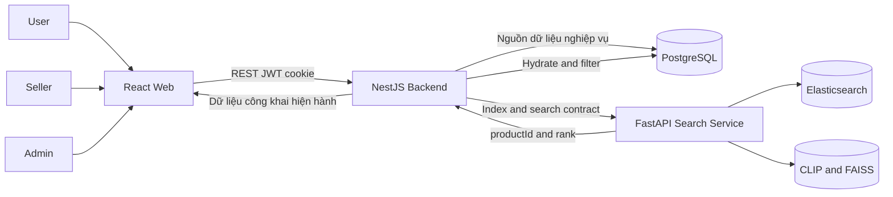
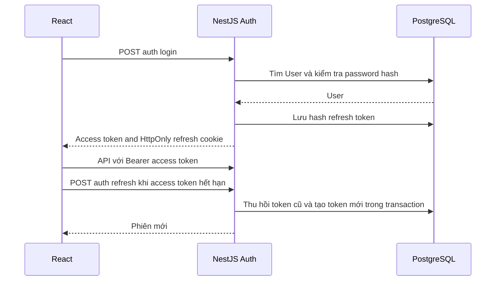
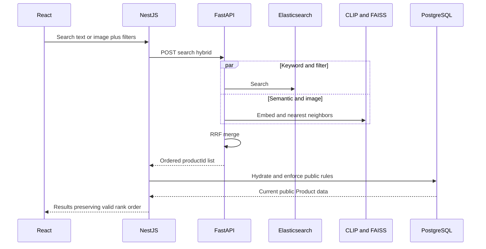

# Tổng quan kiến trúc và trạng thái hệ thống

Tài liệu này là điểm bắt đầu để thành viên và AI hiểu hệ thống trước khi đọc code hoặc sửa một chức năng. Nội dung trả lời bốn câu hỏi: hệ thống đang giải quyết bài toán gì, các thành phần phối hợp như thế nào, phần nào đã chạy thật, và cần đọc đâu để tiếp tục công việc mà không suy đoán.

Ảnh chụp trạng thái được cập nhật ngày **03/10/2026**, với `develop` tại `cff5b3c` (PR #8, #23 và #24 đã merge). Search Service và Backend Search sync là CURRENT ở mức code/test đã tích hợp; điều này không đồng nghĩa toàn bộ Web Search hoặc đánh giá chất lượng đã hoàn thành. Schema/migration Cart–Order–Inventory trên PR #26 vẫn là IN_PROGRESS, chưa merge; API checkout và state machine Order chưa triển khai. Kiến trúc và quyết định bền vững được duy trì tại đây; trạng thái PR mới nhất vẫn phải kiểm tra trên GitHub.

## 1. Cách đọc và nguồn chuẩn

Khi tài liệu mâu thuẫn, dùng thứ tự ưu tiên sau:

1. `AGENTS.md` và quy tắc an toàn repository.
2. `docs/project/implementation-scope.md` cho phạm vi P0, P1, P2 và Definition of Done.
3. Tài liệu thiết kế miền tương ứng trong `docs/architecture/`.
4. Contract API đã được các bên sở hữu cùng review.
5. Migration, code và test đã merge trên `develop` để xác định trạng thái triển khai thật.
6. Pull request mở để hiểu phần đang phát triển, chưa được xem là chức năng đã hoàn thành.

Các nhãn trạng thái trong tài liệu:

| Nhãn | Ý nghĩa | Có được báo cáo là đã hoàn thành không |
|---|---|---|
| `CURRENT` | Đã merge vào `develop`; có code hoặc tài liệu làm bằng chứng | Chỉ khi luồng tích hợp và điều kiện Definition of Done đã đạt |
| `IN_PROGRESS` | Đang ở branch, PR, prototype hoặc thiếu một lớp trong luồng | Không |
| `TARGET` | Đã chốt yêu cầu/thiết kế nhưng chưa có đủ code | Không |
| `P2` | Hướng mở rộng sau phạm vi khóa luận hiện tại | Không |

Một schema, endpoint Swagger, màn hình Figma hoặc test đơn lẻ không đủ để biến một release gate thành `DONE`.

## 2. Mục tiêu và ranh giới hệ thống

Hệ thống là sàn thương mại điện tử nhiều người bán và đa ngành hàng. Người dùng có thể mua hàng; sau quy trình mở Store và được duyệt, cùng tài khoản đó phải có khả năng bán hàng trong kiến trúc đích. Seller quản lý Store, sản phẩm, biến thể, ảnh, giá và tồn kho. Admin quản lý danh mục, duyệt Store và sản phẩm. User tìm sản phẩm bằng từ khóa, văn bản ngữ nghĩa hoặc hình ảnh, sau đó mua hàng, theo dõi đơn, chat và sử dụng các nghiệp vụ hậu mãi trong phạm vi khóa luận.

Dataset ABO Electronics chỉ là dữ liệu seed và corpus thực nghiệm. Nó không giới hạn hệ thống ở ngành điện tử và không quyết định schema nghiệp vụ.



## 3. Kiến trúc chạy và trách nhiệm thành phần

### 3.1 Frontend React

Thư mục `FE/` chứa ứng dụng React, TypeScript và Vite. React Router điều hướng các trang public, account, Seller và Admin. `AuthProvider` giữ phiên đăng nhập trong bộ nhớ, gọi refresh session khi tải lại trang và dùng `apiClient` làm điểm gọi Backend thống nhất.

Frontend không được tự quyết định quyền, giá, tồn kho, trạng thái duyệt hay trạng thái đơn. Nó hiển thị dữ liệu và gửi command; Backend xác thực lại mọi quy tắc nghiệp vụ.

### 3.2 Backend NestJS

**CURRENT — PR #24 đã merge:** bộ lọc listing `categoryId`/`brandId`/`inStock` được xử lý ở PostgreSQL và policy public trước khi đủ số kết quả một trang. `categoryId` có nghĩa là category đã chọn cùng toàn bộ nhánh con hoạt động, thống nhất với hybrid search khi người dùng nhập từ khóa. `inStock` chỉ tính variant bán hợp lệ; frontend dùng `nextCursor` để tải tiếp, kể cả sau trang rỗng. Xem [contract public listing](../api/product-moderation-public-api.md). Không đổi schema hoặc contract Search Service.

Form Product tại `FE/src/pages/SellerDashboardPage.tsx` dùng state cho tên/mô tả/category/brand: chọn Product nào nạp đúng dữ liệu Product đó, lỗi lưu giữ nguyên form, lưu thành công mới reset. Khóa thao tác trong khi request đang chạy ngăn gửi trùng. Nếu đã lưu nhưng reload danh sách lỗi, UI báo rõ đã lưu để tránh hiểu nhầm cần tạo lại. Listing/detail bỏ qua response cũ khi đổi truy vấn/Product. Các thay đổi này chưa đồng nghĩa hoàn thành toàn bộ UI Seller hoặc gate G-LISTING.

Thư mục `BE/` là modular monolith NestJS. Mỗi miền có controller, service, DTO, guard và test riêng nhưng chạy trong cùng một ứng dụng:

```text
HTTP request
→ Controller nhận DTO
→ ValidationPipe loại hoặc từ chối trường không hợp lệ
→ JWT and role guard xác thực actor
→ Service kiểm tra ownership và trạng thái
→ Prisma transaction đọc hoặc ghi PostgreSQL
→ Response DTO hoặc lỗi HTTP có cấu trúc
```

NestJS là lớp điều phối nghiệp vụ. Client không gọi trực tiếp PostgreSQL, Elasticsearch hoặc FAISS.

### 3.3 PostgreSQL và Prisma

PostgreSQL là nguồn dữ liệu chuẩn cho tài khoản, Store, catalog, sản phẩm, giá, tồn kho và các miền giao dịch sẽ được bổ sung. Prisma cung cấp schema, migration và client truy cập dữ liệu.

Mọi thay đổi database phải tạo migration mới. Không sửa migration đã merge. Những quy tắc có thể biểu diễn bằng foreign key, unique key và check constraint nên được bảo vệ ở database; ownership, state transition và quy tắc liên bảng phức tạp được kiểm tra trong service/transaction và phải có test.

### 3.4 FastAPI Search Service

Thư mục `AI_CLIP/` là ranh giới của Search Service. Kiến trúc đích giao cho FastAPI quản lý:

- Elasticsearch cho keyword search và filter.
- CLIP cho embedding ảnh và văn bản ngữ nghĩa.
- FAISS cho nearest-neighbor vector search.
- Reciprocal Rank Fusion để hợp nhất danh sách xếp hạng.

FastAPI chỉ trả `productId`, điểm và thứ hạng. NestJS phải đọc lại PostgreSQL, loại Product không còn công khai và hydrate dữ liệu hiển thị. Vì vậy index chậm không được làm sản phẩm đã ẩn xuất hiện công khai.

### 3.5 Docker và CI

Docker Compose trên `develop` hiện khởi động PostgreSQL. Frontend, Backend và Search Service chưa được đóng gói đầy đủ trong Compose chung.

Workflow `repository-checks` hiện kiểm tra fresh install bằng pnpm, whitespace, Docker Compose config, Prisma schema/migration/seed, lint, unit test và build của các workspace Node/Frontend/Backend, cùng Backend E2E trên PostgreSQL. Cùng workflow CI có job `ai-python-checks` (hiển thị `AI Service - Ruff and Pytest`), dùng Python 3.12 và chạy Ruff/Pytest cho `AI_CLIP/`; job này đã merge qua PR #8. Hai job xanh chứng minh các bộ kiểm tra tương ứng đã đạt, nhưng chưa thay thế CI xuyên dịch vụ thật hoặc kiểm thử luồng người dùng trên Web.

## 4. Bản đồ repository

| Vị trí | Trách nhiệm | Đọc khi nào |
|---|---|---|
| `FE/src/` | React UI, route, auth context và API client | Khi sửa màn hình hoặc luồng trình duyệt |
| `BE/src/` | NestJS controller, service, DTO, guard | Khi sửa API hoặc nghiệp vụ |
| `BE/prisma/` | Prisma schema, migration và seed | Khi thay đổi dữ liệu hoặc ràng buộc |
| `BE/test/` | E2E cho Auth, schema Product, Store/Catalog và seed | Khi xác minh hành vi tích hợp |
| `AI_CLIP/` | FastAPI, CLIP, FAISS, Elasticsearch và RRF | Khi sửa Search Service hoặc thực nghiệm |
| `docs/api/` | Contract giữa các dịch vụ | Trước khi đổi request/response |
| `docs/architecture/` | Quyết định kiến trúc theo miền | Trước khi sửa schema hoặc luồng chính |
| `docs/project/` | Phạm vi, phân công và release gate | Trước khi nhận task |
| `docs/analysis/` | Cơ sở nghiệp vụ và nguồn tham khảo | Khi viết SRS, ERD, Use Case hoặc báo cáo |
| `docs/testing/` | Ground truth, query và test artifact | Khi đánh giá Search hoặc nghiệm thu |
| `docs/data-quality/` | Quyết định làm sạch dataset | Khi import hoặc thay đổi metadata |

## 5. Quy tắc dữ liệu xuyên suốt

### 5.1 ID sản phẩm

- `productId` là số nguyên do PostgreSQL sinh và là ID dùng trong Backend, Elasticsearch và FAISS.
- `externalId` là mã truy vết tùy chọn của dữ liệu import, có dạng `<source>:<source-id>` như `abo:B07ABC123`.
- Prefix phụ thuộc nguồn. `abo:` không gắn vào sản phẩm từ nguồn khác; sản phẩm Seller tạo trực tiếp có `externalId = null`.
- Mapping gửi pipeline AI có dạng `{"externalId":"abo:B07ABC123","productId":125}`.

### 5.2 Product và Variant

`Product` giữ thông tin chung như tên, mô tả, Store, Category, Brand và trạng thái. `ProductVariant` giữ SKU, giá, tồn kho và trạng thái bán. Sản phẩm không có phân loại vẫn cần một variant mặc định để Cart và Order chỉ xử lý một mô hình.

Không thêm các cột cố định như `color`, `size`, `ram` vào Product. Thuộc tính mô tả theo Category và option tạo Variant là hai khái niệm khác nhau.

### 5.3 Nguồn chuẩn và index phụ trợ

```text
PostgreSQL commit thành công
→ tạo SearchOutbox cùng transaction
→ worker gửi productId and version tới FastAPI
→ FastAPI cập nhật Elasticsearch and FAISS
→ tìm kiếm trả productId
→ NestJS hydrate and filter bằng PostgreSQL
```

Elasticsearch và FAISS có thể xây lại. Không dùng chúng làm nguồn chuẩn cho giá, tồn kho, quyền sở hữu hoặc trạng thái công khai.

## 6. Trạng thái triển khai tại ngày 03/10/2026

| Miền | Trạng thái | Bằng chứng chính trên `develop` hoặc PR đang mở | Khoảng trống tiếp theo |
|---|---|---|---|
| Nền móng workspace và PostgreSQL | `CURRENT` | PR #3; pnpm workspace, NestJS, React, migration, Docker PostgreSQL | Compose toàn hệ thống và hướng dẫn demo hoàn chỉnh |
| Auth email and password | `CURRENT` | PR #4; register, login, refresh rotation, logout, `/auth/me`, JWT/RBAC test | Profile/address, verify/reset, OAuth, OTP và multi-role mục tiêu |
| Frontend shell | `CURRENT` | PR #13; router, layout, auth context, route guard, trang khung | Màn hình nghiệp vụ thật cho Store, Product, Cart, Order, Search |
| Product database schema | `CURRENT` | PR #10, #18 và #22; Store, catalog, Product/Variant, thuộc tính, ảnh, shipping, importer và lịch sử quyết định | Media private/signed URL và UI Seller/Admin đầy đủ vẫn thiếu |
| Store and Catalog API | `CURRENT` | PR #15; Seller Store lifecycle, Admin review, Category/Brand API, ownership và E2E | Store address/profile đầy đủ và UI Seller/Admin |
| CI quality gates | `CURRENT` | PR #16, #17, #19 và #8; CI kiểm tra pnpm/FE/BE, Backend E2E và job Python Ruff/Pytest cho Search Service | Tiếp tục theo dõi độ ổn định và bổ sung kiểm thử trình duyệt khi UI nghiệp vụ hoàn thiện |
| Product draft API and importer | `CURRENT` | PR #18 đã merge (`cbc3e40`): draft, option/attribute/variant, image lifecycle, shipping, submit và importer idempotent kiểm tra ảnh hỏng; có Backend E2E. Smoke đã tạo mapping 86 Product DRAFT | 86 Product chưa phải Public Product; private media/signed URL và UI vẫn thiếu |
| FastAPI Search Service và Backend Search sync | `CURRENT` | PR #8 và #23 đã merge: Elasticsearch, CLIP/FAISS, RRF, dual-index, version/idempotency, transactional outbox, worker, durable reconciliation và PostgreSQL hydrate/filter; integration local đã đạt | Hoàn thiện Web Search và đánh giá chất lượng bằng ground truth độc lập ở PR #25 |
| SRS, Use Case and ERD | `CURRENT` (tài liệu) | PR #5 đã merge; SRS v3.1 ở `docs/analysis/hien/srs-v3.md`; 13 Use Case, 60 test case thiết kế. PR #21 bổ sung consensus pilot Search | Test case thiết kế không đồng nghĩa PASS; duy trì truy vết yêu cầu–API–test khi từng PR được nghiệm thu |
| Public Product and moderation | `CURRENT` | PR #22 và #23: Admin approve/reject/freeze, Seller hide/show, public list/detail, predicate chung, ProductStatusHistory, SearchOutbox/reconciliation và E2E | Media privacy và Admin/Seller/Public UI đầy đủ vẫn thiếu |
| Cart, Order, COD and inventory transaction | `IN_PROGRESS` | PR #26: schema/migration nền cho Address, Cart, Checkout, Order snapshot, Payment COD và StockMovement đã được review; chưa merge vào `develop` | Sau khi merge schema: triển khai API checkout transaction cạnh tranh kho, state machine, FE và E2E end-to-end |
| Chat User and Seller | `TARGET` | `chat-domain-design.md` | Schema, REST/WebSocket, UI và E2E quyền/reconnect |
| Review, Admin dashboard and notification | `TARGET` | Phạm vi P0 | Schema/API/UI/test |
| Verify/reset, OAuth, OTP, payment sandbox and returns | `TARGET P1` | `implementation-scope.md` | Chỉ triển khai sau dependency P0 tương ứng ổn định |

Trạng thái này không tự cập nhật. Khi một PR được merge, người phụ trách phải sửa dòng liên quan, cập nhật ngày ảnh chụp và dẫn chứng test. Không xóa khoảng trống còn tồn tại chỉ vì một lớp riêng lẻ đã có code.

## 7. Các luồng cần hiểu

### 7.1 Auth hiện tại



Trạng thái hiện tại vẫn dùng một `Role` cho mỗi User. Yêu cầu cùng tài khoản vừa mua vừa bán là `TARGET` và cần migration/Auth/UI/test riêng; không được mô tả là đã hoạt động.

### 7.2 Store hiện tại

Seller tạo một Store ở `PENDING`. Admin có thể chuyển `PENDING` sang `ACTIVE` hoặc `REJECTED`; Store bị từ chối được Seller sửa và nộp lại trên cùng bản ghi. Admin có thể chuyển `ACTIVE` sang `SUSPENDED` và khôi phục lại. Mỗi thay đổi ghi `StoreStatusHistory`; service dùng cập nhật có điều kiện để chống hai request ghi đè trạng thái của nhau.

### 7.3 Product và import dataset

```text
products.jsonl plus image folder
→ dry-run validate schema, externalId, category and safe relative paths
→ upsert by externalId without overwriting unrelated business edits
→ PostgreSQL assigns productId
→ ingest valid image into managed storage
→ keep incomplete Product as DRAFT
→ export externalId to productId mapping
→ rebuild FAISS and Elasticsearch with official productId
```

Code importer đã merge qua PR #18. Lượt smoke đã import 86 Product DRAFT, kiểm tra PostgreSQL và xuất mapping 86 cặp cho Đạt rebuild FAISS. Mapping xác nhận ID kỹ thuật; việc công khai từng Product vẫn phải qua hoàn thiện dữ liệu, submit và Admin duyệt.

### 7.3.1 Phần mới: quyết định duyệt và đọc Product công khai

**CURRENT — PR #22 đã merge.** Contract cụ thể ở [Product moderation/public API](../api/product-moderation-public-api.md).

```text
Seller submit (PR #18) → ACTIVE/PENDING, version N
→ Admin đọc chi tiết và gửi approve/reject kèm version N
→ Serializable transaction kiểm tra version/trạng thái/điều kiện bán
→ Product đổi trạng thái + tăng version + ghi ProductStatusHistory
→ commit → public list/detail kiểm tra lại PostgreSQL → response chỉ có dữ liệu hiển thị
```

`ProductLifecycleService` xử lý quyết định và hide/show. `product-public-policy.ts` là nơi đọc quy tắc công khai: Store/account, category và tổ tiên, ảnh, required attributes, kiện hàng và variant hợp lệ. Public list và detail gọi cùng quy tắc để không có chuyện bị ẩn ở danh sách nhưng còn mở được qua URL chi tiết. Giá/tồn kho vẫn thuộc Variant; hàng hết kho được hiển thị với `inStock:false`.

Ví dụ: Admin đang xem version 7, Seller hoặc request khác đã làm Product thành version 8 thì quyết định cho version 7 nhận 409. Admin phải tải lại nội dung. Product và history cùng transaction nên không có tình trạng đổi kết quả duyệt nhưng mất lịch sử. Hai service instance vẫn được bảo vệ bằng version và Serializable; khóa process chỉ bổ trợ việc publish ảnh.

Seller hide chuyển ACTIVE/APPROVED thành HIDDEN/APPROVED. Show chỉ được phép khi APPROVED và đủ điều kiện. Admin freeze chặn Seller tự mở lại. Sửa nội dung APPROVED theo PR #18 đưa về DRAFT/NOT_SUBMITTED, vì thế public ngừng trả ngay dù Search index chưa đồng bộ.

File cần đọc theo thứ tự:

1. `BE/src/product/admin-product.controller.ts`, `public-product.controller.ts` và route visibility ở `seller-product.controller.ts`.
2. `BE/src/product/product-lifecycle.service.ts`: transaction, phiên bản, lịch sử và phân trang.
3. `BE/src/product/product-public-policy.ts`: điều kiện hiển thị và dữ liệu được phép trả.
4. `BE/prisma/schema.prisma` → `ProductStatusHistory`; migration `20260925120000_product_status_history` chỉ thêm bảng, không sửa Product cũ.
5. `BE/test/product-lifecycle.e2e-spec.ts`: ca thành công, từ chối, race, rollback và public filtering.

**Chưa làm trong đợt này:** thông báo, media private/signed URL, gỡ FROZEN và UI đầy đủ. Bảng history mới ghi quyết định Admin/hide/show, chưa phải audit toàn bộ nội dung. Public endpoint bảo vệ JSON; bảo vệ file ảnh draft là đầu việc storage riêng. SearchOutbox, worker và durable reconciliation đã merge qua PR #23.

### 7.4 Tìm kiếm đích



Hoàng và Đạt đã thống nhất version, UPSERT/DELETE, filter, image URL theo môi trường, lỗi và retry trong `docs/api/ai-service-contract.md`. PR #8 và #23 đã merge: Search Service, SearchOutbox/worker, reconciliation và PostgreSQL hydrate/filter đều đã có code và kiểm thử. Phần chưa đạt là trải nghiệm Web Search hoàn chỉnh và đánh giá chất lượng bằng bộ ground truth độc lập.

### 7.5 Checkout đích

Cart tham chiếu `variantId`. Khi checkout, Backend phải đọc lại Product/Variant, giá và tồn kho; tạo Order và OrderItem snapshot, trừ kho và ghi lịch sử trong transaction. Client không gửi giá cuối cùng để Backend tin trực tiếp. Giỏ nhiều Store được tách thành Order theo Store. PR #26 đang bổ sung schema/migration nền; API checkout transaction và state machine vẫn là bước tiếp theo, chưa được mô tả là đã hoàn thành.

### 7.6 Chat đích

Một Conversation duy nhất cho cặp User-Store; Product chỉ là ngữ cảnh tùy chọn. Tin nhắn được commit vào PostgreSQL trước khi phát WebSocket. `clientMessageId` chống gửi trùng, read state chỉ tiến về phía trước và Backend kiểm tra membership ở cả REST lẫn socket. Đây là `TARGET`; chi tiết ở `chat-domain-design.md`.

## 8. Cách lần theo một chức năng trong code

Khi không hiểu AI đã làm gì, không đọc ngẫu nhiên toàn repo. Dùng trình tự sau:

1. Đọc dòng trạng thái của miền trong mục 6.
2. Đọc tài liệu thiết kế miền và contract liên quan.
3. Xem PR/commit được dẫn làm bằng chứng và đọc phần Files changed.
4. Tìm route bằng `rg -n "@(Controller|Get|Post|Patch|Delete)" BE/src`.
5. Từ controller đi tới service, DTO, guard rồi Prisma model/migration.
6. Tìm test bằng tên route, service hoặc model trong `BE/test`, `BE/src` và `FE/src`.
7. Đối chiếu Frontend route, page, context và `apiClient` nếu luồng đã có UI.
8. Chạy đúng test/lint/build được ghi trong PR; không chỉ tin tóm tắt của AI.

Ví dụ Store:

```text
BE/src/store/store.controller.ts
→ BE/src/store/store.service.ts
→ BE/prisma/schema.prisma models Store and StoreStatusHistory
→ BE/prisma/migrations/20260918160000_store_onboarding_lifecycle
→ BE/test/store-catalog.e2e-spec.ts
```

## 9. Quy tắc ghi lại công việc của AI

Mỗi PR chức năng phải để người khác trả lời được các câu hỏi sau mà không cần lịch sử chat của AI:

- Chức năng và actor nào đang được xử lý?
- Trạng thái trước và sau thay đổi là gì?
- File, schema, migration, endpoint và màn hình nào bị ảnh hưởng?
- Quy tắc ownership, validation, transaction và idempotency nằm ở đâu?
- Test nào chứng minh happy path, sai quyền, trạng thái lỗi và request lặp?
- Contract hoặc tài liệu kiến trúc nào được cập nhật?
- Phần nào vẫn chưa làm và PR tiếp theo phụ thuộc điều gì?

PR description là nhật ký của task đang làm. Sau khi merge, kiến thức bền vững phải được chuyển về tài liệu miền và cập nhật bảng trạng thái trong file này. Không dùng một file `task_on_progress` lâu dài làm nguồn chuẩn vì nó dễ lỗi thời sau merge.

Nếu task kéo dài qua nhiều phiên AI, branch có thể dùng file tạm không commit để ghi:

```text
Mục tiêu
Đã đọc
Đã thay đổi
Đã kiểm tra
Đang vướng
Bước tiếp theo
Rủi ro và giả định
```

Trước khi bàn giao, đưa nội dung cần giữ vào PR/tài liệu chính thức và xóa file tạm khỏi staged files.

## 9.1. Search sync — trạng thái sau merge PR #8/#23 ngày 03/10/2026

**CURRENT — PR #8 và #23 đã merge vào `develop`.** PR #22 đã cung cấp Product moderation/public; PR #23 bổ sung transactional outbox, worker, durable reconciliation, runtime image repair và PostgreSQL hydrate/filter. Luồng tích hợp local đã được kiểm chứng theo [contract Backend–Search Service](../api/ai-service-contract.md#bằng-chứng-tích-hợp-backendsearch-service). Không hiểu việc có worker hoặc CI xanh là đã hoàn thiện toàn bộ trải nghiệm tìm kiếm trên Web hay đạt chất lượng retrieval.

Luồng đã có trên `develop` sau PR #23:

1. Admin duyệt/từ chối/đóng băng hoặc Seller ẩn/hiện: Product tăng version, lịch sử trạng thái và SearchOutbox được ghi **trong cùng Serializable transaction**. Ghi outbox thất bại thì toàn bộ quyết định rollback; không còn ghi best-effort sau commit.
2. UPSERT chứa categoryId, categoryName, categoryPathIds lấy từ cây category PostgreSQL, brandId/brandName nullable, attributes dạng danh sách chuỗi và giá dạng chuỗi. DELETE giữ productId/version của event.
3. Worker lấy event tới hạn, tăng attemptCount khi claim. attemptCount đồng thời là fencing token: worker cũ không được ghi đè kết quả của worker đã thu hồi lease. updatedAt là mốc lease 60 giây; HTTP timeout 10 giây. Event không bị sửa payload/reset attempt khi upsert lại cùng version.
4. HTTP 200 chỉ được công nhận khi phản hồi khớp productId/version/operation và outcome/index status hợp lệ. HTTP 409 và lỗi HTTP vĩnh viễn được lưu FAILED + processedAt khác null, không tự retry. Lỗi mạng/5xx retry sau 30s, 120s, 300s, 900s, tối đa 3600s. Không tự mở lại lỗi terminal bằng cách sửa payload cùng version.
5. Hydrate kiểm tra lại điều kiện public, category/brand và giá/tồn kho trên **cùng một Variant**, loại ID trùng, giữ thứ tự tương đối và giới hạn topK. Giới hạn gửi AI: topK ≤ 50, candidateK ≤ 150, candidateK ≥ topK, minPrice ≤ maxPrice.
6. Seller sửa nội dung, ảnh, Variant hoặc shipping của Product đã APPROVED: Product được hạ về DRAFT/NOT_SUBMITTED, tăng version và ghi DELETE SearchOutbox trong cùng transaction. Nếu ghi outbox thất bại thì mutation rollback.
7. Upload ảnh áp dụng khóa theo Product cho tới khi publish/compensation kết thúc. Nếu publish file thất bại, compensation xóa bản ghi ảnh mới, khôi phục ảnh chính, tăng version theo chiều tiến và ghi event SearchOutbox tương ứng. Compensation retry tối đa 3 lần; Product còn bản ghi ảnh thiếu file sẽ bị chặn submit để không duyệt dữ liệu hỏng.
8. Reconciliation quét Product theo cursor, đọc lại canonical state trong transaction Serializable và ghi `version + outbox` nguyên tử với optimistic version check. Fan-out không còn dựa vào Promise trong memory: Store, Category, Brand, Seller eligibility và category-attribute rule tạo `SearchReconciliationJob` trong cùng transaction với parent mutation. Worker claim bằng attempt fencing + lease, lưu cursor sau từng page, retry có exponential backoff và chuyển `DEAD` sau 8 lần. API trả kèm job ID/status để không mô tả invalidation là đã hoàn tất khi mới được chấp nhận.
9. Image repair chỉ xử lý URL thuộc managed uploads, dùng khóa theo Product, bỏ bản ghi thiếu file, khôi phục ảnh chính và tăng version nguyên tử. Nếu Product đang APPROVED, repair hạ về DRAFT/NOT_SUBMITTED và phát DELETE để bắt buộc duyệt lại. `ProductImageRepairWorker` là runtime path: cron chạy mỗi phút, chống hai lượt chạy chồng trong cùng tiến trình và áp dụng exponential backoff tối đa một giờ khi một lượt có lỗi. Từng Product được cô lập lỗi nên một Product hỏng không dừng cả batch; E2E tắt cron theo thời gian và gọi đúng entry point `runBatch()` của worker. Khóa hiện là khóa trong một process; khi triển khai nhiều Backend replica phải thay bằng distributed lock hoặc database lease.

### Dependency và search invalidation

| Mutation | Ảnh hưởng | Cơ chế |
|---|---|---|
| Product content/status/image | payload hoặc public eligibility | Product version + SearchOutbox trong cùng transaction |
| Variant price/stock/active/options | min/max price, inStock hoặc eligibility | Product version + SearchOutbox trong cùng transaction |
| Shipping weight | public eligibility | Product version + SearchOutbox trong cùng transaction |
| Store ACTIVE/SUSPENDED | public eligibility của toàn Store | Durable job `STORE` |
| Seller account isActive | public eligibility của toàn Seller | Durable job `SELLER` |
| Category name/parent/isActive | path, category name hoặc eligibility của cây con | Durable job `CATEGORY` |
| Brand name/isActive | brand payload hoặc eligibility | Durable job `BRAND` |
| Required/active/type/custom rule của category attribute | eligibility hoặc attribute payload | Durable job `CATEGORY` |

Mỗi job chỉ xác định phạm vi cần quét, không chứa snapshot Product. Khi xử lý, worker đọc lại PostgreSQL; vì vậy mutation mới hơn trong thời gian chờ luôn thắng. Elasticsearch và FAISS tiếp tục là derived index.

Kiểm thử E2E tắt cron và chỉ cho worker lấy event thuộc fixture của test; không gửi event dataset demo sang AI. PostgreSQL vẫn là nguồn chuẩn. Retry transaction nhận cả Prisma P2034 và lỗi serialization/deadlock từ pg adapter, tối đa 5 lần có backoff; không hạ isolation để tránh conflict.

**Đã merge:** durable reconciliation có checkpoint (mốc tiếp tục xử lý), lease (quyền xử lý có thời hạn), fencing (chặn worker cũ ghi đè) và retry. Contract hiện hành nằm tại `docs/api/ai-service-contract.md`, được đối chiếu với Pydantic models và contract tests trong `AI_CLIP/`; PR #8 không còn Draft. Luồng tích hợp Backend–FastAPI–Elasticsearch–FAISS–hydrate đã chạy local ngày 28/09/2026. Thay đổi contract tiếp theo vẫn phải được Hoàng–Đạt review, không tự thay đổi chỉ vì hai PR đã merge.

**Khoảng trống còn lại, không nhận là đã hoàn thành:**

- Hoàn thiện và nghiệm thu Web Search end-to-end cho các kiểu truy vấn; PR #24 đã cung cấp listing/filter và UI nền, chưa đủ để chốt toàn bộ gate G-DISCOVERY.
- Đánh giá chất lượng bằng ground truth độc lập. Công cụ/workflow ở PR #25 còn đang mở; chỉ công bố Precision/Recall sau khi nhãn và bằng chứng đánh giá đủ điều kiện, không dùng self-match ảnh catalog làm kết quả chất lượng.
- Tự dựng toàn bộ chuỗi PostgreSQL–Backend–FastAPI–Elasticsearch trong CI. Các job Backend E2E và AI Ruff/Pytest hiện chạy riêng, không phải bằng chứng CI xuyên dịch vụ.
- Kiểm chứng crash/recovery bằng nhiều Backend process thật; E2E hiện mô phỏng phục hồi. Khóa image publish/repair còn trong một process; trước khi chạy nhiều replica cần distributed lock hoặc database lease (khóa dùng chung/quyền xử lý ở DB), cùng test cạnh tranh tương ứng.

Bộ E2E dùng chung PostgreSQL và biến môi trường `UPLOAD_ROOT`, vì vậy các file E2E chạy tuần tự (`fileParallelism: false`). Đây là cô lập môi trường kiểm thử, không phải giới hạn xử lý đồng thời của ứng dụng production.

## 10. Definition of Done rút gọn

Một chức năng chỉ được gọi là hoàn thành khi có đủ phần cần thiết trong luồng: migration/database, Backend, Frontend, phân quyền, validation, lỗi, test, tài liệu và bằng chứng chạy trên nhánh tích hợp. Với đồng bộ tìm kiếm, tồn kho, thanh toán, hậu mãi và notification, phải có test request lặp và lỗi dịch vụ phụ trợ.

Các lệnh kiểm tra cơ sở:

```powershell
pnpm install --frozen-lockfile
pnpm prisma:validate
pnpm lint
pnpm test
pnpm build
pnpm --dir BE test:e2e
docker compose config --quiet
```

Với thay đổi trong Search Service, chạy thêm từ thư mục `AI_CLIP/`:

```powershell
ruff check app tests
pytest
```

Hai lệnh Python trên đã được job `ai-python-checks` thực thi trên GitHub Actions từ PR #8. Người bàn giao phải đối chiếu đúng head và kết quả của cả `repository-checks` lẫn `AI Service - Ruff and Pytest`; chỉ check Backend xanh không đủ để kết luận code AI đạt. CI chưa tự dựng luồng xuyên dịch vụ hoặc đánh giá Precision/Recall. Chỉ chạy các lệnh phù hợp với task, nhưng phải ghi rõ lệnh nào chưa chạy và lý do.

## 11. Chỉ mục tài liệu chi tiết

- Phạm vi và release gate: [`../project/implementation-scope.md`](../project/implementation-scope.md)
- Phân công: [`../project/work-assignment.md`](../project/work-assignment.md)
- Nghiệp vụ sàn: [`../analysis/marketplace-business-processes.md`](../analysis/marketplace-business-processes.md)
- Product domain: [`product-domain-design.md`](product-domain-design.md)
- Kế hoạch triển khai Product: [`product-implementation-plan.md`](product-implementation-plan.md)
- Cart, Order và Inventory: [`cart-order-inventory-design.md`](cart-order-inventory-design.md)
- Chat domain: [`chat-domain-design.md`](chat-domain-design.md)
- Backend and AI contract: [`../api/ai-service-contract.md`](../api/ai-service-contract.md)
- Quy trình Git: [`../git/team-task-delivery-guide.md`](../git/team-task-delivery-guide.md)
- Dataset QA: [`../data-quality/README.md`](../data-quality/README.md)
- Test and ground truth: [`../testing/README.md`](../testing/README.md)

## 12. Quy tắc duy trì tài liệu

- Thay đổi ranh giới thành phần hoặc nguồn dữ liệu phải cập nhật mục 3 và sơ đồ.
- Thay đổi ID, payload hoặc endpoint liên dịch vụ phải cập nhật contract tương ứng và có đúng reviewer.
- Migration mới phải cập nhật mô hình dữ liệu và trạng thái miền.
- PR merge làm thay đổi mức triển khai phải cập nhật mục 6 trong cùng PR hoặc PR docs ngay sau đó.
- Tài liệu `TARGET` không được tự đổi thành `CURRENT`; phải có link commit/PR, test và kết quả tích hợp.
- Các ví dụ dữ liệu không được chứa secret, đường dẫn máy cá nhân hoặc dataset lớn.
