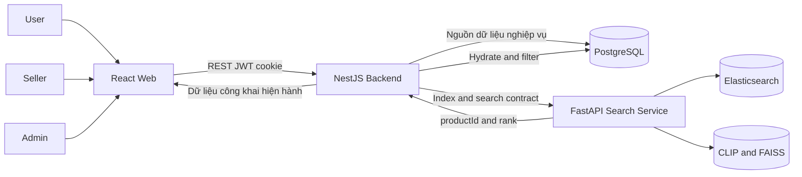
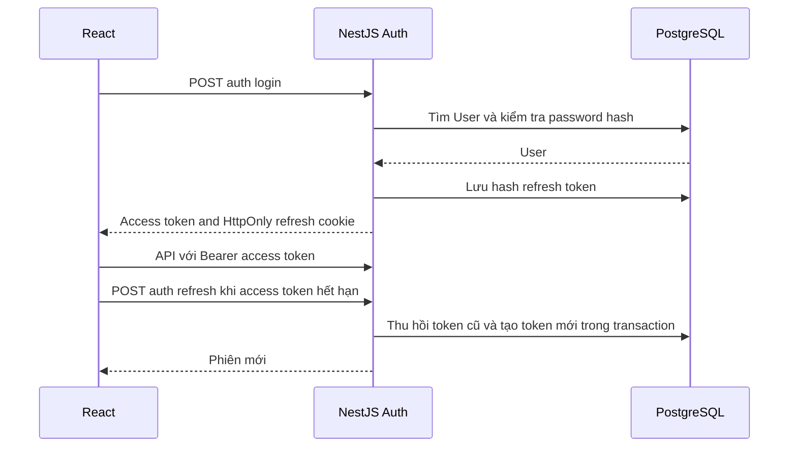
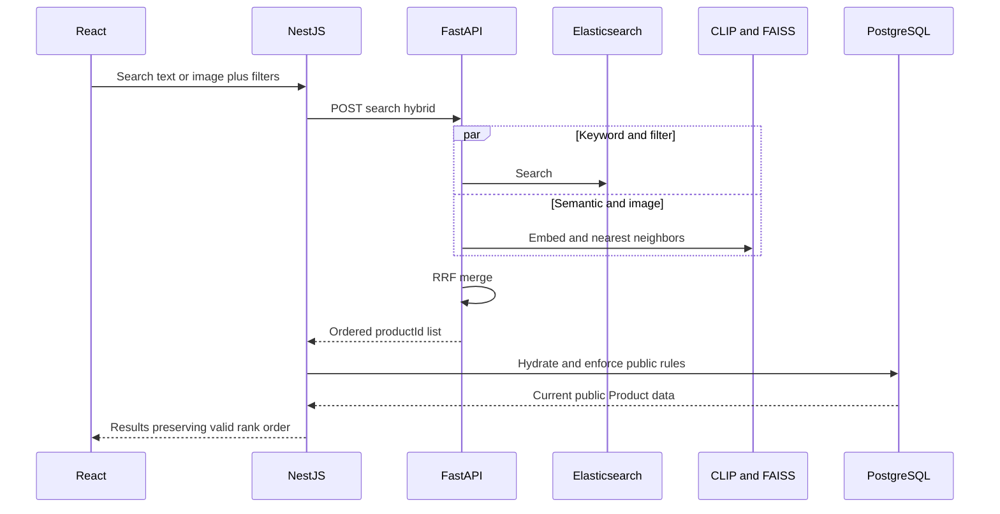

# Tổng quan kiến trúc và trạng thái hệ thống

**Đồng bộ 23/10/2026:** nhận develop `66c5756` sau merge Backend Attributes
#94, toolkit #105 và Account settings #108. Các ghi chú “chưa merge” ngày22/10
dưới đây là lịch sử của PR; API ghi
Attributes đã có trên develop, nhưng chưa nghiệm thu editor UI của Hiền.
Không thay contract hoặc schema tìm ảnh trong lượt đồng bộ này.

**Image query gateway — REVIEW23/10:** nhánh Backend nối multipart JPEG/PNG
tới FastAPI image endpoint hiện có, không đổi AI/schema. Memory/pixel/decode,
quota/deadline/body cap và strict wire validator nằm trước shared PostgreSQL
hydrate; ảnh truy vấn không lưu. Chưa Web upload/loaded CLIP–FAISS acceptance.
[Luồng, biến, giới hạn và test](../api/image-search-gateway.md).

**Account settings —23/10/2026, runtime PR:** tên hiển thị CAS và đổi mật khẩu
có kiểm mật khẩu hiện tại; User row lock dùng chung login/refresh/password.
Hai migration mới thêm credentialVersion và audit bất biến; hash/version/revoke
mọi refresh/audit cùng giao dịch, JWTcv chặn phiên cũ ở request mới. Web giữ
boundary tài khoản, không replay password khi mất response và yêu cầu đăng nhập
lại. Hai cờ write/UI mặc định tắt; phạm vi tích hợp được ghi tại PR #108,
không hoàn thành toàn bộ profile,
onboarding hoặc reset/verify P1. Phải migrate trước Auth code và nâng cấp đủ
replica trước bật ghi. [API/biến/rollout](../api/account-settings.md),
[kiểm thử và giới hạn](../testing/account-settings-2026-10-23.md).

**Attributes QA handoff / timeout —22/10/2026, PR review:** lock/query timeout
55P03/57014 trả503/Retry-After:1, không replay giao dịch. Thêm launcher opt-in
kiểm target/role/migrations, tạo bundle mới gồm2Admin/Seller/Buyer và đủ4kiểu
thuộc tính; credentials chỉ ở artifacts Git-ignored trên máy nhận. Compose QA
riêng5549 và API loopback3014 không dùng DB demo. Không migration hoặc thay
contract Search; chưa merge/chưa bật editor. [Chạy và giới hạn](../testing/attributes-editor-handoff-2026-10-22.md).

**Attributes write runtime — REVIEW, 22/10/2026:** branch
`codex/admin-attribute-write-api` từ develop `e394c9e`, sau merge chính thức
#83/#87/#92/#89/#90/#85/#75/#84/#59. Bốn POST/PATCH definition/options đã nối
controller → policy → shared Category fence → revision/audit/durable Search job
trong cùng giao dịch. Seller create/value/move/submit cùng giao thức, public/Search
bỏ optional value không còn hợp lệ; không thay Order snapshot hoặc migration.
Đây là PR runtime mới, **chưa merge/chưa editor UI**, không dùng approval nền
thay runtime review. [Luồng và biến](changes/attributes-write-api-2026-10-22.md),
[API](../api/admin-category-attributes-write-runtime.md),
[kiểm thử đúng nền mới](../testing/attributes-write-api-promotion-2026-10-22.md).
Các ghi chú ngày cũ dưới đây là lịch sử, không thay trạng thái nền đã merge.
**Seller Order Web — 23/10/2026, runtime promotion:** route chi tiết nối ba
bước xác nhận → đóng gói → sẵn sàng bàn giao, mặc định bật và có build
kill-switch chỉ đọc. Không POST khi mount/reload; confirmation/resolve tách
riêng, giữ key khi unknown và chỉ retryGET khi receipt đã biết. Không đổi
Backend/schema/Auth. Chrome11case đạt trên QA; chưa Seller hủy/nhận hàng hoàn,
Admin delivery UI hoặc full marketplace DONE. [Luồng/biến](seller-order-web-production.md),
[bằng chứng/giới hạn](../testing/seller-order-web-production-2026-10-23.md).

**#40 đồng bộ 20/10/2026:** nhận develop `2f78a98`; giữ toàn bộ route thật
Address/Cart/Checkout/Order và Admin shell riêng. Màn mẫu chỉ ở `/dev` khi DEV,
không thay nghiệp vụ thật. 680 FE PASS/6 live SKIP, build/lint PASS;
browser/API/DB bản kết hợp chưa chạy. [Báo cáo](../testing/pr40-post71-sync-2026-10-20.md).
**Chat SQL experiment21/10:** thêm script fixture riêng chứng minh sequence
theo hội thoại, replay/payload conflict và rollback;4nhóm assertion PostgreSQL
PASS. Không schema/API/socket/Chat runtime hoặc tự đổi cursor contract.
[Cách kiểm lại và gate](../testing/chat-sequence-experiment-2026-10-21.md).
**Đồng bộ PR #51 ngày 20/10/2026:** nền `develop 2f78a98` sau merge Brand #71.
Giữ công cụ QA prepare/serve/verify cùng phần client Checkout. Cart #50 đã merge; fixture/API smoke QA không thay nghiệm thu luồng Order hoặc Checkout Web.
Những mục ảnh chụp 10/10 phía dưới là lịch sử, không thay trạng thái mới này.
Giữ cả bước CI kiểm tra guard QA và bộ kiểm tra evaluation Python từ develop.
Build Backend và 10 guard test đã đạt trên bản kết hợp; chưa chạy lại API/DB
handoff hoặc trình duyệt trong lượt đồng bộ này, không dùng kết quả cũ thay thế.
**Order concurrency QA — 22/10/2026, IN_PROGRESS:** nhánh test riêng bỏ khóa
Seller do observer giữ trong lúc polling; hai transaction thật gặp nhau trước
khóa User, rồi PostgreSQL tự quyết định conflict/replay. Bổ sung ca đồng bộ
chậm và ca hai request hết hạn khóa thật rồi retry cùng key. Không đổi runtime,
schema, timeout hoặc bật Buyer Web; nguyên nhân chính xác của409/409 lịch sử
vẫn chưa đủ trace để kết luận. [Cơ chế, bằng chứng và giới hạn](../testing/order-concurrency-test-isolation-2026-10-22.md).

**Đồng bộ #91 sau merge #93 — 22/10/2026:** nhận develop `966f146`.
Giữ kernel PREPARATION và bản sửa Search chờ đúng durable job. Không thay
production kernel, schema hoặc bật API ghi; kết quả lịch sử bên dưới giữ nguyên.
Kiểm thử bản kết hợp được ghi riêng, không dùng approval cũ thay re-review.

**Attributes canonical usage — 21/10/2026:** kernel #91 bổ sung count tổng
options/active options/Product trực tiếp của Category, cùng snapshot sau fence,
không tin usage từ UI. 36case PostgreSQL/795unit đạt; full E2E lượt mới còn lỗi
test Search khi hàng đợi dài, đang sửa riêng; chưa coi API ghi đã hoàn thành.
Chi tiết và giới hạn ở báo cáo kernel bên dưới.

**Sau #86/#73 — 21/10/2026:** nhận develop `be568e0`, giữ Accounts
production và Attributes DEV/read preparation; không bật Backend ghi mới.
Runtime riêng của nhánh giữ nguyên, conflict chỉ tài liệu kiến trúc.

**Attributes transaction boundary — PREPARATION21/10/2026:** nhánh riêng từ
developfa85f66, đã nhận #88/develop `d84381a`, thêm kernel chưa đăng ký
provider/controller. Có đường tạo definition mới với revision1/audit/job atomic;
không gọi đó là create API. User SHARE → Category
MVCC write fence → definition UPDATE/CAS; usage đọc trong transaction, canonical
audit + optional durable job nguyên tử, final signature chặn trạng thái lệch sau
audit. Chưa create-definition API, normalized uniqueness, full policy hoặc shared
writers production; không nhận Backend Attributes/Hiền editor đã hoàn thành.
[Luồng/biến/gate](attribute-write-transaction-boundary.md) và
[kiểm thử có giới hạn](../testing/attribute-transaction-boundary-2026-10-21.md).

**Search regression — 21/10/2026:** test Store/Category/Brand/Seller invalidation
chờ đúng durable job thay vì giả định một batch20 đã xử lý mọi việc. Đã tái lập
bằng21job fixture của Category rỗng; worker/runtime/schema không đổi. Full
670E2E PASS/20TODO trên QA riêng; không phải live dual-index nghiệm thu mới.
[Root cause và bằng chứng](../testing/search-reconciliation-queue-regression-2026-10-21.md).

**Tích hợp sau Accounts #86 — 21/10/2026:** #86 đã merge tại `e409335`.
Nhánh #73 giữ cả reader Accounts production và Attributes DEV/read preparation;
không mở ghi Attributes hoặc khóa/mở Accounts. Conflict chỉ ghi chú kiến trúc.

**Attributes #73 — 21/10/2026:** nhận develop `d84381a` gồm read foundation
#77, Accounts #81, Buyer #74 và guard DB E2E #88. DEV entry dùng Auth/GET thật,
PostgreSQL riêng16migrations; browser read/filter/cursor/role/logout và45HTTP/DB
checks đạt, FE821PASS/6liveSKIP. Không gắn Catalog production, không bật ghi;
hai profile độc lập và live race/network chưa chạy, toàn Admin/G3 chưa nghiệm thu.
[Bằng chứng và giới hạn](../testing/pr73-live-read-qa-2026-10-21.md).

**Accounts #86 — sau #88,21/10/2026:** nhận develop `d84381a` tại `d3949cb`;
conflict chỉ ghi chú kiến trúc, giữ cả Accounts và E2E safety. Runtime FE/BE/
Prisma/AI nguyên byte so3f82a70. Bổ sung bằng chứng browser đúng3f82a70 cho
59User/3Store, network/timeout/logout và role; sau sync722FE/14guardDB PASS,
lint/build/typecheck đạt. [Báo cáo và giới hạn](../testing/pr86-post88-qa-2026-10-21.md).
Hai profile Admin và status hardening chưa nghiệm thu; giữ Draft chờ re-review.
Các kết quả baseline cũ bên dưới giữ lịch sử, không đổi nhãn thành lần chạy mới.

**Accounts #86 — sync sau #74,21/10/2026:** nhận develop `fa85f66` tại
`c4d6a83`, giữ nguyên FE đã được Hoàng approve ở `f8648f3` và toàn Backend Buyer
đã merge. Conflict chỉ ghi chú kiến trúc, giữ cả hai phía. Giới hạn/bằng chứng
bản kết hợp:722FE PASS/6liveSKIP,751BE unit và73E2E chọn lọc PASS; lint/build/
typecheck và16fresh migration đạt trên DB riêng. [Báo cáo sau #74](../testing/pr86-post74-sync-2026-10-21.md).
Chưa browser mới/hai Admin độc lập, chưa bật khóa/mở hoặc nghiệm thu toàn Admin.
Các bảng kiểm theo baseline phía dưới giữ lịch sử, không đổi nhãn QA cũ.

**Accounts UI integration — IN_PROGRESS,21/10/2026:** sau #81 merge thật tại
`76a62c9`, nhánh riêng nối reader đã duyệt vào `/admin/users` và mục Tài khoản,
AuthContext/GET thật, không bật khóa/mở. Giữ Brand/Catalog, Checkout/Order và
shared Auth/client; không Backend/schema mới trong delta. Đã nhận develop
`bf6f926` (#77) tại `d0b8c49`, giữ đủ ghi chú Accounts/Attributes; kiểm lại722FE
PASS/6liveSKIP,709BE unit PASS, typecheck/lint/build và15migration QA riêng.
Cả FE/BE mới đã QA browser/DB cho pagination/filter/Store
CLOSED/SUSPENDED/null, logout và chặn Buyer/Seller. Hai profile Admin độc lập
vẫn NOT_RUN; chưa toàn Accounts/Admin/G3 DONE. [Bằng chứng và giới hạn](../testing/admin-accounts-integration-2026-10-21.md).
Ghi chú theo ngày bên dưới giữ lịch sử tại baseline tương ứng.

**An toàn E2E — 21/10/2026, #88 đã merge:** `setup-env` không được đọc
`.env` local hoặc ghi đè URL QA. Chốt target trước test collection, chỉ nhận DB
QA riêng hoặc service CI đã cấu hình. Đã có sự cố runner chọn nhầm demo do
`override: true`; lượt FAIL không là bằng chứng nghiệp vụ, không tự dọn dữ liệu.
[Nguyên nhân, ảnh hưởng quan sát được và kiểm chứng](../testing/e2e-database-target-safety-2026-10-21.md).

**Buyer #74 — đồng bộ 21/10/2026:** nhận develop `bf6f926` sau merge #77/#81.
Giữ runtime/migration Buyer và foundation Attributes/Accounts đã merge; conflict
chỉ ghi chú kiến trúc, giữ cả hai phía. Chưa nhận journal #75 hoặc adapter #84,
chưa bật Buyer Web. Bản kết hợp751unit/670E2E PASS,20TODO; fresh16migrations trên
DB QA riêng. [Bằng chứng và giới hạn](../testing/pr74-post77-sync-2026-10-21.md).
Các ghi chú ngày20/10 bên dưới là lịch sử riêng baseline.

**#74 nền sau Brand #71 — 20/10/2026:** nhận develop `2f78a98` gồm
Accounts/AI health/Brand chính thức. Giữ Buyer, conflict chỉ kiến trúc.
Không bật Buyer Web; báo cáo post80 ghi riêng kiểm thử cuối sau #71.

**#74 sau merge AI health #79 — 20/10/2026:** nền develop `20a3c40` đã
merge Accounts/AI readiness; giữ Buyer và toàn bộ AI. Conflict chỉ kiến trúc,
không đổi logic Buyer. Bằng chứng sync sau #80 phía dưới giữ baseline riêng;
CI/review đúng head cuối trước merge, không bật Buyer Web từ preparation.

**PR #74 sau Accounts #80 — 20/10/2026:** nhận develop `39bbe28`, giữ runtime/
migration Buyer và thêm Accounts chính thức. Không Buyer journal/Web POST;
conflict chỉ tài liệu. [Kiểm thử bản kết hợp](../testing/pr74-post80-sync-2026-10-20.md).

**Sau merge #70 — PR #74 sync20/10:** nhận develop `6d682e4`, giữ runtime/
migration Buyer, nhận validator FE chính thức; chưa #75 hoặc Buyer Web POST.
Fresh15 migrations,695unit và634E2E PASS/20TODO; lint/typecheck/build PASS.
[Bằng chứng và giới hạn](../testing/pr74-post70-sync-2026-10-20.md).
Các mốc đồng bộ cũ bên dưới là lịch sử, không thay baseline hiện tại.

**PR #74 đồng bộ 20/10/2026:** nhận develop `335b455` sau #78/#72;
giữ nguyên runtime/migration Buyer đã sửa P2, không nhận #70/#75 chưa merge.
Fresh15 migrations, 695 unit, 634 E2E PASS/20 TODO; Buyer trọng tâm37 PASS.
[Bằng chứng và giới hạn](../testing/pr74-post78-72-sync-2026-10-20.md).
Chưa Buyer Web hoặc nghiệm thu toàn G-FULFILMENT; cần re-review/CI head mới.
Các ghi chú theo ngày phía dưới là lịch sử, không thay trạng thái hiện tại.
**Attributes #77 — kiểm bản kết hợp 21/10/2026:** đã nhận develop `76a62c9`
sau merge Accounts UI #81; Backend/Prisma giữ nguyên source `4cad89d`, FE giữ
source develop. Chạy lại 21 HTTP/migration và 721 FE tests đạt; full Backend
709 unit/633 E2E đạt trên source trước sync không đổi. Gemini CLI chỉ rà được
một tình huống khóa cha–con, không phải full review/test. Chưa API ghi hoặc bật
editor; CI đúng head mới vẫn là gate. [Bằng chứng và giới hạn](../testing/pr77-cli-cross-review-2026-10-21.md).

**Nền tích hợp sau #71 — 20/10/2026:** develop `2f78a98` đã merge Brand
Catalog, Accounts và AI health. Giữ cả các miền; các ghi chú baseline cũ bên
dưới là lịch sử, không thay gate CI/review đúng head cuối. Không bật thêm ghi.

**Chat #66 đồng bộ 20/10/2026:** nền develop `abdc0be` đã có Accounts và AI
health. Giữ nền chính thức, không wire Chat runtime. Type Store nhận thêm
legacy CLOSED theo Prisma; không mở quyền gửi/mở Chat mới, giữ read-only
history theo policy hiện có. [Kiểm thử và giới hạn](../testing/pr66-post80-79-sync-2026-10-20.md).

**Đồng bộ Chat #66 ngày18/10/2026:** nhận develop `aa62c84` sau #67 và
Brand/tooling/Chat readiness. Giữ source nền, chưa wire Chat runtime; bản kết
hợp và sửa validation nếu có cần Hiền review đúng head mới.
[Báo cáo kiểm thử](../testing/pr66-develop-sync-2026-10-18.md).

**Chat policy foundation — PREPARATION, 18/10/2026:** nhánh từ develop7e58255
thêm pure functions kiểm quyền Buyer/Store, account/Store state và read sequence
không lùi. Chưa schema/ChatModule/API/Socket/inbox hoặc dispatcher runtime;
không đổi Auth hay Order. DB facts phải được xác minh trong giao dịch, không
nhận bằng chứng giao dịch cũ từ client. [Luồng và giới hạn test](../testing/chat-policy-foundation-2026-10-18.md).
Follow-up cùng nhánh: chuẩn bị strict Message payload và hash/replay comparison,
chưa persistence/idempotency DB hoặc transport.68Chat unit tests nằm trong662
Backend unit PASS; lint/build PASS. Không nhận test thuần là Chat runtime DONE.
**#77 sau merge AI health #79 — 20/10/2026:** nền develop `20a3c40` đã có
Accounts/AI readiness. Giữ nguyên Backend/Prisma so `a3ac192` và toàn bộ AI mới;
conflict chỉ kiến trúc, chưa writes. Báo cáo sau #80 ghi riêng lượt kiểm sau #79.

**Đồng bộ #77 sau Accounts #80 — 20/10/2026:** nhận develop `39bbe28`.
Giữ đồng thời middleware no-store Attributes và Accounts trước guards/parser;
không bỏ endpoint hoặc bảo vệ đã merge. Schema Attributes giữ nguyên,
chưa write API. [Kiểm thử bản kết hợp](../testing/pr77-post80-sync-2026-10-20.md).

**Đồng bộ #77 sau #70 — 20/10/2026:** nhận develop `6d682e4`, giữ nguyên
Backend/schema/AI của `dd8e5b3` và toàn bộ validator Buyer đã merge. Conflict
chỉ tài liệu, giữ cả hai phía; không nhận #74/#75/#80 chưa merge.
Kiểm thử bản kết hợp và giới hạn: [báo cáo sau #70](../testing/pr77-post70-sync-2026-10-20.md).

**Đồng bộ #77 — 20/10/2026:** nhận develop `335b455` sau #78/#72 đã merge,
giữ bản sửa HEAD/case-insensitive no-store `6849b55`. Conflict chỉ ghi chú kiến
trúc, giữ đủ cả hai phía; các dòng "chưa merge" về #78 bên dưới là lịch sử.
Chưa hoàn thành Backend write Attributes; bản kết hợp cần E2E/CI và re-review.
[Bằng chứng bản kết hợp](../testing/pr77-post78-72-sync-2026-10-20.md).

**Attributes foundation/Admin read — 19/10/2026, IN_PROGRESS:** nhánh
`codex/admin-attribute-read` thêm migration revision/audit và ba GET Admin đọc
cấu hình, inactive, usage, cursor trong read-only RepeatableRead. Không có API
ghi options/revision/audit hoàn chỉnh hoặc thay đổi Search/FastAPI trong đợt này.
Hiền chưa được coi đã có đủ Backend để nối editor ghi. Cơ chế, test và phần còn
thiếu ở [báo cáo foundation/read](../testing/admin-attribute-read-foundation-2026-10-19.md).

**#71 sau Accounts/AI health — 20/10/2026:** nhận develop `abdc0be` sau
#80/#79/#76; giữ Brand/Catalog source nguyên byte `b812e85` và toàn bộ
Backend/AI chính thức. Conflict chỉ kiến trúc; không tự mở rộng Brand/Accounts.
[Kiểm thử bản kết hợp](../testing/pr71-post80-79-sync-2026-10-20.md).

**#71 đồng bộ sau #70 ngày20/10:** nhận develop `6d682e4`; source Brand
integration nguyên byte9cf0e53, giữ Buyer receipt và test nền mới.55targeted,
662FE PASS/6liveSKIP; lint/build PASS. Chưa browser/DB QA mới, không mở rộng
phạm vi Admin hoặc sửa Backend. [Bằng chứng và giới hạn](../testing/pr71-post70-sync-2026-10-20.md).
Ghi chú theo ngày phía dưới là lịch sử, không thay baseline đồng bộ này.

**Đồng bộ #71 ngày19/10/2026:** nhận develop622cfb9 sau health #61,
Seller #68 và contract Buyer #69. Chỉ conflict kiến trúc, giữ đủ hai phía;
Brand source giữ nguyên425071a, chưa thay giới hạn unknown/Backend versioning.

**Brand Catalog integration — IN_PROGRESS,18/10/2026:** sau #64 merge thật tại
`bdd3fce`, nhánh mới từ develop `aa62c84` nối editor name/slug vào tab
Thương hiệu `/admin/catalog`. Giữ create/toggle Brand và Category; khóa thao tác
chéo khi xác nhận/ghi/unknown, giữ draft qua tab. Source`37b4182` đã QA chọn lọc
desktop/mobile với Nest/PostgreSQL riêng: tạo Brand,409/name/slug/unknown+GET và
Category OFF. Đã bù trên source`560f7af` (chỉ đổi docs): Brand12 OFF→ON và
Category11 ON khớp browser/DB, đúng3PATCH200, jobs32→35, dữ liệu khác giữ nguyên.
Không đổi Backend/schema,
Auth/client, Checkout/Order hoặc bật Seller command. Chưa nghiệm thu toàn Admin;
xem [kiểm thử và giới hạn bản tích hợp](../testing/admin-brand-catalog-integration-2026-10-18.md).
Các ghi chú #64 bên dưới là lịch sử module trước integration.
**Đồng bộ #79 sau Accounts #80 — 20/10/2026:** nhận develop `39bbe28`.
Giữ AI runtime `1223fd3` nguyên byte và toàn bộ Accounts/Bảo vệ đã merge;
conflict chỉ kiến trúc. Bản đồng bộ cần CI/review delta mới, không dùng approval
cũ thay bản kết hợp. Chưa Backend aggregation hoặc Admin health UI.

**#79 sửa P2 — 20/10/2026, IN_PROGRESS:** health ES kiểm khả năng query của
text/filter, không chỉ type. Mapping lỗi trả ES_MAPPING_INVALID, không giả READY
trên index rỗng. Không sửa mapping hoặc Product/search contract trong probe.
[Red/green, ES QA và giới hạn](../testing/pr79-es-queryability-fix-2026-10-20.md).

**Đồng bộ #79 sau merge #70 — 20/10/2026:** nhận develop `6d682e4`;
giữ đủ phần AI health và Buyer receipt validation. #70 đã merge ở mức pure
validator PREPARATION; #79 vẫn IN_PROGRESS/chờ review, chưa Backend aggregation
hoặc Admin UI health. Các ghi chú đồng bộ #70 bên dưới là lịch sử trước merge.
[Kiểm thử bản kết hợp và giới hạn](../testing/pr79-post70-sync-2026-10-20.md).

**Search health AI — 20/10/2026, IN_PROGRESS:** contract #61 đã merge; nhánh
`feat/dat/search-health-runtime` bổ sung GET nội bộ/token, cached read-only probes
CLIP image/text, FAISS, ES và single-flight/deadline/TTL. Legacy/search/index giữ
nguyên; Backend aggregation/Admin UI vẫn chờ PR riêng. Test và smoke với model
cache/FAISS/ES thật không thay nghiệm thu G-OPERATE hoặc chất lượng retrieval.
[Cách chạy, bằng chứng và giới hạn](../testing/search-health-runtime-2026-10-20.md).
**Admin Accounts list — IN_PROGRESS, 20/10/2026:** Backend thêm GET
`/admin/accounts` theo phần read-only contract #76, current active ADMIN,
query strict/cursor/select allowlist/no-store; PostgreSQL RepeatableRead read-only.
Không schema/migration hoặc ghi audit/Search job. PATCH khóa/mở giữ mức cơ bản,
chưa status hardening/session epoch; chưa nhận Accounts UI hoàn thành.
[API và cách dựng QA cho Hiền](../api/admin-accounts-list.md).

**PR #70 đồng bộ 20/10/2026:** nhận develop `335b455` sau #78/#72;
giữ nguyên validator Buyer, chưa nhận #74/#75 hoặc bật giao dịch.
98 test trọng tâm và 653 FE PASS/6 live SKIP; cần review delta/CI mới.
[Bằng chứng và giới hạn](../testing/pr70-post78-72-sync-2026-10-20.md).
Các ghi chú theo ngày phía dưới là lịch sử, không thay trạng thái hiện tại.

**Sau merge #69 ngày19/10/2026:** contract Buyer đã được duyệt và merge tại
`622cfb9`; runtime resolver Buyer vẫn chưa triển khai. #70 đang đồng bộ tài liệu,
giữ nguyên validator đã duyệt; bản mới cần kiểm thử và review lại trước merge.

**Đồng bộ #70 sau merge Seller #68 — 19/10/2026:** nền `bd45b54`,
giữ nguyên payload Buyer đã review và toàn Seller/Brand/health contract mới.
Chỉ conflict ghi chú kiến trúc; không đổi logic Buyer hoặc bật cờ giao dịch.
Seller opt-in đã merge, các dòng chưa merge bên dưới là lịch sử tại baseline cũ.
[Kết quả kiểm bản kết hợp](../testing/pr70-post-seller-sync-2026-10-19.md).

**Đồng bộ #70 ngày18/10/2026:** nền `aa62c84`, giữ validator/test Buyer của
`82d300b` nguyên byte để reviewer độc lập tiếp tục đối chiếu. Conflict chỉ kiến
trúc, giữ đủ nội dung Buyer và Brand/tooling/Chat. Không Backend/API/journal/UI.
[Báo cáo kiểm bản kết hợp](../testing/pr70-develop-sync-2026-10-18.md).

**Buyer receipt validation — PREPARATION ngày18/10/2026:** nhánh riêng từ
`develop 39e8343` thêm hai hàm kiểm biên nhận cancel/complete theo Backend đã merge.
Kiểm đúng Order/Buyer/tổng tiền, reason và một sự kiện lịch sử của command;
không nhận SYSTEM receipt thay Buyer. Không HTTP, schema/API, journal v2, UI
hoặc dependency vào đề xuất #69/#68. Không là nghiệm thu giao dịch Buyer Web.
[Hướng dẫn biến, điều kiện và kiểm thử](../testing/buyer-receipt-validation-2026-10-18.md).

**Product concurrency test — 19/10/2026, TEST-ONLY:** sửa tiền điều kiện của
kiểm thử hai PATCH cùng version bằng barrier sau đọc snapshot thật. Giữ CAS/
transaction/outbox production nguyên vẹn; tách ca tuần tự200/200 khỏi cùng-version
200/409, kiểm thêm APPROVED về DRAFT và một DELETE Search. Chưa merge, không thêm
API/schema hoặc xem test barrier là khóa vận hành. Xem [bằng chứng và giới hạn](../testing/product-concurrency-test-stabilization-2026-10-19.md).

**Đồng bộ #69 sau merge Seller #68 — 19/10/2026:** nền `bd45b54`,
giữ nguyên payload Buyer đã review và toàn Seller/Brand/health contract mới.
Chỉ conflict ghi chú kiến trúc; không đổi logic Buyer hoặc bật cờ giao dịch.
Seller opt-in đã merge, các dòng chưa merge bên dưới là lịch sử tại baseline cũ.
[Kết quả kiểm bản kết hợp](../testing/pr69-post-seller-sync-2026-10-19.md).

**Đồng bộ proposal #69 ngày18/10/2026:** nhận develop `aa62c84` sau Brand,
evaluation/preflight và Chat readiness. Giữ contract Buyer của `42c223f` nguyên
nội dung; conflict chỉ kiến trúc, giữ cả hai phía. Approval `42c223f` cần review
delta/CI bản đồng bộ; vẫn chưa schema/API/journal v2 hoặc nút Buyer.
[Báo cáo đồng bộ](../testing/pr69-develop-sync-2026-10-18.md).

**Buyer recovery contract — PROPOSED, chưa triển khai:** bổ sung
[đặc tả đối chiếu/đóng yêu cầu Buyer](../api/buyer-order-command-resolution-proposal.md),
hash v1 và journal v2 tương thích pending cũ; không lưu nguyên văn lý do hủy.
[Acceptance](../testing/buyer-resolution-contract-acceptance-2026-10-18.md)
đều NOT_RUN cho runtime mới. Không thay schema/API hoặc bật nút Buyer.

**Buyer cancel/complete readiness ngày18/10/2026 — PREPARATION:** audit nền
`39e8343` xác nhận Backend #44/#48 đã merge; Web Buyer vẫn chưa nối. Resolver
#67 chỉ SELLER/ba lệnh chuẩn bị; journal USER hiện chỉ complete body{}, không
có cancellation reason payload/recovery Buyer. Chưa schema/API/command mới,
không trộn #68. [Quyền, luồng, khoảng trống và thứ tự](buyer-order-command-readiness-2026-10-18.md)
và [ma trận kiểm thử](../testing/buyer-order-command-test-matrix-2026-10-18.md).
Unit nền chạy lại150BE/51FE PASS; Buyer Web/live recovery mới NOT_RUN.

**Đồng bộ #68 ngày18/10/2026 — chờ review delta:** nhận develop `aa62c84`
sau #64/#25/#34/#35/#41; giữ cả Brand, evaluation/preflight và Chat readiness.
Conflict chỉ ở tài liệu này; không đổi source Seller hoặc bật cờ QA mặc định.
Approval `acbf28f` là bản trước đồng bộ; bản kết hợp cần regression/CI/re-review.
[Báo cáo đồng bộ](../testing/pr68-develop-sync-2026-10-18.md).

**Sau merge Backend resolver #67, ngày18/10/2026 — Seller Web IN_PROGRESS:**
nhánh `codex/seller-resolution-client` nhận nền `39e8343`, nối Seller detail qua
cờ QA mặc định tắt. Một controller/view đọc Order + Store, consent từng bước,
lưu key trước HTTP, giữ unknown qua reload, resolver settlement rồi GET mới;
lỗi GET sau receipt chỉ read-retry. Đổi phiên/unmount không clear pending cũ.
Chrome/Nest/PostgreSQL QA riêng đạt6/6 nhóm; FE524PASS/6liveSKIP. Chưa review/
merge FE hoặc bật command mặc định, chưa toàn G-FULFILMENT DONE. Không lấy UI
cam #59 chưa merge. [Luồng, biến, bằng chứng và giới hạn](../testing/seller-order-web-runtime-2026-10-18.md).

**Đồng bộ Brand #64 sau merge #67 ngày18/10/2026:** nhận develop `39e8343`.
Giữ nguyên Brand editor của `a220a5e` và source Admin/Address/Cart/Checkout/Order
từ nền mới, gồm Backend resolver/migration đã merge. Chưa nối Brand vào Catalog
production, chưa bật nút giao dịch Seller trên Web. Kiểm thử/giới hạn của lượt đồng bộ này ghi tại
[báo cáo sau resolver](../testing/admin-brand-post-resolver-sync-2026-10-18.md);
không dùng QA cũ để xác nhận bản kết hợp mới.

**Bổ sung bằng chứng #67 ngày18/10/2026:** không đổi runtime/schema; thêm
kiểm khác Order/hash và malformed resolution identity. Full Backend E2E595 PASS/
20 TODO, unit629 PASS; lint/typecheck/build/Prisma validate PASS. Hai Nest app
không được mô tả là hai OS process; Web settlement/browser vẫn chưa nghiệm thu.
[Ma trận bằng chứng và giới hạn](../testing/order-command-resolution-runtime-2026-10-18.md).

**Lịch sử Brand trước lượt đồng bộ sau #67:**

**Đồng bộ Brand #64 ngày18/10/2026:** nhận develop `9956379` sau #58/#62/#63/#60/#65.
Giữ nguyên source Brand editor và Admin nền; chưa nối editor vào router production.
Kết quả QA cũ bên dưới không thay thế kiểm thử bản đồng bộ.

**Đồng bộ Brand #64 ngày 17/10/2026 — IN_PROGRESS:** lấy `develop ad3b969`
sau merge Admin #28. Giữ nguyên module Brand editor độc lập và toàn bộ Admin,
Address/Cart/Checkout/Order đã merge; conflict chỉ ở tài liệu này, giữ đủ hai
phía. Chưa nối editor vào tab Thương hiệu của Catalog: bước đó là PR integration
riêng sau #64 merge. Các số QA ngày 16/10 bên dưới là lịch sử, không thay kiểm
thử bản kết hợp mới; xem [báo cáo đồng bộ](../testing/admin-brand-develop-sync-2026-10-17.md).

**IN_PROGRESS — Admin Brand editor riêng, 16/10/2026:** module sửa name/slug theo
API Admin hiện có, không đổi isActive/schema/Auth/client hoặc nhập #28. Source
`6aabf98`: 377 FE PASS/6 SKIP, lint/build PASS; QA browser → Backend → PostgreSQL
riêng kiểm 409 giữ draft, sửa tên/slug và mất response sau commit vẫn khóa ghi
sau GET. Chưa nối router/menu production, mobile Backend/Search index/competing
Admin chưa nghiệm thu. [Bằng chứng và giới hạn](../testing/admin-brand-editor-and-attributes-readiness-2026-10-16.md).

**Lịch sử cập nhật nền tích hợp:**
**Sau merge #62 ngày18/10/2026:** #63 đồng bộ develop `7619a76`, giữ
contract resolver chính thức và test harness chưa activate. Không đổi helpers
hoặc schema/API; ghi chú baseline cũ dưới đây giữ để truy vết, không là trạng
thái PR hiện tại. Runtime resolver vẫn NOT_IMPLEMENTED/NOT_RUN.

**Đồng bộ #63 ngày 18/10/2026:** nền `develop 7e58255` đã merge #58.
Giữ thiết kế recovery và Admin/Checkout/Order GET; không đổi helpers hoặc
activate TODO. Resolver #62 còn OPEN, acceptance runtime vẫn NOT_RUN.
Regression mới18/10:20 harness self-tests PASS, Backend lint PASS.
Không lấy fake-upstream harness làm bằng chứng Nest/PostgreSQL resolver.

**Đồng bộ #63 ngày 17/10/2026:** nền `ad3b969` sau #28, giữ Admin và
Order GET. Chỉ chuẩn bị kiểm thử, không resolver runtime; approval `7c5c809`
là bản trước đồng bộ. Acceptance resolution vẫn NOT_RUN.
Kiểm bản kết hợp:20 harness self-tests PASS, Backend lint PASS; không DB/API
runtime hoặc migration mới, không lấy proxy fake-upstream thay transaction proof.

**TEST PREPARATION — resolution16/10/2026:** nhánh test-only từ035656b chuẩn bị
guard namespace DB QA, proxy cắt HTTP200 và20TODO Backend theo contract #62,
gồm identity claim PROCESSING bất biến theo feedback mới.
Self-test proxy dùng fake upstream, không DB/transaction proof. Chưa endpoint,
schema hoặc bật POST; toàn bộ acceptance resolution vẫn NOT_RUN.
[Kế hoạch triển khai, fixture và ranh giới bằng chứng](../testing/order-resolution-implementation-readiness.md).

**Sau merge #58 ngày 17/10/2026:** nền `develop 7e58255` đã có thiết kế
recovery. #62 đồng bộ nền này, giữ nguyên contract được Hiền approve tại
`4bca065`; chưa triển khai resolver/schema hoặc Web POST. Các ghi chú dưới
đây là lịch sử tại baseline tương ứng, không thay trạng thái merge mới này.

**Đồng bộ #62 ngày 17/10/2026:** nền `ad3b969` sau merge Admin #28.
Giữ Admin/Checkout/Order GET; contract tại `e1590be` đã được Hiền approve,
delta đồng bộ cần review lại. Không thêm resolver/schema hoặc bật Web POST.

**PROPOSED — contract resolution Seller 16/10/2026:** Hiền approve nguyên tắc
#58 tại6e544dc, #60 preparation tạica84f6a; không phải nghiệm thu runtime. Nhánh
contract mới từ035656b chi tiết COMMITTED/CLOSED, lock protocol, shared quota và
DB guard toàn USER-scope writer và identity immutable từ lúc PROCESSING.
Chưa API/schema/migration hoặc bật POST;25ca mới
NOT_RUN. [Contract để review trước implementation](../api/seller-order-command-resolution-contract.md).


**Đồng bộ #58 ngày 17/10/2026:** nền `ad3b969` sau merge Admin #28.
Giữ Admin, Checkout, Order GET và recovery foundation; không đổi thiết kế C2.
Approval Hiền tại `fbbb13d` là bản trước đồng bộ, cần review delta mới.

**Đồng bộ thiết kế #58 ngày 16/10/2026:** nền `develop 035656b` đã merge
#56 (journal/coordinator phục hồi) và #57 (Order Web GET). Giữ cả hai phần;
không bật Seller POST. #60 chỉ chuẩn bị adapter/component; contract chi tiết
resolution ở #62 và bộ chuẩn bị kiểm thử #63 vẫn là PR riêng chưa merge.
Approval thiết kế không thay nghiệm thu migration/API hoặc Web giao dịch thật.

**Baseline thiết kế nối Seller C2 trước đồng bộ — PREPARATION:** từ develop `09daae0`,
chốt theo API đã merge confirm → packing → ready; không lấy #56 chưa merge làm
nền code. [Thiết kế cầu nối và settlement](seller-command-web-recovery-design.md)
phân biệt receipt thành công với unknown outcome. Lỗi HTTP không tự chứng minh
key chưa commit; đề xuất riêng Backend resolution + durable fence để đóng ý định
an toàn, cần Hiền review và migration mới, **chưa triển khai**. Có
[ma trận C2 Web](../testing/seller-command-web-test-matrix.md), tất cả ca tích hợp
mới NOT_RUN. Không bật POST hoặc nhận foundation/GET là G-FULFILMENT DONE.

**Admin và bằng chứng nền:**
**Admin #28 — sửa draft và đồng bộ local ngày 16/10/2026, PARTIAL:**
Nhánh Admin hợp nhất `develop 035656b` sau #56/#57, giữ route Checkout,
Buyer/Seller Order chỉ đọc, recovery foundation và phần Address/Cart đã bàn giao.
Sửa lỗi phản hồi lưu Catalog chậm xóa bản nháp mới: khóa selection/input/tabs/
Create/Cancel/refresh trong lúc ghi; giữ identity bản sửa và chặn ghi khi tải
Catalog thất bại hoặc bản ghi đã biến mất. Không thêm Brand editor, attribute
editor, account/dashboard preview hoặc Backend mới vào #28. Kiểm hồi quy bản
kết hợp: FE361 PASS/6 SKIP, lint/build PASS (5 warning nền). QA Catalog trên
source `ab60dd8`: Hiền xác nhận Category giữ draft khi trùng slug, ảnh Brand
giữ draft; DB xác nhận A lưu được, B không đổi, không thêm Brand sau lỗi.
Pending controls/GET lỗi chỉ có test tự động, chưa xác nhận bằng browser thật.
Không lấy QA `abe4a14` làm PASS toàn bộ bản mới.
Xem [sửa draft và kiểm đồng bộ](../testing/admin-catalog-draft-fix-sync-2026-10-16.md).

**Lịch sử Admin #28 — đồng bộ local ngày 16/10/2026, PARTIAL:** nhánh Admin lấy
`develop 09daae0` sau merge Checkout #54 (`1e111f4`) và Order readiness #55.
Giữ nguyên code Admin/Address/Cart/Auth/client, thêm route Checkout USER và các
module Order đã merge; Order readiness chưa có route hoặc nút giao dịch thật.
Không lấy foundation #56 chưa merge. Conflict chỉ tài liệu kiến trúc, giữ đủ
Admin, Checkout và Order. QA trên `071f28a`/nền `541d15b` ngày 15/10 là bằng
chứng lịch sử của bản trước; phải ghi riêng kiểm thử bản kết hợp mới, không nâng
G-ADMIN/G-CHECKOUT/G-FULFILMENT thành DONE.
Kiểm local bản kết hợp: FE284 PASS/4live SKIP, lint/typecheck/build PASS (5 warning
Admin cũ); browser/live DB trên bản mới NOT_RUN. Xem [báo cáo đồng bộ Admin](../testing/admin-ui-post-checkout-sync-2026-10-16.md).

**Lịch sử Admin #28 — đồng bộ ngày 15/10/2026, PARTIAL:** nhánh Admin lấy
`develop 541d15b` sau merge #46/#47/#48, giữ nguyên toàn bộ FE của head
`8eab9ef`: Admin shell, Address/Cart/Auth/client/router. Cây hợp nhất thử đã
đối chiếu blob và không thay FE; chỉ conflict tài liệu kiến trúc. Giữ đủ
Order list/detail/Seller/cancel/delivery/returned/complete và D07.
Không ghép Checkout #54 hoặc Order UI #55. QA source `1260a47` trên nền
`2ed3ee5` là lịch sử, không tự áp sang bản kết hợp `541d15b`; kiểm tra mới
phải ghi riêng nguồn/bằng chứng và trạng thái NOT_RUN còn thiếu.
Kết quả 85 FE test và QA Backend nền `41450b4` ngày 12–15/10 là bằng chứng
lịch sử, không xác nhận bản đồng bộ mới. Lượt hồi quy mới phải ghi riêng FE/BE
commit, DB và từng ca thực chạy. Ca hai Admin Product10 trên nền cũ có ảnh lỗi,
DB một quyết định của B và bước phục hồi do Hiền xác nhận; không suy thành
mọi race/session-isolation hoặc toàn bộ Admin đã nghiệm thu.
Không dùng API PASS thay cho browser acceptance. Chi tiết lịch sử và giới hạn tại
[Admin Backend QA](../testing/admin-ui-backend-qa.md). Backend đã có API khóa/mở
account và Category attribute, nhưng UI tương ứng còn thiếu; không gọi toàn bộ
hai chức năng này là thiếu API. Không nâng G-ADMIN hoặc toàn hệ thống thành DONE.
**Sau merge #48 ngày 15/10/2026:** develop `541d15b` đã có #42/#43/#44/#46/#47/#48, Buyer complete/D07 CURRENT ở Backend. Migration completion giữ nguyên; không lấy #54/#55 chưa merge. Các đoạn ngày cũ dưới đây là lịch sử, không thay bằng chứng tích hợp mới. Web/G-FULFILMENT chưa nghiệm thu.
**Sau merge #55 ngày 16/10/2026:** develop `09daae0` đã có Order readiness cùng Checkout #54. Chỉ các module chuẩn bị Order đã merge, chưa nối route Order hoặc nút giao dịch thật; không gọi Order Web DONE. #56 chưa merge, không ghép trong bản Admin này.

**Lịch sử đồng bộ #55 ngày 16/10/2026:** nền develop `1e111f4` đã merge Checkout #54 và Order #42/#43/#44/#46/#47/#48. Giữ route Checkout và lớp chuẩn bị Order mục 15; khi kiểm trên nhánh #55 vẫn PREPARATION/IN_PROGRESS, chưa nối route Order hoặc nút giao dịch thật. Các bằng chứng ngày cũ bên dưới là lịch sử; merge Checkout không đồng nghĩa nghiệm thu toàn bộ G-CHECKOUT/G-FULFILMENT.

**Browser #57 ngày 16/10/2026:** cùng source FE/BE `e0e9d22`, Chrome riêng + HTTP
Nest + PostgreSQL QA đạt 5/5 nhóm: desktop/mobile sáng/tối, phân trang/filter,
Seller Store tạm khóa, GET lỗi/retry, logout/login Buyer B khi GET A còn chờ,
ownership404 và guest redirect. Baseline nghiệp vụ không đổi; không bật command.
Header/Login dark có contrast risk cũ ngoài diff Order. [Bằng chứng, ảnh và giới hạn](../testing/pr57-browser-qa-2026-10-16.md).
#57 vẫn Draft/IN_PROGRESS, không thay nghiệm thu POST/recovery/G-FULFILMENT.

**Order Web GET — IN_PROGRESS, 16/10/2026:** nhánh `codex/order-web-read-runtime`
từ develop `09daae0` sau merge #55 nối `/account/orders[/id]` và
`/seller/orders[/id]` vào GET adapter/hooks/validator đã merge. Account/Seller
dashboard và receipt Checkout có link; giữ Address/Cart/Checkout/Admin. List
phân trang cursor, filter; detail lấy snapshot, lỗi/ownership/phiên được chặn.
Không lấy #56 chưa merge, không truyền dispatcher cho nút command nên tất cả
nút thay đổi đơn vẫn disabled. 295 FE PASS và 6 live HTTP/PostgreSQL QA PASS;
browser chưa chạy, G-FULFILMENT chưa DONE. Xem [luồng và bằng chứng mới](../testing/order-read-web-runtime-2026-10-16.md).

**Đồng bộ #55 ngày 16/10/2026:** nền develop `1e111f4` đã merge Checkout #54 và Order #42/#43/#44/#46/#47/#48. Giữ route Checkout và lớp chuẩn bị Order mục 15; #55 vẫn PREPARATION/IN_PROGRESS, chưa nối route Order hoặc nút giao dịch thật. Các bằng chứng ngày cũ bên dưới là lịch sử; merge Checkout không đồng nghĩa nghiệm thu toàn bộ G-CHECKOUT/G-FULFILMENT.

**Đồng bộ #54 ngày 15/10/2026:** nền develop `541d15b` đã merge Cart #50, client #53 và Order #42/#43/#44/#46/#47/#48. Conflict chỉ kiến trúc, giữ cả Checkout và các luồng Order. Mã FE Checkout không đổi so với `2d30ef0`; #48 đã merge chính thức; #55 chưa merge không được ghép vào. #54 vẫn Draft/IN_PROGRESS; bằng chứng browser/live 12/10 bên dưới là lịch sử, chưa phải rerun browser trên head mới.

**Lịch sử đồng bộ PR #54 ngày 12/10/2026:** nền `develop d4d1884` sau merge Cart #50.
Giữ route Cart đã merge và route Checkout đang review; giữ toàn bộ bản sửa khôi phục ý định mua, giá/kho và bằng chứng trình duyệt. Checkout #54 vẫn IN_PROGRESS, không nối thêm Order UI trong đợt đồng bộ.
Những mục ảnh chụp 10/10 phía dưới là lịch sử, không thay trạng thái mới này.

**IN_PROGRESS — sửa review #54 ngày 12/10:** Checkout giữ nền/chữ sáng riêng
trong module để không kế thừa heading/control khó đọc từ dark theme global.
Đã đồng bộ client #53 và Cart #50 head 10e7400 (Cart chưa merge).
4 ca live HTTP/PostgreSQL chạy lại đạt. Sau đó browser Chrome thật đã kiểm
desktop 1440/mobile 390, sáng/tối: 4/4 scenario đạt, gồm login/cookie,
Address → selected Cart → preview → COD, lỗi giá/kho và reload/replay sau
mất response. Có 18 ảnh và đối chiếu PostgreSQL QA. Follow-up sửa riêng UX
Checkout: empty state chỉ sau GET thành công, tóm tắt địa chỉ đầy đủ, tải lại
giá/kho sau từ chối; reload lỗi khóa dữ liệu cũ, không bỏ pending key/body.
Không đổi contract/schema, không dispatch Search
hoặc nối Order UI. Giữ Draft chờ re-review và dependency #50. Xem
[browser QA và các lưu ý UX](../testing/checkout-browser-qa-2026-10-12.md) và
[bằng chứng và phần còn mở](../testing/checkout-contrast-review-fix-2026-10-12.md).

**IN_PROGRESS — 12/10/2026, `codex/checkout-web-integration`:** Buyer Address
#49 và Cart #50 được nối cục bộ tới `/checkout` với client #53. Checkout đọc
giỏ/địa chỉ từ Backend, preview lại giá/kho, lưu mã/body theo Buyer trước tạo
COD; mất phản hồi giữ yêu cầu để tra/replay. Test live dùng HTTP Nest và
PostgreSQL riêng, React trong jsdom; bổ sung Chrome QA tại ghi chú phía trên.
Chưa nối Order detail
hay command UI chưa merge; chưa đánh dấu G-CHECKOUT DONE. Xem
[bằng chứng và giới hạn](../testing/checkout-web-integration-verification.md).

**Lịch sử đồng bộ #48 trước merge:** nền develop `5d17d4f` đã merge #42/#43/#44/#46/#47. Giữ list/detail/Seller/cancel/delivery/returned và thêm Buyer complete/D07 trên nhánh #48 (IN_PROGRESS). Migration completion giữ nguyên; không lấy #54/#55 chưa merge. Các đoạn ngày cũ dưới đây là lịch sử, không thay bằng chứng tích hợp mới. Web/G-FULFILMENT chưa nghiệm thu.

**Lịch sử đồng bộ PR #48 ngày 12/10/2026:** nền `develop d4d1884` sau merge Cart #50.
Giữ cron D07, job PostgreSQL, lease/retry và Buyer complete; giữ phần client Checkout đã merge. Completion vẫn IN_PROGRESS trên PR riêng; migration mới của #48 giữ nguyên, không sửa migration dùng chung.
Những mục ảnh chụp 10/10 phía dưới là lịch sử, không thay trạng thái mới này.
**Lịch sử đồng bộ #47 trước merge:** nền develop `11a0da7` đã có #42/#43/#44/#46. C4.2 xác nhận hàng quay về vẫn IN_PROGRESS trên nhánh #47; giữ đầy đủ list/detail/Seller/cancel/delivery/returned và parser tương ứng. Các số kiểm thử cũ bên dưới là bằng chứng lịch sử, không thay kết quả head tích hợp. Web/G-FULFILMENT chưa nghiệm thu.

**Đợt kiểm thử PR #47 ngày 14/10/2026:** giữ baseline head ac7d003 trên nền f267399 để bổ sung test C4.2. Develop đã có #43 tại 515f68a nhưng chưa sync vào nhánh này; không lấy kết quả nhánh riêng thay nghiệm thu bản kết hợp. Không sửa service/schema/contract nghiệp vụ; C4.2/Web/G-FULFILMENT vẫn IN_PROGRESS. Các snapshot trước đây giữ ngày/baseline riêng.
**Lịch sử kiểm thử #46 trước merge:** develop đã merge #44 tại `2ed3ee5`, có API đọc đơn #42, Seller chuẩn bị #43 và hủy COD/hoàn kho #44. Nhánh #46 ghép thêm giao mô phỏng, chưa merge. Kiểm mới trên nhánh kết hợp: 535 unit, 511 Backend E2E, 122 FE PASS; 2 ca mới đi từ Checkout COD thật qua Seller tới delivery/replay và kiểm hủy muộn. [Báo cáo sau #44](../testing/pr46-post-pr44-integration-2026-10-15.md). Không ghép #47/#48/#54/#55 chưa merge; G-FULFILMENT/Web vẫn chưa nghiệm thu.

**Bằng chứng lịch sử PR #44 ngày 14/10/2026 (đã merge ngày 15/10 tại 2ed3ee5):** nền kiểm thử khi đó `develop 515f68a` sau merge Seller preparation #43; giữ API detail #42 và C3 hủy COD/hoàn kho trên nhánh #44.
OrderModule giữ list/detail/confirm/packing/ready/cancel, SearchModule và guard; parser GET → Seller command → cancellation → Checkout/default. #42/#43 CURRENT ở Backend, C3 vẫn IN_PROGRESS/chưa merge. Giữ nền #45/#49/#50/#52/#53; không ghép delivery/complete chưa merge. [Bằng chứng 13/10](../testing/pr44-post-pr42-integration-2026-10-13.md) là lịch sử, không thay test cạnh tranh HTTP head mới; toàn luồng Web chưa nghiệm thu.
Những mục ảnh chụp 10–13/10 phía dưới là lịch sử, không thay trạng thái mới này; G-FULFILMENT vẫn chưa DONE. [Bằng chứng tích hợp #43/#44 ngày 14/10](../testing/pr44-post-pr43-race-verification-2026-10-14.md): 458 unit, 487 Backend E2E và 122 FE PASS, gồm 5 ca cạnh tranh HTTP mới.

Tài liệu này là điểm bắt đầu để thành viên và AI hiểu hệ thống trước khi đọc code hoặc sửa một chức năng. Nội dung trả lời bốn câu hỏi: hệ thống đang giải quyết bài toán gì, các thành phần phối hợp như thế nào, phần nào đã chạy thật, và cần đọc đâu để tiếp tục công việc mà không suy đoán.

**Lịch sử đồng bộ PR #46 trước merge:** nền `develop 2ed3ee5` sau merge #44, giữ detail #42, Seller preparation #43, cancellation #44 và bốn Admin delivery commands trên cùng ứng dụng. Parser GET → Seller command → cancellation → delivery → Checkout/default; OrderModule giữ SearchModule và đủ controller/service/guard. #42/#43/#44 CURRENT ở Backend, C4.1 vẫn IN_PROGRESS trên #46; chưa ghép #47/#48/Web hoặc nghiệm thu G-FULFILMENT. Các mốc và số liệu cũ phía dưới là bằng chứng lịch sử, không thay kết quả test tích hợp mới.

**Sau merge #38:** giữ CheckoutModule/OrderModule, guard body Order GET trước parser JSON, cookie/CORS Retry-After và writer audit BUYER. Mục 7.5.4–7.5.5 là bằng chứng lịch sử; mục 7.5.6–7.5.8 mô tả nền đã merge. Detail #42/Seller #43/C3 #44 hiện đã merge; các đoạn có baseline/ngày cũ giữ bằng chứng tại thời điểm đó. Khi tích hợp phải giữ cả controller/parser và chạy lại test, không dùng kết quả riêng hai nhánh làm bằng chứng head kết hợp.

## 1. Cách đọc và nguồn chuẩn

Khi tài liệu mâu thuẫn, dùng thứ tự ưu tiên sau:

1. `AGENTS.md` và quy tắc an toàn repository.
2. `docs/project/implementation-scope.md` cho phạm vi P0, P1, P2 và Definition of Done.
3. Tài liệu thiết kế miền tương ứng trong `docs/architecture/`.
4. Contract API đã được các bên sở hữu cùng review.
5. Migration, code và test đã merge trên `develop` để xác định trạng thái triển khai thật.
6. Pull request mở để hiểu phần đang phát triển, chưa được xem là chức năng đã hoàn thành.

Các nhãn trạng thái trong tài liệu:

| Nhãn | Ý nghĩa | Có được báo cáo là đã hoàn thành không |
|---|---|---|
| `CURRENT` | Đã merge vào `develop`; có code hoặc tài liệu làm bằng chứng | Chỉ khi luồng tích hợp và điều kiện Definition of Done đã đạt |
| `IN_PROGRESS` | Đang ở branch, PR, prototype hoặc thiếu một lớp trong luồng | Không |
| `TARGET` | Đã chốt yêu cầu/thiết kế nhưng chưa có đủ code | Không |
| `P2` | Hướng mở rộng sau phạm vi khóa luận hiện tại | Không |

Một schema, endpoint Swagger, màn hình Figma hoặc test đơn lẻ không đủ để biến một release gate thành `DONE`.

## 2. Mục tiêu và ranh giới hệ thống

Hệ thống là sàn thương mại điện tử nhiều người bán và đa ngành hàng. Người dùng có thể mua hàng; sau quy trình mở Store và được duyệt, cùng tài khoản đó phải có khả năng bán hàng trong kiến trúc đích. Seller quản lý Store, sản phẩm, biến thể, ảnh, giá và tồn kho. Admin quản lý danh mục, duyệt Store và sản phẩm. User tìm sản phẩm bằng từ khóa, văn bản ngữ nghĩa hoặc hình ảnh, sau đó mua hàng, theo dõi đơn, chat và sử dụng các nghiệp vụ hậu mãi trong phạm vi khóa luận.

Dataset ABO Electronics chỉ là dữ liệu seed và corpus thực nghiệm. Nó không giới hạn hệ thống ở ngành điện tử và không quyết định schema nghiệp vụ.



## 3. Kiến trúc chạy và trách nhiệm thành phần

### 3.1 Frontend React

**IN_PROGRESS — bổ sung 09/10/2026:** chuẩn bị Seller Order UI DEV
`/dev/seller-orders`, chỉ thay đổi state phiên mẫu, không gọi giao dịch thật;
đọc [Seller readiness](seller-order-ui-readiness.md). Kịch bản Buyer → COD →
Seller → theo dõi và lỗi cạnh tranh được ghi tại
[journey verification](../testing/checkout-order-journey-verification.md),
toàn bộ luồng thật NOT_RUN/chờ dependencies. Rà màn #40 chưa có screenshot
do công cụ Browser lỗi; [checklist](../testing/buyer-preview-experience-checklist.md)
phân biệt DOM/code check với desktop/mobile chưa kiểm. Không đổi API/schema
hoặc phân công Address/Cart/Admin của Hiền.

**IN_PROGRESS — 09/10/2026, Buyer Checkout/Order UI preview:** bốn màn được
chuẩn bị riêng tại `FE/src/features/buyer-preview/`, route DEV
`/dev/buyer-flow/*`, có nhãn dữ liệu giả và không gọi Checkout/Order API.
Không sửa hai màn Address/Cart Hiền phụ trách. Fixture là view model, không
được coi là DTO hay bằng chứng luồng mua hàng hoàn thành. Luồng, dependencies
và bước nối API ở [Buyer Checkout/Order readiness](buyer-checkout-order-ui-readiness.md).

Thư mục `FE/` chứa ứng dụng React, TypeScript và Vite. React Router điều hướng các trang public, account, Seller và Admin. `AuthProvider` giữ phiên đăng nhập trong bộ nhớ, gọi refresh session khi tải lại trang và dùng `apiClient` làm điểm gọi Backend thống nhất.

Frontend không được tự quyết định quyền, giá, tồn kho, trạng thái duyệt hay trạng thái đơn. Nó hiển thị dữ liệu và gửi command; Backend xác thực lại mọi quy tắc nghiệp vụ.

**CURRENT — bảo vệ phiên Frontend, #52 đã merge tại `fc52c8c` ngày 10/10/2026:** bản sửa trên
`codex/frontend-session-isolation` từ `develop f267399`; độc lập
với UI Address/Cart của Hiền. `apiClient` ghi nhớ chủ tài khoản và
`authSessionVersion` (số thế hệ phiên, tăng khi đăng nhập/đăng xuất, không tăng
khi xoay token cùng phiên). Mỗi request chụp số này lúc gửi. Phản hồi 401 cũ
không được refresh/retry sau khi đổi phiên; refresh trả về tài khoản khác cũng
không được dùng để gửi lại dữ liệu. Refresh cũ bị hủy và kiểm tra thế hệ trước
cập nhật token; lỗi cũ không xóa phiên mới. `AuthProvider` kiểm tra lại thế hệ
trước cập nhật User hoặc hoàn tất logout. Cùng phiên vẫn chia sẻ một refresh
và retry tối đa một lần. Đây là kiểm tra phía client, không thay JWT/ownership
Backend, không hoàn tác request đã được server chấp nhận, không tự đồng bộ
giao diện giữa các tab. Xem [test và giới hạn](../testing/frontend-session-isolation-verification.md).

**Cập nhật Address/Cart ngày 11/10/2026:** #49 Address đã merge tại `dc52d92`:
route `/account/addresses`, link từ Account, CRUD/default qua API Backend, guard
USER active và bỏ dữ liệu/response cũ khi đổi Buyer. #50 Cart vẫn đang ở PR riêng;
nhánh được đồng bộ với nền Address và Auth đã merge. Conflict `AppRouter.tsx`
được giải quyết bằng giữ cả hai import/route và guard USER, không bỏ Address
để thêm Cart. Cart gọi GET/PUT/DELETE, không giữ kho hoặc tạo đơn; link
`/checkout?variantId=...` chỉ là điểm bàn giao cho Checkout của Hoàng. Test
điều hướng chung dùng mock service, không thay bằng chứng browser/PostgreSQL
hoặc nghiệm thu G-CHECKOUT. Xem [bằng chứng Cart](../testing/buyer-cart-ui-verification.md).

### 3.2 Backend NestJS

**PROPOSED — 09/10/2026, Chat readiness trước code:** đã đối chiếu FR-CHT-01/
D08 và JWT/User/Store hiện hành. Chưa có schema, REST, Gateway hoặc inbox runtime.
Luồng gửi/read/reconnect, quyền suspended/account khóa, ràng buộc chống tin trùng
và đề xuất sequence cần Hiền review tại
[Chat implementation readiness](chat-implementation-readiness.md).
Không đưa nội dung Chat vào Elasticsearch/FAISS; không tự đổi Auth đa quyền.

**CURRENT — PR #24 đã merge:** bộ lọc listing `categoryId`/`brandId`/`inStock` được xử lý ở PostgreSQL và policy public trước khi đủ số kết quả một trang. `categoryId` có nghĩa là category đã chọn cùng toàn bộ nhánh con hoạt động, thống nhất với hybrid search khi người dùng nhập từ khóa. `inStock` chỉ tính variant bán hợp lệ; frontend dùng `nextCursor` để tải tiếp, kể cả sau trang rỗng. Xem [contract public listing](../api/product-moderation-public-api.md). Không đổi schema hoặc contract Search Service.

Form Product tại `FE/src/pages/SellerDashboardPage.tsx` dùng state cho tên/mô tả/category/brand: chọn Product nào nạp đúng dữ liệu Product đó, lỗi lưu giữ nguyên form, lưu thành công mới reset. Khóa thao tác trong khi request đang chạy ngăn gửi trùng. Nếu đã lưu nhưng reload danh sách lỗi, UI báo rõ đã lưu để tránh hiểu nhầm cần tạo lại. Listing/detail bỏ qua response cũ khi đổi truy vấn/Product. Các thay đổi này chưa đồng nghĩa hoàn thành toàn bộ UI Seller hoặc gate G-LISTING.

Thư mục `BE/` là modular monolith NestJS. Mỗi miền có controller, service, DTO, guard và test riêng nhưng chạy trong cùng một ứng dụng:

```text
HTTP request
→ Controller nhận DTO
→ ValidationPipe loại hoặc từ chối trường không hợp lệ
→ JWT and role guard xác thực actor
→ Service kiểm tra ownership và trạng thái
→ Prisma transaction đọc hoặc ghi PostgreSQL
→ Response DTO hoặc lỗi HTTP có cấu trúc
```

NestJS là lớp điều phối nghiệp vụ. Client không gọi trực tiếp PostgreSQL, Elasticsearch hoặc FAISS.

### 3.3 PostgreSQL và Prisma

PostgreSQL là nguồn dữ liệu chuẩn cho tài khoản, Store, catalog, sản phẩm, giá, tồn kho và các miền giao dịch sẽ được bổ sung. Prisma cung cấp schema, migration và client truy cập dữ liệu.

Mọi thay đổi database phải tạo migration mới. Không sửa migration đã merge. Những quy tắc có thể biểu diễn bằng foreign key, unique key và check constraint nên được bảo vệ ở database; ownership, state transition và quy tắc liên bảng phức tạp được kiểm tra trong service/transaction và phải có test.

### 3.4 FastAPI Search Service

Thư mục `AI_CLIP/` là ranh giới của Search Service. Kiến trúc đích giao cho FastAPI quản lý:

- Elasticsearch cho keyword search và filter.
- CLIP cho embedding ảnh và văn bản ngữ nghĩa.
- FAISS cho nearest-neighbor vector search.
- Reciprocal Rank Fusion để hợp nhất danh sách xếp hạng.

FastAPI chỉ trả `productId`, điểm và thứ hạng. NestJS phải đọc lại PostgreSQL, loại Product không còn công khai và hydrate dữ liệu hiển thị. Vì vậy index chậm không được làm sản phẩm đã ẩn xuất hiện công khai.

### 3.5 Docker và CI

Docker Compose trên `develop` hiện khởi động PostgreSQL. Frontend, Backend và Search Service chưa được đóng gói đầy đủ trong Compose chung.

Workflow `repository-checks` hiện kiểm tra fresh install bằng pnpm, whitespace, Docker Compose config, Prisma schema/migration/seed, lint, unit test và build của các workspace Node/Frontend/Backend, cùng Backend E2E trên PostgreSQL. Cùng workflow CI có job `ai-python-checks` (hiển thị `AI Service - Ruff and Pytest`), dùng Python 3.12 và chạy Ruff/Pytest cho `AI_CLIP/`; job này đã merge qua PR #8. Hai job xanh chứng minh các bộ kiểm tra tương ứng đã đạt, nhưng chưa thay thế CI xuyên dịch vụ thật hoặc kiểm thử luồng người dùng trên Web.

**CURRENT — PR #39 đã merge tại f0c7896 ngày 09/10/2026:**
CI thêm bước `pnpm --dir BE typecheck` để kiểm tra kiểu TypeScript cho cả source,
test và cấu hình Prisma. Build Nest chỉ biên dịch `src`, còn Vitest chạy test
không thay thế kiểm tra kiểu toàn bộ; trước đây 13 lỗi kiểu ở test/config có
thể tồn tại dù build/test xanh. Bản sửa bỏ cấu hình Prisma đã hết hiệu lực, dùng
kiểu HTTP server suy ra từ API công khai của Supertest, khai báo kiểu chính xác
cho seed JavaScript và thay assertion (điều kiện kiểm chứng) `locked` lỗi thời
bằng kiểm tra thống kê, Product nháp không đổi và không phát sự kiện outbox.
Không thay schema, API, mức cô lập giao dịch hoặc contract FastAPI.
Đây là củng cố chất lượng, không phải chức
năng nghiệp vụ mới; phải chạy lại typecheck trên nhánh kết hợp trước kết luận không có diagnostic mới.

## 4. Bản đồ repository

| Vị trí | Trách nhiệm | Đọc khi nào |
|---|---|---|
| `FE/src/` | React UI, route, auth context và API client | Khi sửa màn hình hoặc luồng trình duyệt |
| `BE/src/` | NestJS controller, service, DTO, guard | Khi sửa API hoặc nghiệp vụ |
| `BE/prisma/` | Prisma schema, migration và seed | Khi thay đổi dữ liệu hoặc ràng buộc |
| `BE/test/` | E2E cho Auth, schema Product, Store/Catalog và seed | Khi xác minh hành vi tích hợp |
| `AI_CLIP/` | FastAPI, CLIP, FAISS, Elasticsearch và RRF | Khi sửa Search Service hoặc thực nghiệm |
| `docs/api/` | Contract giữa các dịch vụ | Trước khi đổi request/response |
| `docs/architecture/` | Quyết định kiến trúc theo miền | Trước khi sửa schema hoặc luồng chính |
| `docs/project/` | Phạm vi, phân công và release gate | Trước khi nhận task |
| `docs/analysis/` | Cơ sở nghiệp vụ và nguồn tham khảo | Khi viết SRS, ERD, Use Case hoặc báo cáo |
| `docs/testing/` | Ground truth, query và test artifact | Khi đánh giá Search hoặc nghiệm thu |
| `docs/data-quality/` | Quyết định làm sạch dataset | Khi import hoặc thay đổi metadata |

## 5. Quy tắc dữ liệu xuyên suốt

### 5.1 ID sản phẩm

- `productId` là số nguyên do PostgreSQL sinh và là ID dùng trong Backend, Elasticsearch và FAISS.
- `externalId` là mã truy vết tùy chọn của dữ liệu import, có dạng `<source>:<source-id>` như `abo:B07ABC123`.
- Prefix phụ thuộc nguồn. `abo:` không gắn vào sản phẩm từ nguồn khác; sản phẩm Seller tạo trực tiếp có `externalId = null`.
- Mapping gửi pipeline AI có dạng `{"externalId":"abo:B07ABC123","productId":125}`.

### 5.2 Product và Variant

`Product` giữ thông tin chung như tên, mô tả, Store, Category, Brand và trạng thái. `ProductVariant` giữ SKU, giá, tồn kho và trạng thái bán. Sản phẩm không có phân loại vẫn cần một variant mặc định để Cart và Order chỉ xử lý một mô hình.

Không thêm các cột cố định như `color`, `size`, `ram` vào Product. Thuộc tính mô tả theo Category và option tạo Variant là hai khái niệm khác nhau.

### 5.3 Nguồn chuẩn và index phụ trợ

```text
PostgreSQL commit thành công
→ tạo SearchOutbox cùng transaction
→ worker gửi productId and version tới FastAPI
→ FastAPI cập nhật Elasticsearch and FAISS
→ tìm kiếm trả productId
→ NestJS hydrate and filter bằng PostgreSQL
```

Elasticsearch và FAISS có thể xây lại. Không dùng chúng làm nguồn chuẩn cho giá, tồn kho, quyền sở hữu hoặc trạng thái công khai.

## 6. Trạng thái triển khai tại ngày 10/10/2026

| Miền | Trạng thái | Bằng chứng chính trên `develop` hoặc PR đang mở | Khoảng trống tiếp theo |
|---|---|---|---|
| Nền móng workspace và PostgreSQL | `CURRENT` | PR #3; pnpm workspace, NestJS, React, migration, Docker PostgreSQL | Compose toàn hệ thống và hướng dẫn demo hoàn chỉnh |
| Auth email and password | `CURRENT` | PR #4; register, login, refresh rotation, logout, `/auth/me`, JWT/RBAC test | Profile/address, verify/reset, OAuth, OTP và multi-role mục tiêu |
| Frontend shell | `CURRENT` | PR #13; router, layout, auth context, route guard, trang khung | Màn hình nghiệp vụ thật cho Store, Product, Cart, Order, Search |
| Product database schema | `CURRENT` | PR #10, #18 và #22; Store, catalog, Product/Variant, thuộc tính, ảnh, shipping, importer và lịch sử quyết định | Media private/signed URL và UI Seller/Admin đầy đủ vẫn thiếu |
| Store and Catalog API | `CURRENT` | PR #15; Seller Store lifecycle, Admin review, Category/Brand API, ownership và E2E | Store address/profile đầy đủ và UI Seller/Admin |
| CI quality gates | `CURRENT` | PR #16, #17, #19 và #8; CI kiểm tra pnpm/FE/BE, Backend E2E và job Python Ruff/Pytest cho Search Service | Tiếp tục theo dõi độ ổn định và bổ sung kiểm thử trình duyệt khi UI nghiệp vụ hoàn thiện |
| Product draft API and importer | `CURRENT` | PR #18 đã merge (`cbc3e40`): draft, option/attribute/variant, image lifecycle, shipping, submit và importer idempotent kiểm tra ảnh hỏng; có Backend E2E. Smoke đã tạo mapping 86 Product DRAFT | 86 Product chưa phải Public Product; private media/signed URL và UI vẫn thiếu |
| FastAPI Search Service và Backend Search sync | `CURRENT` | PR #8 và #23 đã merge: Elasticsearch, CLIP/FAISS, RRF, dual-index, version/idempotency, transactional outbox, worker, durable reconciliation và PostgreSQL hydrate/filter; integration local đã đạt | Hoàn thiện Web Search và đánh giá chất lượng bằng ground truth độc lập ở PR #25 |
| SRS, Use Case and ERD | `CURRENT` (tài liệu) | PR #5 đã merge; SRS v3.1 ở `docs/analysis/hien/srs-v3.md`; 13 Use Case, 60 test case thiết kế. PR #21 bổ sung consensus pilot Search | Test case thiết kế không đồng nghĩa PASS; duy trì truy vết yêu cầu–API–test khi từng PR được nghiệm thu |
| Public Product and moderation | `CURRENT` | PR #22 và #23: Admin approve/reject/freeze, Seller hide/show, public list/detail, predicate chung, ProductStatusHistory, SearchOutbox/reconciliation và E2E | Media privacy và Admin/Seller/Public UI đầy đủ vẫn thiếu |
| Cart–Order–Inventory foundation | `CURRENT` (schema/migration) | PR #26 tại 08f165e và contract #27 tại c0a7d48 đã merge | Checkout Backend đã có qua #36; state machine, FE và nghiệm thu E2E luồng mua hàng còn thiếu |
| Buyer Cart API | `CURRENT` (Backend) | #31 đã merge tại 6663fab, GET/PUT/DELETE/DTO/privacy/rate limit, unit và E2E Address/Cart cùng hai app instance | Buyer Cart UI và Checkout/COD chưa nghiệm thu; chưa đạt G-CHECKOUT |
| Buyer/Seller Order list | `CURRENT` (Backend) | PR #37 đã merge tại bed88a0; hai GET list summary, cursor/status/ownership/READ ONLY; mục 7.5.7 | Detail/C2/C3 đã merge; delivery/complete/UI chưa nghiệm thu |
| OrderCommand/audit foundation | `CURRENT` (database/helpers) | PR #38 merge tại 27e083b; unique/receipt/audit/typed BUYER writer; mục 7.5.8 | Không phải command API runtime |
| Buyer/Seller Order detail | `CURRENT` (Backend) | #42 đã merge tại ad1771b; snapshot/privacy/readonly, mục 7.5.11 | UI và toàn luồng fulfillment chưa nghiệm thu |
| C3 hủy COD/hoàn kho | `CURRENT` (Backend) | #44 merge tại 2ed3ee5, mục 7.5.9 | UI và Search xuyên dịch vụ trên head mới chưa nghiệm thu |
| Seller chuẩn bị đơn C2 | `CURRENT` (Backend) | #43 merge tại 515f68a; confirm/start-packing/ready-to-ship, mục 7.5.12 | Delivery/complete/UI chưa nghiệm thu |
| Admin delivery simulation C4.1 | `CURRENT` (Backend) | #46 merge tại 11a0da7; mục 7.5.13 | Chưa nghiệm thu Web/toàn luồng |
| Checkout v1 + preview/lookup + create COD | `CURRENT` (Backend) | PR #36 đã merge tại a2561c1, nền hash/receipt, hai API đọc và POST /checkouts với Order/stock/Cart/Payment/ledger/outbox cùng transaction, mục 7.5.4–7.5.6 | Buyer UI/Order lifecycle và nghiệm thu toàn luồng vẫn thiếu; G-CHECKOUT chưa DONE |
| Chat User and Seller | `TARGET` | `chat-domain-design.md` | Schema, REST/WebSocket, UI và E2E quyền/reconnect |
| Buyer Address API | `CURRENT` (Backend) | #30 đã merge tại efd86a3: CRUD/default/DTO/ownership, migration district nullable, unit/HTTP E2E; mục 7.5.1 | Buyer UI thật và bằng chứng tích hợp; chưa đạt gate G-ACCOUNT/G-CHECKOUT toàn luồng |
| Review, Admin dashboard and notification | `TARGET` | Phạm vi P0 | Schema/API/UI/test |
| Verify/reset, OAuth, OTP, payment sandbox and returns | `TARGET P1` | `implementation-scope.md` | Chỉ triển khai sau dependency P0 tương ứng ổn định |

Trạng thái này không tự cập nhật. Khi một PR được merge, người phụ trách phải sửa dòng liên quan, cập nhật ngày ảnh chụp và dẫn chứng test. Không xóa khoảng trống còn tồn tại chỉ vì một lớp riêng lẻ đã có code.

## 7. Các luồng cần hiểu

### 7.1 Auth hiện tại



Trạng thái hiện tại vẫn dùng một `Role` cho mỗi User. Yêu cầu cùng tài khoản vừa mua vừa bán là `TARGET` và cần migration/Auth/UI/test riêng; không được mô tả là đã hoạt động.

### Bổ sung C4.2 — hàng giao thất bại quay về (CURRENT Backend sau merge #47)

PR #47 đã merge tại `develop 5d17d4f` ngày 15/10. Bằng chứng 532 Backend E2E
trong báo cáo sau #46 thuộc head #47 trước merge, không thay kết quả mới của
#48 và không phải nghiệm thu Web. D07/Buyer complete vẫn ở PR #48 riêng.

Đồng bộ 15/10 trên `develop 11a0da7` sau #46. Luồng mới được kiểm qua HTTP:
Cart → Checkout COD → Seller confirm/packing/ready → Admin ship/delivery-failed
→ Seller confirm-returned → Buyer/Seller GET detail. Chỉ bước nhận hàng quay về
mới hoàn kho; replay cùng key không hoàn hai lần. Catalog/ảnh/địa chỉ vẫn là
fixture có nhãn, không phải nghiệm thu Web, ảnh được phục vụ hay ES/FAISS.
Kết quả head tích hợp xem [báo cáo sau #46](../testing/pr47-post-pr46-integration-2026-10-15.md).

[Kiểm thử bổ sung 14/10](../testing/pr47-returned-regression-2026-10-14.md) kiểm Product APPROVED có hai Variant hết kho → hoàn 2/3 đúng từng dòng nhưng một version/UPSERT; exact DELETE khi Store/Category invalid, restore cũ/version overflow rollback và account/role bị thu hồi sau receipt thật. Production service không đổi. 20 return E2E và 372 full E2E PASS trên database QA riêng; không chứng minh API #46, serving ảnh hoặc ES/FAISS/Web đã chạy.

Nhánh `codex/order-returned-confirmation` bổ sung hai command Seller/Admin `confirm-returned` theo [contract](../api/order-returned-command-contract.md). Không cộng kho ngay khi DELIVERY_FAILED. Khi xác nhận hàng đã quay về và bán lại được, giao dịch ghi ledger hoàn kho, Variant.stock, Product.version/SearchOutbox, Order/Payment CANCELLED, history và receipt bền vững cùng nhau. Hàng hỏng/mất không tăng kho; LOST chỉ Admin. Replay dùng receipt gốc, không hoàn hai lần. Chưa có UI/toàn luồng và không thay thế ReturnRequest/refund P1.

### 7.2 Store hiện tại

Seller tạo một Store ở `PENDING`. Admin có thể chuyển `PENDING` sang `ACTIVE` hoặc `REJECTED`; Store bị từ chối được Seller sửa và nộp lại trên cùng bản ghi. Admin có thể chuyển `ACTIVE` sang `SUSPENDED` và khôi phục lại. Mỗi thay đổi ghi `StoreStatusHistory`; service dùng cập nhật có điều kiện để chống hai request ghi đè trạng thái của nhau.

### 7.3 Product và import dataset

```text
products.jsonl plus image folder
→ dry-run validate schema, externalId, category and safe relative paths
→ upsert by externalId without overwriting unrelated business edits
→ PostgreSQL assigns productId
→ ingest valid image into managed storage
→ keep incomplete Product as DRAFT
→ export externalId to productId mapping
→ rebuild FAISS and Elasticsearch with official productId
```

Code importer đã merge qua PR #18. Lượt smoke đã import 86 Product DRAFT, kiểm tra PostgreSQL và xuất mapping 86 cặp cho Đạt rebuild FAISS. Mapping xác nhận ID kỹ thuật; việc công khai từng Product vẫn phải qua hoàn thiện dữ liệu, submit và Admin duyệt.

### 7.3.1 Phần mới: quyết định duyệt và đọc Product công khai

**CURRENT — PR #22 đã merge.** Contract cụ thể ở [Product moderation/public API](../api/product-moderation-public-api.md).

```text
Seller submit (PR #18) → ACTIVE/PENDING, version N
→ Admin đọc chi tiết và gửi approve/reject kèm version N
→ Serializable transaction kiểm tra version/trạng thái/điều kiện bán
→ Product đổi trạng thái + tăng version + ghi ProductStatusHistory
→ commit → public list/detail kiểm tra lại PostgreSQL → response chỉ có dữ liệu hiển thị
```

`ProductLifecycleService` xử lý quyết định và hide/show. `product-public-policy.ts` là nơi đọc quy tắc công khai: Store/account, category và tổ tiên, ảnh, required attributes, kiện hàng và variant hợp lệ. Public list và detail gọi cùng quy tắc để không có chuyện bị ẩn ở danh sách nhưng còn mở được qua URL chi tiết. Giá/tồn kho vẫn thuộc Variant; hàng hết kho được hiển thị với `inStock:false`.

Ví dụ: Admin đang xem version 7, Seller hoặc request khác đã làm Product thành version 8 thì quyết định cho version 7 nhận 409. Admin phải tải lại nội dung. Product và history cùng transaction nên không có tình trạng đổi kết quả duyệt nhưng mất lịch sử. Hai service instance vẫn được bảo vệ bằng version và Serializable; khóa process chỉ bổ trợ việc publish ảnh.

Seller hide chuyển ACTIVE/APPROVED thành HIDDEN/APPROVED. Show chỉ được phép khi APPROVED và đủ điều kiện. Admin freeze chặn Seller tự mở lại. Sửa nội dung APPROVED theo PR #18 đưa về DRAFT/NOT_SUBMITTED, vì thế public ngừng trả ngay dù Search index chưa đồng bộ.

File cần đọc theo thứ tự:

1. `BE/src/product/admin-product.controller.ts`, `public-product.controller.ts` và route visibility ở `seller-product.controller.ts`.
2. `BE/src/product/product-lifecycle.service.ts`: transaction, phiên bản, lịch sử và phân trang.
3. `BE/src/product/product-public-policy.ts`: điều kiện hiển thị và dữ liệu được phép trả.
4. `BE/prisma/schema.prisma` → `ProductStatusHistory`; migration `20260925120000_product_status_history` chỉ thêm bảng, không sửa Product cũ.
5. `BE/test/product-lifecycle.e2e-spec.ts`: ca thành công, từ chối, race, rollback và public filtering.

**Chưa làm trong đợt này:** thông báo, media private/signed URL, gỡ FROZEN và UI đầy đủ. Bảng history mới ghi quyết định Admin/hide/show, chưa phải audit toàn bộ nội dung. Public endpoint bảo vệ JSON; bảo vệ file ảnh draft là đầu việc storage riêng. SearchOutbox, worker và durable reconciliation đã merge qua PR #23.

### 7.4 Tìm kiếm đích



Hoàng và Đạt đã thống nhất version, UPSERT/DELETE, filter, image URL theo môi trường, lỗi và retry trong `docs/api/ai-service-contract.md`. PR #8 và #23 đã merge: Search Service, SearchOutbox/worker, reconciliation và PostgreSQL hydrate/filter đều đã có code và kiểm thử. Phần chưa đạt là trải nghiệm Web Search hoàn chỉnh và đánh giá chất lượng bằng bộ ground truth độc lập.

### 7.5 Checkout đích

**Contract đã review/merge; Checkout Backend CURRENT, Order lifecycle TARGET:** #27 đã merge tại c0a7d48; #36 Checkout Backend đã merge tại a2561c1 ngày 09/10. Xem [Cart–Order–Inventory API contract](../api/cart-order-inventory-api-contract.md). Checkout chỉ lấy dòng trong giỏ Buyer với quantity khớp. Order command đích dùng key/hash và receipt PostgreSQL để replay không hoàn kho hai lần; audit hủy dùng cột/history riêng; Buyer hoặc job D07 hoàn tất theo SRS v3.1, vận chuyển mô phỏng Admin/adapter. Các command này chưa triển khai trên branch list, không đổi actor theo tài liệu v0.5.

Cart tham chiếu variantId. Checkout đọc lại canonical Product/Variant, giá/kho, tạo Order snapshot một Store mỗi Order và cập nhật kho/history/outbox cùng transaction. Schema #26, Address #30, Cart #31, Checkout.hashVersion/receipt #36, OrderCommand/audit #38 và DeliveryAttempt #45 đã merge. C4.1 API giao mô phỏng ở nhánh riêng; state machine/Frontend toàn luồng chưa nghiệm thu, không sửa migration cũ.

Contract đã chốt province/ward bắt buộc, district nullable; delivered/failed phải khớp attempt hiện hành, tối đa 3 retry (4 attempt tổng). Các quyết định này đã review, không nhận API/test runtime là hoàn thành.

**Điều phối/readiness:** Hoàng giữ Backend Address/Cart → Checkout/COD/Order và Buyer UI Checkout/Order. Hoàng giao Hiền CODE hai màn Buyer Address/Cart ngày 04/10; Hiền đã [xác nhận nhận task trên PR #29](https://github.com/grumhu124/BCKL_ThuongMaiDienTu/pull/29#issuecomment-5978048696) (**CONFIRMED_BY_HIEN**), không chỉ review. Hiền tách hai PR UI ngoài Admin #28, nối API thật sau Backend tương ứng merge vào develop. Chưa có cam kết lịch cụ thể hoặc bằng chứng UI hoàn thành. Xem [phân công tăng tốc](../project/address-cart-delivery-assignment-2026-10-03.md), [checklist Address/Cart](address-cart-backend-readiness.md) và [checklist Checkout/COD](checkout-cod-backend-readiness.md). #29 đã được re-review và merge như mục 7.5.3; approval thiết kế không chứng minh UI đã làm.

### 7.5.1 Address API — CURRENT ở lớp Backend, PR #30 đã merge

Contract Address đã duyệt trong #27. PR #30 merge tại `efd86a3` thêm `AddressModule` và năm route tại `/me/addresses`: GET/POST, PATCH/DELETE `/:addressId`, PUT `/:addressId/default`. CURRENT chỉ ở lớp Backend; chưa có UI thật thì chưa nhận luồng người dùng DONE. Cart Backend cũng đã merge qua #31 tại `6663fab`; Cart UI/Checkout chưa triển khai.

Luồng: JWT đọc User active → guard USER → DTO trim/validate và từ chối trường thừa → service lọc ownership → transaction PostgreSQL → response chỉ có địa chỉ của actor. Error filter chỉ áp dụng route Address, không đổi lỗi API cũ. GET không cache dữ liệu cá nhân.

Mọi write khóa hàng `users` của actor bằng `SELECT ... FOR UPDATE` trước đọc/count địa chỉ, kể cả User chưa có địa chỉ. READ COMMITTED đọc dữ liệu mới sau khi chờ khóa; vì tất cả write Address tuân thủ cùng khóa, hai service instance không tạo hai default hoặc vượt giới hạn 20. Partial unique index vẫn bảo vệ tối đa một default tại DB. Đổi default bỏ cờ cũ và đặt cờ mới cùng transaction; lỗi rollback cả hai. Xóa default chọn địa chỉ cũ nhất `(createdAt,id)`; xóa cuối cho phép không có default. Đây không phải khóa trong memory; những writer mới vào bảng Address phải dùng cùng giao thức. Retry chỉ serialization/deadlock, tối đa 5 lần có backoff; không retry mọi lỗi DB.

Migration mới `20261003140000_nullable_address_district` chỉ bỏ NOT NULL ở `user_addresses.district` và `orders.districtSnapshot`; không sửa migration #26 hoặc dữ liệu/snapshot cũ. Province/ward bắt buộc, district nullable. `ADDRESS_MAX_PER_USER` mặc định 20. PATCH bỏ field giữ nguyên, null chỉ xóa optional; default không unset bằng PATCH. Address không sửa Product/version/outbox, giá/kho hoặc snapshot Order.

Đọc code theo thứ tự: `BE/src/address/address.controller.ts` → `address.dto.ts`/`address-http.ts` → `address.service.ts` → migration mới → `BE/test/address.e2e-spec.ts`. Xem [hướng dẫn kiểm thử và bàn giao Address](../testing/address-api-verification.md) để biết bằng chứng và giới hạn.

### 7.5.2 Buyer Cart API — CURRENT ở Backend, PR #31 đã merge

PR #31 đã được người dùng merge ngày 05/10 tại `6663fab`, sau review Hiền đúng head `979ef58` và CI xanh. Bản tích hợp giữ cả AddressModule/CartModule, cấu hình Address + Cart và migration district nullable đã merge; không tạo migration mới, không sửa migration cũ, Auth hay FastAPI. `GET /cart`, `PUT /cart/items/:variantId` và `DELETE /cart/items/:variantId` phục vụ USER active; actor lấy từ JWT, không nhận userId/cartId từ client.

Luồng PUT: guard JWT/role → giới hạn request → kiểm tra quantity → Serializable transaction khóa User → đọc Product/Variant/category và policy public hiện hành → kiểm tra đúng Variant, ownership và kho → tạo Cart lười/đặt quantity tuyệt đối → đọc response giỏ trong cùng transaction → commit. Gửi lại cùng quantity không cộng thêm hoặc đổi updatedAt của dòng; không giữ/trừ kho, không tạo Order/movement/outbox hay tăng Product.version. Checkout sau này phải kiểm tra lại mọi điều kiện và cam kết kho riêng.

GET dùng RepeatableRead — các lần đọc trong một request thấy cùng ảnh chụp database — để tránh lấy Product ở thời điểm này nhưng category ở thời điểm khác. Tổng tiền dùng Prisma.Decimal, trả chuỗi hai số thập phân. `lineCount` đếm dòng, `totalQuantity` cộng mọi quantity, `purchasableSubtotal` chỉ cộng món mua được. Product không còn public trả bốn trường tối thiểu ở `unavailableItems`; Variant không hợp lệ của Product vẫn public không lộ giá/option/stock riêng. Thiếu/hết kho vẫn hiện thông tin bán công khai nhưng không cộng tổng.

Khóa User ở PostgreSQL tuần tự hóa ghi giỏ giữa nhiều instance, không chỉ một process. Serialization/deadlock retry tối đa 5 lần với backoff; hết retry trả 409 CART_WRITE_CONFLICT. GET/PUT/DELETE dùng chung rate bucket 60 request/phút/User, có Retry-After khi 429; limiter in-memory chỉ bảo vệ một instance. Không tuyên bố đây là cơ chế chống lạm dụng đa replica.

Đọc code: `BE/src/cart/cart.controller.ts` → `cart.dto.ts`/`cart-http.ts`/`cart-rate-limit.guard.ts` → `cart.service.ts` → `product-public-policy.ts` → `Cart`/`CartItem` trong schema. Bằng chứng và cách chạy ở [Cart API verification](../testing/cart-api-verification.md). Frontend Cart, Checkout/COD/Order và multi-role chưa thuộc PR này; `G-CHECKOUT` chưa DONE.

### 7.5.3 Bước chuẩn bị mới ngày 04/10 — Checkout/COD

Đã rà schema nền, SRS v3.1, contract #27, khóa giỏ trên hàng User của #31 và SearchOutbox producer hiện có. [Checklist Checkout/COD](checkout-cod-backend-readiness.md) ghi thứ tự transaction, phần cần migration mới, ma trận cạnh tranh/rollback/replay và những quyết định kỹ thuật chưa đủ cụ thể để tự code. Đây chỉ là tài liệu chuẩn bị, không tạo endpoint, không sửa schema và không chạy migration. Thay kho do checkout không phải Seller sửa listing: giữ APPROVED, tăng version và ghi outbox cùng transaction; không dùng luồng sửa nội dung làm Product về DRAFT.

Cập nhật review 05/10: một request/key tạo đúng **một Checkout chung, một Order mỗi Store**, tất cả tham chiếu cùng Checkout và commit/rollback nguyên tử. Checklist gồm 19 ca Checkout và bốn ca tích hợp Search bổ sung, đều **NOT_RUN**; giữ event retry bất biến và xác minh hai index. Hydrate PostgreSQL ngăn trả dữ liệu không còn hợp lệ nhưng không tự bù ứng viên bị index cũ bỏ sót, nên không hứa tìm kiếm đầy đủ tức thời. Hoàn kho 0 → dương kiểm thử ở PR Order sau này.

[Quyết định triển khai Checkout/COD ngày 05/10](../api/checkout-cod-implementation-proposal.md) cụ thể hóa bảy điểm: preview, phí ship demo, giới hạn dữ liệu/tiền, rate-limit và replay, hash legacy, receipt bất biến, tra kết quả sau timeout. Hiền đã chấp thuận Q1–Q7; Đạt đã [approve phần Search ở head 6cbaeb1](https://github.com/grumhu124/BCKL_ThuongMaiDienTu/pull/29#pullrequestreview-5439915734). #29 đã được người dùng merge tại `c6e0ba1` ngày 07/10. Thiết kế đã được duyệt không có nghĩa toàn bộ runtime đã hoàn thành: PR #36 có nền hash/receipt và preview/lookup chỉ đọc như các mục sau; create COD và CHK/QCHK toàn luồng vẫn chưa nghiệm thu.

### 7.5.4 Phần mới ngày 08/10 — nền Checkout v1, IN_PROGRESS

Mục 7.5.4–7.5.5 ghi nhận hai bước trước ở head `38fda70`. Phần tạo đơn COD mới trong working tree cùng branch được mô tả tại 7.5.6; không diễn giải giới hạn “chưa có create” của hai bước trước thành trạng thái code mới nhất.

Đây là bước nhỏ đầu tiên sau thiết kế #29, không phải Checkout API hoàn chỉnh. [Bằng chứng và cách kiểm tra nền Checkout](../testing/checkout-foundation-verification.md) ghi rõ môi trường riêng, test mới và phần chưa làm.

| Thành phần/biến | Dùng để làm gì | Quy tắc cần nhớ |
|---|---|---|
| `Checkout.requestHash` | Dấu SHA-256 của yêu cầu đặt hàng đã chuẩn hóa | Gồm Buyer/address/provider/items; không gồm key hoặc dữ liệu giỏ/giá hiện hành |
| `Checkout.hashVersion` | Phiên bản cách chuẩn hóa/hash yêu cầu | Request mới dùng 1; dữ liệu cũ để null, không đoán/backfill |
| `Checkout.receiptVersion` / `receiptJson` | Phiên bản và biên nhận kết quả tạo đơn ban đầu | Không dựng lại từ Order/Payment hiện hành; không lưu địa chỉ/key/token |
| `Product.version` | Phiên bản dữ liệu sản phẩm gửi Search | Khác hoàn toàn `hashVersion`; nền này chưa thay Product hoặc phát outbox |

Luồng helper hiện có: input chưa tin cậy → reject trường thừa/ID/quantity/provider sai → chuẩn hóa tiền nguyên đồng bằng Decimal → sort item và JSON key → hash v1. Khi đọc Checkout đã có: kiểm ownership → kiểm hashVersion → so hash nếu là replay tạo đơn → phân loại PENDING/COMPLETED → validate receipt allowlist → trả bản sao receipt gốc. Lookup chỉ đọc đã gọi helper như mục 7.5.5; **chưa có service tạo đơn**. Khi nối create phải đọc lại Checkout dưới khóa Buyer trong transaction, không coi lookup trước transaction là chống race.

Migration mới `20261007100000_checkout_hash_receipt` chỉ thêm ba cột nullable, check constraint và trigger chặn UPDATE làm đổi biên nhận/identity của Checkout v1 đã COMPLETED. Row legacy giữ nguyên status/hash/key/thời gian và các cột mới null. Constraint SQL kiểm provenance/shape cơ bản; helper runtime kiểm đầy đủ allowlist, ID, status, tiền và thứ tự Store. Không sửa migration đã merge, không tự xóa key/receipt hoặc backfill theo Order hiện hành.

Đọc code: `BE/prisma/schema.prisma` model Checkout → migration mới → `checkout-money.ts` → `checkout-request.ts` → `checkout-receipt.ts` → `checkout-replay.ts` trong `BE/src/checkout/` → hai unit specs và `BE/test/checkout-receipt-migration.e2e-spec.ts`.

Bước kế tiếp sau preview/lookup bên dưới: create COD với Stock/Order/Payment/movement/Cart/receipt/version/outbox commit hoặc rollback cùng nhau; vẫn giữ APPROVED khi chỉ đổi kho. Không gọi FastAPI trong transaction. Không đổi `CURRENT` hay tick toàn bộ CHK/QCHK chỉ vì các helper/schema/read tests đạt.

### 7.5.5 Phần mới ngày 08/10 — preview và tra biên nhận, IN_PROGRESS

Tiếp nối **trên cùng PR #36**, không xếp chồng feature branch và không triển khai create ngầm. `CheckoutModule` nối `AppModule`; `configureApp` đăng ký CORS trước parser giới hạn Checkout, đồng thời giữ parser JSON mặc định cho Auth/Address/Cart và các route cũ. [Bằng chứng và hướng dẫn kiểm tra hai API](../testing/checkout-read-api-verification.md) ghi kết quả, lỗi phát hiện/sửa và giới hạn.

**Xem trước:** `POST /checkout/preview` → JWT/role USER → quota riêng 20/phút/Buyer → chuẩn hóa input strict → PostgreSQL RepeatableRead READ ONLY → kiểm tài khoản lại trong snapshot → địa chỉ thuộc Buyer → tập con giỏ và quantity khớp → policy public Product/Variant hiện hành → nhóm Store/tính Decimal → response, không ghi dữ liệu. Snapshot = bản đọc nhất quán trong một lần gọi; nó không hứa giá/kho còn đúng khi người dùng đặt hàng sau đó. PostgreSQL chặn write ở chính transaction đọc, có thời hạn statement/lock/transaction.

| Trường | Nghĩa và nguồn | Khi không hợp lệ |
|---|---|---|
| `addressId` | ID địa chỉ Buyer đã chọn, từ sổ địa chỉ PostgreSQL | Sai ownership/không tồn tại cùng 404 |
| `variantId` / `quantity` | Phiên bản hàng và số lượng đang ở giỏ chính Buyer | Thiếu dòng 404, quantity lệch 409; không tự mua ngoài giỏ |
| `expectedUnitPrice` | Chuỗi giá Buyer xác nhận; không phải nguồn tính tiền | So với giá Variant hiện hành; lệch trả PRICE_CHANGED |
| `unitPrice` / `lineTotal` | Giá hiện hành và giá nhân quantity, Decimal | Kiểm tràn, không tính bằng float |
| `unavailableItems` | Dòng Product/Variant không còn công khai | Chỉ ID, quantity, mã lỗi; không lộ tên/giá/Store/nội dung nháp |
| `groups` / `totals` | Nhóm mỗi Store và tổng toàn lần mua dự kiến | Group lỗi có bốn tổng null; bất kỳ lỗi dòng nào làm totals null |
| `canCheckout` | Tất cả điều kiện đọc hiện tại hợp lệ | false không được đặt bằng tổng một phần; create sau này vẫn kiểm lại |
| `shippingMode` | DEMO_ZERO_V1: phí vận chuyển mô phỏng 0đ, giảm giá 0đ | Không phải cam kết miễn phí vận chuyển thật |

**Tra biên nhận:** `GET /checkouts/by-key`, key chỉ trong header `Idempotency-Key`, không query/body → JWT/USER → quota lookup riêng → READ ONLY snapshot, đọc Checkout theo Buyer/key → helper kiểm phiên bản/receipt → trả biên nhận gốc `replayed:true`. Không tra Cart/địa chỉ hoặc dựng lại từ Order/Payment hiện hành; giỏ/địa chỉ đã xóa không làm mất biên nhận. PENDING trả 409 + Retry-After; legacy null/khác v1 yêu cầu rà thủ công; receipt hỏng trả 500 an toàn. 404 không chứng minh request tạo đơn cũ chưa commit. API create chưa có nên E2E lookup dùng fixture receipt đã ghi trong DB, **không** nhận đó là bằng chứng mua hàng thật.

**Bảo vệ:** body POST Checkout tối đa 64 KiB sau giải nén, kể cả chunked/gzip và alias hoa/thường/dấu slash cuối; chặn trước xử lý nghiệp vụ. GET lookup từ chối body có framing Content-Length/Transfer-Encoding, không dựa vào adapter có parse GET hay không. Hai API trả `Cache-Control:no-store`; lỗi không echo body/key/token/PII. Quota hiện trong memory từng Backend instance, không phải rate limit dùng chung nhiều replica; cấu hình riêng trong `.env.example`. Chưa có quota/create replay, khóa mua hàng hoặc retry trừ kho trong phần này.

Đọc code: `checkout-read.controller.ts`/`checkout-read.dto.ts` → `checkout-http.ts`/`checkout-read-rate.guard.ts` → `checkout-read.service.ts` → policy `product-public-policy.ts` và helper tiền/receipt → `checkout-read.e2e-spec.ts`. Kiểm thử toàn Backend 213 unit + 223 E2E đạt trên DB riêng; 41 ca HTTP mới và 17 unit mới. Full typecheck vẫn còn 13 diagnostics baseline, không nhận toàn repo sạch lỗi kiểu dữ liệu. Chưa có Frontend Checkout hoặc bằng chứng stock → outbox → AI; G-CHECKOUT chưa DONE.

### 7.5.6 API tạo đơn COD nguyên tử — CURRENT ở Backend sau merge #36 ngày 09/10

`POST /checkouts` từ PR #36 đã merge tại develop `a2561c1`; chưa nghiệm thu end-to-end có UI. Contract không đổi: JWT USER đang hoạt động, header `Idempotency-Key`, body giống preview. 201 cho lần tạo mới; 200 với `replayed:true` khi trả biên nhận cũ. Các số liệu 08/10 ở mục chuẩn bị/preview phía trên là lịch sử; full typecheck đã đạt sau merge #39.

Luồng: parser JSON 64 KiB → JWT/role → quota ingress → validate/hash v1 → Serializable transaction → khóa hàng Buyer (cùng khóa Address/Cart) → kiểm tài khoản và đọc Checkout theo Buyer/key → replay trước kiểm giỏ/địa chỉ → quota intent mới → kiểm địa chỉ → khóa các Product theo ID tăng dần → kiểm giỏ/quantity/ownership và policy/giá/kho canonical → Decimal kiểm toàn bộ tổng → tạo Checkout → trừ Variant có điều kiện stock >= quantity theo ID tăng dần → tạo một Order mỗi Store, OrderItem snapshot, Payment COD UNPAID, StockMovement âm và history ban đầu → tăng một version mỗi Product, ghi một SearchOutbox từ listing cuối → xóa đúng dòng giỏ đã mua → validate/lưu receipt v1 và COMPLETED → commit.

Mọi thao tác ghi ở trên dùng **cùng transaction client**. Lỗi outbox, receipt hoặc bất cứ bước DB nào hoàn tác đơn/kho/version/giỏ/biên nhận toàn nhóm. Auto-increment sequence có thể có khoảng trống sau rollback; không phải đơn bị mất. Không gọi FastAPI/email/provider trong transaction. Stock-only không hạ APPROVED; hết kho vẫn UPSERT với inStock=false nếu listing còn hợp lệ. Worker Search xử lý event sau commit; chưa có bằng chứng Checkout → Elasticsearch/FAISS thật trong lượt này.

| Thành phần/biến mới | Ý nghĩa | Cách kiểm soát |
|---|---|---|
| CheckoutCreateService | Điều phối giao dịch mua hàng, không thay Order state machine | `create` nhận diện replay; `purchase` chỉ ghi qua tx |
| Idempotency-Key + requestHash | Mã một ý định mua và dấu kiểm nội dung | Cùng Buyer/key/hash trả receipt gốc; khác hash 409; không reset key legacy |
| skuSnapshot/optionSnapshot | SKU nội bộ và nhãn option lúc mua | Option lưu `{groupId,groupName,valueId,value}`; không tra lại catalog để sửa đơn cũ |
| quantityDelta/balanceAfter | Số lượng giảm và số dư kho ngay sau giảm | Một movement CHECKOUT_DECREMENT/OrderItem, cùng transaction |
| Product.version/SearchOutbox | Phiên bản listing sau thay kho và công việc gửi index | Một lần/Product/checkout, payload/version canonical; replay không tăng thêm |
| CheckoutCreateRate | Chống spam theo User, trong memory mỗi instance | 60 ingress gồm replay + 5 intent mới/phút; retry transaction không đếm thêm |

Khóa/unique DB bảo vệ nhiều app instance; quota memory không phải quota dùng chung nhiều replica. Retry tối đa ba attempts, chỉ serialization/deadlock; có backoff 25/50 ms cộng jitter 0–24 ms, statement 2s, lock 1s, transaction 5s, chờ pool 2s, deadline tổng 22s mặc định (cấu hình `.env.example`). Lỗi raw-query Prisma P2010 có thể bọc SQLSTATE 40001/40P01 trong driverAdapterError.cause; chỉ hai mã này được retry. Lock/statement/transaction timeout trả CHECKOUT_IN_PROGRESS có Retry-After, không retry vô hạn. CORS cho browser đọc Retry-After; mọi response Checkout no-store, không dump key/token/địa chỉ/SQL.

Đọc: `checkout-create.controller.ts` → `checkout-create-rate.ts` → `checkout-request.ts` → `checkout-create.service.ts` → public policy/outbox/receipt helpers → `BE/test/checkout-create.e2e-spec.ts`. Kết quả và giới hạn ở [COD API verification](../testing/checkout-cod-api-verification.md). Đã có Order list qua #37; chưa có detail/confirm/cancel/hoàn kho/vận chuyển, Buyer Checkout UI hoặc notification bền vững; G-CHECKOUT/G-FULFILMENT vẫn chưa DONE.

### 7.5.7 Buyer/Seller Order list — CURRENT ở Backend sau merge #37 ngày 10/10

Sau Cart/Checkout, Buyer cần xem các đơn của mình, Seller cần thấy công việc của Store. #37 đã merge tại `bed88a0` ngày 10/10 sau review và kiểm thử tích hợp #36/#39. `GET /orders` và `GET /seller/orders` chỉ là danh sách tóm tắt, chưa là toàn bộ miền Order. Nền audit #38 đã merge sau đó tại `27e083b`.

Luồng: chặn body GET trước JSON parser → JWT đọc User hiện hành → guard role và quota → kiểm status/limit/afterId → RepeatableRead READ ONLY → kiểm lại tài khoản → SQL lọc buyerId hoặc Store.sellerId → lấy limit+1 theo id giảm dần → allowlist summary/tiền Decimal string/nextCursor → no-store. Store bị khóa vẫn xem lịch sử nếu Seller active; không dùng predicate Product public cho đơn cũ. Không ghi Order/Payment/kho/version/outbox khi đọc.

Projection là tập trường được chọn để trả: id/orderNumber/status, Store id/name, total, Payment summary và timestamps. Không địa chỉ, phone, buyerId, key/hash hay nội dung catalog nháp. Hiền đã chốt tại review head e6f4427: Payment legacy thiếu trả null, không bịa COD/UNPAID; quota 60/phút/actor/instance phù hợp demo. Phần đồng bộ cần re-review; response detail trong contract vẫn giữ yêu cầu riêng. Cursor là mốc ID lấy trang tiếp, mặc định 20/tối đa 50; không đếm tổng giả.

Đọc `BE/src/order/order-list.controller.ts` → `order-list.http.ts` → `order-list-rate.guard.ts` → `order-list.service.ts` → Order/Payment/Store trong schema → E2E. [Order list verification](../testing/order-list-api-verification.md) giữ bằng chứng lịch sử 08/10 (166 unit/190 E2E) và bản kết hợp 09/10: **270 unit + 293 E2E PASS**, full TypeScript/lint/build/Prisma validate đạt. Hai ca mới tạo COD qua HTTP thật rồi đọc Buyer/Seller list, gồm hai Store, kiểm privacy/ownership và replay không đổi DB. Guard Order GET body đặt trước JSON parser Checkout/default để giữ lỗi an toàn. Chưa có browser/UI hoặc API detail/command; test Backend không chuyển G-CHECKOUT/G-FULFILMENT sang DONE.

Nền canonical audit hủy/timeline đã có ở #38; API detail #42 đã merge tại ad1771b. Không suy diễn actor từ role hiện tại, không thay snapshot từ dữ liệu Product/address mới. [Order readiness](order-read-backend-readiness.md) ghi audit lịch sử và checklist; trạng thái mới xem [command readiness](order-command-backend-readiness.md). DeliveryAttempt #45 đã merge; cancel/hoàn kho #44 đã merge; notification và UI còn ở các bước riêng; G-FULFILMENT chưa DONE.

### 7.5.8 OrderCommand/audit ngày 09/10 — CURRENT ở nền database sau merge #38

[Readiness Order detail, vòng đời và hoàn kho](order-command-backend-readiness.md) đối chiếu contract #27/SRS v3.1, Checkout #36 và list #37 đã merge; baseline tích hợp `bed88a0`. Kết quả [SQL audit chỉ đọc](../testing/order-legacy-readiness-audit.sql) trước T0 là lịch sử: DB demo `klcn_ecommerce` có 7 migration và dừng SCHEMA_NOT_READY; hai DB test rỗng sau cleanup. Đợt sửa #38 không chạy lại hoặc thay đổi DB demo; không suy “legacy sạch” từ bảng chưa tồn tại hoặc DB test rỗng.

Migration `20261009090000_order_command_audit_foundation` đã merge trong #38: OrderCommand unique theo actorScope/key, receipt (kết quả lệnh đã lưu) không sửa sau thành công, kiểm tra lúc commit không để PROCESSING tồn tại ngoài transaction; history liên kết đúng Order bằng FK ghép và tối đa một history/command. Audit mới nullable giữ nguyên legacy, không suy actor từ role hiện tại. FK actor history đổi từ SET NULL sang RESTRICT để giữ định danh lịch sử. Đây là nền dữ liệu; API writer/read nằm trong PR riêng, không lấy test schema làm bằng chứng state machine đã hoàn thành.

[Bằng chứng kiểm thử nền Order](../testing/order-command-foundation-verification.md) giữ số liệu T0 lịch sử và kết quả mới ngày 10/10 sau đồng bộ #37 tại `bed88a0`: **377 unit (19 suite) + 331 E2E (20 suite) PASS**, lint/build/Prisma/full TypeScript đạt. Full E2E gồm 37 ca schema/upgrade và 71 ca Checkout create + Order list trên cùng DB test riêng. Không thao tác DB demo. Trigger không thay service authorization, validation receipt, transition matrix hoặc transaction hoàn kho/outbox.

Sửa blocker tích hợp của Hiền: `CheckoutCreateService.purchase` ghi `OrderStatusHistory.actorId=buyerId` và `actorType=BUYER` trong cùng transaction tạo COD/Payment/kho/outbox/receipt. `actorType` mô tả vai trò lúc tạo đơn, không lấy role hiện hành để đoán lịch sử. Replay dùng receipt đã commit nên không thêm history/đơn hoặc tăng version/trừ kho. E2E kiểm audit một Store, nhiều Store và replay qua hai app độc lập; test trước sửa tái hiện actorType=null. Không backfill legacy, không thay SQL/checksum migration audit đã áp dụng. API detail, Seller command, cancel/hoàn kho và delivery vẫn NOT_RUN.

Bước tiếp theo: #38 đã merge → tích hợp #42 detail/#43 Seller command sau merge → C3 hủy/hoàn kho → delivery/complete mô phỏng → UI. Không lấy User.role hiện tại đoán actor lịch sử, không tạo Payment giả khi GET và không sửa migration đã merge. Quyết định legacy cần Hiền review trước backfill/siết ràng buộc; G-FULFILMENT vẫn chưa DONE.

Chuẩn bị ngày 09/10: `BE/src/order/order-command-request.ts` chuẩn hóa payload/ID/key và SHA-256 request; `order-command-policy.ts` kiểm tra ma trận Seller confirm/packing/ready và Buyer/Seller cancel. Hai helper đã merge cùng #38, được C3 nối runtime ngày 10/10. Xem mục 9/10 readiness và mục 7.5.9 để hiểu guard → ownership → receipt/replay → canonical state → transaction. 107 unit helper không thay bằng chứng runtime; test C3 ghi riêng và không nâng toàn bộ Order lên DONE.
Bằng chứng sau merge chính thức tại 27e083b: **377 unit/331 E2E PASS**, 11 migration up to date trên DB test riêng, CI develop đúng head xanh. Detail #42 và C2 là hai nhánh riêng; tiếp theo hủy/hoàn kho → delivery/complete mô phỏng → UI. Không lấy User.role hiện tại đoán actor lịch sử, không tạo Payment giả khi GET và không sửa migration đã merge. Quyết định legacy cần Hiền review trước backfill/siết ràng buộc; G-FULFILMENT vẫn chưa DONE.

Chuẩn bị thêm trong lúc chờ review 09/10: `BE/src/order/order-command-request.ts` chuẩn hóa payload/ID/key và SHA-256 request; `order-command-policy.ts` kiểm tra ma trận Seller confirm/packing/ready và Buyer/Seller cancel đã chốt. **PREPARATORY CODE, chưa nối controller/service transaction.** Xem mục 9 của readiness để hiểu biến và thứ tự guard → ownership → receipt/replay → canonical state → transaction. 107 unit test mới không thay bằng chứng hoàn kho, cạnh tranh hoặc replay HTTP; không nâng Order lên CURRENT/DONE.

### 7.5.12 Seller xác nhận/chuẩn bị đơn C2 — CURRENT ở Backend sau merge #43

Cập nhật 15/10: các số test/ngày trong báo cáo C2 là bằng chứng lịch sử, không phải test mới của Order UI.

Nhánh `codex/seller-order-commands` xuất phát từ develop 27e083b, độc lập với detail #42. Ba POST `/seller/orders/:orderId/confirm`, `/start-packing`, `/ready-to-ship` chuyển lần lượt PENDING_CONFIRMATION → CONFIRMED → PACKING → READY_TO_SHIP, không cho Seller tự đánh dấu đã giao hoặc hoàn thành.

Luồng: JSON `{}` + Idempotency-Key → JWT/role/quota → kiểm ID/query → Serializable transaction → khóa User → Store → Order → Payment → kiểm quyền/tài khoản hiện hành → tra receipt → replay kết quả đã lưu hoặc kiểm trạng thái/Payment cho lệnh mới → Order + một history typed SELLER + receipt SUCCEEDED cùng commit. Sai quyền/không tồn tại đều 404; lỗi ở history/receipt hoàn tác toàn bộ. Khóa PostgreSQL và unique USER:id/key bảo vệ nhiều process/cả trường hợp cùng key ở hai Order; không dựa vào khóa trong memory.

**Hoàng chốt ngày 10/10:** Seller active được xử lý đơn đã tồn tại trong Store ACTIVE hoặc SUSPENDED; không mở bán mới hoặc cho account khóa. Store PENDING/REJECTED/CLOSED chặn lệnh mới. Replay vẫn kiểm quyền hiện hành, trả snapshot gốc trước policy trạng thái/Payment mới. Quy tắc Store này cần Hiền review trong PR C2.

`receipt` là kết quả lệnh lưu trong `OrderCommand.resultSnapshot`, không phải hóa đơn thu tiền. `actorScope=USER:<id>` là phạm vi chống trùng; `requestHash` là dấu kiểm nội dung chuẩn hóa, không phải quyền truy cập. `result.timeline` chỉ chứa transition của lệnh đó (C2 v1 cần reviewer xác nhận); toàn lịch sử theo GET detail #42. Validator kiểm allowlist/identity/version/tiền/timestamp cả lúc ghi lẫn replay; không dựng receipt hỏng từ Order hiện tại, không trả key/hash/token hoặc địa chỉ.

COD phải UNPAID và paidAt=null; VNPAY/MOMO phải PAID, có paidAt; amount đúng total VND. Policy kiểm ở cả ba bước nhưng chưa tích hợp thanh toán sandbox. C2 không sửa Payment, giá/kho, StockMovement, snapshot, Product.version hoặc SearchOutbox. Retry hữu hạn/backoff, timeout từng lớp, 409 Retry-After khi hết chờ; quota ingress 20/actor/phút mỗi instance chỉ chống spam, chưa chia sẻ nhiều replica.

Đọc [contract C2](../api/seller-order-command-contract.md) → `seller-order-command.controller.ts` → `seller-order-command.service.ts` → request/policy/receipt helpers → E2E. [Verification C2](../testing/seller-order-command-api-verification.md) giữ bằng chứng lịch sử; #43 đã merge tại 515f68a sau approval đúng head 3490277. Browser UI/delivery/notification chưa nghiệm thu; không báo G-FULFILMENT DONE từ test Backend.

### 7.5.9 C3 hủy COD và hoàn kho — CURRENT Backend sau merge #44 ngày 15/10

[Contract hủy đơn](../api/order-cancellation-contract.md) và [bằng chứng C3](../testing/order-cancellation-api-verification.md) mô tả hai POST Buyer/Seller, đã merge tại `develop 2ed3ee5`. Kết quả kiểm thử bên dưới là bằng chứng lịch sử C3, không phải nghiệm thu Web. Đây là hủy **trước giao**, không phải xử lý hàng đã giao thất bại hoặc hoàn tiền sandbox.

Đường chạy: Controller → JWT/role/quota → chuẩn hóa reason/key → Serializable
transaction (User → Store → Order → Product tăng dần) → đọc ledger đã trừ kho →
hoàn stock từng Item → một version/outbox mỗi Product → Order CANCELLED +
Payment CANCELLED + history + receipt SUCCEEDED → commit rồi trả HTTP.
Tất cả thay đổi dùng cùng transaction; không gọi AI/Search HTTP trong giao dịch.

- `quantity` trong OrderItem là số lượng lúc mua; không dùng tồn/giá hiện tại để đoán.
- `StockMovement` là sổ biến động kho; cần CHECKOUT_DECREMENT khớp Item trước khi
  tạo CANCELLATION_RESTORE. `balanceAfter` là tồn sau bước hoàn trong transaction.
- `Product.version` đánh số thay đổi tăng dần. Nhiều Variant cùng Product chỉ
  tăng một lần; stock-only không làm APPROVED thành DRAFT.
- `SearchOutbox` lưu việc cần gửi cho Search; worker xử lý sau commit. Product
  vẫn public nhận UPSERT/inStock mới; không public nhận DELETE. Không nhận test
  database/outbox là bằng chứng Elasticsearch/FAISS đã nhận.
- `OrderCommand.resultSnapshot` lưu response bất biến để gửi lại request không
  hoàn kho lần hai. Tài khoản/ownership vẫn được kiểm tra lại trước replay.
- Legacy thiếu ledger, overflow stock/version, Payment thiếu/PAID/sandbox đều
  chặn và rollback, không tự backfill/suy đoán. Không thêm lại Cart đã mua.

Seller active xử lý đơn cũ Store ACTIVE/SUSPENDED; Buyer không mất quyền hủy
chỉ vì Store khóa. #43 đã được Hiền xác nhận hướng Store/quota/timeline receipt.
Đợt đồng bộ 13/10 bổ sung test HTTP #42: sau Buyer hủy, cả Buyer/Seller đọc được
Payment CANCELLED, timeline và snapshot nguyên trạng. Test UPSERT kiểm tra đủ
payload với hai mức giá, cây danh mục cha–con, brand và primary image trước;
DELETE kiểm tra chính xác productId/version, replay không tạo thêm event.
Sau #43 merge tại 515f68a, ngày 14/10 đã chạy 5 ca HTTP mới: confirm–Buyer cancel
qua hai app đảo vai, ép cả hai kết quả bằng khóa PostgreSQL và quan sát request
thực sự chờ DB, cùng start-packing–Seller cancel. Chỉ một command mới commit;
xác nhận/đóng gói thắng không hoàn kho/event, hủy thắng hoàn mỗi Item đúng một
lần và một version/UPSERT đầy đủ mỗi Product. Replay, detail/history/privacy
được đọc lại để đối chiếu. Web UI chưa chạy. Đạt đã gửi ZIP CHK-S04 ở head cũ
30669b5 nhưng chưa tải/kiểm chứng độc lập và chưa rerun trên head mới này;
không nhận báo cáo đó là bằng chứng xuyên dịch vụ mới.
G-FULFILMENT chưa DONE.
Backend detail đã merge, chưa nối Order UI. Nhánh #43 đăng ký cả OrderDetailController/Service và SellerOrderCommandController/Service/guard trong OrderModule; parser GET list/detail chạy trước parser riêng Seller command và parser Checkout/default. Không đổi migration hoặc FastAPI. Test HTTP kết hợp kiểm Checkout thật → ba bước Seller → đọc detail Buyer/Seller, snapshot hàng/địa chỉ không thay theo catalog hiện hành, timeline mới nhất, privacy actor và replay qua app thứ hai không ghi trùng. Bằng chứng chạy mới được ghi ở [báo cáo tích hợp #42/#43](../testing/pr43-post-pr42-integration-2026-10-13.md). G-CHECKOUT/G-FULFILMENT chưa DONE; hủy đã merge qua #44; giao/hoàn tất và UI chưa nghiệm thu.

### 7.5.10 C4.0 — nền danh tính lần giao đã merge qua #45

PR #45 được Hiền approve đúng `60248ef`, CI xanh và người dùng merge ngày10/10;
develop `f267399`. [Thiết kế và giải nghĩa trường](order-delivery-foundation.md)
→ `DeliveryAttempt`/hai counter của Order trong Prisma → migration mới
`20261010100000_order_delivery_attempt_foundation` →
`BE/test/order-delivery-foundation.e2e-spec.ts`.

Order chưa giao/legacy có counter null/null; không đoán lần giao cũ. Danh tính là
`(orderId,deliveryAttempt)` với vận đơn bất biến; được dùng lại vận đơn giữa lần
giao. FK ghép và trigger cuối giao dịch giữ đủ chuỗi 1..current, counter chỉ tăng
từng lần; 3 lần giao lại tương ứng tối đa 4 lần tổng. Test schema/upgrade không
thay API kiểm tra late callback, actor, state, Payment hoặc replay. Đây là bằng chứng lịch sử của đợt nền; API
ship/failed/retry/delivered/complete và job auto-complete đang ở các PR riêng;
[verification](../testing/order-delivery-foundation-verification.md) ghi bằng chứng thực tế.
### 7.5.11 API chi tiết đơn Buyer/Seller — CURRENT ở lớp Backend sau merge #42

Hai API `GET /orders/:orderId` và `GET /seller/orders/:orderId` đã merge tại `ad1771b`. Controller → JWT/role/quota đọc chung → SQL ownership → RepeatableRead READ ONLY → DTO snapshot/Payment/history hiện hành. Buyer không thấy ID Seller/Admin; Seller chỉ đọc Store mình, không trả profile Buyer hoặc key/hash/receipt nội bộ. Store SUSPENDED vẫn đọc lịch sử nếu account active. GET body bị chặn trước parser, query thừa/ID sai trả 400, ngoài quyền hoặc không tồn tại cùng 404, no-store trên cả lỗi.

`options` là string[] nhãn lúc mua; Payment thiếu trả null; audit chưa biết giữ null, không đoán role từ User hiện hành. Snapshot options hỏng trả 500 an toàn, không lấy catalog mới thay thế. Quota list/detail chung 60/phút/actor/instance; timeout statement 2s, pool 2s, transaction 5s. Đọc [contract và giải thích trường](../api/order-detail-read-contract.md) và [bằng chứng detail](../testing/order-detail-api-verification.md).

Đồng bộ #44 giữ detail/Seller preparation/cancel, kiểm tra snapshot/Payment/timeline sau cạnh tranh và payload Search đầy đủ. #43 đã merge và confirm-vs-cancel HTTP đã chạy trong đợt 14/10; UI và G-FULFILMENT chưa DONE. Không dùng test API/database thay bằng chứng toàn luồng Web.

### 7.5.13 C4.1 — API giao mô phỏng, CURRENT Backend sau merge #46

PR #46 đã merge tại develop `11a0da7`; trước đó branch đã sync 2ed3ee5 sau #44;
giữ #42/#43/#44/#45 đã merge. Hoàng code, Hiền review nghiệp vụ.
[Contract C4.1](../api/order-delivery-command-contract.md) →
`order-delivery.controller.ts`/`order-delivery.http.ts` →
`order-delivery-request.ts` → `order-delivery.service.ts` →
OrderCommand/DeliveryAttempt/Order/Payment/history →
`order-delivery-receipt.ts` → unit + HTTP E2E thật.

Admin active ship/failed/retry/delivered, không Seller tự giao thành công.
Parser giới hạn8KiB, quota20/actor/phút/instance; quyền DB đọc lại dưới khóa.
Serializable transaction (cùng commit/rollback) lưu danh tính lần giao, counter,
state/history/receipt; COD PAID/paidAt chỉ khi DELIVERED. Failure không hoàn kho,
không Product.version/outbox; DELIVERY_FAILED không đồng nghĩa hàng đã trả về.
3 giao lại =4 tổng, tracking được lặp; stale attempt/tracking409.
Replay (gửi lại đúng mã/payload) lấy receipt PostgreSQL gốc trước kiểm tra lần
giao hiện hành, không mutation (đổi dữ liệu) lần hai. Retry/timeout hữu hạn.

[Verification C4.1](../testing/order-delivery-command-verification.md) tách
unit/HTTP/PostgreSQL khỏi Web và full-flow. Fixture READY_TO_SHIP không chứng minh
Checkout → Seller command đã chạy. Confirm-returned/Buyer complete/job3ngày,
notification và UI còn riêng; không nâng G-FULFILMENT thành DONE.

Đợt sync 14/10 giữ API detail #42. HTTP test đọc Buyer/Seller sau ship/failed/retry/delivered: trạng thái/Payment/timeline theo DB mới nhất, snapshot không lấy lại catalog, Buyer ẩn ID Admin. Replay ship sau delivered trả receipt gốc nhưng GET vẫn DELIVERED và DB không ghi thêm. Fault SQL ở bước finalize retry-delivery kiểm rollback attempt/counter/history/claim, rồi cùng key retry thành công đúng một lần. READY_TO_SHIP vẫn là fixture có nhãn, không nhận đã chạy Seller preparation #43. [Báo cáo head kết hợp](../testing/pr46-post-pr42-integration-2026-10-14.md).

Đợt 15/10 sau merge #44 đã thêm đường kiểm thử tích hợp: catalog/address là fixture có nhãn, nhưng PUT Cart → POST Checkout COD → Seller confirm/start-packing/ready-to-ship → Admin ship/failed/retry/delivered đều gọi HTTP vào hai Nest app với pool DB riêng, không mock thành công. Checkout giảm kho 5→3 và phát ledger/outbox; chuẩn bị/giao không đổi kho/Product.version/outbox. Detail giữ snapshot dù catalog/address đổi, Payment PAID/deliveredAt atomic, callback attempt cũ bị chặn; replay Checkout/confirm/ship/delivered giữ receipt gốc và không ghi thêm. Seller cancel cạnh tranh ship trên READY_TO_SHIP luôn bị ORDER_CANNOT_CANCEL (không phải hai lệnh đều hợp lệ rồi tranh thắng). Toàn bộ 24 delivery tests và regression #44 đạt; đây chưa là browser, hậu mãi/refund, notification hay nghiệm thu Search/Order Web.

### 7.6 Chat đích

Một Conversation duy nhất cho cặp User-Store; Product chỉ là ngữ cảnh tùy chọn. Tin nhắn được commit vào PostgreSQL trước khi phát WebSocket. `clientMessageId` chống gửi trùng, read state chỉ tiến về phía trước và Backend kiểm tra membership ở cả REST lẫn socket. Đây là `TARGET`; chi tiết ở `chat-domain-design.md`.

## 8. Cách lần theo một chức năng trong code

Khi không hiểu AI đã làm gì, không đọc ngẫu nhiên toàn repo. Dùng trình tự sau:

1. Đọc dòng trạng thái của miền trong mục 6.
2. Đọc tài liệu thiết kế miền và contract liên quan.
3. Xem PR/commit được dẫn làm bằng chứng và đọc phần Files changed.
4. Tìm route bằng `rg -n "@(Controller|Get|Post|Patch|Delete)" BE/src`.
5. Từ controller đi tới service, DTO, guard rồi Prisma model/migration.
6. Tìm test bằng tên route, service hoặc model trong `BE/test`, `BE/src` và `FE/src`.
7. Đối chiếu Frontend route, page, context và `apiClient` nếu luồng đã có UI.
8. Chạy đúng test/lint/build được ghi trong PR; không chỉ tin tóm tắt của AI.

Ví dụ Store:

```text
BE/src/store/store.controller.ts
→ BE/src/store/store.service.ts
→ BE/prisma/schema.prisma models Store and StoreStatusHistory
→ BE/prisma/migrations/20260918160000_store_onboarding_lifecycle
→ BE/test/store-catalog.e2e-spec.ts
```

## 9. Quy tắc ghi lại công việc của AI

Mỗi PR chức năng phải để người khác trả lời được các câu hỏi sau mà không cần lịch sử chat của AI:

- Chức năng và actor nào đang được xử lý?
- Trạng thái trước và sau thay đổi là gì?
- File, schema, migration, endpoint và màn hình nào bị ảnh hưởng?
- Quy tắc ownership, validation, transaction và idempotency nằm ở đâu?
- Test nào chứng minh happy path, sai quyền, trạng thái lỗi và request lặp?
- Contract hoặc tài liệu kiến trúc nào được cập nhật?
- Phần nào vẫn chưa làm và PR tiếp theo phụ thuộc điều gì?

PR description là nhật ký của task đang làm. Sau khi merge, kiến thức bền vững phải được chuyển về tài liệu miền và cập nhật bảng trạng thái trong file này. Không dùng một file `task_on_progress` lâu dài làm nguồn chuẩn vì nó dễ lỗi thời sau merge.

Nếu task kéo dài qua nhiều phiên AI, branch có thể dùng file tạm không commit để ghi:

```text
Mục tiêu
Đã đọc
Đã thay đổi
Đã kiểm tra
Đang vướng
Bước tiếp theo
Rủi ro và giả định
```

Trước khi bàn giao, đưa nội dung cần giữ vào PR/tài liệu chính thức và xóa file tạm khỏi staged files.

## 9.1. Search sync — trạng thái sau merge PR #8/#23 ngày 03/10/2026

**CURRENT — PR #8 và #23 đã merge vào `develop`.** PR #22 đã cung cấp Product moderation/public; PR #23 bổ sung transactional outbox, worker, durable reconciliation, runtime image repair và PostgreSQL hydrate/filter. Luồng tích hợp local đã được kiểm chứng theo [contract Backend–Search Service](../api/ai-service-contract.md#bằng-chứng-tích-hợp-backendsearch-service). Không hiểu việc có worker hoặc CI xanh là đã hoàn thiện toàn bộ trải nghiệm tìm kiếm trên Web hay đạt chất lượng retrieval.

Luồng đã có trên `develop` sau PR #23:

1. Admin duyệt/từ chối/đóng băng hoặc Seller ẩn/hiện: Product tăng version, lịch sử trạng thái và SearchOutbox được ghi **trong cùng Serializable transaction**. Ghi outbox thất bại thì toàn bộ quyết định rollback; không còn ghi best-effort sau commit.
2. UPSERT chứa categoryId, categoryName, categoryPathIds lấy từ cây category PostgreSQL, brandId/brandName nullable, attributes dạng danh sách chuỗi và giá dạng chuỗi. DELETE giữ productId/version của event.
3. Worker lấy event tới hạn, tăng attemptCount khi claim. attemptCount đồng thời là fencing token: worker cũ không được ghi đè kết quả của worker đã thu hồi lease. updatedAt là mốc lease 60 giây; HTTP timeout 10 giây. Event không bị sửa payload/reset attempt khi upsert lại cùng version.
4. HTTP 200 chỉ được công nhận khi phản hồi khớp productId/version/operation và outcome/index status hợp lệ. HTTP 409 và lỗi HTTP vĩnh viễn được lưu FAILED + processedAt khác null, không tự retry. Lỗi mạng/5xx retry sau 30s, 120s, 300s, 900s, tối đa 3600s. Không tự mở lại lỗi terminal bằng cách sửa payload cùng version.
5. Hydrate kiểm tra lại điều kiện public, category/brand và giá/tồn kho trên **cùng một Variant**, loại ID trùng, giữ thứ tự tương đối và giới hạn topK. Giới hạn gửi AI: topK ≤ 50, candidateK ≤ 150, candidateK ≥ topK, minPrice ≤ maxPrice.
6. Seller sửa nội dung, ảnh, Variant hoặc shipping của Product đã APPROVED: Product được hạ về DRAFT/NOT_SUBMITTED, tăng version và ghi DELETE SearchOutbox trong cùng transaction. Nếu ghi outbox thất bại thì mutation rollback.
7. Upload ảnh áp dụng khóa theo Product cho tới khi publish/compensation kết thúc. Nếu publish file thất bại, compensation xóa bản ghi ảnh mới, khôi phục ảnh chính, tăng version theo chiều tiến và ghi event SearchOutbox tương ứng. Compensation retry tối đa 3 lần; Product còn bản ghi ảnh thiếu file sẽ bị chặn submit để không duyệt dữ liệu hỏng.
8. Reconciliation quét Product theo cursor, đọc lại canonical state trong transaction Serializable và ghi `version + outbox` nguyên tử với optimistic version check. Fan-out không còn dựa vào Promise trong memory: Store, Category, Brand, Seller eligibility và category-attribute rule tạo `SearchReconciliationJob` trong cùng transaction với parent mutation. Worker claim bằng attempt fencing + lease, lưu cursor sau từng page, retry có exponential backoff và chuyển `DEAD` sau 8 lần. API trả kèm job ID/status để không mô tả invalidation là đã hoàn tất khi mới được chấp nhận.
9. Image repair chỉ xử lý URL thuộc managed uploads, dùng khóa theo Product, bỏ bản ghi thiếu file, khôi phục ảnh chính và tăng version nguyên tử. Nếu Product đang APPROVED, repair hạ về DRAFT/NOT_SUBMITTED và phát DELETE để bắt buộc duyệt lại. `ProductImageRepairWorker` là runtime path: cron chạy mỗi phút, chống hai lượt chạy chồng trong cùng tiến trình và áp dụng exponential backoff tối đa một giờ khi một lượt có lỗi. Từng Product được cô lập lỗi nên một Product hỏng không dừng cả batch; E2E tắt cron theo thời gian và gọi đúng entry point `runBatch()` của worker. Khóa hiện là khóa trong một process; khi triển khai nhiều Backend replica phải thay bằng distributed lock hoặc database lease.

### Dependency và search invalidation

| Mutation | Ảnh hưởng | Cơ chế |
|---|---|---|
| Product content/status/image | payload hoặc public eligibility | Product version + SearchOutbox trong cùng transaction |
| Variant price/stock/active/options | min/max price, inStock hoặc eligibility | Product version + SearchOutbox trong cùng transaction |
| Shipping weight | public eligibility | Product version + SearchOutbox trong cùng transaction |
| Store ACTIVE/SUSPENDED | public eligibility của toàn Store | Durable job `STORE` |
| Seller account isActive | public eligibility của toàn Seller | Durable job `SELLER` |
| Category name/parent/isActive | path, category name hoặc eligibility của cây con | Durable job `CATEGORY` |
| Brand name/isActive | brand payload hoặc eligibility | Durable job `BRAND` |
| Required/active/type/custom rule của category attribute | eligibility hoặc attribute payload | Durable job `CATEGORY` |

Mỗi job chỉ xác định phạm vi cần quét, không chứa snapshot Product. Khi xử lý, worker đọc lại PostgreSQL; vì vậy mutation mới hơn trong thời gian chờ luôn thắng. Elasticsearch và FAISS tiếp tục là derived index.

Kiểm thử E2E tắt cron và chỉ cho worker lấy event thuộc fixture của test; không gửi event dataset demo sang AI. PostgreSQL vẫn là nguồn chuẩn. Retry transaction nhận cả Prisma P2034 và lỗi serialization/deadlock từ pg adapter, tối đa 5 lần có backoff; không hạ isolation để tránh conflict.

**Đã merge:** durable reconciliation có checkpoint (mốc tiếp tục xử lý), lease (quyền xử lý có thời hạn), fencing (chặn worker cũ ghi đè) và retry. Contract hiện hành nằm tại `docs/api/ai-service-contract.md`, được đối chiếu với Pydantic models và contract tests trong `AI_CLIP/`; PR #8 không còn Draft. Luồng tích hợp Backend–FastAPI–Elasticsearch–FAISS–hydrate đã chạy local ngày 28/09/2026. Thay đổi contract tiếp theo vẫn phải được Hoàng–Đạt review, không tự thay đổi chỉ vì hai PR đã merge.

**Khoảng trống còn lại, không nhận là đã hoàn thành:**

- Hoàn thiện và nghiệm thu Web Search end-to-end cho các kiểu truy vấn; PR #24 đã cung cấp listing/filter và UI nền, chưa đủ để chốt toàn bộ gate G-DISCOVERY.
- Đánh giá chất lượng bằng ground truth độc lập. Công cụ/workflow ở PR #25 còn đang mở; chỉ công bố Precision/Recall sau khi nhãn và bằng chứng đánh giá đủ điều kiện, không dùng self-match ảnh catalog làm kết quả chất lượng.
- Tự dựng toàn bộ chuỗi PostgreSQL–Backend–FastAPI–Elasticsearch trong CI. Các job Backend E2E và AI Ruff/Pytest hiện chạy riêng, không phải bằng chứng CI xuyên dịch vụ.
- Kiểm chứng crash/recovery bằng nhiều Backend process thật; E2E hiện mô phỏng phục hồi. Khóa image publish/repair còn trong một process; trước khi chạy nhiều replica cần distributed lock hoặc database lease (khóa dùng chung/quyền xử lý ở DB), cùng test cạnh tranh tương ứng.

Bộ E2E dùng chung PostgreSQL và biến môi trường `UPLOAD_ROOT`, vì vậy các file E2E chạy tuần tự (`fileParallelism: false`). Đây là cô lập môi trường kiểm thử, không phải giới hạn xử lý đồng thời của ứng dụng production.

## 10. Definition of Done rút gọn

Một chức năng chỉ được gọi là hoàn thành khi có đủ phần cần thiết trong luồng: migration/database, Backend, Frontend, phân quyền, validation, lỗi, test, tài liệu và bằng chứng chạy trên nhánh tích hợp. Với đồng bộ tìm kiếm, tồn kho, thanh toán, hậu mãi và notification, phải có test request lặp và lỗi dịch vụ phụ trợ.

Các lệnh kiểm tra cơ sở:

```powershell
pnpm install --frozen-lockfile
pnpm prisma:validate
pnpm lint
pnpm test
pnpm build
pnpm --dir BE test:e2e
docker compose config --quiet
```

Với thay đổi trong Search Service, chạy thêm từ thư mục `AI_CLIP/`:

```powershell
ruff check app tests
pytest
```

Hai lệnh Python trên đã được job `ai-python-checks` thực thi trên GitHub Actions từ PR #8. Người bàn giao phải đối chiếu đúng head và kết quả của cả `repository-checks` lẫn `AI Service - Ruff and Pytest`; chỉ check Backend xanh không đủ để kết luận code AI đạt. CI chưa tự dựng luồng xuyên dịch vụ hoặc đánh giá Precision/Recall. Chỉ chạy các lệnh phù hợp với task, nhưng phải ghi rõ lệnh nào chưa chạy và lý do.

## 11. Chỉ mục tài liệu chi tiết

- Phạm vi và release gate: [`../project/implementation-scope.md`](../project/implementation-scope.md)
- Phân công: [`../project/work-assignment.md`](../project/work-assignment.md)
- Nghiệp vụ sàn: [`../analysis/marketplace-business-processes.md`](../analysis/marketplace-business-processes.md)
- Product domain: [`product-domain-design.md`](product-domain-design.md)
- Kế hoạch triển khai Product: [`product-implementation-plan.md`](product-implementation-plan.md)
- Cart, Order và Inventory: [`cart-order-inventory-design.md`](cart-order-inventory-design.md)
- Chat domain: [`chat-domain-design.md`](chat-domain-design.md)
- Backend and AI contract: [`../api/ai-service-contract.md`](../api/ai-service-contract.md)
- Cart–Order–Inventory API contract: [`../api/cart-order-inventory-api-contract.md`](../api/cart-order-inventory-api-contract.md)
- Quy trình Git: [`../git/team-task-delivery-guide.md`](../git/team-task-delivery-guide.md)
- Dataset QA: [`../data-quality/README.md`](../data-quality/README.md)
- Test and ground truth: [`../testing/README.md`](../testing/README.md)

## 12. Quy tắc duy trì tài liệu

- Thay đổi ranh giới thành phần hoặc nguồn dữ liệu phải cập nhật mục 3 và sơ đồ.
- Thay đổi ID, payload hoặc endpoint liên dịch vụ phải cập nhật contract tương ứng và có đúng reviewer.
- Migration mới phải cập nhật mô hình dữ liệu và trạng thái miền.
- PR merge làm thay đổi mức triển khai phải cập nhật mục 6 trong cùng PR hoặc PR docs ngay sau đó.
- Tài liệu `TARGET` không được tự đổi thành `CURRENT`; phải có link commit/PR, test và kết quả tích hợp.
- Các ví dụ dữ liệu không được chứa secret, đường dẫn máy cá nhân hoặc dataset lớn.

## 13. Chuẩn bị client Checkout — 12/10/2026, IN_PROGRESS

**Admin attributes #65 — đồng bộ18/10 sau merge #62:** nền develop `7619a76`,
giữ contract resolver/Order recovery và Admin/Checkout/Order GET; không đổi
contract thuộc tính/34acceptance. Chưa schema/API/runtime,34ca NOT_RUN.

Nhật ký #65: đồng bộ develop7e58255 sau#58 và ad3b969 sau#28; Hiền approve
2d637e9, Hiền/Đạt approve b69b06b; các approval thuộc head ghi kèm.
Audit develop035656b xác nhận thiếu Admin GET đầy đủ/options mutation và PATCH
chưa bảo vệ type đã dùng. [Contract](../api/admin-category-attributes-contract.md)
và [checklist](admin-category-attributes-readiness.md) tách thuộc tính với SKU,
revision/audit/reason/confirmation/durable Search work. Implementation cần PR
riêng sau merge; không nhận proposal hoặc CI là runtime PASS.

Nhánh `codex/checkout-client-readiness` từ develop `dc52d92` (Address #49 và
Auth #52 đã merge) bổ sung nhỏ ở `FE/src/services/apiClient.ts`, không lấy
code Cart #50 hoặc Order chưa merge làm dependency. `ApiError.code` giữ mã
lỗi nghiệp vụ dạng chuỗi do Backend trả: UI có thể phân biệt PRICE_CHANGED,
INSUFFICIENT_STOCK và CHECKOUT_IN_PROGRESS thay vì suy đoán từ câu thông báo.
Envelope lỗi null/không hợp lệ dùng thông báo HTTP an toàn; code không phải
chuỗi bị bỏ. Client không tự quyết định giá/kho hoặc commit/rollback.

Shared refresh dùng cả tín hiệu hủy khi đổi thế hệ phiên và timeout 15 giây.
Giữ nguyên kiểm tra chủ tài khoản, thế hệ phiên, single-flight và tối đa một
lần gửi lại sau 401 của #52. Request nghiệp vụ vẫn phải có timeout riêng ở
adapter Checkout/Order; giới hạn refresh không tự giới hạn mọi HTTP request.
Timeout/mất mạng không chứng minh mutation trước đó rollback, không cho phép
xóa ý định mua hoặc tạo idempotency key mới. UI phải giữ payload/key cũ để tra
biên nhận/gửi lại có kiểm soát.

Đây là nền client đang trên PR riêng, chưa là Checkout UI runtime hay DONE
G-CHECKOUT. Xem [kiểm chứng client](../testing/checkout-client-readiness-verification.md).

## Công cụ QA Address/Cart cục bộ — 10/10/2026

`BE/scripts/address-cart-handoff.mjs` có ba bước prepare → serve → verify.
Prepare tạo fixture có nhãn trong PostgreSQL loopback riêng, giữ dữ liệu đã sửa
khi chạy lại. Serve khởi động AppModule thật từ build với JWT/DB tự sinh cục bộ,
upload fixture riêng và tắt worker index/repair/auto-complete. Verify gọi HTTP
thật, dùng Buyer tạm và cleanup theo đúng owner; không gửi giao dịch tạo Order.
Database demo và index dùng chung không tham gia; không đổi schema/API nghiệp vụ.

Các credentials/upload/kết quả nằm trong `.env.address-cart-*` bị Git ignore,
không phải artifact bàn giao trên Git. Mỗi thành viên dựng trên máy mình; URL
loopback không chia sẻ giữa các máy. UI #49/#50 và tích hợp Order là lớp riêng,
không tự coi DONE từ API smoke. Xem [runbook portable](../testing/address-cart-local-qa.md).
## 14. Bổ sung C4.3 — hoàn tất đơn (CURRENT Backend sau merge #48)

#48 đã merge tại `develop 541d15b` ngày 15/10; đây là nền Backend, chưa phải nghiệm thu Order Web hoặc G-FULFILMENT.

**Trạng thái cập nhật 15/10:** #48 đã merge tại develop541d15b; mục này giữ mô tả triển khai từ nhánh cũ, Backend completion/D07 đã CURRENT, Web chưa nghiệm thu.

Nhánh `codex/order-completion-runtime` triển khai [Buyer complete và tác vụ D07](../api/order-completion-runtime-contract.md). Buyer chỉ hoàn tất đơn mình sau DELIVERED/PAID. Cron thật phát hiện Order tới hạn 3 ngày và tạo `OrderCompletionJob` trong PostgreSQL; job có lease, lịch retry và FAILED sau tối đa 6 lượt. OrderCommand vẫn là receipt bất biến, không dùng PROCESSING làm queue lâu dài.

Buyer hoặc SYSTEM thắng khóa Order sẽ ghi COMPLETED/completedAt/history/receipt nguyên tử; bên còn lại không chuyển trạng thái hai lần. Worker cũ mất lease không ghi được, việc chờ còn qua restart. Không thay stock/snapshot/Payment; không báo Dashboard/Review/Notification là DONE khi mới có mốc COMPLETED. Migration expand-only thêm bảng job/index, không đoán dữ liệu lịch sử. API giao hàng #46 và hàng quay về #47 đã merge; #48 đã giữ đủ controller/parser khi đồng bộ. Ba ca mới dùng COD Checkout → Seller chuẩn bị → Admin giao thành công qua HTTP thật rồi Buyer/D07 hoàn tất; có ca hai bên cạnh tranh. [Bằng chứng và giới hạn sau #47](../testing/pr48-post-pr47-integration-2026-10-15.md).

## 15. Chuẩn bị nối Order UI — IN_PROGRESS, 15/10/2026

Nhánh `codex/order-ui-api-readiness` đã đồng bộ `develop 1e111f4` sau merge #54 ngày 16/10, bổ sung lớp chuẩn bị độc lập ở FE, không lấy code từ PR chưa merge. Giữ nguyên router/menu Checkout đã merge; phần Order chưa sửa router/menu, Address/Cart của Hiền, Auth/apiClient dùng chung, Backend, schema hoặc FastAPI. Các màn #40 vẫn là dữ liệu mẫu, không được đổi nhãn thành giao dịch thật. WIP ở nhánh `codex/order-ui-readiness` được giữ nguyên.

Luồng đọc đã chuẩn bị: `useOrderList/useOrderDetail` → `orderApi` → `fetchApi` hiện có → Backend #37/#42 → kiểm tra cấu trúc response → state `loading/ready/error/idle` → panel Buyer/Seller. Đây là các module được unit/component test, **chưa nối route runtime**. Đổi phiên, actor, Order, cursor hoặc bộ lọc loại dữ liệu cũ; AbortController hủy read không còn dùng và kiểm thế hệ phiên chặn phản hồi cũ. Không cache địa chỉ/lịch sử đơn vào localStorage. List chỉ có summary, không tự gắn tên/ảnh sản phẩm chưa được API trả; detail dùng snapshot, tiền nguyên đồng dạng chuỗi và không suy COD từ Payment null.

Nút Seller chỉ được chuẩn bị cho confirm → start-packing → ready-to-ship khi đúng role/Store, tài khoản active, Store ACTIVE/SUSPENDED, Payment hợp lệ, dữ liệu mới và không còn yêu cầu chưa rõ kết quả. UI chỉ gợi ý thao tác; Backend vẫn quyết định quyền/trạng thái trong transaction. Panel khóa bấm nhanh và không tự đổi trạng thái. Adapter POST giữ cùng Idempotency-Key (mã chống xử lý trùng), không auto retry/refresh sau 401; receipt (kết quả lệnh đã lưu) chỉ xác nhận lệnh cũ, không thay GET detail mới. Adapter này chưa được nối nút Web; phần điều phối recovery (đối chiếu khi mất kết quả) phải làm trước khi bật giao dịch.

Buyer hủy/hoàn tất và Seller hủy/nhận hàng quay về vẫn disabled, chờ nối adapter/runtime FE (#44/#47/#48 đã merge Backend; FE chưa nối); không tạo quyền mới hoặc cho Seller tự đánh dấu giao thành công. Đã chạy **239 FE tests**, lint và build; chưa chạy browser, live API/PostgreSQL hoặc toàn luồng đặt COD–giao–hoàn tất cho nhánh này. Xem [audit màn hình, cách nối và checklist còn lại](../testing/order-ui-api-readiness-2026-10-15.md). G-CHECKOUT/G-FULFILMENT giữ IN_PROGRESS.

## 16. Nền journal phục hồi yêu cầu Order — IN_PROGRESS

Nhánh `codex/order-command-recovery` đồng bộ develop `09daae0` sau merge #54/#55 ngày 16/10/2026. Giữ Checkout và Order read panels đã merge; chỉ bổ sung thư viện tab-scoped pending intent (yêu cầu còn chờ trong tab). Nó lưu ID/lệnh/key trước HTTP, giữ qua reload, tách actor, chặn dữ liệu hỏng và chỉ xóa bằng receipt đã validate. Chưa controller/route/POST; chưa tự replay hoặc phục hồi sau đóng tab. V1 chỉ Seller preparation và Buyer complete body `{}`, không cancellation/returned. Không lưu token/địa chỉ hoặc tự coi GET là ack. [Cách hoạt động, biến và điều kiện còn thiếu](order-command-recovery-readiness.md). Đây là foundation, không phải Order Web/G-FULFILMENT DONE.

Coordinator độc lập yêu cầu xác nhận, khóa bấm trùng, chụp và kiểm lại phiên trước/sau adapter, giữ unknown intent khi lỗi và chặn response/lỗi phiên cũ acknowledge. Adapter vẫn inject trong test, chưa nối Backend. #55 đã là dependency chính thức; nối route đọc và nối command recovery runtime là bước triển khai riêng, không bật POST trong lần đồng bộ này.

## 17. Seller recovery bridge #60 — chuẩn bị, chưa mount runtime

### Resolver Backend — nhánh triển khai 18/10/2026, chưa merge

`codex/order-command-resolution-runtime` thêm bảng `OrderCommandResolution`:
bản chặn bền vững cho mã yêu cầu Seller đã được xác nhận chưa thực thi. API
`POST /seller/orders/:orderId/resolve-command` xác thực tài khoản/quyền Store,
khóa User → Store → Order trong transaction Serializable (giao dịch có cơ chế
phát hiện xung đột đồng thời), rồi trả biên nhận gốc hoặc ghi bản chặn trước
khi phản hồi. Nó không hủy đơn, không đổi kho hoặc trạng thái Order.

Cả năm luồng ghi Order kiểm tra bản chặn trước replay/thực thi. Trigger DB
ngăn tồn tại đồng thời biên nhận và bản chặn cùng actor/key; identity bất biến
từ PROCESSING. Retry giới hạn ba lần, timeout hữu hạn; dùng chung quota Seller.
Không dùng khóa trong RAM làm bảo đảm duy nhất. Migration mới không sửa lịch sử.
Seller Web chưa nối resolver, chưa bật nút giao dịch. Xem
[kết quả thực tế và giới hạn](../testing/order-command-resolution-runtime-2026-10-18.md).

Đồng bộ18/10 sau merge #62 trên develop `7619a76`. Chỉ nhận contract chính
thức, chưa resolver API/schema; không đổi source bridge/component hoặc bật POST.
Nhật ký dưới đây giữ baseline và bằng chứng gốc, không nhận full integration.

**Đồng bộ #60 ngày 18/10/2026:** nền `develop 7e58255` đã merge #58.
Giữ thiết kế recovery, Admin/Checkout/Order GET; không đổi source bridge hoặc
bật Seller POST. Resolver #62 chưa merge/chưa triển khai ở baseline đó.
Regression: FE401 PASS/6live SKIP, lint/build PASS (5 warning Admin nền).
Browser/HTTP/DB resolver NOT_RUN, không bật command.

**Đồng bộ #60 ngày 17/10/2026:** nền `ad3b969` sau #28, giữ Admin và
Order GET. Source bridge/component không đổi; chưa mount route hoặc bật POST.
Approval `ca84f6a` là bản trước đồng bộ. Kiểm bản kết hợp: FE401 PASS/6live
SKIP, lint/build PASS (5 warning Admin nền); chưa browser/HTTP/PostgreSQL.

**Khung xác nhận Seller 16/10/2026:** `SellerCommandReview` cho confirmation,
unknown, sending, đã ghi nhận/GET lỗi và blocked. Callback trống mặc định khóa;
19 ca component chỉ jsdom. [Luồng và giới hạn](../testing/seller-command-confirmation-preparation-2026-10-16.md).

**Cầu nối Seller recovery 16/10/2026:** từ develop `035656b`,
`createSellerCommandRecovery` nối journal/coordinator với handle/validator #55,
tái dùng key gốc và kiểm generation phiên.21 ca mới là mock HTTP, chưa live
transaction. [Luồng và gate](../testing/seller-recovery-adapter-preparation-2026-10-16.md).

## 18. Seller resolution client — chuẩn bị độc lập ngày 18/10/2026

Nhánh `codex/seller-resolution-client` từ develop `9956379` triển khai phần FE
theo contract #62 đã merge, **không lấy code Backend #67 đang review làm nền**.
`orderResolutionApi` gửi key gốc, kiểm response strict và phiên; kết quả hợp lệ
được gắn với invocation (lần gọi cụ thể) trong memory. JSON tự dựng, bản sao
response hoặc proof của phiên/key khác không giải phóng pending.

Journal có `settleClosedIntent` riêng cho CLOSED, không giả `commandId` thành
công. Coordinator dùng chung latch execute/resolve, so đầy đủ identity pending
và thế hệ phiên trước/sau HTTP. Lỗi giữ key; không auto resolve/replay khi mount.

`sellerResolutionFlow` tách settlement (xác minh kết quả cũ) khỏi GET mới. GET
lỗi sau COMMITTED/CLOSED chỉ cho retry GET; chưa qua freshness gate để xét lệnh
kế tiếp. Gate này không cấp quyền hoặc thay policy trạng thái/Payment Backend.
`SellerResolutionReview` yêu cầu đồng ý riêng vì resolver có thể dừng ý định
chưa thực thi; không gọi đó là hủy Order hoặc nút "gửi lại".

Không sửa router/pages/OrderPanels, không mount component hoặc bật nút Seller.
Không schema/Backend/Search/Auth chung hoặc UI Address/Cart/Admin của Hiền.
Kiểm thử tại [báo cáo client](../testing/seller-resolution-client-2026-10-18.md)
tách unit/jsdom/mock HTTP khỏi live API/PostgreSQL/browser; G-FULFILMENT vẫn
IN_PROGRESS. Sau review/merge Backend #67 mới nối Web và nghiệm thu giao dịch.

## Admin Category Attributes — PREPARATION, 19/10/2026

Hiền chuẩn bị layout/editor definition và option theo contract #65 đã merge,
trên nền develop `622cfb9`. Preview chỉ DEV với mẫu tổng hợp, draft trong RAM,
validation/reason và hộp trước/sau; nút ghi thật luôn khóa. Không API adapter,
Auth/router/menu, PostgreSQL hoặc Search mới; không thay Brand/Category đã có.
Backend Admin read/options/revision/usage/audit đầy đủ chưa bàn giao; acceptance
AT01–34 vẫn NOT_RUN ở mức tích hợp, chưa Admin/G3 DONE. Xem
[bàn giao, kiểm tra và đầu vào cần Hoàng cung cấp](../testing/admin-category-attributes-local-review-2026-10-19.md).

## 19. Buyer resolver Backend — IN_PROGRESS, 19/10/2026

Contract #69 đã merge tại `622cfb9`; nhánh `codex/buyer-resolution-runtime`
triển khai migration mới mở Buyer cancel/complete trong bảng fence hiện có và
API `POST /orders/:orderId/resolve-command`. User UPDATE → Store SHARE → Order
UPDATE trong Serializable, đọc canonical owner và receipt/fence rồi commit.
COMMITTED chỉ trả receipt Buyer gốc; CLOSED chỉ đóng key, không đổi Order,
Payment, kho, history hoặc SearchOutbox. Cancel không receipt chỉ dùng hash
định danh fence, không giả đã chứng minh reason. D07 giữ namespace SYSTEM.

Cả năm writer hiểu allowed-pair Buyer/Seller, chặn key đã đóng trước replay/
policy kể cả đổi role. Giữ DB opposing-outcome/immutable triggers; không sửa
migration #67. Quota Buyer resolver riêng, retry3lần/timeout hữu hạn, không
log key/hash/lý do. Không sửa FastAPI, journal v2 hoặc bật nút Buyer.
[Luồng/thuật ngữ](../api/buyer-order-command-resolution-runtime.md) và
[kiểm thử/giới hạn](../testing/buyer-command-resolution-runtime-2026-10-19.md).
Code trên nhánh riêng chưa là CURRENT; hai Nest app/SQL race không phải browser
hay hai OS process crash test. G-FULFILMENT vẫn IN_PROGRESS.
## Bổ sung 19/10/2026 — Buyer resolution test preparation

Audit năm writer trên `bd45b54`: guard trước replay/policy, SYSTEM namespace
riêng; helper/check DB hiện chỉ nhận fence Seller. Chuẩn bị input fixture bằng
builders đã merge và guard DB QA sẵn có; không connect/seed, không migration/API
hoặc bật nút Buyer.16 kịch bản cạnh tranh tương lai vẫn NOT_RUN, self-tests
không là proof DB. [Audit, fixtures và oracle kiểm thử](../testing/buyer-resolution-test-readiness-2026-10-19.md).

## Admin Attributes read preparation — 20/10/2026

Bổ sung adapter ba GET Admin và component chỉ đọc tách khỏi editor minh họa;
phân trang ID, kiểm nesting/usage/revision và bỏ options khi phiên bản thay đổi.
Chỉ dùng trong DEV/test với transport giả lập; chưa nối Catalog/router production,
chưa API ghi hoặc QA Backend/PostgreSQL thật. Không dùng kết quả unit/mock để
nghiệm thu AT01–34, Admin hoặc toàn giai đoạn 3. Đồng bộ nền develop `6d682e4`,
giữ nguyên cả ghi chú Attributes và Buyer ở trên, không nhận Backend #77 đã merge.
[Phạm vi, bằng chứng và phần còn chờ bàn giao](../testing/admin-attributes-read-preparation-2026-10-20.md).

## Order preview #40 — đồng bộ develop 22/10/2026

Nhận `e394c9e`, conflict chỉ kiến trúc, giữ đủ ghi chú. Preview nguyên byte so
`d3c0f6a`; route thật/Accounts/Admin shell được giữ và preview chỉ ở DEV.
40selected/957fullFE PASS/6liveSKIP, lint/typecheck/build đạt; marker preview
không có trong JavaScript production. Không giao dịch Buyer mới hoặc nhận mẫu
là Web thật; chưa browser/API/PostgreSQL bản kết hợp. Nhờ Hiền review head mới.
[Bằng chứng và giới hạn](../testing/pr40-post-develop-sync-2026-10-22.md).
## Chat #66 — đồng bộ develop 22/10/2026, PREPARATION

Nhận develop `e394c9e`; conflict chỉ tài liệu này, giữ cả Chat và nền
Buyer/Attributes/Accounts/UI mới. Chat policy/request/SQL probe nguyên byte so
`944d9a6`, không schema/module/API/socket/inbox mới. Full BE1113unit và FE939
PASS/6liveSKIP; typecheck/lint/build/Prisma đạt. Chưa SQL/Chat live/browser mới;
giữ Draft chờ Hiền review đúng head kết hợp, không dùng approval cũ để merge.
[Bằng chứng và giới hạn](../testing/pr66-post-develop-sync-2026-10-22.md).
## Công cụ QA #51 — đồng bộ develop 22/10/2026

Nhận `e394c9e`, conflict chỉ kiến trúc; giữ CI evaluation và guard QA. Script
prepare/serve/verify giữ nguyên, không Backend/schema/Auth/FE mới. Trên checkout
sạch/DB QA mới5549:17migration, prepare lặp bảo toàn dữ liệu và verify HTTP thật
đạt;0Order/0outbox sau verify, cấu hình ignored cũ không đổi. Full BE1034unit,
FE939PASS/6liveSKIP và10guard đạt. Chưa browser/Checkout write/fulfilment/index;
nhờ Hiền review đúng head mới, chưa merge hoặc nghiệm thu Web bằng QA tools.
[Bằng chứng và giới hạn](../testing/pr51-post-develop-sync-2026-10-22.md).
## Buyer command confirmation UI — PREPARATION, 22/10/2026

Từ develop `e394c9e`, thêm `BuyerCommandReview` chưa mount: xác nhận hủy có lý
do/hoàn tất khi đã nhận hàng; chặn pending, dữ liệu cũ, đổi phiên và bấm trùng.
Unknown không replay/new key; receipt đã xác minh nhưng GET lỗi chỉ tải GET.
Tái sử dụng `BuyerRecoveryConsent` đã merge cho bước đồng ý đối chiếu riêng;
không nhận code #95 pending hoặc bật nút Buyer. Không API/schema/Auth/router mới.
Full FE992PASS/6liveSKIP, lint/typecheck/build đạt; chưa browser/live HTTP/DB UI.
[Thành phần, biến và điểm nối](buyer-command-ui-preparation.md),
[bằng chứng và giới hạn](../testing/buyer-command-ui-preparation-2026-10-22.md).

## Buyer command client — runtime review, 22/10/2026

Nhánh `codex/buyer-command-client-runtime` từ develop `e394c9e` sau #75/#84:
nối journal với execute/resolver adapter, chỉ settle đúng receipt/fence proof,
giữ key khi unknown, known outcome rồi GET lỗi chỉ tải GET lại. Body lý do chỉ
RAM, không lưu storage. Không mount route/nút hoặc đổi Backend/schema/Auth;
chưa Buyer Web DONE. [Luồng và biến](buyer-command-client-runtime.md),
[kiểm thử mới và giới hạn](../testing/buyer-command-client-runtime-2026-10-22.md).
Không phụ thuộc #94 Attributes đang review, không dùng approval nền thay review mới.

### Đồng bộ Buyer confirmation sau #95 — 23/10/2026

#95 đã merge tại develop `5a872e6`. Nhánh confirmation nhận nền chính thức,
giữ source UI/runtime nguyên byte so cây QA đã kiểm `d478d9b`; conflict chỉ
hai ghi chú kiến trúc phía trên và giữ đủ cả hai. Không mount production.
Chrome QA trước sync14/14 và fullFE1096PASS là bằng chứng của source này,
không nhận như lượt chạy mới; sau sync kiểm targeted và bundle riêng.

## Buyer Order Web integration — 23/10/2026

Branch `codex/buyer-order-web-commands` từ develop023ce96 sau95/96: nối Buyer
detail production với confirmation/cancel/complete và resolver đã merge.
AuthContext/GET/orderId/session generation fence, one runtime/mounted epoch,
same-key recovery, explicit consent; known receipt/fence nhưng GET lỗi chỉ GET.
CLOSED chỉ cho ý định mới sau fresh GET, không tự hủy Order. Reason chỉ RAM.
Buyer detail bật mặc định, build flag `VITE_BUYER_ORDER_COMMANDS_ENABLED=false`
quay UI về chỉ đọc; Seller giữ gate riêng. Không Backend/schema/Auth mới.
Đây là code trên branch tích hợp cho tới khi PR merge, không G-FULFILMENT DONE.
[Luồng/biến/trạng thái](buyer-order-web-workflow.md) và [test/Chrome/giới hạn](../testing/buyer-order-web-runtime-2026-10-23.md).
