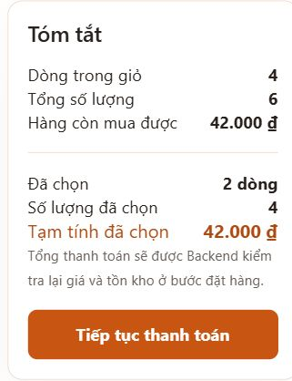
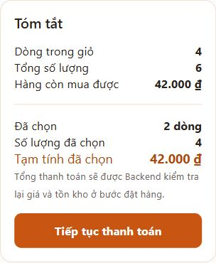

# Cart: contrast retest — 2026-10-10

Sửa cục bộ `CartPage.module.css`: màu chữ h1/h2 tối trên các vùng nền trắng, input số lượng nền trắng; hộp xác nhận xóa có màu chữ và color-scheme riêng vì nằm ngoài wrapper page. Không sửa theme/global CSS, API hoặc schema.

## Bằng chứng

- Frontend: PR #50, base HEAD `0416ee096a8b451e186fb405ff933fee2a5b56c1` cộng bản sửa CSS trong commit chứa tài liệu này.
- Backend thật: QA PR #51 HEAD `e15af4467f9614b5c2a29e6647caf3a1b5637f04`, PostgreSQL riêng, không dùng database demo.
- Browser đang dùng dark preference; root vẫn `rgb(22, 23, 29)`. Heading Cart/thẻ/hộp xác nhận `rgb(40, 33, 29)` trên nền trắng; input nền trắng, chữ tối, color-scheme light.
- Desktop 1280 × 900 và mobile viewport 390 × 844: tiêu đề Tóm tắt/Sản phẩm không còn khả dụng đọc rõ, không tràn ngang. Mobile là giả lập viewport, không phải thiết bị vật lý.
- Dữ liệu trả về thật: 4 dòng, 2 dòng mua được, tổng chọn 42.000 đồng; có dòng hết hàng và dòng private. Mở xác nhận xóa rồi Giữ lại, không xóa dữ liệu trong lượt retest CSS.
- Test 69/69 (10 files), lint, build và diff whitespace: PASS sau sửa CSS.

Ảnh chỉ chụp thẻ Tóm tắt để đối chiếu lỗi màu chữ, không chứa vùng tài khoản QA. Không đăng credentials hoặc cấu hình. Hai frontend Address/Cart được chạy lần lượt, không phải một bundle đã tích hợp.

### Desktop

### Mobile

## Giới hạn

Đây là retest CSS, không chạy lại toàn bộ QA nghiệp vụ. Không kết luận Cart → Checkout end-to-end PASS hoặc biên 50/51 dòng trên Backend thật. Không ép browser sang light/forced-colors. Không thay theme hoặc Header chung. Cần Hoàng re-review và quyết định merge theo CI hiện tại.
