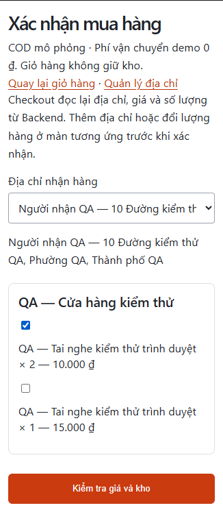
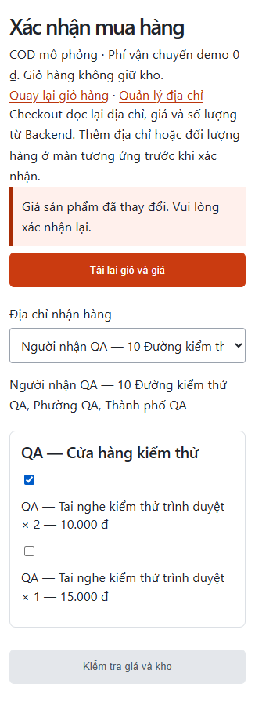
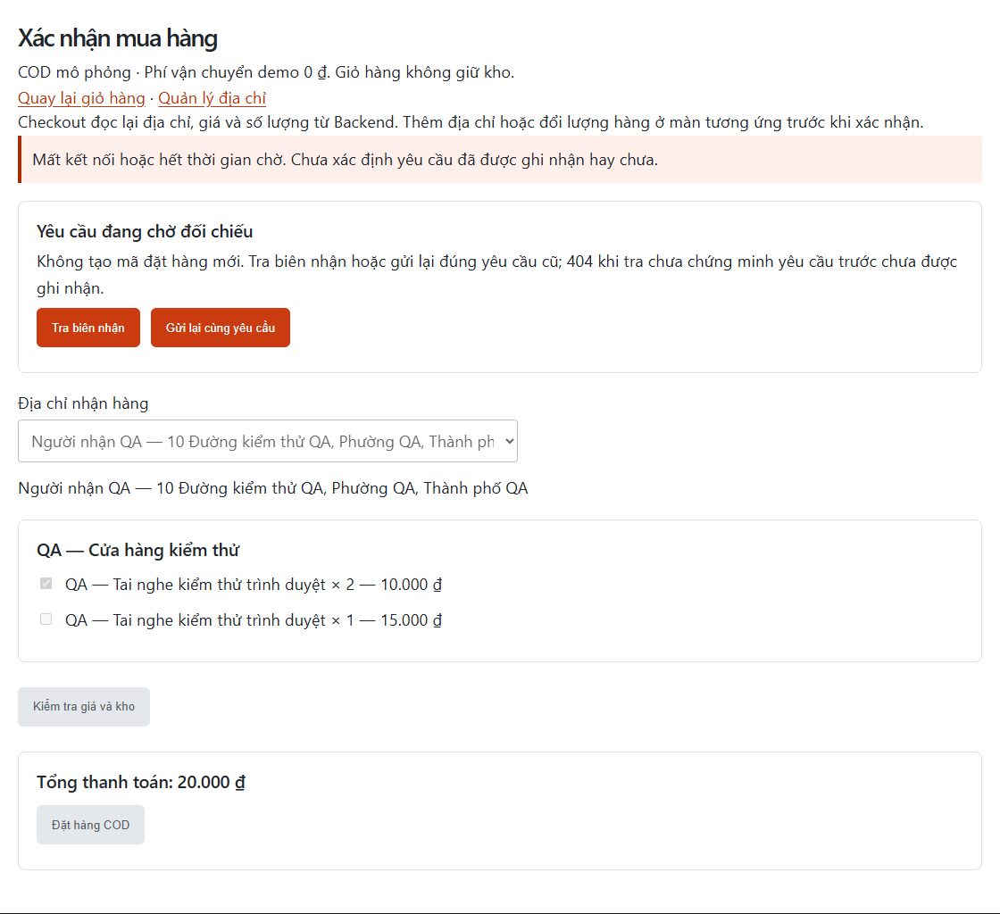
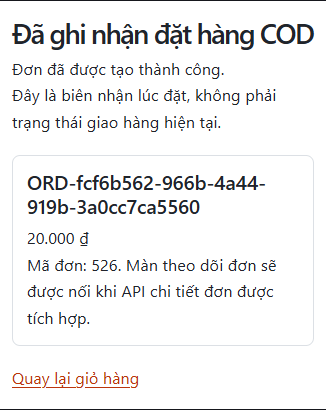

# Checkout browser evidence — 12/10/2026

Chrome thật, Nest HTTP thật, PostgreSQL QA riêng. Code baseline `6b58df9` +
Checkout UX follow-up trong cùng commit chứa tài liệu này. Full harness/run
metadata và 18 ảnh ở `artifacts/checkout-browser/` (local/Git ignore).

Bốn ảnh nhỏ dưới đây được chụp trực tiếp từ vùng Checkout; riêng khi chụp ảnh
chia sẻ, Header sticky được ẩn tạm bằng screenshot style để không che nội dung
hoặc đưa email vào ảnh (không đổi source ứng dụng). Tên/địa chỉ/mã đơn đều là fixture synthetic QA, không có
cookie/token/mật khẩu/DB config hay dữ liệu demo. Không phải ảnh upload sản phẩm.

1. Mobile tối — Checkout/địa chỉ đầy đủ, heading/control rõ.

2. Mobile sáng — giá đổi sau preview bị từ chối, nút tải lại và khóa preview cũ.

3. Desktop tối — bỏ response sau commit thật, giữ intent để replay cùng mã/body.

4. Mobile tối — biên nhận COD, mã đơn tự xuống dòng; không phải trạng thái giao.

Ảnh được mở và kiểm trực tiếp trước stage. Xem
[ma trận, bằng chứng DB và giới hạn](../../../testing/checkout-browser-qa-2026-10-12.md).
Không dùng các ảnh này để tuyên bố nghiệm thu Order/Seller delivery/Search.
