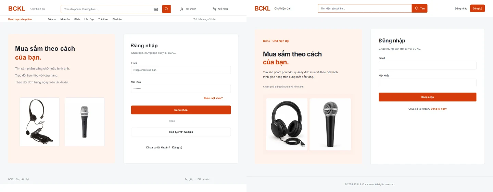
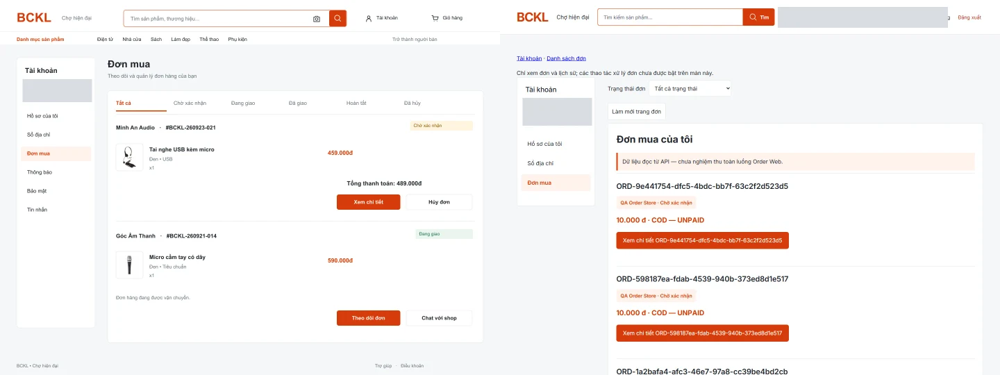
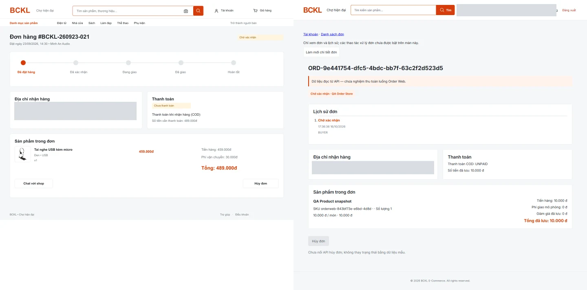
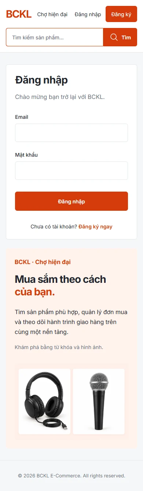

# PR59 — bộ ảnh đối chiếu đã lọc

Source ứng dụng: **ba3dcbf8144afee769b297a8027c6de5b7f5ecdd**. Đây là đóng gói
ảnh đã chụp ngày16/10, KHÔNG phải lượt chạy browser/DB/test mới. Commit ảnh chỉ
đổi tài liệu/evidence, không đổi FE/BE/harness hoặc điều kiện khóa command.

Mở các cặp bên dưới trên GitHub; bấm ảnh riêng để xem kích thước đầy đủ. Có thể
tải thư mục/gói ZIP Hoàng bàn giao; ảnh đều WebP và không cần dịch vụ đang chạy.
Ô xám là che thông tin tài khoản/người nhận/địa chỉ có chủ đích, không lỗi render.
Không kèm token/password/cookie/config/log/DB snapshot; chỉ ảnh đã xem lại bằng mắt.
Định danh Order/SKU còn lại là fixture QA nhân tạo, không đơn khách thật.

## Login — trái mẫu, phải implementation

[Mẫu đầy đủ](source-login.webp) · [Thực tế đầy đủ](actual-login.webp)

## Buyer danh sách đơn — trái mẫu, phải implementation

[Mẫu đầy đủ](source-orders.webp) · [Thực tế phần đầu](actual-orders.webp)

Runtime20summary/cursor, chỉ giữ1080px đầu trong gói để review layout; không giả
đã đưa đủ20dòng. Mẫu2đơn có ảnh/tên item nhưng list API hiện không có những field
đó; không phát thêm20GET/detail hoặc bịa hàng hóa để giống mock. Sidebar chỉ3route
đã triển khai; không giả thông báo/chat/bảo mật. Khoảng trắng/mã đơn dài khác mẫu
là dữ liệu QA; số lượng2/20 không phải cùng state để pixel-diff.

## Buyer chi tiết — trái mẫu, phải implementation

[Mẫu đầy đủ](source-detail.webp) · [Thực tế đầy đủ](actual-detail.webp)

History lấy sự kiện thực, không tạo5mốc tương lai như mock. Không thêm chat/Google/
reset hoặc bật hủy/command. Địa chỉ/payment/items vẫn là snapshot đã nhận từ API;
ô xám che nội dung nhận hàng nhưng giữ hình học vùng. Không dùng ảnh sản phẩm
DRAFT làm ảnh mới cho Login: artwork sinh riêng có provenance trong PR.

## Mobile Login (implementation, không có mẫu mobile tương ứng)

Đây là390×844 CSS viewport, DPR1, full-page cao theo nội dung; form trước artwork.
Không nhận đây là pixelmatch mẫu desktop hoặc nghiệm thu thiết bị cảm ứng thật.
Mobile Order ảnh riêng chưa có trong gói này; test/harness cũ đã công bố vẫn là
bằng chứng tác giả, không ép reviewer coi đã nhìn thấy ảnh mobile Order từ bộ này.

## Điều kiện đối chiếu và giới hạn

- Source mẫu1440×1080. Runtime desktop1440×1080 CSS, DPR1; full-page khác chiều
  cao. Cặp composite thu mỗi bên720px cùng tỉ lệ, nền trắng bù chiều cao chứ không
  co méo. WebP quality88 nên không dùng làm proof màu pixel chính xác tuyệt đối.
- Layout/font/palette/spacing khác dữ liệu được ghi rõ, không nhận clone1:1;
  dùng ảnh đầy đủ để đọc chữ. Xem [báo cáo](../../pr59-visual-followup-2026-10-16.md)
  và [design QA](../../../../design-qa.md) để hiểu test/iteration/giới hạn.
- File manifest ghi application SHA, kích thước và SHA256 từng ảnh để đối chiếu.
  Hash bảo vệ nội dung gói đã lọc, không chứng minh browser/backend tự nó chạy.
- Các ảnh KHÔNG là bằng chứng screen reader/Safari/Firefox, POST recovery,
  transaction hoặc toàn G-FULFILMENT. Hiền review visual độc lập; approval code
  hoặc362unitPASS không thay kết luận giao diện.
